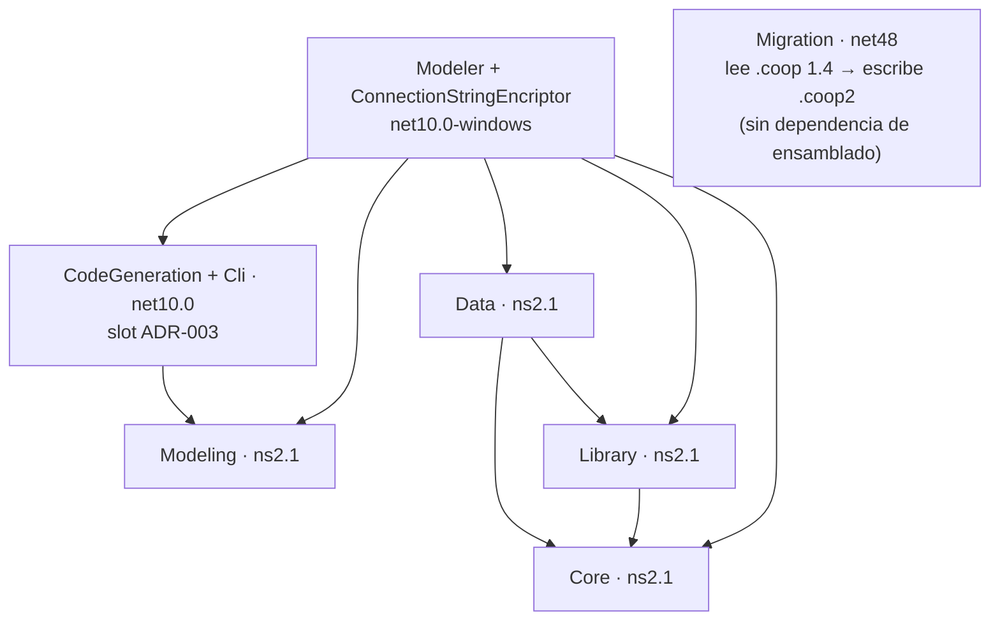

<!-- §3.15 language policy: YAML keys, status enums, IDs and section headings (##) in English (the schema);
     ADR title and prose in the project's content_language (devflow/LANGUAGE); `AITL-ADR-Approval` is never translated.
     ⚠️ AITL-ADR-Approval: this ADR stays a DRAFT — it cannot govern a SPEC, establish an NFR or authorize an
     exception — until an Architect / Tech Lead records the decision in the `review` block (§2.8, §3.5); no
     approval is inherited from related artifacts.
     ⚠️ ADR conflicts (§2.8): check the decision log for active ADRs contradicting this one before approval; a
     conflict is declared in `conflicts_with` and resolved by a superseding ADR.
     ⚠️ Content scope (§2.8): an ADR records architecture decisions and constraints, not functional behaviour —
     functional requirements live in the feature US and its ACs. -->

# ADR-001 — Layout, empaquetado y compatibilidad de Cooperator 2.0

| Field          | Value |
|----------------|-------|
| **Status**     | accepted |
| **Decision-makers** | architect, tech_lead |
| **Sources**    | REV-001 (aprobado 2026-10-15), OQ-001…OQ-006 (respondidas 2026-10-15), código de `1.4/` |
| **Supersedes** | None |
| **Conflicts with** | None — el registro de ADRs está vacío (`adrs/INDEX.md`: sin ADRs previos al 2026-10-15) |

---

## 1. Context

`REV-001` (§6, ítem 1) ruteó a un ADR la decisión de **TFMs, layout de solución, particionado de paquetes, naming, firma y versionado** de la 2.0, desde los hallazgos F-44 (mapa real de dependencias Windows por proyecto), F-45 (strong-name, `AssemblyVersion` y coexistencia con 1.4) y F-31 (firma inconsistente: `Utility` declara el `.snk` y no firma). Este ADR es el primero del ciclo habilitado por el `AITL-REV-Approval` del 2026-10-15.

**Restricciones fijadas aguas arriba** (entrada, no se reabren): consumidores **solo .NET 10+**, sin puente multi-target (OQ-006); librerías núcleo en **`netstandard2.1`**; nueva partición **`Cooperator.Framework.Modeling`** separada de `Utility` (OQ-001 A; F-27/F-28/F-32); **sin paquete `-windows` por ahora**, priorizando *eliminar* las features Windows-only de `Library` según uso real (REV-001 §6 ítem 7); **deprecaciones** VB.NET, Oracle y export a Excel (OQ-005); **firma** sí como identidad, **gate por `PublicKeyToken` retirado** (OQ-003); **Modeler** en .NET 10, solo Windows, WPF como candidato de UI (§6 ítem 14).

**Fuerzas en juego**: no hay ninguna decisión de arquitectura registrada ni tests ni build reproducible sobre los que apoyar un cambio de TFM de 168 `.cs` (F-50); los consumidores referencian por `HintPath` + `SpecificVersion=False` contra `CooperatorAssemblies` (F-45); y las plantillas generadas emiten proyectos .NET Framework 4.0 con `System.Web` (F-37), de modo que migrar las librerías sin corregir el layout de consumo no entregaría el resultado de negocio buscado.

**Frontera**: decide mapa de paquetes/TFMs, compatibilidad y coexistencia con 1.4, naming/versionado/firma, política de dependencias del núcleo y destino de las features deprecadas. **No** decide el esquema del `.coop2` (ADR-002), los internos del motor de generación (ADR-003), ni la carga de providers Lazy (F-02), la configuración (F-04/F-13), la caché (F-07/F-08), el provider de datos (F-09) o la criptografía (F-23): reservados en §3.6.

---

## 2. Alternatives considered

### Alternative A — Núcleo portable único (`netstandard2.1`) + `Modeling` + tooling `net10.0(-windows)`, sin tier `-windows` (✅ Selected)

| Aspect   | Detail |
|----------|--------|
| **Pros** | Cumple lo fijado aguas arriba sin excepciones ni paquetes de compatibilidad. Un paquete por capa y un solo TFM por proyecto. `Modeling` desacopla el modelo de la UI y lo vuelve consumible por el Modeler, el CLI y los agentes (F-27/F-41/F-42). Disolver `Utility` elimina el paquete que hoy corta la portabilidad y no deja un cajón `-windows` sobreviviendo sin dueño. El consumo pasa a `PackageReference` y desaparece el `HintPath` frágil (F-45). |
| **Cons** | Disolver `Cooperator.Framework.Utility` rompe a quien lo referenciara directo (las apps generadas no lo usan, OQ-006). Obliga a refactorizar el modelo **antes** del trabajo del `.coop2` (prerequisito F-27). Las features Windows-only de `Library` deben resolverse en la misma migración, sin dónde postergarlas. |

### Alternative B — Multi-target (`netstandard2.1` + `net10.0`) en las librerías núcleo

| Aspect   | Detail |
|----------|--------|
| **Pros** | El target moderno accede al BCL completo (`System.Text.Json` in-box, `Span`, APIs nuevas) sin paquetes de shim y habilita rutas optimizadas. |
| **Cons** | Duplica la matriz de compilación y de tests justo cuando el árbol no tiene ninguno (F-50) e introduce `#if` en código sin red de seguridad. Contradice el criterio de un solo piso de compatibilidad de OQ-006, a costo permanente por un beneficio que ningún consumidor pidió. |

### Alternative C — Target directo `net10.0` en las librerías núcleo (sin `netstandard2.1`)

| Aspect   | Detail |
|----------|--------|
| **Pros** | Un único TFM en todo el repositorio (`net10.0` + `net10.0-windows`); máximo acceso al BCL, menos dependencias NuGet, sin restricciones de superficie para portar F-02/F-26. |
| **Cons** | Contradice la restricción explícita del dueño (núcleo en `netstandard2.1`) y ata los ensamblados a un runtime puntual, cerrando el consumo desde runtimes intermedios sin ganancia medible: el costo de `netstandard2.1` está acotado y verificado en el REV (F-01 y F-32 migran sin cambios). |

### Alternative D — Conservar la forma de 1.4 con tiers `-windows`/`-web` y el modelo dentro de `Utility`

| Aspect   | Detail |
|----------|--------|
| **Pros** | Cero refactor del modelo ahora; cada feature Windows se aísla por TFM sin decidir su suerte; el Modeler no cambia de acoplamiento; camino rápido a algo que compila. |
| **Cons** | Contradice "sin paquete `-windows` por ahora" y la prioridad de eliminar. Multiplica paquetes y TFMs, y el modelo seguiría acoplado a diseñadores WinForms: el `.coop2` no podría editarse fuera de Windows, bloqueando el objetivo de negocio. `Library` y `Data` tampoco compilarían sobre `netstandard2.1` mientras `System.Web` y compañía sigan adentro (F-07/F-08/F-22). *Variante de granularidad máxima (un paquete por concern) considerada y descartada: fragmentación sin consumidores que la separen — OQ-001 opción C.* |

---

## 3. Decision

Se adopta la **Alternativa A**: paquetes con **un solo TFM por proyecto** — `netstandard2.1` en la capa portable, `net10.0`/`net10.0-windows` en el tooling — **sin tier `-windows` ni `-web`**, sin multi-target, consumibles solo desde .NET 10+, con `Cooperator.Framework.Utility` disuelto y `Cooperator.Framework.Modeling` como paquete portable nuevo.

### 3.1 Mapa de paquetes, ensamblados y TFMs

| Paquete (= ensamblado = namespace raíz) | TFM | Contenido | Observaciones |
|---|---|---|---|
| `Cooperator.Framework.Core` | `netstandard2.1` | Contratos base (`IGateway`, `IGenericGateway`, `IObject`, `IObjectList`, `IValidable`, `IRowVersion`, `IUniqueIdentifiable`, `ILazyProvider`), `BaseObject`, `BaseObjectList`, `BaseObjectListView`, `ValuesGenerator`, `UniqueIdentifierHelper`, `SecurityRights`, `ObjectState*`, excepciones, superficie de `Factory`/`LazyLoad` | Sin dependencias de terceros. `CreateExcelFile` **no existe** (F-03). El mecanismo de carga Lazy (F-02) y la fuente de configuración (F-04) son de un ADR posterior (§3.6). |
| `Cooperator.Framework.Library` | `netstandard2.1` | `Cryptography`, `IO` portable, `TimeFunctions`, `Utility` (`NumberToWords`, `IsEmailValid`), `TaxIDVerification.Argentina`, `SmtpMail`, `Resources`, excepciones | Sin Registro, P/Invoke, EventLog ni WMI (§3.5); `SendMailViaCDONTS` (código muerto, F-22) se elimina. Depende de `Core`. |
| `Cooperator.Framework.Data` | `netstandard2.1` | `BaseGateway`, `BaseRule`, `BaseLoader`, `IBaseGateway`, `SQLHelper`, `SqlHelperParameterCache`, acceso a datos | Un único provider ADO.NET (ADR de provider, §3.6). Caché tras `ICacheProvider` con default en memoria (OQ-002). **Sin** `CheckForToken`/`GetAssemblyToken` ni token embebido en el código generado (F-10/OQ-003). Depende de `Core` y `Library`. |
| `Cooperator.Framework.Modeling` **(nuevo)** | `netstandard2.1` | Modelo del archivo de modelo como POCO (sin atributos de editor ni tipos de UI), `DBReverse` (`DBObject`, `DBField`, `DBTable`, `DBForeignKey`, enums), `IDBReverseProvider`, `IDBTypeConverter`, contrato de lectura/escritura del `.coop2` | F-27/F-28/F-32. **No depende de `Data`** (el provider MSSQL y los editors/Forms viven en el tooling; corrige F-29). Esquema, `schemaVersion`, extensión y migrador → ADR-002. |
| `Cooperator.Framework.CodeGeneration` + `Cooperator.Cli` **(nuevos, slot ADR-003)** | `net10.0` (el CLI como `dotnet tool`) | Motor de generación headless, providers `IScriptor`, plantillas como datos; CLI que genera desde `.coop2` (candidato a hospedar el conversor de connection strings) | Nombres, mecanismo y comandos los confirma el **ADR-003**; aquí se reservan el lugar, el TFM y su dependencia de `Modeling`. Cross-platform a propósito: el flujo agente (editar `.coop2` y regenerar) no puede depender de Windows, y es el punto de automatización que hoy no existe (`MainForm.cs:509-512`, F-42). |
| `Cooperator.Framework.Migration` **(herramienta, no paquete NuGet)** | `net48` | Migrador one-shot `.coop` (binario) → `.coop2` | Corre sobre **.NET Framework 4.8** con `BinaryFormatter` aún disponible, **antes** de migrar el Modeler (F-41: irreversible). Forma/UX → ADR-002. |
| `CooperatorModeler` y `ConnectionStringEncriptor` **(aplicaciones)** | `net10.0-windows` | Shell del Modeler con los editors/Forms movidos desde `Utility` sobre el motor headless; encriptador de connection strings | Solo Windows. El framework de UI (WPF vs retarget WinForms) lo decide el ADR del shell (§6 ítem 14): este layout no depende de él. Sin ClickOnce (F-36). El encriptador sigue la política criptográfica (F-23) y es candidato a `dotnet tool` (F-40). |
| ~~`Cooperator.Framework.Utility`~~ | — | **No existe en 2.0** | Modelo y reverse → `Modeling`; **excepciones del grafo** (`UtilityException`, `UnknownDBTypeExeception`, `NodeAlreadyExistException`, `CannotAddOrRemoveItemException`) → `Modeling`; **`Providers/*`** (`MSSQLProvider.cs`, `MSSQLCommon.cs`) → Modeler/tooling; helpers portables → `Library`; editors/Forms → Modeler; motor CodeDOM → slot del ADR-003. |

**Dos puntos duros de la partición de `Utility`** (no son "mover archivos"):

- **Acoplamiento bidireccional verificado**: `DBReverseHelper/DomainTree.cs:35` importa `Cooperator.Framework.Utility.DBReverseHelper.Providers.MSSQL`, y el provider a su vez consume el modelo. Romperlo exige **extraer ese `using`** del modelo y **reubicar el reverse** (`MSSQLProvider`/`MSSQLCommon`) en el tooling; mientras el `using` exista, `Modeling` no puede ser portable.
- **Fuente única del mapeo de tipos SQL↔CLR**: el mapeo (`IDBTypeConverter`, hoy `MSSQLTypeConverter.NativeType2CLRType` en `Providers/MSSQL`) vive en **`Modeling` como dato portable** (la interfaz + la tabla de mapeo), y lo consumen **tanto el reverse como el motor de generación**. Ni el tooling ni las plantillas lo redefinen: una sola tabla, un solo lugar donde un tipo nuevo se declara. En consecuencia **`MSSQLCommon.cs` no migra completo**: la tabla `MSSQLTypeConverter.NativeType2CLRType` se **extrae** como dato portable a `Modeling`, y el resto del archivo (`sp_help`, queries de schema y helpers de lectura) va al tooling junto con `MSSQLProvider.cs`.

**Layout del repositorio y reglas de empaquetado:**

- El código de la 2.0 vive en **`2.0/`**, en paralelo a `1.4/` (que queda congelado): solución propia (`Cooperator2.sln`), `src/` + `tests/`, `global.json` fijando el SDK, y configuración de build centralizada (`Directory.Build.props` para calidad/determinismo; `Directory.Packages.props` para la versión de cada dependencia). Ningún proyecto declara versiones de paquete por su cuenta.
- Proyectos **SDK-style**, `TargetFramework` único (nunca `TargetFrameworks`), sin `Packages.config`, sin `HintPath` y sin referencias muertas (F-11/F-12/F-21/F-36/F-44).
- Direcciones de dependencia permitidas (un ciclo es un defecto de build, no una discusión):

- **El migrador no depende de `Modeling`**: `Cooperator.Framework.Migration` (`net48`) produce salida **conforme al contrato `.coop2` de `Modeling`, pero sin dependencia de ensamblado** — `net48` no puede consumir `netstandard2.1`, así que el contrato está **duplicado** en la herramienta y la conformidad se prueba con fixtures dorados (ADR-002 §3.2). Por eso el diagrama no traza arco `Migration → Modeling`.

- **Distribución**: paquetes NuGet consumidos por `PackageReference`; la carpeta `CooperatorAssemblies` + `HintPath` + `SpecificVersion=False` desaparece como modelo de consumo (F-45). El release del Modeler publica junto a sus binarios un **folder feed** con el juego de `.nupkg`, para que las plantillas de la 2.0 (F-37) referencien paquetes y el consumo offline no dependa de infraestructura extra.

### 3.2 Política de compatibilidad y coexistencia con 1.4

- **Piso de consumo: .NET 10+ y el 1.4 congelado** (OQ-006 A). Aunque `netstandard2.1` sea consumible desde runtime moderno anterior, la matriz soportada es .NET 10 en adelante; **no** hay multi-target `netstandard2.0`, ni shims, ni type-forwarders hacia .NET Framework. El 1.4 queda sin backports: es la versión de las apps .NET Framework hasta que migren de runtime y la base sobre la que corre el migrador (F-41).
- **Coexistencia: no lado a lado en el mismo proceso.** Se conservan IDs de paquete y namespaces (`Cooperator.Framework.*`) y el discriminador es la **versión mayor** (1.4.x vs 2.x); un ensamblado `netstandard2.1` no es cargable por una app .NET Framework y referenciar ambas versiones en un mismo proyecto produce conflicto de tipos. El objetivo es la migración, no la convivencia.
- **Camino de migración del consumidor** (el orden es parte de la decisión, sin atajos): (1) **convertir** todos los `.coop` a `.coop2` con el migrador sobre .NET Framework 4.8, antes de tocar el TFM del Modeler (F-41), con dos condiciones heredadas de ADR-002 §3.2: **(a)** el corpus de `.coop` queda **respaldado y commiteado** antes del batch (es la única red si algo se migra mal) y **(b)** el migrador se **construye contra el fuente 1.4 congelado** —sin editar una línea— con **verificación de identidad de los binarios 1.4** en runtime; (2) **repuntar** el proyecto — `HintPath` → `PackageReference` 2.x y re-target a `net10.0` (las plantillas 2.0 emiten proyectos SDK-style sin `System.Web` ni `App.config`, F-37); (3) **resolver** las features cortadas y las Windows-only de `Library` que la app use; (4) **regenerar** con el motor 2.0 (ADR-003).
- **Meta de compatibilidad** (OQ-006): una app que no usa las features cortadas compila y opera con **cambios mínimos**; es el criterio con el que se evalúa cada Bolt de migración.
- **Superficie de API — `[Serializable]` y constructores `SerializationInfo` (F-05)**: se retiran de la superficie pública de los tipos del framework. No hay compatibilidad binaria 1.4 → 2.0 que preservar (cambian runtime y TFM, y `BinaryFormatter` está eliminado en .NET 9+): mantenerlos sólo perpetúa una dependencia muerta y emite `SYSLIB0051`. Un tipo puede conservar `[Serializable]` como excepción justificada en su Bolt, nunca como mecanismo de persistencia nuevo. Lo que hagan las **entidades generadas** es decisión de las plantillas del **ADR-003** (es el motor el dueño del set: las entidades emitidas son POCOs, sin `[Serializable]`).

### 3.3 Naming, versionado y firma

- **IDs**: se conservan `Cooperator.Framework.<Área>` (namespace = ensamblado = `PackageId`); el único ID nuevo de la capa portable es `Cooperator.Framework.Modeling`. Se prohíben prefijos o sufijos de versión en el nombre (`Cooperator2.*`, `*V2`): la versión y el TFM discriminan, y el nombre no cambia para el consumidor.
- **Versionado**: `2.0.0` como primera versión, con **SemVer** en adelante. `AssemblyVersion` = `2.0.0.0`, **fijo durante toda la línea 2.0.x** (un parche no provoca binding nuevo); `FileVersion`/`InformationalVersion` llevan la versión completa publicada.
- **Firma (strong-name)**: se mantiene como **identidad** en **todos** los ensamblados de la 2.0, con el mismo `CooperatorFramework.snk` de 1.4 — se corrige la inconsistencia de F-31 (`Utility` declaraba el `.snk` y no firmaba; en 2.0 no hay `Utility` y `Modeling` firma como el resto). Firma es identidad, no licenciamiento.
- **El gate por `PublicKeyToken` se retira** (F-10/OQ-003 A): se eliminan `CheckForToken`, `GetAssemblyToken`, `GetEntryAssemblyTokenString` y su contraparte embebida en el código generado. **No se reemplaza por otro gate en código**: el mecanismo era detección de manipulación, no licenciamiento comercial, y en hosts modernos se salteaba o daba falsos positivos. La integridad de despliegue se cubre en la **capa de empaquetado** (feed NuGet controlado y Authenticode de los binarios del tooling cuando se defina el canal), nunca en el runtime del framework.
- **Limpieza obligatoria de proyecto**: fuera metadata ClickOnce y `System.Deployment` (F-36), `ComVisible`/`System.Runtime.ConstrainedExecution` sin uso (F-45), referencias muertas (F-11/F-12/F-21/F-44) y los `*CryptoServiceProvider` concretos en favor de los factory (F-24).

### 3.4 Política de dependencias de terceros

- **BCL primero.** Toda dependencia de terceros es una decisión de arquitectura: se autoriza aquí o en un ADR que reemplace a éste, nunca por conveniencia dentro de un Bolt.
- **`Core`: cero dependencias de terceros**; **`Library`: cero por defecto** (sólo BCL). Son los paquetes base y su superficie se mantiene en BCL puro (F-01).
- **`Data`: exactamente un provider ADO.NET**, elegido por el ADR de provider (§3.6; candidato documentado en F-09: `Microsoft.Data.SqlClient`). Sin ORMs ni capas de acceso adicionales. Las implementaciones alternativas de caché (Redis u otras, OQ-002) viven en **paquetes satélite** que define el ADR de caché: el núcleo depende de la interfaz, nunca del adaptador.
- **`Modeling`: `System.Text.Json` como única dependencia de serialización** (paquete necesario en `netstandard2.1`, in-box en el runtime moderno). El ADR-002 puede nombrar dependencias adicionales del formato bajo la misma regla.
- **Toda dependencia declara y fija** versión (centralizada en `Directory.Packages.props`), TFM soportado, motivo y **licencia**. En la capa portable sólo se aceptan licencias permisivas (MIT, Apache-2.0, BSD); una licencia copyleft exige un ADR que la autorice, y nada Windows-only entra en un paquete portable. El cumplimiento se verifica con gates de build/CI (SBOM, licencias y listado de paquetes), no por revisión manual.

### 3.5 Deprecaciones y suerte de las features Windows-only

- **VB.NET**: el motor 2.0 es **solo C#** — no se suman plantillas VB ni el `CodeDomProvider` de VB (OQ-005; F-26/F-37); las plantillas `Templates/VisualBasic*` se eliminan del entregable del generador.
- **Oracle**: se eliminan el esqueleto `OracleScriptor` y la referencia muerta a `System.Data.OracleClient` (F-11/F-39); **SQL Server es el único motor** de la 2.0, sin paquete ni Bolt de Oracle.
- **Export a Excel**: `CreateExcelFile` (OleDb/Jet) se **elimina** del framework; no se reescribe ni se mueve a un paquete `-windows`. Quien necesite exportar lo resuelve en su capa, y queda documentado en las notas de migración (F-03/OQ-005). Efecto buscado: `Core` 100 % portable.
- **Features Windows-only de `Library`** (Registro y "Repository", P/Invoke de impersonation y working set, EventLog, WMI; F-15…F-20): **no se crea un paquete `-windows`**. Regla de migración: **se eliminan por defecto**, previa verificación del uso real; cuando una capacidad deba conservarse, se implementa **detrás de una abstracción portable** (almacén de usuario en `%APPDATA%` en lugar del Registro; abstracción de logging en lugar del EventLog; `IMachineIdentity` en lugar de WMI; `Environment.UserName` en lugar de impersonation), nunca detrás de un TFM Windows. Un paquete `-windows` sólo podría aparecer con un **ADR que reemplace a éste**: el layout no cambia por conveniencia de un Bolt.
- **Distribución del tooling**: **sin ClickOnce** (F-36). `dotnet publish` self-contained para `win-x64`; MSIX queda como opción si más adelante hace falta instalación y asociación del `.coop2` (F-35), que se resuelve en el instalador o en runtime con verificación de SO.
- **Supervivencia Windows-only esperada y explícita**: el shell del Modeler, el encriptador de connection strings y el migrador `net48` — aplicaciones/herramientas, no paquetes de librería.

### 3.6 Slots reservados y fronteras de decisión

| Slot | Qué queda reservado | Quién lo decide |
|---|---|---|
| Formato del archivo de modelo | Esquema JSON del `.coop2`, `schemaVersion`, orden canónico, campos derivados no serializados, UX/ubicación del migrador | **ADR-002** (aquí se reserva: `Modeling` hospeda el contrato; el migrador es herramienta `net48`) |
| Motor de generación | Sintaxis de plantillas, providers `IScriptor`, comandos del CLI, ausencia de VB | **ADR-003** (aquí se reservan nombres, TFM y dependencias de `CodeGeneration` y `Cli`) |
| Carga de providers Lazy | Nombre calificado + ruta/`AssemblyLoadContext` explícito y error diagnóstico (F-02) | ADR posterior (§6 ítem 10); la superficie queda en `Core` |
| Configuración de la 2.0 | Fuente portable de configuración y connection strings; sacar del `Core` la escritura del `.config` (F-04/F-13) | ADR posterior (§6 ítem 9) |
| Caché | Forma de `ICacheProvider`, TTL y adaptadores; default en memoria (F-07/F-08; OQ-002) | ADR posterior (§6 ítem 4) |
| Provider de datos | Elección y encapsulado del provider; eliminación de los casts `DbTransaction → SqlTransaction` (F-09) | ADR posterior (§6 ítem 5) |
| Criptografía | Algoritmo, gestión de claves y migración de las connection strings ya cifradas (F-23) | BUG de seguridad + ADR posterior (§6 ítem 12) |
| Shell del Modeler | Framework de UI (WPF vs WinForms retarget), settings de usuario, asociación `.coop2` (F-33/F-38) | ADR posterior (§6 ítem 14) |
| Mapeo de tipos SQL↔CLR | Forma exacta del dato de mapeo y su consumo por el reverse y el motor | **Se fija acá**: fuente única como **dato portable en `Modeling`** (§3.1); lo detalla el Bolt de partición/modelado, no un ADR nuevo |
| Canal de distribución | Feed privado vs público, firma de paquetes y publicación de los `.nupkg` (incluido el folder feed offline) | **Decisión pendiente con dueño y fecha**: la define `tech_lead` (`human:eugenioserrano`) **antes del release 2.0.0**. No es un ADR de este ciclo, pero **no queda huérfana**: tiene dueño y vencimiento |

---

## 4. Consequences

**Positive:**

- Un solo piso de compatibilidad (.NET 10+) y un solo TFM por proyecto: matriz de build y tests mínima, sin condicionales de TFM en el código.
- `Core` queda 100 % portable (deprecación del export a Excel, F-03) y `Modeling` desacopla el modelo de la UI: se habilita el `.coop2` y el flujo agente que lo motivó (F-27/F-41/F-42).
- No hay tier `-windows`/`-web` como cajón permanente: las features Windows-only se resuelven o se eliminan en la migración, con el uso real como criterio; el consumo pasa a NuGet/`PackageReference` y desaparece la resolución por `HintPath` (F-45), con lo que las referencias muertas dejan de ser un error latente en cada retargeteo (F-44).
- El retiro del gate elimina un control que en hosts modernos se salteaba o fallaba (F-10) y la firma queda con un único propósito declarado, identidad; además se borra del alcance el costo de migrar VB.NET, Oracle y export a Excel (OQ-005).

**Trade-offs:**

- `netstandard2.1` obliga a tomar `System.Text.Json` como paquete y renuncia a APIs del BCL moderno en la capa portable (limitación aceptada a cambio de independencia de runtime).
- Disolver `Utility` y retirar `[Serializable]`/`SerializationInfo` son rupturas de superficie frente a 1.4: aceptables porque no hay compatibilidad binaria que preservar, pero **deben aparecer en las notas de migración** de la 2.0.
- Sin puente `netstandard2.0`, toda app .NET Framework que quiera la 2.0 debe migrar de runtime primero (costo del consumidor, asumido en OQ-006), y el folder feed dentro del payload del Modeler resuelve el consumo offline a cambio de un paso de distribución propio (publicar el juego de `.nupkg` junto al release).
- Las features Windows-only de `Library` no tienen dónde postergarse: si el uso real no está relevado a tiempo, el Bolt correspondiente se bloquea en lugar de diferirse.

**Technical debt:**

- **Puente transitorio acotado y con vencimiento**: mientras no exista el ADR de configuración (slot F-04/F-13), **sólo `Data`** puede leer configuración vía `System.Configuration.ConfigurationManager` como **excepción explícita y temporal al NFR `dependency-footprint`** (§5), con **vencimiento en el release 2.0.0** y dueño el Bolt que introduzca la fuente portable (eliminarla es su criterio de aceptación). `Core`, `Library` y `Modeling` **no** pueden tomarla: su umbral de dependencias sigue siendo cero.
- Las claves e IV hardcodeados del cifrado siguen presentes hasta que el BUG de seguridad y el ADR de política criptográfica (F-23) se resuelvan; toda connection string ya cifrada debe **migrarse**, no sólo re-cifrarse.
- La verificación de integridad de despliegue (firma de paquetes/Authenticode) queda como deuda de la capa de empaquetado: el retiro del gate no la compensa en código y no bloquea la 2.0.0.
- El árbol 1.4 sigue sin tests ni build reproducible (F-50): el primer Bolt de la 2.0 debe establecer el arnés en `2.0/tests/` **antes** de migrar código, o ninguna decisión de este ADR será verificable.

---

## 5. Applicable NFRs

| NFR | Description | Threshold | How it is measured |
|-----|-------------|-----------|-------------------|
| Portability | Los paquetes de la capa portable (`Core`, `Library`, `Data`, `Modeling`) compilan y testean sobre `netstandard2.1` sin ninguna API Windows-only | 0 referencias a APIs Windows-only en los 4 paquetes portables | Build por TFM + gate de analizadores/API por paquete; línea base: inventario F-44 de REV-001 |
| Dependency footprint | La superficie de terceros del núcleo es mínima, explícita y con licencia permisiva | `Core`, `Library` y `Modeling`: 0 dependencias de terceros; `Data`: exactamente 1 provider ADO.NET **más la excepción transitoria y acotada** de `System.Configuration.ConfigurationManager` hasta el release 2.0.0 (§4); capa portable: sólo MIT/Apache-2.0/BSD; toda dependencia declarada y fijada en `Directory.Packages.props` | `dotnet list package` por proyecto + gate de licencias/SBOM en CI, con el listado versionado junto al código |

> La **integridad de despliegue** (firma de paquetes, Authenticode, control del canal) **no es un NFR de este ADR**: se gobierna en la capa de empaquetado y en el ADR de política criptográfica (slot F-23, §3.6), y el retiro del gate por `PublicKeyToken` (§3.3) no la compensa en código.

---

## 6. References

- [`REV-001`](../reviews/REV-001-analisis-migracion-cooperator.md) — revisión aprobada el 2026-10-15; fuente principal (§6 ítem 1; hallazgos F-01, F-03, F-05, F-10, F-11, F-12, F-15…F-22, F-24, F-27, F-28, F-31, F-32, F-33, F-35…F-40, F-42…F-45 y F-50).
- OQs resueltas, todas del 2026-10-15: [`OQ-001`](../analysis/open-questions/OQ-001-particion-de-utility.md) (partición de `Utility` → `Modeling`) · [`OQ-002`](../analysis/open-questions/OQ-002-soporte-system-web.md) (`ICacheProvider` con default en memoria; `System.Web` fuera del core) · [`OQ-003`](../analysis/open-questions/OQ-003-gate-de-licenciamiento.md) (retiro del gate por token; la firma se mantiene como identidad) · [`OQ-004`](../analysis/open-questions/OQ-004-formato-del-coop-json.md) (extensión `.coop2` + migrador requerido sobre .NET Framework 4.8) · [`OQ-005`](../analysis/open-questions/OQ-005-alcance-features-en-riesgo.md) (se deprecan VB.NET, Oracle y export a Excel) · [`OQ-006`](../analysis/open-questions/OQ-006-politica-de-compatibilidad.md) (moderno-only: .NET 10+, sin puente multi-target).
- Evidencia de código 1.4: `1.4/Framework.sln`, `1.4/Cooperator.Framework.{Core,Data,Library,Utility}/*.csproj`, `1.4/Tools/CooperatorModeler/Templates/CSharpProjects/*.csproj`. Related ADRs: ninguno previo (`adrs/INDEX.md` sin ADRs al 2026-10-15); los slots de este layout los consumen el ADR-002 (`.coop2` + migrador) y el ADR-003 (motor headless + CLI) de este mismo ciclo.

---

## 7. AITL-ADR-Approval

> **AITL-ADR-Approval** (Avenga DevFlow §2.8, §3.0, §3.5). An ADR does not
> become `accepted` — and therefore governing — without the approval of an
> Architect / Tech Lead. This ADR is the **source of truth for its own
> approval** (recorded in the `review` frontmatter block with review
> evidence); when it governs a SPEC revision, its path appears in that
> revision's `sources`. ADR approvals are never copied to the Bolt manifest.

| Field | Value |
|-------|-------|
| **Architect / Tech Lead** | `human:eugenioserrano` |
| **Role** | tech_lead |
| **Decision** | **approved** |
| **review_ready_at** | `2026-10-15T22:22:28-03:00` |
| **review.started_at** | `2026-10-15T22:32:47-03:00` |
| **review.decided_at** | `2026-10-15T22:32:47-03:00` |
| **Findings** | Sin hallazgos adicionales — `acknowledged_without_comment: true` (motivo en el frontmatter) |
