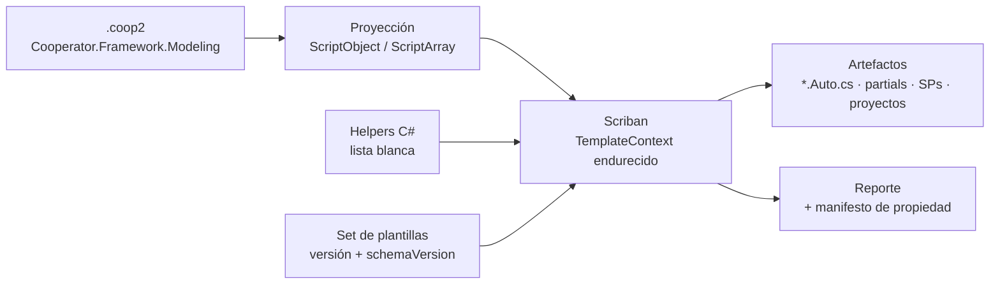

<!-- §3.15 language policy: YAML keys, status enums, IDs and section headings (##) in English (the schema);
     ADR title and prose in the project's content_language (devflow/LANGUAGE); `AITL-ADR-Approval` is never translated.
     ⚠️ AITL-ADR-Approval: this ADR stays a DRAFT — it cannot govern a SPEC, establish an NFR or authorize an
     exception — until an Architect / Tech Lead records the decision in the `review` block (§2.8, §3.5); no
     approval is inherited from related artifacts.
     ⚠️ ADR conflicts (§2.8): check the decision log for active ADRs contradicting this one before approval; a
     conflict is declared in `conflicts_with` and resolved by a superseding ADR.
     ⚠️ Content scope (§2.8): an ADR records architecture decisions and constraints, not functional behaviour —
     functional requirements live in the feature US and its ACs. -->

# ADR-003 — Motor de generación headless (Scriban) y CLI

| Field          | Value |
|----------------|-------|
| **Status**     | accepted |
| **Decision-makers** | architect, tech_lead |
| **Sources**    | REV-001 (aprobado 2026-10-15), OQ-005 (respondida 2026-10-15), ADR-001 y ADR-002 (borradores del mismo ciclo) |
| **Supersedes** | None |
| **Conflicts with** | None — no hay ADRs previos (`adrs/INDEX.md`) y este ADR no contradice los borradores ADR-001/ADR-002: respeta sus slots, consume su contrato y mantiene sus deprecaciones |

---

## 1. Context

`REV-001` F-26 identificó el **bloqueante arquitectónico más profundo** de la migración: el motor de generación compila plantillas **en runtime** con `CodeDomProvider` (`ScriptingHost.CompileExecutable` con `GenerateInMemory = true`, `provider.CompileAssemblyFromSource`, `CSharpCodeProvider`/`VBCodeProvider`) y las plantillas son **C# con bloques `<% %>`** que se compilan porque operan directamente sobre el modelo (`Model.Children`, `Response.Write`, `Response.SaveBuffer`). `Microsoft.CSharp.CSharpCodeProvider` y `Microsoft.VisualBasic.VBCodeProvider` **no existen fuera de .NET Framework**, así que nada del generador sobrevive al retargeteo sin reescritura. A eso se suman: F-39 (selección de scriptor por nombre de clase en un string —`//{PROVIDERCLASSNAME}//`—, con un `OracleScriptor` vacío), F-46 (T-SQL legacy: `sysobjects`/`OBJECTPROPERTY` y **split de lotes por el string `GO`**, frágil), F-37 (las plantillas emiten proyectos .NET Framework 4.0 con `System.Web`, y copian las DLLs a `CooperatorAssemblies`, que ADR-001 reemplazó por paquetes NuGet) y F-33/F-42 (el único punto de automatización hoy es abrir el Modeler con un archivo como argumento, `MainForm.cs:509-512`: **no hay camino headless**).

**Direcciones fijas del dueño** (no se reabren): el motor de plantillas de la 2.0 es **Scriban**; el generador se separa del Modeler como **motor headless + CLI** (flujo agente: editar el `.coop2`, correr el CLI, regenerar SPs y `*.Auto.cs` sin GUI), con el Modeler como host sobre el mismo motor **cuya UI se decide en otro ADR**; el motor genera **solo C#** (sin VB), **solo SQL Server** (sin Oracle) y **sin export a Excel** (OQ-005); y el CLI es `net10.0`, sin API Windows y sin paquete `-windows` (ADR-001 §3.1/§3.4).

**Evidencia legacy que este ADR reemplaza**: el set de plantillas vive en `Templates\**` como archivos `<None>` (`CSharpClasses`, `CSharpProjects`, `StoredProcedures`, `ConfigFiles`, `Assemblies`, y el árbol `VisualBasic*` que se elimina); la cabecera que emiten es `// This file was generated by Cooperator Modeler, version <GeneratorVersion>` + `// Created: <AutoFilesDateAndTime>`; la propiedad de archivos se decide en `FolderHelper.CopyFolder(source, destination, onlyAutoFiles, overwrite)`: con `onlyAutoFiles` los archivos que contienen `".Auto"` se **sobrescriben siempre** y los demás se copian **solo si no existen**, mientras que en el modo completo **todo** se sobrescribe (destruyendo ediciones a mano). El destino se arma en una carpeta de staging que se **borra antes de cada corrida**.

**Frontera**: decide la superficie del motor, el CLI y su distribución, el modelo de plantillas, la regla de convivencia con el código del consumidor y el determinismo de la salida. **No** decide la UI del Modeler (otro ADR), ni el formato `.coop2` (ADR-002), ni el mapa de paquetes/TFMs (ADR-001), ni el contenido de configuración de las apps generadas (slot F-04/F-13 de ADR-001 §3.6), ni la integración como tarea MSBuild/source generator (reservada).

---

## 2. Alternatives considered

### Alternative A — Scriban interpretado, plantillas como datos + helpers tipados, motor headless con CLI `net10` (✅ Selected)

| Aspect   | Detail |
|----------|--------|
| **Pros** | Elimina la compilación en runtime: Scriban **interpreta** plantillas (no CodeDOM, no Roslyn), corre en `netstandard2.0+`/`net10` y declara `IsAotCompatible` en .NET 8+ **desde la 7.x** con su API segura (`TemplateContext` + `ScriptObject`/`ScriptArray`) — lo que habilita el binario self-contained sin reflexión sobre POCOs. Las plantillas pasan a ser **datos** (diffables, revisables, overrideables) y la lógica no plantillable queda en helpers C# versionados, que es exactamente la dirección que F-26 recomendó. Separar motor/CLI habilita el flujo agente (F-33/F-42) sin GUI y sin Windows. |
| **Cons** | Obliga a **reescribir todo el set de plantillas** (C#-blocks → Scriban) y a construir la superficie de helpers que los templates legacy obtenían gratis al compilar C# contra el modelo. La proyección del modelo hacia `ScriptObject` se vuelve un contrato público que hay que versionar y mantener estable. |

### Alternative B — Conservar el motor propio (`CodeDomProvider` + `ScriptingHost` + scriptors) retargeteado

| Aspect   | Detail |
|----------|--------|
| **Pros** | Cero reescritura de plantillas: el set actual funciona tal cual y el conocimiento acumulado (scriptors, `DomainTreeHelper`) se conserva. |
| **Cons** | **Imposible**: los `CodeDomProvider` de C#/VB no están implementados en el runtime objetivo (F-26). La alternativa real es "reimplementar el motor de compilación sobre Roslyn", que reintroduce compilación en runtime, assemblies generados en memoria, arranque lento, inviabilidad con AOT y la superficie de plantillas-como-código que el dueño quiere dejar atrás. |

### Alternative C — Razor (`Microsoft.AspNetCore.Razor` / RazorLight)

| Aspect   | Detail |
|----------|--------|
| **Pros** | Sintaxis C#-céntrica familiar para el equipo; tooling maduro; compilación en build-time con el SDK moderno (generadores de fuente). |
| **Cons** | El motor de Razor arrastra la pila de ASP.NET/hosting o un host de plantillas de terceros; su modelo de compilación en build-time no encaja con "plantillas como datos" versionadas junto al motor ni con overrides del usuario sin recompilar; la curva de dependencias es mucho mayor que un intérprete para generar texto. No aporta nada que Scriban no dé, y contradice la dirección fijada por el dueño. |

### Alternative D — T4 (`Microsoft.VisualStudio.TextTemplating` / Mono.TextTemplating)

| Aspect   | Detail |
|----------|--------|
| **Pros** | Estándar histórico de generación en el ecosistema .NET/VS; plantillas `.tt` conocidas; integración natural con el diseño en Visual Studio. |
| **Cons** | Es un motor de **design-time/VS**: el hosting headless depende de `Mono.TextTemplating` (otra dependencia grande), compila las plantillas (el mismo problema conceptual de F-26) y su modelo de ejecución y de errores es hostil para CI/agentes. Su superficie de plantilla es C#, no datos. |

### Alternative E — Otro motor Liquid (DotLiquid / Liquid.NET)

| Aspect   | Detail |
|----------|--------|
| **Pros** | Mismo paradigma de "plantilla como dato" que Scriban, con sintaxis Liquid compatible; DotLiquid es maduro. |
| **Cons** | Ninguna de las dos ofrece la combinación que este ADR necesita: compatibilidad AOT/trimming declarada, control fino de límites de ejecución y un loader de `include` restringible a un directorio raíz. Además el dueño fijó Scriban; elegir otra librería del mismo paradigma sólo agrega riesgo de mantenimiento sin ventaja medible. |

---

## 3. Decision

Se adopta la **Alternativa A**: el motor es un componente **headless** (`Cooperator.Framework.CodeGeneration`, `net10.0`) cuyo contrato de entrada es el `.coop2` de `Modeling` y cuyo motor de plantillas es **Scriban interpretado, con plantillas tratadas como datos y una superficie de helpers C# de lista blanca**; el **CLI** (`Cooperator.Cli`, `net10.0`, .NET tool) expone esa capacidad para agentes y CI, y el Modeler queda como un host más sobre la misma librería.

### 3.1 Superficie del motor (`CodeGeneration`)

- **API de librería (para embeber)**: el motor expone un punto de entrada único y tipado —una petición (modelo `.coop2`, carpeta de salida, set de plantillas, opciones) y un resultado (artefactos escritos/omitidos, warnings, errores, digests)—, sin depender de `System.Console` ni de `Environment.Exit`: el CLI es un consumidor más. Esto es lo que permite que el Modeler (host de UI, otro ADR) y el CLI compartan la **misma** implementación y no existan dos comportamientos de generación.
- **Contrato de entrada**: **exclusivamente** un `.coop2` leído por `Modeling` (ADR-002). El motor no lee `.coop`, no abre conexión a base de datos y no conoce `Snapshot` ni el árbol legacy: si el `.coop2` tiene un `schemaVersion` fuera del rango que declara el set de plantillas, el motor **falla con error claro** en lugar de generar con supuestos.
- **Plantillas Scriban como datos**: se reemplaza el modelo "plantilla = C# compilado en runtime" por "plantilla = texto interpretado". Qué obtiene la plantilla: un objeto raíz de datos (modelo proyectado) y los helpers de §3.5, nada más.
- **Proyección del modelo (`ScriptObject`/`ScriptArray`)**: los datos entran como diccionarios/listas, **no** como POCOs expuestos por reflexión. Tres motivos: (1) es la condición de la API AOT/trimming-safe de Scriban; (2) fija un **contrato de plantilla explícito y versionado** — un refactor del modelo en `Modeling` no cambia silenciosamente lo que ven las plantillas; (3) mantiene el conjunto de datos visible acotado y auditable.
- **Endurecimiento del contexto de render** (no negociable, §3.5): `StrictVariables = true` para que una variable inexistente **falle** en lugar de renderizar vacío; límites explícitos de bucle, recursión, tamaño de salida y recursión de objetos; `RegexTimeOut` acotado; `CancellationToken` tomado del CLI; y **sin acceso a filesystem, red, reflexión ni carga de ensamblados** desde las plantillas.
- **Qué reemplaza al concepto legacy de "scriptor"**: `DBBaseScriptor`/`SqlServerScriptor` y la indirección `//{PROVIDERCLASSNAME}//` (F-39) desaparecen. El conocimiento de SQL Server (quoting `[schema].[table]` con default `[dbo]`, nombres y lotes) vive en **helpers C# + plantillas del set**, ambos versionados con el motor; sin selección por nombre de clase en un string y sin esqueleto de providers alternativos (OQ-005: SQL Server es el único motor). El **mapeo de tipos SQL↔CLR** no se define acá: su fuente única es el **dato portable de `Modeling`** (ADR-001 §3.1), que el motor **consume** para que el reverse y la generación no puedan discrepar sobre qué tipo CLR corresponde a un tipo nativo.
- **Artefactos que produce** (el set de 2.0): `*.Auto.cs` (Entity/Gateway/Mapper/Object), los partials editables por el humano, `DefaultLazyProvider`, el ejemplo de regla, los proyectos **SDK-style** de las librerías `Data`/`Entities`/`Rules` (`net10.0`, con `PackageReference` — sin `HintPath`, sin `CooperatorAssemblies`, sin `System.Web`, F-37) y los **scripts de stored procedures** de SQL Server. **Las entidades generadas son POCOs, sin `[Serializable]` ni `SerializationInfo`** (F-43): el `[Serializable]` que hoy emiten las plantillas es herencia de `BinaryFormatter` y no se reproduce en la 2.0. El esqueleto de **app** del consumidor (`net10.0-windows`, WinForms) queda detrás de un flag explícito para que el camino por defecto del motor no fije UI. La modernización del T-SQL emitido (`sys.objects`/`IF OBJECT_ID`, F-46) es alcance del set, no de este ADR.
- **Sin ejecución de SQL**: el motor **emite** scripts y **nunca** los aplica contra una base. Una plantilla por stored procedure ⇒ **un archivo por SP**, con lo que el split de lotes por el string `GO` (F-46) deja de existir; aplicar los scripts es responsabilidad del pipeline del consumidor. El campo `postGenerationScript` del modelo se conserva como **contenido a emitir** (se escribe como archivo cuando no está vacío), no como algo que el motor ejecute.

### 3.2 CLI (`Cooperator.Cli`)

- **Superficie**: `cooperator generate` (código + proyectos; el caso del flujo agente), `cooperator sql` (solo los scripts de SP), `cooperator verify` (re-evalúa el modelo y **no escribe**: reporta deriva, huérfanos y artefactos faltantes — el comando con el que un agente o CI comprueba que el workspace está al día), `cooperator templates` (lista el set activo, su versión y las plantillas overrideadas) y `cooperator version`. Flags transversales: `--model`, `--output`, `--templates`, `--dry-run`, `--force`, `--report <archivo>`, `--json`.
- **UX para agentes**: `--dry-run` imprime el plan (altas, actualizaciones, borrados, conteos) sin tocar disco; `--json` emite a stdout un documento estable y ordenado (mismo input → mismos bytes) para que el agente lo parsee sin heurísticas; toda decisión relevante (plantilla usada, archivo omitido por ser editable, warning) queda en el reporte, nunca solo en un mensaje de UI. **Códigos de salida**: `0` éxito; `1` error inesperado; `2` éxito con warnings; `3` entrada inválida (`schemaVersion` fuera de rango, modelo inválido); `4` deriva u huérfanos detectados por `verify`. Es el **mismo vocabulario base `0/1/2/3`** que `cooperator-migration` (ADR-002 §3.2), con `4` como código propio del CLI para el estado "el workspace no está al día" que el migrador no tiene: un agente o un pipeline trata ambos pasos de la migración con la misma convención.
- **Headless y multiplataforma**: el CLI corre donde corra .NET 10 —CI, Linux, contenedores—, **sin** GUI, sin registro de Windows y sin paquete `-windows`; el motor no referencia ninguna API Windows-only. La UI del Modeler no es parte de esta decisión: el Modeler consume la misma librería (o el CLI) como host.
- **Fuera de alcance (reservado)**: el conversor de connection strings que ADR-001 §3.1 dejó como *candidato* de este CLI (F-40) no se construye acá — depende de la política criptográfica (slot F-23 de ADR-001 §3.6) y de que el reemplazo de la ofuscación actual esté decidido. Este ADR no fija su comando ni su contrato.
- **Distribución (evaluada)**: **.NET tool** (`dotnet tool install`) como canal primario —los agentes y la CI ya tienen el SDK y la herramienta se instala/actualiza como cualquier paquete— **más** un **binario self-contained single-file** por RID publicado desde el mismo código para entornos sin SDK. La vía AOT/exe recortado es viable **porque** el motor usa la superficie segura de Scriban (`TemplateContext` + `ScriptObject`, sin `Render(object model)` por reflexión); el Bolt fija la versión de Scriban y valida `PublishAot`/trimming sobre el modelo de referencia como parte de su build. Descartado: distribución por instalador/MSIX (ADR-001 §3.5: sin ClickOnce; el CLI no necesita registro) y la integración como tarea MSBuild/source generator (reservada: no es necesaria para el flujo agente y agrega acoplamiento al build del consumidor).

### 3.3 Determinismo e idempotencia de la salida

- **Misma entrada ⇒ misma salida, byte a byte.** Reglas: archivos en **UTF-8 sin BOM**; saltos de línea **`LF`** fijos (independientes del SO); sin espacios finales de línea; orden de artefactos y de colecciones internas **canónico** (entidades, propiedades, queries y archivos por nombre, ordinal), de modo que dos corridas produzcan el mismo diff y un cambio de modelo produzca un diff proporcional al cambio.
- **Sin marcas temporales.** Se retira la cabecera `Created: <fecha>` (`StampDateAndTimeOnAutoFiles`/`AutoFilesDateAndTime`) porque hace imposible que dos corridas del mismo modelo den bytes idénticos. La cabecera fija de cada artefacto generado dice quién lo generó y **no se edita a mano**: herramienta + versión del motor, versión del set de plantillas, `schemaVersion` del modelo y el nombre del archivo editable que lo acompaña (partial). El **digest del modelo** no va en cada archivo (haría diff en todo el árbol al tocar una entidad): va en el **reporte**.
- **Escritura sólo si cambia**: el motor compara el contenido calculado con el del archivo destino y **no** reescribe si es idéntico (sin `mtime` que se mueve ⇒ los builds incrementales del consumidor no se invalidan). No se borra ninguna carpeta "para limpiar": los artefactos se actualizan y se eliminan por regla de propiedad (§3.4).
- **`core.autocrlf` y line endings del checkout**: como los artefactos se versionan en git, "¿cambió?" no puede depender de cómo el checkout escribió los finales de línea. Regla doble: el set emite un **`.gitattributes`** para el árbol generado (`eol=lf` sobre los artefactos del motor) y la comparación del motor **normaliza CRLF→LF** antes de decidir si el archivo difiere del contenido calculado. Sin esto, un repo Windows con `core.autocrlf=true` vería todo el árbol como "cambiado" en cada corrida y la idempotencia del NFR `generation-idempotence` (§5) sería falsa.
- **Verificación**: `verify`/`--check` recomputa todo y reporta deriva sin escribir (exit `4` si el workspace no coincide con el modelo), que es la forma en que CI detecta "el `.coop2` cambió y nadie regeneró".

### 3.4 Convivencia con el código del consumidor

El patrón `*.Auto.cs` se conserva y se **endurece**: la regla de F-37 (`X.Auto.cs` se regenera; `X.cs` es la otra mitad del partial) deja de depender del modo de corrida como en `FolderHelper.CopyFolder` —donde el modo completo sobrescribía también los archivos editables— y pasa a ser **incondicional**:

- **Artefactos que el motor posee** (`*.Auto.cs`, el **manifiesto** de propiedad y los **scripts de stored procedures** emitidos): se **reescriben siempre** con el contenido calculado, y se **eliminan** cuando dejan de corresponder (entidad o query que desaparece del modelo).
- **Artefactos editables** (los partials sin `.Auto.`, `Program.cs`, el ejemplo de regla **y los `*.csproj`/`.sln` de los proyectos generados** — que el consumidor ajusta a mano: TFM, referencias, propiedades): se **crean sólo si faltan** y **nunca** se sobrescriben; si el contenido calculado difiere del archivo existente, el motor deja el archivo intacto y registra un **warning de deriva** para que el humano decida. `--force` es la única forma de sobrescribirlos, y es explícito. Los proyectos generados **no** son "reescribe siempre" justamente porque son el punto donde más se edita.
- El motor no borra archivos que no reconoce como propios: la lista de lo que posee sale de un **manifiesto** que escribe cada corrida (artefactos generados + su digest). Si el manifiesto no está, el motor puede generar todo y **no** borra nada (modo conservador).
- Ninguna operación destructiva fuera de lo propio: nunca se borra una carpeta completa del consumidor (el staging con `Delete()` previo del legacy no se reproduce).

### 3.5 Plantillas: ubicación, versionado y extensibilidad controlada

- **Ubicación**: el set **por defecto** viaja **embebido** en el paquete `CodeGeneration` (una sola fuente de verdad, sin depender de archivos sueltos junto al ejecutable). Las plantillas pueden **overridearse** desde una carpeta del consumidor (`--templates <dir>` o `<solución>/.cooperator/templates/`), con resolución "el override del usuario gana" **por nombre de plantilla del set conocido**.
- **Límite de extensibilidad (decisión)**: se puede **overridear** una plantilla existente; **no** se pueden **agregar** plantillas nuevas ni cambiar el conjunto de artefactos. Motivo: el motor necesita conocer qué produce para poder verificar, reportar y limpiar huérfanos; un set abierto produce artefactos que nadie puede validar ni regenerar de forma determinista. Si un consumidor necesita artefactos adicionales, eso se evalúa con un ADR que reemplace a éste.
- **Versionado vs `schemaVersion`**: el set de plantillas tiene su **propia versión** y **declara el rango de `schemaVersion` del `.coop2` que entiende**; el motor rechaza generar con un modelo fuera de rango (exit `3`) en lugar de producir artefactos a medias. Un override del usuario **declara la versión base del set que reemplaza**, y el motor avisa cuando esa base ya no es la vigente (detección de deriva de plantillas).
- **Sandboxing y seguridad**: las plantillas son **datos, jamás código**: se interpretan con Scriban (sin compilación, sin carga de assemblies, sin acceso a filesystem/red/reflexión); el `include` se resuelve con un **loader restringido a un directorio raíz** que rechaza cualquier ruta que se escape; el contexto de render corre con los límites y el modo estricto de §3.1; y las funciones disponibles son **sólo** los helpers de la lista blanca (nunca objetos arbitrarios del runtime). Un template hostil puede, en el peor caso, consumir hasta los límites configurados y fallar — no puede leer archivos, abrir conexiones ni cargar código.
- **Superficie de helpers**: accesos derivados del modelo que antes se obtenían compilando C# contra él (nombres generados, namespaces, tipo CLR/nativo, campos de descripción y clave) llegan **calculados por `Modeling`** (ADR-002 §3.1: los derivados no se serializan, se recalculan al leer) y se proyectan a la plantilla; los helpers **de generación** que **consumen** el mapeo de tipos de `Modeling` (escritura T-SQL de tipos y quoting de identificadores, nombre de archivo/lote, utilidades de texto) viven en el motor y están documentados como API de plantilla versionada; el mapeo en sí es el **dato portable de `Modeling`** (ADR-001 §3.1) y el motor no lo redefine.

### 3.6 Interplay con ADR-001, ADR-002 y el Modeler

- **Consume `Modeling`**: el motor depende del paquete `netstandard2.1` de ADR-002 y **no** de nada legacy; el `.coop2` es su única entrada. La conformidad del formato (fixtures dorados y el test bilateral de ADR-002 §3.2) se cierra en el Bolt de `Modeling`, y este motor es su primer consumidor: si el `.coop2` migrado no se lee bien, el fallo aparece acá.
- **Slots respetados sin renombrar**: `Cooperator.Framework.CodeGeneration` (`net10.0`) y `Cooperator.Cli` (`net10.0`, .NET tool) según ADR-001 §3.1; `Cooperator.Framework.Migration` (`net48`) es **solo** del migrador y no se toca; `Modeling` es el dueño del contrato.
- **Dependencias**: este ADR **autoriza Scriban** como la dependencia de terceros del motor (licencia permisiva, ADR-001 §3.4) y ninguna otra sin un ADR que la reemplace. El motor y el CLI quedan fuera de la capa portable: no hay dependencia Windows-only.
- **El Modeler como host**: el shell del Modeler consumirá esta misma librería/CLI; su UI (WPF u otra), sus settings de usuario y su asociación de archivos **no** se deciden acá (`REV-001` §6 ítem 14). El motor no requiere el Modeler para funcionar y el Modeler no puede divergir del CLI: una sola implementación de generación.
- **Secuencia**: el motor es el **paso 4** del camino de migración de ADR-001 §3.2 (regenerar con la 2.0), y su entrada —el corpus `.coop2`— viene del migrador (ADR-002). El flujo agente completo queda: editar `.coop2` → `cooperator generate` → diff revisable.

---

## 4. Consequences

**Positive:**

- Se elimina la compilación de plantillas en runtime: el bloqueante más profundo de F-26 desaparece y el motor funciona en `net10` en cualquier SO, incluida la CI.
- El flujo agente pedido por el negocio queda completo y sin GUI: el modelo es texto editable (ADR-002) y la regeneración es un comando con salida parseable y reporte.
- Las plantillas pasan a ser datos revisables y overrideables, con una superficie de helpers acotada y documentada: la generación deja de ser un artefacto de conocimiento tácito del Modeler.
- Determinismo e idempotencia: regenerar sin cambios no produce diff ni invalida builds incrementales; `verify` convierte "el modelo cambió y nadie regeneró" en un fallo de CI.
- La regla de propiedad de archivos pasa a ser incondicional: ninguna corrida puede destruir código escrito a mano, que era el riesgo real del modo completo legacy.
- Un archivo por stored procedure elimina el split por `GO` (F-46) y desacopla la generación de la aplicación de los scripts contra la base.

**Trade-offs:**

- **Reescritura completa del set de plantillas** (C#-blocks → Scriban) usando el set legacy como referencia funcional: es el mayor costo de migración de este ADR y el trabajo se reparte entre el motor y los Bolts de plantillas.
- La proyección del modelo hacia plantillas se vuelve un **contrato público**: cambiarla rompe overrides de usuarios y exige versionado cuidadoso.
- Se pierde la fecha de generación en los artefactos (a cambio del determinismo); cualquier herramienta del consumidor que hoy lea esa fecha deja de funcionar.
- `verify`/`generate` dependen del manifiesto de propiedad para el borrado de huérfanos: sin manifiesto el motor es conservador y los artefactos muertos quedan en disco hasta que alguien los note.
- El override de plantillas agrega una dimensión de soporte (deriva de plantillas del usuario) que hoy, sencillamente, no existe porque nadie las overridea.

**Technical debt:**

- La modernización del T-SQL emitido (`sysobjects`/`OBJECTPROPERTY` → `sys.objects`/`IF OBJECT_ID`) queda como trabajo del set de plantillas (F-46, §6 ítem 18) y **no** se resuelve con este ADR: hasta entonces el motor sigue emitiendo T-SQL que funciona pero está deprecado.
- El contenido de configuración de las apps generadas (hoy `App.config`) sigue pendiente del ADR de configuración (slot F-04/F-13); este ADR sólo fija que **ninguna plantilla emite credenciales en claro** (F-13/F-23).
- Las plantillas de proyecto dejan de copiar `CooperatorAssemblies`: el consumo pasa a `PackageReference` (ADR-001 §3.1), lo que ata el proyecto generado a la existencia del feed de paquetes 2.x.
- La fidelidad funcional de la reescritura de plantillas no se puede probar contra el motor legacy (depende de CodeDOM, que no existe en el runtime objetivo): la referencia es el **código generado 1.4** como artefacto dorado, no el motor viejo en ejecución.
- El motor no integra MSBuild/source generator: quien quiera generación en build deberá invocar el CLI desde su pipeline hasta que exista un ADR que lo cambie.

---

## 5. Applicable NFRs

| NFR | Description | Threshold | How it is measured |
|-----|-------------|-----------|-------------------|
| Generation idempotence | Regenerar un modelo sin cambios no produce diferencias en el workspace (los artefactos son función determinista del `.coop2`) | 2 corridas consecutivas sobre el modelo de referencia ⇒ `git diff` vacío y 0 escrituras (ni `mtime`), **incluido un checkout Windows con `core.autocrlf=true`** (§3.3) | Test del arnés sobre el modelo de referencia + `cooperator verify` en CI con el exit code esperado. Complementa (no repite) el NFR `determinism` de ADR-002, que gobierna el archivo de modelo, no los artefactos |
| Template sandbox / confinement | Una plantilla (del set o un override del usuario) **no puede salir de su caja**: sin acceso a filesystem, red, reflexión ni carga de código, y sin poder exceder los límites de ejecución del contexto | **0 escapes** en la batería de plantillas hostiles; 0 APIs de I/O o de carga de ensamblados alcanzables desde el contexto de render | **Tests negativos** en el arnés (plantillas que intentan leer archivos/escribir/red/instanciar tipos y deben fallar con error controlado), verificación de los límites efectivos del `TemplateContext` y **gate de analizadores** que impida registrar helpers fuera de la lista blanca |
| Generation throughput *(provisional)* | El motor headless genera el modelo de referencia completo en un presupuesto acotado, sin GUI ni base de datos | Modelo de referencia (≥100 entidades / ≥1000 propiedades, fixtures del corpus) generado en **< 10 s** — **umbral provisional y recalibrable**: el Bolt del motor lo confirma o lo ajusta contra los fixtures reales del corpus y un **hardware de referencia declarado** en el propio Bolt | Benchmark automatizado ejecutado en el arnés del Bolt, con el tiempo registrado en el reporte de la corrida; el umbral se actualiza junto con la línea base cuando cambian hardware o fixtures |

---

## 6. References

- [`REV-001`](../reviews/REV-001-analisis-migracion-cooperator.md) — revisión aprobada el 2026-10-15; hallazgos F-26 (CodeDOM en runtime y recomendación de plantillas como datos), **F-30** (rastro de `BinaryFormatter` en el modelo — el `using` muerto de `DomainTree.cs:36` — que se erradica con el rediseño del motor), F-39 (scriptor por nombre de clase, `OracleScriptor` vacío), F-46 (T-SQL legacy y split por `GO`), F-37 (plantillas que emiten .NET Framework + `System.Web` y copian `CooperatorAssemblies`), F-33/F-42 (falta de camino headless y único punto de automatización), F-43 (`[Serializable]` en las plantillas de entidades), F-50 (ausencia de arnés de tests); §6 ítems 6 (F-26/F-30/F-39), 14, 15, 18, 19 y 20.
- [`OQ-005`](../analysis/open-questions/OQ-005-alcance-features-en-riesgo.md) — VB.NET, Oracle y export a Excel deprecados: el motor genera sólo C# y sólo SQL Server.
- [`ADR-001`](ADR-001-layout-y-empaquetado-cooperator-2.md) — borrador del mismo ciclo: slots `CodeGeneration`+`Cli` (`net10.0`), política de dependencias de terceros, sin paquete `-windows` y orden del camino de migración.
- [`ADR-002`](ADR-002-formato-coop2-y-migrador.md) — borrador del mismo ciclo: contrato `.coop2` en `Modeling` (entrada del motor), derivados recalculados al leer y conformidad por fixtures.
- Evidencia de código 1.4: `Tools/CooperatorModeler/CodeGenerator.cs` (selección de plantillas por `GenerateAutoFileOnly`, `AutoFilesDateAndTime`, creación de carpetas), `CodeGenerator/ScriptingHost.cs` (compilación en runtime), `FolderHelper.cs` (`CopyFolder`: `Auto` siempre, resto sólo si no existe, y modo completo que sobrescribe todo), `ScriptorProviders/*` (`//{PROVIDERCLASSNAME}//`), `Templates/**` (set legacy, `VisualBasic*` incluido).
- Scriban: documentación de *runtime safety* (`TemplateContext`: `StrictVariables`, `LoopLimit`, `RecursiveLimit`, `LimitToString`, `RegexTimeOut`, `CancellationToken`), *includes* (`ITemplateLoader` con raíz restringida), *scriptobject* (funciones custom) y *AOT support* (`IsAotCompatible` en .NET 8+ desde la 7.x con `ScriptObject`/`ScriptArray`; `Template.Render(object model)` emite warnings de AOT).

---

## 7. AITL-ADR-Approval

> **AITL-ADR-Approval** (Avenga DevFlow §2.8, §3.0, §3.5). An ADR does not
> become `accepted` — and therefore governing — without the approval of an
> Architect / Tech Lead. This ADR is the **source of truth for its own
> approval** (recorded in the `review` frontmatter block with review
> evidence); when it governs a SPEC revision, its path appears in that
> revision's `sources`. ADR approvals are never copied to the Bolt manifest.

| Field | Value |
|-------|-------|
| **Architect / Tech Lead** | `human:eugenioserrano` |
| **Role** | tech_lead |
| **Decision** | **approved** |
| **review_ready_at** | `2026-10-15T22:22:28-03:00` |
| **review.started_at** | `2026-10-15T22:32:47-03:00` |
| **review.decided_at** | `2026-10-15T22:32:47-03:00` |
| **Findings** | Sin hallazgos adicionales — `acknowledged_without_comment: true` (motivo en el frontmatter) |
