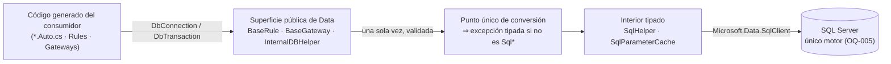

<!-- §3.15 language policy: YAML keys, status enums, IDs and section headings (##) in English (the schema);
     ADR title and prose in the project's content_language (devflow/LANGUAGE); `AITL-ADR-Approval` is never translated.
     ⚠️ AITL-ADR-Approval: this ADR stays a DRAFT — it cannot govern a SPEC, establish an NFR or authorize an
     exception — until an Architect / Tech Lead records the decision in the `review` block (§2.8, §3.5); no
     approval is inherited from related artifacts.
     ⚠️ ADR conflicts (§2.8): check the decision log for active ADRs contradicting this one before approval; a
     conflict is declared in `conflicts_with` and resolved by a superseding ADR.
     ⚠️ Content scope (§2.8): an ADR records architecture decisions and constraints, not functional behaviour —
     functional requirements live in the feature US and its ACs. -->

# ADR-005 — Provider de datos de Cooperator 2.0

| Field          | Value |
|----------------|-------|
| **Status**     | accepted |
| **Decision-makers** | architect, tech_lead |
| **Sources**    | REV-001 (aprobado 2026-10-15), OQ-005 (respondida 2026-10-15), ADR-001/ADR-002/ADR-003 (accepted) y ADR-004 (mismo ciclo, en revisión) |
| **Supersedes** | None |
| **Conflicts with** | None — no contradice a los ADR-001/002/003 accepted: consume el único slot de provider (ADR-001 §3.4/§3.6), respeta SQL Server como único motor (OQ-005) y toma la configuración y la caché del ADR-004 |

---

## 1. Context

`REV-001` §6 ítem 5 agrupa tres hallazgos que son una sola decisión: **cómo accede `Data` a la base**. El inventario los describió así:

- **F-09 — acoplamiento duro a `System.Data.SqlClient`, con casts que rompen la abstracción**: los tipos `SqlConnection`/`SqlParameter`/`SqlException` atraviesan la implementación, y —lo grave— las firmas públicas reciben `DbTransaction`/`DbConnection` para **castearlos** inmediatamente a `SqlTransaction`/`SqlConnection` (`BaseGateway.cs:640`, `BaseRule.cs:241/264/289/312/327` y decenas de sitios equivalentes). El cast convierte el `DbProviderFactory` en una promesa falsa: cualquier proveedor alternativo explota en runtime, no en compilación. Además `System.Data.SqlClient` está en modo mantenimiento (la recomendación del ecosistema es `Microsoft.Data.SqlClient`), con **cambio de namespace y de comportamiento** en los tipos de parámetros.
- **F-14 — espera activa como sincronización**: `BaseRule.cs:185` hace `Thread.Sleep(0)` después de liberar una transacción para esquivar el bug `SqlTransaction.Zombie()`, y `ObjectListHelper` (Core) hacía `Thread.Sleep(100)` bajo lock. Es portable pero frágil: no garantiza el efecto buscado y el bug de fondo pertenece al proveedor, que está cambiando.
- **F-29 — el reverse-engineering hereda de la capa de datos**: `DBReverseHelper/Providers/MSSQLProvider.cs` usa procedimientos de sistema (`exec sp_help`, `INFORMATION_SCHEMA`, `sp_fkeys`) a través de una clase privada `DataAccess : Cooperator.Framework.Data.BaseRule`. Ese `Utility → Data` es el acoplamiento que ADR-001 §3.1 ya rompió a nivel de paquete (el reverse vive en el tooling) y que hay que romper también a nivel de **herencia**.

**Dato verificado que acota la decisión**: la superficie del framework que consumen los proyectos generados es **BCL-typed** — las plantillas usan `BaseRule`, `BaseGateway`, `IGateway`, `ObjectListHelper`, `DataBaseHelper.*` y los tipos `DbConnection`/`DbTransaction`, y **no** referencian `SqlHelper`, `SqlConnection` ni `SqlTransaction` (grep sobre `Templates/**`; el único rastro de SqlClient en el set es `providerName="System.Data.SqlClient"` en la plantilla de `App.config`, que muere con ADR-004 §3.4). Eso importa: el `SqlHelper` derivado del Data Access Application Block (2532 líneas, público, SqlClient-typed) es **implementación**, no contrato.

**Restricciones fijas**: **SQL Server es el único motor** (OQ-005 + ADR-001 §3.5: sin Oracle, sin esqueleto `OracleScriptor`, sin referencia muerta); `Data` admite **exactamente un** provider ADO.NET y ninguna otra capa de acceso (ADR-001 §3.4/§5); `Modeling` **no depende de `Data`** (ADR-001 §3.1); `netstandard2.1`, consumidores .NET 10+, sin paquete `-windows`; y la configuración (connection string, timeout) más la caché (metadata de parámetros) llegan del **ADR-004**, no se redefinen acá.

**Frontera**: decide provider, versión, manejo de transacciones/conexiones, forma de la superficie pública de `Data` y el destino de los restos de abstracción multi-proveedor. **No** decide **criptografía** (F-23, ADR en preparación: este ADR sólo exige que el resolutor de valores protegidos sea intercambiable y que `Data` no conozca el algoritmo), ni la carga de providers Lazy (F-02), ni el T-SQL que emite el motor (F-46, ADR-003), ni el enumerador de servidores del Modeler (F-34, ruteado a DISC).

---

## 2. Alternatives considered

### Alternative A — `Microsoft.Data.SqlClient` único, implementación tipada y un solo punto de conversión en el borde (✅ Selected)

| Aspect   | Detail |
|----------|--------|
| **Pros** | Elimina los casts por diseño: el interior es SqlClient-typed y el borde público traduce **una vez**, con error tipado si el objeto no es del tipo esperado (deja de haber `InvalidCastException` a mitad de una transacción). Mantiene **el contrato que el código generado ya usa** (BCL-typed), así la migración del consumidor sigue siendo "cambios mínimos" (OQ-006), y a la vez se declara explícitamente que la abstracción es **forma de firma**, no promesa multi-motor. Retira de la superficie pública lo que nunca fue contrato (`SqlHelper`/`SqlHelperParameterCache`) y deja `Data` con **una** dependencia, como exige ADR-001 §3.4. |
| **Cons** | Obliga a escribir y testear el punto de conversión y a documentar una ruptura de superficie (el `SqlHelper` público desaparece). El código que hoy hace casts deja de compilar hasta que se reemplaza por el adaptador. |

### Alternative B — Conservar `System.Data.SqlClient` (sólo retargetear)

| Aspect   | Detail |
|----------|--------|
| **Pros** | Diff mínimo en `Data`: el código compila tal cual sobre `netstandard2.1` y los tipos de parámetros no cambian de comportamiento. |
| **Cons** | Es el proveedor en **mantenimiento**: se queda sin features nuevas (niveles de cifrado, TDS 8.0, mejoras de Azure/Entra) justo cuando la 2.0 quiere durar años, y perpetúa los casts y el `DbProviderFactory` fantasma que F-09 documenta. La migración se vuelve a deber más adelante, con más código encima. |

### Alternative C — Abstracción real vía `DbProviderFactory` (multi-proveedor)

| Aspect   | Detail |
|----------|--------|
| **Pros** | Honra la intención original del diseño: un `DbProviderFactory` configurable por `providerName`, sin casts, con providers intercambiables (Oracle, SQLite…). |
| **Cons** | Es exactamente la promesa que F-09 verificó **rota** (los casts la anulan) y que OQ-005 **canceló** (SQL Server único; Oracle deprecado). Construirla costaría un rediseño de `SqlHelper` completo para sostener providers que nadie va a enchufar, y agrega una dimensión de test (matriz por provider) sin consumidor. |

### Alternative D — Superficie pública tipada a SqlClient (`SqlTransaction`/`SqlConnection` en `IBaseGateway`/`BaseRule`)

| Aspect   | Detail |
|----------|--------|
| **Pros** | La más simple y honesta de leer: sin adaptador, sin conversión, sin `Db*` decorativo; el compilador garantiza que el objeto es el correcto. |
| **Cons** | Rompe el contrato que el **código generado ya usa** (verificado: `DbTransaction`/`DbConnection` en las plantillas), es decir, obliga a regenerar y re-tocar todo proyecto de cliente — el opuesto de la meta "cambios mínimos" de OQ-006 — y ata la firma pública a la versión del paquete SqlClient. |

### Alternative E — Capa de acceso de terceros (Dapper / EF Core / otro micro-ORM)

| Aspect   | Detail |
|----------|--------|
| **Pros** | Menos código propio: mapeo, parámetros y pools resueltos por una librería madura y muy usada. |
| **Cons** | Choca con ADR-001 §3.4 (una dependencia de acceso a datos, y es el provider: nada de ORMs ni capas adicionales) y con el modelo del producto: los mappers `*.Auto.cs` **los genera Cooperator** con `DataSet`/`DataReader` y `ObjectState`, no un ORM. Sería reescribir el motor de generación y la superficie de reglas para ganar poco. |

---

## 3. Decision

Se adopta la **Alternativa A**: **`Microsoft.Data.SqlClient` es el único provider** de la 2.0; la implementación interna de `Data` se tipa sobre él y **no castea**; el borde público conserva la forma BCL-typed que consume el código generado, con **un único punto de conversión** que falla de forma tipada; y los restos de abstracción multi-proveedor (`DbProviderFactory`, `providerName`) desaparecen.

### 3.1 Provider y versión

- **Provider**: `Microsoft.Data.SqlClient`, **único**. Los paquetes de la 2.0 **no** dependen de `System.Data.SqlClient` (se retira de `Data`); un consumidor que lo use por su cuenta sigue siendo su decisión, ajena al framework.
- **Versión**: la fija el **Bolt** (no este ADR), centralizada en `Directory.Packages.props` (ADR-001 §3.4) y con **dos criterios obligatorios de aceptación**: (1) la línea elegida debe ofrecer un **asset consumible desde `netstandard2.1`**, y (2) el arnés debe pasar un **smoke test de conexión real** contra SQL Server (no basta con que compile).
- **Riesgo del asset/stub y sus condiciones** (documentado por el propio proveedor; **verificado a la fecha**, y el Bolt que elija la línea lo vuelve a verificar): en las líneas nuevas, el asset que un consumidor `netstandard2.1` ve es un **stub `netstandard2.0` cuyos métodos lanzan `PlatformNotSupportedException`** — existe para que quien no resuelva assets de runtime reciba un error explícito. Nota de hiato entre líneas: **la 6.0 retiró** el asset `netstandard2.0` y **la 6.1 lo restauró como stub**, así que el Bolt debe fijar una línea que **publique el stub** (5.x o **6.1+, nunca 6.0**). Consecuencias que este ADR fija:
  - es apto para **compilar** `Data` (la superficie pública coincide), pero **exige un host que resuelva el asset de runtime por plataforma**;
  - eso se cumple por construcción: los consumidores son **.NET 10+** (ADR-001 §3.2), y
  - queda **prohibido** correr el arnés de `Data` —o cualquier host que cargue `Data`— **desde `lib/` sin selección de asset por runtime**: ahí lo que se carga es el stub y todo método falla. No es un escenario de `net48` por TFM —`net48` sencillamente **no puede consumir** un ensamblado `netstandard2.1` (ADR-001 §3.2)—, sino de un host que referencie el binario crudo en lugar de resolver por runtime; el arnés vive en `2.0/tests/` sobre `net10.0` y resuelve assets (F-50).
  - **Disparador de escalamiento** (cuando el Bolt debe parar y reportar, en vez de improvisar): **(a)** que **ninguna** línea vigente publique un asset compilable desde `netstandard2.1` (ni siquiera el stub), **o (b)** que el **smoke test de conexión real sobre `net10.0`** falle con el asset que el runtime resuelve para la línea elegida. En cualquiera de los dos casos, **se reporta y se decide con el dueño**: cambiar el TFM de `Data` no es una salida por conveniencia, porque el ADR-001 accepted lo fija y exigiría un ADR que lo reemplace.
- **Cambios de comportamiento del proveedor que la migración debe absorber** (documentados por el proveedor y verificados en su guía de migración): (a) `Encrypt` pasa a tener **`Mandatory` por defecto** (desde la línea 4.0 con `true`, y con `SqlConnectionEncryptOption` desde 5.0) y `TrustServerCertificate` sigue en `false` ⇒ las conexiones contra servidores con certificado autofirmado **empiezan a fallar** y hay que arreglar el certificado o declarar `TrustServerCertificate=true`/`Encrypt=false` **explícitamente**; (b) un `SqlParameter` con `DbType.Time` requiere **`TimeSpan`** (con `DateTime` deja de funcionar) y `DbType.Date` **trunca** la parte horaria; (c) el namespace cambia en todos los tipos (`Microsoft.Data.SqlClient`), con mapeos puntuales (`SqlDataRecord`/`SqlMetaData` → `Microsoft.Data.SqlClient.Server`, `OperationAbortedException` → `Microsoft.Data`). Todo esto va a las **notas de migración** de la 2.0 (ADR-001 §3.2, paso 3) y es criterio del Bolt que toque `Data`.
- **Nota de alcance**: el enumerador de servidores del Modeler (F-34) tendría su equivalente en `Microsoft.Data.Sql.SqlDataSourceEnumerator`, y sigue siendo Windows-only; se menciona sólo para que el Bolt del Modeler no lo busque en `System.Data.Sql`. Su pertinencia es materia del DISC ruteado, no de este ADR.

### 3.2 Casts, transacciones y sincronización (F-09/F-14)

- **Cero casts `Db*` → `Sql*` fuera de un punto.** Se eliminan los `(SqlTransaction)transaction`, `(SqlConnection)conn` y equivalentes. El borde público los recibe, los valida y los transforma **en un único lugar documentado** (`SqlTransactionAdapter`/`AsSqlTransaction`, implementación del Bolt), que lanza una **excepción tipada y accionable** (`InvalidTransactionTypeException`, con el tipo recibido y el esperado) en vez de un `InvalidCastException` a mitad de una operación.

- **Interior tipado**: `SqlHelper` y `SqlHelperParameterCache` trabajan con `Microsoft.Data.SqlClient` de punta a punta (`SqlConnection`, `SqlTransaction`, `SqlCommand`, `SqlParameter`) y **no** convierten nada. `GetAndBeginTransaction()` sigue devolviendo `DbTransaction` (contrato preservado) y el objeto concreto es un `SqlTransaction`; `GetNewConnection()` devuelve una `SqlConnection` como `DbConnection`.
- **Sincronización explícita, sin esperas activas**: se retiran `Thread.Sleep(0)` (`BaseRule.cs:185`) y el `Thread.Sleep(100)` bajo lock del Core. El orden correcto —dispose/commit/rollback deterministas, sin liberar la transacción antes de terminar el comando— es la solución; si el comportamiento "zombi" reaparece con el proveedor nuevo, se resuelve con una **política de retry explícita y acotada** (intentos y backoff documentados), nunca con una espera activa que "ordena" por tiempo. Si no se logra reproducir, queda como deuda técnica declarada en el MEM del Bolt, no como parche silencioso.
- **Timeout de comandos acotado** (cruce con ADR-004 §3.2): el timeout sale del catálogo de configuración (`Cooperator:Data:CommandTimeoutSeconds`), con un **default documentado** y validación del valor; se elimina la construcción de un `SqlCommand` descartable que hoy se usa sólo para leer el default del proveedor.

### 3.3 Superficie pública de `Data`

- **Se preserva la forma BCL-typed** de lo que el código generado consume: `IBaseGateway`, `BaseGateway`, `BaseRule`, `InternalDBHelper` (`DataBaseHelper`) con sus firmas sobre `DbConnection`/`DbTransaction`/`DbDataReader`/`DataSet`. La razón es de compatibilidad de fuente (OQ-006) y está verificada contra las plantillas.
- **Se declara la naturaleza de esa abstracción**: es **forma de firma**, no una promesa de multi-motor. Queda escrito en la documentación pública de `Data` para que nadie vuelva a construir sobre la idea de que un provider alternativo va a funcionar (que es la trampa que F-09 documentó).
- **`SqlHelper` y `SqlHelperParameterCache` pasan a `internal`**: son implementación (el DAAB derivado), nunca fueron parte del contrato que usa el código generado, y exponerlos era lo que obligaba a que la superficie pública fuera SqlClient-typed. Es una **ruptura de superficie** frente a 1.4 que se documenta en las notas de migración (quien los usara directamente puede usar `Microsoft.Data.SqlClient`). **Constancia de alcance (extensión del ruteo)**: el ítem 5 de `REV-001` §6 pedía eliminar los casts y tipar el helper, **no** retirarlo de la superficie pública; pasar `SqlHelper`/`SqlHelperParameterCache` a `internal` es una decisión **agregada por este ADR** sobre la base de que el código generado no los consume (verificado) y de que la abstracción multi-motor está cancelada (OQ-005). Queda registrada para el MEM del Bolt, de modo que la ruptura sea trazable a una decisión y no a un efecto colateral de la migración.
- **Se eliminan los restos de la abstracción muerta**: `providerName` deja de existir en el framework y en la configuración; no hay selección de provider por string en ningún punto de `Data`.

### 3.4 Parámetros y caché de metadata (cruce con ADR-004)

- `SqlHelperParameterCache` usa el **`ICacheProvider` del ADR-004** con su propia región y TTL por defecto (**1 día**, igual que 1.4) en lugar de un `Hashtable` estático con espejo en `HttpContext`; con el default en memoria el comportamiento es el mismo de 1.4 en escritorio, y configurable si algún día hay adaptador.
- **Hazard verificado que se corrige**: hoy `DiscoverSpParameterSet` hace `connection.Open()` … `connection.Close()` sobre una conexión **que recibe del llamador**. En 2.0 la conexión la administra quien la provee: el descubrimiento de parámetros no abre ni cierra conexiones ajenas (y, si necesita una, la pide y la dispone).
- El descubrimiento sigue apoyándose en `SqlCommandBuilder.DeriveParameters` (equivalente disponible en `Microsoft.Data.SqlClient`), sin cambios de semántica más allá de la conexión.

### 3.5 Connection strings: alineación con el ADR de criptografía (F-23)

- La cadena se obtiene de `ICooperatorConfiguration` (ADR-004 §3.2/§3.3) con **prefijo de esquema explícito**; `Data` **no** conoce algoritmo, claves ni formato protegido: pide el valor al resolutor que fije el **ADR de criptografía** (en preparación en este mismo ciclo).
- **Este ADR no decide criptografía.** Su único requisito es de forma: el resolutor es **intercambiable** y **no** está incrustado en `Data`; si el ADR de cripto cambia el esquema de protección o define la migración de las cadenas ofuscadas de 1.4, el plan y su ejecución viven allá y `Data` no necesita cambios.
- Se elimina, en `Data`, la heurística de detección por substrings y el `Dictionary` estático (F-13, decidido en ADR-004 §3.3): acá se confirma que **no queda ningún punto** en `Data` que inspeccione el contenido de la cadena para adivinar su estado.

### 3.6 `BaseRule`, `BaseGateway` y el reverse-engineering (F-29)

- **El reverse deja de heredar de `BaseRule`**: `MSSQLProvider` (tooling, junto al Modeler y al motor) usa `Microsoft.Data.SqlClient` directamente para leer el esquema (`sp_help`, `INFORMATION_SCHEMA`, `sp_fkeys`) y toma la connection string de la configuración portable (ADR-004). Es un lector de esquema, no una regla de negocio: heredar la maquinaria de transacciones, `ObjectState` y caché de `BaseRule` nunca estuvo justificado y era lo que acoplaba `Utility` a `Data`.
- **`Modeling` mantiene su independencia**: nada del modelo ni de las interfaces de reverse (`IDBReverseProvider`, `IDBTypeConverter`) depende de `Data` (ADR-001 §3.1). Los POCOs y las interfaces quedan en `Modeling`; el provider concreto, en el tooling.
- **`BaseRule` conserva su rol para el consumidor**: sigue siendo la clase base de las reglas generadas (`Rules` project) y expone la misma superficie BCL-typed de §3.3. Lo que cambia es su **lado de datos** (provider, casts, sincronización, configuración), no su papel en el código del cliente.
- **`BaseGateway`/`BaseLoader`** alinean su caché con ADR-004 (`ICacheProvider`, claves propias, `ResetCache()` removiendo **sus** claves) y dejan de lanzar `Exception("The table is not cacheable.")` —la excepción genérica que hoy usa `ResetCache()`— en favor de una excepción tipada del framework con mensaje accionable.

---

## 4. Consequences

**Positive:**

- Desaparece el cast que hacía explotar en runtime cualquier uso no-SqlClient: el error se vuelve **temprano, tipado y explicable**, y con él muere la ficción del multi-proveedor que F-09 documentó.
- `Data` queda con **una sola** dependencia de terceros (el proveedor), exactamente el umbral de ADR-001 §3.4/§5, y con el proveedor **soportado** en lugar del que está en mantenimiento.
- El código generado del consumidor **no cambia de forma**: la superficie que usan las plantillas se preserva, y la migración de una app sigue siendo "cambios mínimos" (OQ-006).
- El acoplamiento `Utility → Data` se corta también en la herencia: el reverse es un lector de esquema independiente, y `Modeling` queda sin ninguna arista hacia `Data`.
- Se elimina la espera activa como mecanismo de sincronización y se corrige el cierre de conexiones ajenas en la caché de parámetros: dos hazards reales dejan de estar en el camino crítico.
- La metadata de parámetros entra en el mismo mecanismo de caché que el resto (ADR-004), con una sola forma de configurar TTLs y de reemplazar el caché.

**Trade-offs:**

- **Ruptura de superficie**: `SqlHelper`/`SqlHelperParameterCache` dejan de ser públicos y cualquier consumidor que los usara directo debe reescribir esa parte (documentado en las notas de migración).
- El **punto único de conversión** es una concesión deliberada: mantiene compilando el 90 % del código del consumidor a cambio de una conversión en el borde que, si el objeto no es una `SqlTransaction`, falla ahí. Se paga con una línea de código y un test negativo, y se gana que el fallo sea temprano y tipado.
- La versión del proveedor queda **condicionada al asset compatible con `netstandard2.1`** (el stub `netstandard2.0` de las líneas nuevas): mientras eso se cumpla, todo bien; si el proveedor lo retira, hay una decisión que tomar con el dueño y no una salida por conveniencia.
- Adoptar el proveedor nuevo **cambia defaults de seguridad** en las conexiones (`Encrypt=Mandatory`): apps con certificados autofirmados empiezan a fallar al migrar y hay que ajustarlas — es el costo correcto, pero es trabajo de migración real y debe estar en las notas.
- Los cambios de tipo de parámetro (`DbType.Time`, `DbType.Date`) son silenciosos en compilación y **visibles en runtime**: exigen revisión de los sitios que pasan parámetros y pruebas contra la base.

**Technical debt:**

- El adaptador de conversión es la única costura artificial que sobrevive: mientras exista, hay un lugar donde un objeto del runtime equivocado produce error; el arnés debe cubrirlo con un test negativo por tipo (`DbTransaction` que no es `SqlTransaction`, `DbConnection` que no es `SqlConnection`).
- El `SqlHelper` derivado del DAAB sigue siendo **2532 líneas de código heredado** (aunque ahora interno): la decisión la reduce a implementación, no la moderniza. Su simplificación es candidata a un Bolt posterior, no un requisito de la 2.0.
- Si el comportamiento "zombi" de la transacción no se reproduce con el proveedor nuevo, queda un workaround eliminado sin explicación completa: se registra como deuda con la evidencia del intento de reproducción.
- La migración de las cadenas de conexión (protección real, esquemas, cadenas ofuscadas de 1.4) sigue **fuera** de este ADR: hasta el ADR de cripto, `plain:` es la única condición soportada.
- El T-SQL que el motor emite (`sys.objects`, lotes, F-46) y su validación contra Azure SQL siguen pendientes en el set de plantillas (ADR-003), no acá: `Data` sólo ejecuta lo que le dan.

---

## 5. Applicable NFRs

| NFR | Description | Threshold | How it is measured |
|-----|-------------|-----------|-------------------|
| No hidden casts | Toda conversión entre tipos de ADO.NET y del proveedor ocurre en un punto explícito y validado; el interior no castea | **0** ocurrencias de `(SqlTransaction)`, `(SqlConnection)` y equivalentes fuera del adaptador de borde | Gate de analizadores/expresión regular en CI sobre `Data` + tests negativos del adaptador (objeto de tipo equivocado ⇒ excepción tipada, nunca `InvalidCastException`) |
| Command timeout bounded | Ningún comando corre sin timeout explícito y acotado | 100 % de los comandos con timeout proveniente de la configuración o del default documentado; **0** comandos con timeout infinito o no validado | Test del arnés que construye un comando y verifica el timeout aplicado (valor configurado y default) + revisión del catálogo de configuración de ADR-004 §3.2 |

---

## 6. References

- [`REV-001`](../reviews/REV-001-analisis-migracion-cooperator.md) — revisión aprobada el 2026-10-15; §6 ítem 5; hallazgos F-09 (acoplamiento a `System.Data.SqlClient`, casts `DbTransaction`/`DbConnection` → `Sql*`, proveedor en mantenimiento), F-14 (`Thread.Sleep` como sincronización) y F-29 (el reverse hereda de `BaseRule` y acopla `Utility` a `Data`); relacionados: F-34 (enumerador de servidores, DISC) y F-46 (T-SQL generado, ADR-003).
- [`OQ-005`](../analysis/open-questions/OQ-005-alcance-features-en-riesgo.md) — SQL Server es el único motor: sin Oracle y sin providers alternativos que sostengan una abstracción multi-motor.
- [`ADR-001`](ADR-001-layout-y-empaquetado-cooperator-2.md) — accepted: un solo provider ADO.NET en `Data` (§3.4), NFR de huella de dependencias (§5), slot del provider y frontera de criptografía (§3.6), `Modeling` sin depender de `Data` (§3.1).
- [`ADR-003`](ADR-003-motor-scriban-headless-y-cli.md) — accepted: el motor emite artefactos y no ejecuta SQL; el set de plantillas es quien deja de emitir `providerName`/`App.config`.
- [`ADR-004`](ADR-004-cache-y-configuracion.md) — mismo ciclo: configuración portable (timeout, connection string con prefijo de esquema explícito) y `ICacheProvider` para la metadata de parámetros.
- Evidencia de código 1.4: `Data/BaseRule.cs` (casts en `ExecuteScalar*/ExecuteNonQuery*/ExecuteReader*/FillDataSet*` y `Thread.Sleep(0)` en la línea 185), `Data/BaseGateway.cs:640/653`, `Data/SqlHelper.cs`, `Data/SqlHelperParameterCache.cs:73-84` (apertura/cierre de la conexión del llamador), `Utility/DBReverseHelper/Providers/MSSQLProvider.cs` (`sp_help`, `INFORMATION_SCHEMA`, `sp_fkeys`, `DataAccess : BaseRule`), `Tools/CooperatorModeler/Templates/**` (superficie BCL-typed usada por el código generado).
- `Microsoft.Data.SqlClient`: guía de migración desde `System.Data.SqlClient` y *porting cheat sheet* (namespace, `Encrypt` por defecto `Mandatory` desde 4.0/5.0, `TrustServerCertificate=false`, `DbType.Time`/`DbType.Date`), y notas de soporte por línea (assets por plataforma y el stub `netstandard2.0` que lanza `PlatformNotSupportedException`).

---

## 7. AITL-ADR-Approval

> **AITL-ADR-Approval** (Avenga DevFlow §2.8, §3.0, §3.5). An ADR does not
> become `accepted` — and therefore governing — without the approval of an
> Architect / Tech Lead. This ADR is the **source of truth for its own
> approval** (recorded in the `review` frontmatter block with review
> evidence); when it governs a SPEC revision, its path appears in that
> revision's `sources`. ADR approvals are never copied to the Bolt manifest.

| Field | Value |
|-------|-------|
| **Architect / Tech Lead** | `human:eugenioserrano` |
| **Role** | tech_lead |
| **Decision** | **approved** |
| **review_ready_at** | `2026-10-15T23:06:38-03:00` |
| **review.started_at** | `2026-10-15T23:11:40-03:00` |
| **review.decided_at** | `2026-10-15T23:11:40-03:00` |
| **Findings** | Sin hallazgos adicionales — `acknowledged_without_comment: true` (motivo en el frontmatter) |
