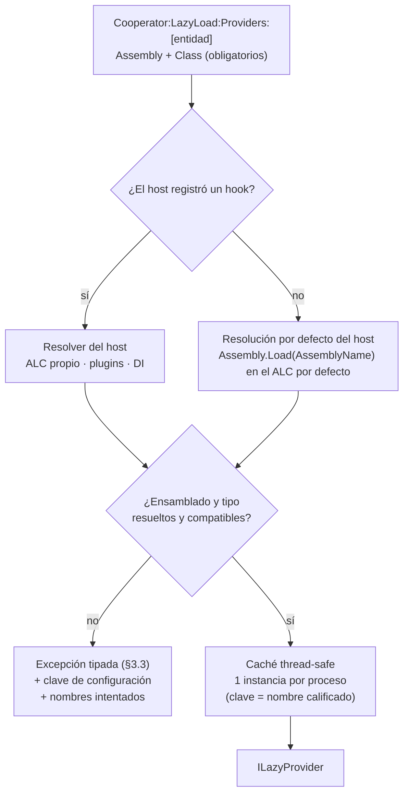

<!-- §3.15 language policy: YAML keys, status enums, IDs and section headings (##) in English (the schema);
     ADR title and prose in the project's content_language (devflow/LANGUAGE); `AITL-ADR-Approval` is never translated.
     ⚠️ AITL-ADR-Approval: this ADR stays a DRAFT — it cannot govern a SPEC, establish an NFR or authorize an
     exception — until an Architect / Tech Lead records the decision in the `review` block (§2.8, §3.5); no
     approval is inherited from related artifacts.
     ⚠️ ADR conflicts (§2.8): check the decision log for active ADRs contradicting this one before approval; a
     conflict is declared in `conflicts_with` and resolved by a superseding ADR.
     ⚠️ Content scope (§2.8): an ADR records architecture decisions and constraints, not functional behaviour —
     functional requirements live in the feature US and its ACs. -->

# ADR-006 — Carga de ensamblados de Cooperator 2.0

| Field          | Value |
|----------------|-------|
| **Status**     | accepted |
| **Decision-makers** | architect, tech_lead |
| **Sources**    | REV-001 (aprobado 2026-10-15), OQ-005 (respondida 2026-10-15), ADR-001/ADR-002 (accepted) y ADR-004/ADR-005 (mismo ciclo) |
| **Supersedes** | None |
| **Conflicts with** | None — cierra el slot que ADR-001 §3.6 dejó reservado (F-02) sin contradecir a los ADR accepted: usa la configuración de providers de ADR-004 §3.2, respeta `netstandard2.1` sin dependencias en `Core` (ADR-001 §3.4) y no reintroduce ninguna forma de carga implícita |

---

## 1. Context

`REV-001` §6 ítem 10 ruteó a un ADR el hallazgo **F-02**, el único bloqueante del inventario cuya severidad es **de comportamiento, no de compilación**: `Assembly.LoadFrom(String)` y `Assembly.Load(String)` **existen** en la superficie de `netstandard2.0/2.1`, así que el retargeteo compila — y el fallo aparece en producción.

El mecanismo legacy, verificado en código: `LazyProviderFactory.Get(assemblyName, className)` delega en `FactoryCache.Get(...)`, que **cachea instancias** en un `Dictionary` estático por clave `"{assemblyName}.{className}"` y, en el primer uso, llama a `SingleFactory.CreateObject(assemblyName, className)` → **`Assembly.Load(assemblyName)`** (nombre simple) + `CreateInstance(className, true)`. Existe además una sobrecarga por ruta (`Assembly.LoadFrom(assemblyPath + assemblyName)`). Tres consecuencias:

- **Resolución implícita**: `Assembly.Load("miAssembly")` construye un `AssemblyName` **parcial** y lo resuelve contra el `AssemblyLoadContext` del host. El modelo de `AppDomain` de .NET Framework **sondeaba el directorio base**; el ALC moderno **no lo hace**: sólo encuentra lo que forma parte de las dependencias de la aplicación (o de lo que el host haya cargado explícitamente). Una DLL copiada a un directorio —el patrón que el propio producto fomentaba con `CooperatorAssemblies` + `HintPath`, ADR-001 §3.1— deja de resolverse. Y como el mensaje de error aparece en el punto de instanciación, lejos de la configuración que lo provocó, el diagnóstico es malo por construcción.
- **Carga por ruta** (`LoadFrom`): en el ALC moderno carga con semántica de contexto propio, con riesgo de **tipos duplicados** (dos copias del mismo tipo `ILazyProvider` de ALCs distintos no son el mismo tipo) y con la posibilidad de cargar desde una ruta arbitraria que venga en configuración.
- **Caché de providers**: `FactoryCache` guarda **instancias** en un `Dictionary` estático **sin sincronización** (mutación concurrente de un `Dictionary` no es segura: puede lanzar o corromper el estado) y **nunca** se invalida.

**Restricciones y contexto fijo**: consumidores **.NET 10+** (ADR-001 §3.2); `Core` es **`netstandard2.1` con cero dependencias** (ADR-001 §3.4/§5) — de modo que la maquinaria de `AssemblyLoadContext`, que es del runtime moderno del **host**, no puede volverse una dependencia de la capa portable ni un requisito para el caso normal; los nombres de provider ya viven en el catálogo de configuración portable (`Cooperator:LazyLoad:Providers:<entidad>:Assembly` y `:Class`, ADR-004 §3.2); y **F-47** (resolución de `Type.GetType` por nombre simple en `BaseObjectList`) rutea a un Bolt, pero su arreglo tiene que ser coherente con la estrategia de nombres que este ADR fija.

**Evidencia del modelo de uso**: el provider se configura por entidad y se genera del lado del consumidor (`Templates/CSharpClasses/DefaultLazyProvider.cs` produce una clase `ILazyProvider` en `*.LazyProviders` que mapea nombres de tipo a mappers/gateways). Es decir: el provider del caso normal es **una clase del propio ensamblado de reglas del cliente**, que ya es una dependencia normal de su aplicación — el escenario "plugin externo en una carpeta" es la excepción, no la regla.

**Frontera**: decide cómo se nombran, se resuelven, se cachean y se diagnostican los providers Lazy. **No** decide qué configuración existe ni dónde vive (ADR-004 §3.2), ni el modelo/contrato del `.coop2` (ADR-002), ni el provider de datos (ADR-005), ni el arreglo puntual de `Type.GetType` (F-47, Bolt), ni ningún mecanismo de licenciamiento o anti-manipulación (retirado en ADR-001 §3.3).

---

## 2. Alternatives considered

### Alternative A — Resolución por el host por defecto, nombres obligatorios y hook explícito para el resto (✅ Selected)

| Aspect   | Detail |
|----------|--------|
| **Pros** | El caso normal (el provider es una clase del ensamblado de reglas del cliente, o un paquete NuGet) se resuelve por la **vía natural** del runtime — el ALC por defecto y las dependencias declaradas de la aplicación — sin que el framework cargue nada a mano, sin rutas y sin dependencias nuevas en `Core`. La maquinaria avanzada (ALC propio, rutas, plugins) queda donde pertenece: en el **host**, detrás de un hook explícito que el framework consulta antes de resolver por defecto. Los nombres pasan a ser obligatorios y explícitos (ensamblado + tipo completo), lo que convierte el fallo en un error **tipado, temprano y ubicado** en lugar de un `NullReferenceException` lejano. |
| **Cons** | Obliga a que el provider sea una dependencia real de la aplicación (o a que el host aporte el hook): un despliegue que hoy funciona "copiando DLLs a una carpeta" necesita declarar la dependencia o configurar el hook — es precisamente el cambio que el producto debe dejar de tolerar. |

### Alternative B — Carga por **ruta** siempre (`LoadFromAssemblyPath` con ruta absoluta desde configuración)

| Aspect   | Detail |
|----------|--------|
| **Pros** | Explícito y verificable: el framework sabe exactamente qué archivo carga y puede validar que existe antes de usarlo; contempla el despliegue "carpeta de plugins" sin depender de las dependencias de la app. |
| **Cons** | Mete **rutas absolutas de máquina en la configuración** (justo lo que el `.coop2` excluye por buenas razones, ADR-002 §3.1), ata el despliegue a una estructura de carpetas, y convierte la configuración en un vector de carga arbitraria de código: cualquier valor que llegue a esa clave se ejecuta. Además el ALC moderno mantiene los problemas de tipos duplicados de `LoadFrom`. |

### Alternative C — Sólo hook: el framework no resuelve nada y el host registra una factory

| Aspect   | Detail |
|----------|--------|
| **Pros** | Máxima pureza y máxima seguridad: el framework nunca carga nada, todo lo decide la aplicación. Ideal para hosts con contenedor de DI o AOT. |
| **Cons** | Rompe la meta de "cambios mínimos" (OQ-006): cada app generada tendría que escribir resolución de providers antes de poder usar LazyLoad, y el caso normal —que es trivial— pasa a ser trabajo repetido en cada consumidor. Convierte una decisión de plataforma en deuda de cada cliente. |

### Alternative D — Portar la semántica de `AppDomain` (probar el directorio base y usar `LoadFrom`)

| Aspect   | Detail |
|----------|--------|
| **Pros** | Preserva el comportamiento histórico: lo que funcionaba en 1.4 sigue funcionando, sin tocar despliegues ni configuraciones. |
| **Cons** | Reconstruye a mano un modelo que el runtime abandonó, y lo hace **peor**: sondeo implícito de directorios (con lo que el orden del sistema de archivos influye en qué código se ejecuta), carga de ensamblados no declarados, tipos duplicables y fallos silenciosos. Es exactamente el estado del que hay que salir. |

### Alternative E — Un `AssemblyLoadContext` propio **siempre**, con aislamiento por provider

| Aspect   | Detail |
|----------|--------|
| **Pros** | Aislamiento fuerte: cada provider con sus dependencias, sin interferencias entre plugins ni colisiones de versiones. |
| **Cons** | Obliga a resolver el problema de los tipos compartidos (`ILazyProvider` del ALC del host no es el `ILazyProvider` del ALC del provider): exige contratos en un ensamblado "de frontera" y marshalling, con una complejidad desproporcionada para providers que hoy son clases del mismo proyecto de reglas. Además no aporta nada al caso normal (Alternative A lo cubre sin código). |

---

## 3. Decision

Se adopta la **Alternativa A**: el framework resuelve los providers **por nombre, a través de la resolución normal del host**, con **nombres obligatorios y explícitos**; ofrece un **hook** para que el host imponga su propia estrategia (ALC, rutas, DI) cuando el caso lo requiera; **nunca** carga desde rutas arbitrarias por defecto; y todo fallo de resolución se convierte en un **error tipado y ubicado**.

### 3.1 Estrategia de resolución

- **Nombres obligatorios**: la configuración de un provider exige **ambos** valores —ensamblado (`Cooperator:LazyLoad:Providers:<entidad>:Assembly`) y **nombre completo del tipo** (`…:Class`)— y el tipo debe estar **calificado por namespace**. No hay valor por defecto, no hay heurística y no hay búsqueda de "algún tipo con ese nombre entre los ensamblados cargados": si falta cualquiera de los dos, la carga **no ocurre** y se reporta el error (con la clave ofensora).
- **Terminología (fijada)**: el valor de `…:Assembly` es el **nombre de ensamblado, en su forma simple de *display name*** (p. ej. `Ventas.Lazy`); el valor de `…:Class` es el **nombre completo del tipo calificado por namespace** (p. ej. `Ventas.LazyProviders.DefaultLazyProvider`). **No** se exige ni se pretende un `AssemblyName` completo con versión, cultura y `PublicKeyToken`: la versión y la identidad de firma las resuelve el host (ADR-001 §3.3 fija la firma como identidad; el framework no impone binding). Un valor que incluya esos campos se acepta como documentación pero **no** cambia la resolución —el framework no verifica versiones ni tokens en runtime—.
- **Resolución por defecto: la del host.** El framework resuelve con `Assembly.Load(new AssemblyName(<assemblyNameSimple>))` —el nombre simple que declara la configuración, **no** "el primero que aparezca"— y obtiene el tipo por su **nombre completo**, delegando en el **ALC por defecto** del host. Esto cubre el caso real: el provider es una clase del ensamblado de reglas del cliente (evidencia: la plantilla `DefaultLazyProvider` se genera en `*.LazyProviders`) o de un paquete NuGet, y por lo tanto es una **dependencia declarada** de la aplicación.
- **Hook del host (segundo camino, explícito)**: el framework expone un punto de extensión —una **factory/`IAssemblyProvider` que el host registra una vez** (mismo patrón de fijación única que la configuración de ADR-004 §3.2)— con la que el host puede: resolver con un `AssemblyLoadContext` propio, cargar desde una carpeta de plugins con `AssemblyDependencyResolver`, o devolver una instancia ya construida (p. ej. desde su contenedor de DI). Si el hook está registrado, el framework **no** usa la resolución por defecto.
- **La maquinaria de ALC es del host, no de la capa portable**: `Core` es `netstandard2.1` **sin dependencias** (ADR-001 §3.4) y no va a tomar `System.Runtime.Loader` ni a exigir ALC: quien necesita aislamiento lo implementa donde el runtime se lo permite —en la aplicación— y lo entrega por el hook.
- **Nada de rutas arbitrarias por defecto**: la carga por ruta **no** existe en el camino por defecto y **no** se configura desde el catálogo de configuración; si un host necesita cargar desde una ruta, lo hace en **su** hook, con **su** política de confianza, fuera del framework.
- **Qué se elimina del modelo legacy**: la sobrecarga `CreateObject(assemblyPath, assemblyName, className)` con `LoadFrom`; el sondeo implícito por directorio base; la carpeta `CooperatorAssemblies` como mecanismo de resolución en runtime (su contraparte de compilación ya murió con los `PackageReference`, ADR-001 §3.1) y los `HintPath` + `SpecificVersion=False` de las plantillas 1.4.
- **Consistencia con F-47**: la regla de este ADR —"sin resolución implícita por nombre simple; el nombre debe identificar unívocamente el destino"— es la misma que necesita el arreglo de `Type.GetType` en `BaseObjectList` (hoy toma un nombre simple derivado de `PropertyType.ToString()` y, en el runtime moderno, devuelve `null` cuando el tipo no vive en el ensamblado llamador). El Bolt de F-47 debe usar **nombre calificado por ensamblado** o el mismo resolvedor; **no** puede reintroducir la resolución implícita que este ADR elimina.

### 3.2 Caché de providers

- El caché de providers pasa a ser **thread-safe** (hoy es un `Dictionary` estático mutado sin sincronización) y se conserva la semántica buscada: **una instancia por provider y por proceso** —el provider del cliente mantiene sus propios cachés internos, y recrearlo por llamada era lo que el `FactoryCache` evitaba—.
- La clave es el **nombre calificado** (ensamblado + tipo completo), no la concatenación por puntos que hoy puede colisionar (`"A.B" + "C"` vs `"A" + "B.C"`).
- Se expone un **reset explícito** (para tests y para hosts que recargan providers) en lugar de una caché imposible de invalidar.
- Un fallo de resolución **no** se cachea como "ausente": la excepción se propaga y el siguiente intento vuelve a resolver (así una configuración corregida en caliente no queda envenenada).

### 3.3 Diagnóstico: errores tipados con causa concreta

Cada modo de fallo tiene su excepción, con el **contexto suficiente para arreglarlo sin depurar**: la entidad y la **clave de configuración** que lo pidió, el ensamblado y el tipo intentados, y la causa.

| Causa | Excepción | Qué reporta |
|---|---|---|
| Falta la clave de configuración | `ProviderNotConfiguredException` | Entidad sin provider configurado y la clave esperada del catálogo (ADR-004 §3.2) |
| El ensamblado no se resuelve | `ProviderAssemblyNotFoundException` | Nombre de ensamblado intentado + si hay hook registrado + la causa subyacente (`FileNotFoundException`/`FileLoadException` del runtime) |
| El ensamblado existe pero el tipo no | `ProviderTypeNotFoundException` | Nombre completo de tipo, ensamblado resuelto y los tipos del ensamblado que **sí** implementan `ILazyProvider` (si hay alguno) |
| El tipo existe pero no sirve | `ProviderTypeIncompatibleException` | Por qué: no implementa `ILazyProvider`, es abstracto/interfaz, o no tiene constructor público sin parámetros |
| El hook del host falla | `ProviderResolutionFailedException` | Que el fallo vino del hook (no de la resolución por defecto) + la excepción original del host |

- **Sin fallos silenciosos**: nunca se devuelve `null`, ni se "prueba con otro nombre", ni se degrada a un provider por defecto sin decirlo. Un provider que no se puede construir es un error, no una ausencia.
- **Fail-fast disponible**: el framework expone una **validación de arranque** que resuelve **todos** los providers configurados y falla con el listado completo, para que la app la invoque al iniciar en lugar de descubrir el problema en el primer lazy load de una request de producción.

### 3.4 Interplay con ADR-001, ADR-002, ADR-004 y ADR-005

- **ADR-001**: cierra su slot §3.6 ("Carga de providers Lazy"); no agrega dependencias a la capa portable (§3.4) y elimina la última pieza de runtime del modelo `CooperatorAssemblies`.
- **ADR-002**: el mecanismo de carga **no** toca el formato del modelo; el `.coop2` no contiene ensamblados ni rutas, y sigue sin contenerlas (ADR-002 §3.1).
- **ADR-004**: los nombres de provider que este ADR resuelve son las claves de su catálogo de configuración (§3.2); el hook y la configuración comparten el patrón de "fijación única al arranque" y el error tipado de configuración inválida (§3.3 del ADR-004).
- **ADR-005**: sin interacción directa; el provider de datos es del framework, los providers Lazy son del consumidor, y ninguno de los dos se resuelve por ruta.

---

## 4. Consequences

**Positive:**

- El fallo deja de ser silencioso y lejano: cualquier problema de provider aparece como una excepción tipada **en el punto de configuración**, con el nombre intentado y la alternativa disponible.
- El caso normal —provider como dependencia declarada de la app— funciona **sin escribir una línea** de resolución: la vía natural del runtime hace el trabajo y el framework no carga nada por su cuenta.
- Desaparece la superficie de carga arbitraria: sin rutas en configuración, sin sondeo de directorios, sin `LoadFrom` por defecto — un valor de configuración comprometido no puede provocar la ejecución de código desde una ruta elegida por un atacante.
- La caché de providers deja de ser un `Dictionary` estático sin sincronización y gana una clave que no puede colisionar, un reset explícito y un modo de fallo que no envenena el proceso.
- El aislamiento avanzado (ALC propio, plugins en carpeta, DI) sigue siendo posible sin contaminar la capa portable: lo aporta el host por el hook, que es donde la política de confianza tiene que vivir.

**Trade-offs:**

- Un despliegue que hoy funciona copiando DLLs a una carpeta **deja de funcionar por defecto** y necesita una de dos cosas: declarar el provider como dependencia de la aplicación (lo correcto, y lo que las plantillas de ADR-003 ya hacen vía `PackageReference`) o registrar el hook del host. Es una ruptura de comportamiento deliberada y documentada.
- El hook agrega una superficie de extensión que hay que documentar y testear (incluido el caso "hook registrado que falla", que ahora tiene su propia excepción).
- La validación de arranque es **opt-in**: una app que no la invoque sigue enterándose del problema en el primer uso, aunque ahora con un error claro.
- Los nombres calificados obligatorios convierten en error de configuración lo que en 1.4 podía "resolver por casualidad": configuraciones viejas con nombres incompletos deben corregirse al migrar.

**Technical debt:**

- Mientras el hook no se use, la resolución por defecto **depende de que el provider sea una dependencia declarada**: es una propiedad del despliegue del cliente, no algo que el framework pueda verificar. La validación de arranque y las notas de migración son la mitigación; el gate real es el despliegue.
- `FactoryCache` se reescribe, pero su uso sigue siendo un **singleton por proceso**: un provider que guarde estado (los del cliente guardan cachés de mappers) no puede recargarse sin reset explícito. El comportamiento queda documentado como contrato, no como accidente.
- El arreglo de F-47 (`Type.GetType` en `BaseObjectList`) sigue pendiente en su Bolt: hasta entonces subsiste una resolución por nombre simple en el mapeo de filas→objetos, con el mismo defecto de fondo que este ADR elimina en la carga de providers.
- La maquinaria de diagnóstico completa (tabla de §3.3) es trabajo del Bolt: hasta que exista, el comportamiento nuevo convive con mensajes heredados.

---

## 5. Applicable NFRs

| NFR | Description | Threshold | How it is measured |
|-----|-------------|-----------|-------------------|
| No implicit assembly loading | El framework no carga ensamblados por heurística ni desde rutas provistas por configuración | **0** llamadas a `LoadFrom`/`LoadFile`/sondeo de directorio en el camino por defecto; **0** claves de configuración capaces de provocar una carga desde ruta | Gate de API sobre `Core`/`Data` (uso de APIs de carga restringido al módulo de resolución) + revisión del catálogo de configuración (ADR-004 §3.2) en el Bolt |
| Provider resolution fail-fast | Un provider mal configurado produce un error tipado, accionable y en el punto de configuración, nunca un fallo silencioso o tardío | 100 % de las causas de §3.3 con excepción propia; **0** retornos `null`/degradaciones silenciosas; la validación de arranque reporta **todos** los providers fallidos en una sola pasada | Tests negativos por causa (config ausente, ensamblado faltante, tipo faltante, tipo incompatible, hook que falla) verificando el tipo de excepción y el contenido del mensaje (clave + nombres) |

---

## 6. References

- [`REV-001`](../reviews/REV-001-analisis-migracion-cooperator.md) — revisión aprobada el 2026-10-15; §6 ítem 10; hallazgo F-02 (carga por nombre/ruta y riesgo de fallo silencioso en el ALC moderno; corrección de la revisión: `Assembly.LoadFrom(String)` **existe** en `netstandard2.0/2.1`, el problema es comportamental) y F-47 (`Type.GetType` por nombre simple, Bolt, coherencia de nombres).
- [`OQ-005`](../analysis/open-questions/OQ-005-alcance-features-en-riesgo.md) — alcance: no hay providers alternativos que sostengan maquinaria de plugins más allá del caso normal.
- [`ADR-001`](ADR-001-layout-y-empaquetado-cooperator-2.md) — accepted: slot de la carga de providers (§3.6), `Core` `netstandard2.1` sin dependencias (§3.4), retiro del gate y de la integridad en código (§3.3), fin de `CooperatorAssemblies`/`HintPath` (§3.1).
- [`ADR-002`](ADR-002-formato-coop2-y-migrador.md) — accepted: el modelo no transporta rutas ni ensamblados.
- [`ADR-004`](ADR-004-cache-y-configuracion.md) — catálogo de configuración de providers (LazyLoad) y patrón de fijación única al arranque.
- [`ADR-005`](ADR-005-provider-de-datos.md) — alcance del provider de datos, ajeno a esta decisión.
- Evidencia de código 1.4: `Core/Factory/Factories.cs` (`SingleFactory.CreateObject` con `Assembly.Load`/`LoadFrom`, `FactoryCache` con `Dictionary` estático sin lock), `Core/LazyLoad/LazyProviderFactory.cs:46-48`, `Core/LazyLoad/ILazyProvider.cs` (contrato `GetList(Type, IUniqueIdentifiable)`), `Tools/CooperatorModeler/Templates/CSharpClasses/DefaultLazyProvider.cs` (el provider del caso normal se genera en el proyecto de reglas del cliente), `Core/BaseObjectList.cs:409-415` (F-47).

---

## 7. AITL-ADR-Approval

> **AITL-ADR-Approval** (Avenga DevFlow §2.8, §3.0, §3.5). An ADR does not
> become `accepted` — and therefore governing — without the approval of an
> Architect / Tech Lead. This ADR is the **source of truth for its own
> approval** (recorded in the `review` frontmatter block with review
> evidence); when it governs a SPEC revision, its path appears in that
> revision's `sources`. ADR approvals are never copied to the Bolt manifest.

| Field | Value |
|-------|-------|
| **Architect / Tech Lead** | `human:eugenioserrano` |
| **Role** | tech_lead |
| **Decision** | **approved** |
| **review_ready_at** | `2026-10-15T23:06:38-03:00` |
| **review.started_at** | `2026-10-15T23:11:40-03:00` |
| **review.decided_at** | `2026-10-15T23:11:40-03:00` |
| **Findings** | Sin hallazgos adicionales — `acknowledged_without_comment: true` (motivo en el frontmatter) |
