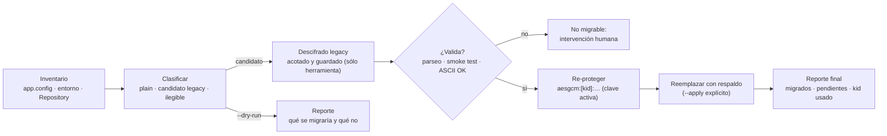

<!-- §3.15 language policy: YAML keys, status enums, IDs and section headings (##) in English (the schema);
     ADR title and prose in the project's content_language (devflow/LANGUAGE); `AITL-ADR-Approval` is never translated.
     ⚠️ AITL-ADR-Approval: this ADR stays a DRAFT — it cannot govern a SPEC, establish an NFR or authorize an
     exception — until an Architect / Tech Lead records the decision in the `review` block (§2.8, §3.5); no
     approval is inherited from related artifacts.
     ⚠️ ADR conflicts (§2.8): check the decision log for active ADRs contradicting this one before approval; a
     conflict is declared in `conflicts_with` and resolved by a superseding ADR.
     ⚠️ Content scope (§2.8): an ADR records architecture decisions and constraints, not functional behaviour —
     functional requirements live in the feature US and its ACs. -->

# ADR-007 — Política criptográfica y migración de datos protegidos

| Field          | Value |
|----------------|-------|
| **Status**     | accepted |
| **Decision-makers** | architect, tech_lead |
| **Sources**    | REV-001 (aprobado 2026-10-15), OQ-003 (respondida 2026-10-15), ADR-001/ADR-002/ADR-003 (accepted) y ADR-004/ADR-005 (mismo ciclo) |
| **Supersedes** | None |
| **Conflicts with** | None — completa lo que los ADR-004 §3.3, ADR-005 §3.5 y ADR-003 §3.2 dejaron **reservado explícitamente** a este ADR, y no reintroduce ningún control de runtime retirado por ADR-001 §3.3 |

---

## 1. Context

`REV-001` (F-23) documentó un **defecto de seguridad verificado**, no una deuda de estilo: `Cooperator.Framework.Library/Cryptography.cs` cifra con **TripleDES** usando una **clave y un IV constantes compilados en el ensamblado** (`_CryptoKey = "*1Am|9Kh)+/?sfGq88"`, `_Iv = {241,0,34,19,23,32,44,151}`), con la clave derivada por **MD5** de ese literal y el texto convertido con **`Encoding.ASCII`**. Cualquiera que tenga el binario descifra cualquier cadena: la clave está en el IL. La "protección" es **ofuscación**, y es lo único que separa las credenciales de base de datos de un archivo en claro (el `BaseRule` del 1.4 incluso autodetectaba el formato por substrings). La API es **estática y sin clave explícita** (`Cryptography.Encrypt(string)` usa la constante embebida), el IV fijo hace el cifrado **determinista** (dos valores iguales producen el mismo texto cifrado), y el uso de ASCII **pierde silenciosamente** todo carácter no ASCII de una contraseña o un nombre.

El ruteo (§6 ítem 12) separa dos entregables: **el defecto se corrige con un BUG de seguridad y su Bolt**; este ADR es la **mitad de arquitectura** — la política que hace implementable ese fix y que además resuelve lo que quedó reservado aguas arriba:

- **ADR-004 §3.3** definió el prefijo de esquema **explícito** (`plain:` = identidad), la prohibición de la heurística, el error tipado ante un prefijo desconocido y un **"resolutor de valores protegidos" intercambiable cuya implementación define ESTE ADR**.
- **ADR-005 §3.5** estableció que `Data` **no conoce el algoritmo**: pide el valor al resolutor y nada más.
- **ADR-003 §3.2** reservó el **conversor de connection strings** (F-40, el `ConnectionStringEncriptor` de 1.4 como candidato a comando del CLI).
- **ADR-001 §3.3** retiró el gate por `PublicKeyToken` y dejó la integridad de despliegue en la **capa de empaquetado**: este ADR **no** la trae de vuelta.
- **F-24** (contexto) dejó el reemplazo mecánico de los `*CryptoServiceProvider` obsoletos (SYSLIB0020/0021) en el Bolt de portabilidad; la **política** de qué primitivas se aceptan se fija acá.

**Restricciones fijas**: las librerías son **portables** (`netstandard2.1`, sin paquete `-windows` y sin dependencias de terceros en `Core`/`Library`, ADR-001 §3.4/§5) mientras el **tooling es Windows**; los consumidores son .NET 10+ (ADR-001 §3.2); SQL Server es el único motor (OQ-005); y la configuración de dónde se leen los valores es del ADR-004, no de acá.

**Frontera**: decide el mecanismo y los esquemas de protección, la gestión y rotación de claves, el estándar de primitivas y el procedimiento de migración de los valores ya cifrados de 1.4. **No** crea el BUG ni ejecuta el fix, no decide el catálogo de configuración (ADR-004), no reabre el licenciamiento/anti-manipulación (OQ-003/ADR-001 §3.3) y no cubre secretos ajenos al framework (certificados o tokens de terceros del consumidor).

---

## 2. Alternatives considered

### Alternative A — AEAD portátil (AES-GCM) con clave externa, esquemas y rotación por `kid` (✅ Selected)

| Aspect   | Detail |
|----------|--------|
| **Pros** | Cifrado **autenticado** (confidencialidad + integridad en un solo paso): un valor manipulado se **detecta** en vez de descifrarse a basura. La clave **no vive en el binario**: la aporta un *key provider* externo (variable de entorno por defecto, hook del host para DPAPI/KMS). Portable (BCL, sin dependencias nuevas) y compatible con la restricción de que las librerías son `netstandard2.1` y no Windows-only. El `kid` explícito habilita **rotación sin big-bang** (una clave activa + varias de lectura) y convierte en error explícito cualquier valor cuya clave no esté disponible. Se apoya en los esquemas y el resolutor que ADR-004 §3.3 ya fijó como interfaz. |
| **Cons** | Obliga a **gestionar claves fuera del producto** (un secreto más que operar y rotar) y a un procedimiento de migración por el corpus ya cifrado. Un valor protegido deja de ser "copiable" entre entornos sin re-protegerlo (si se usa el nombre de la clave como datos autenticados adicionales). |

### Alternative B — DPAPI como mecanismo del framework (esquema `dpapi:`)

| Aspect   | Detail |
|----------|--------|
| **Pros** | Sin gestión de claves: el SO las protege y las rota con la cuenta/máquina; cero secretos que operar; altísimo costo de ataque fuera de la máquina. |
| **Cons** | **Windows-only**: un paquete portable no puede depender de `System.Security.Cryptography.ProtectedData` (contradice ADR-001 §3.4/§3.5: nada Windows-only en la capa portable) y el valor queda atado a la máquina/usuario, lo que rompe cualquier despliegue en contenedor, CI o granja. Viabilidad: **como hook del host** (ver A), no como mecanismo del framework. |

### Alternative C — Sobre asimétrico con certificado X.509 (`x509:`, protege con clave pública, descifra con privada)

| Aspect   | Detail |
|----------|--------|
| **Pros** | Permite que **quien protege no pueda descifrar**: útil cuando el valor se protege en un entorno de build/administración y se consume en producción; encaja con gestores corporativos de certificados. |
| **Cons** | Mucho más pesado de operar (emisión, distribución, rotación y expiración de certificados) para proteger cadenas de conexión de un producto que se despliega en máquinas de cliente; el cifrado híbrido necesario (clave simétrica + sobre) agrega formato propio. Viabilidad: **como esquema aportado por el host**, para quien tenga esa necesidad. |

### Alternative D — Conservar 3DES con una clave "mejor guardada"

| Aspect   | Detail |
|----------|--------|
| **Pros** | Migración mínima: el formato no cambia, no hay corpus que convertir y el `BaseRule`/encriptor siguen entendiendo lo que había. |
| **Cons** | Mantiene criptografía **débil y no autenticada** (sin detección de manipulación), con IV fijo y encoding ASCII, y con la única mejora de dónde está la clave. Deja el defecto de fondo vivo con otro disfraz y arrastra la prohibición de migrar el corpus a la 3.0. |

### Alternative E — Delegar todo a un gestor externo (Key Vault / KMS / HSM) como único mecanismo

| Aspect   | Detail |
|----------|--------|
| **Pros** | La mejor postura posible: claves nunca en el host, rotación y auditoría administradas por el proveedor, control de acceso central. |
| **Cons** | Requiere **red e identidad** en cada arranque: mata el escenario offline/on-premise de un producto que se instala en máquinas de cliente y mete una dependencia de nube en el camino crítico de conexión a base. Viabilidad: **como esquema aportado por el host**, para quien tenga esa infraestructura. |

---

## 3. Decision

Se adopta la **Alternativa A**: la protección de valores del framework es **AEAD con clave externa**; los esquemas que el resolutor de ADR-004 §3.3 acepta son `plain:` (identidad) y `aesgcm:` (mecanismo del framework), más los que el **host** registre por hook (`dpapi:`, `x509:`, `kv:`, …); **ninguna clave vive en el código, en el repositorio ni en un archivo versionado**; y los valores ya cifrados de 1.4 **se migran, no se re-cifran**.

### 3.1 Mecanismo, esquemas y superficie

- **`plain:`** — identidad, ya definido en ADR-004 §3.3. Regla única y reconciliada entre ambos ADRs: un valor **sin prefijo** es **error tipado** (`CooperatorConfigurationException`) que exige declarar `plain:` explícitamente — **no** se asume texto plano —, y un prefijo **desconocido** es error tipado con la clave y el prefijo ofensor, nunca un intento de descifrado a ciegas.
- **`aesgcm:<kid>:<base64>`** — mecanismo **del framework**: **`System.Security.Cryptography.AesGcm`** (confirmado en la superficie de `netstandard2.1`), AES-GCM de 256 bits, **nonce aleatorio por operación** (nunca reutilizado) y **tag de autenticación verificado** al resolver; la carga se codifica en Base64 con `nonce | tag | ciphertext` en ese orden, documentado como contrato. *Detalles que el Bolt fija y publica: nonce de **12 bytes**, tag de **16 bytes**, y clave de entorno **32 bytes** codificada en Base64 (o hex, el Bolt elige una y la documenta).* Nota histórica, fuera del camino vigente: durante la redacción se consideró un fallback `Aes` + HMAC (*encrypt-then-MAC*) por si `AesGcm` no estuviera disponible; con la superficie confirmada, **esa rama queda muerta** y no forma parte de la política.
- **Datos autenticados adicionales (AAD)**: el **nombre completo de la clave de configuración** que contiene el valor. Así un valor protegido **no se puede mover** de un slot a otro sin re-protegerlo (un copiar/pegar entre entornos falla de forma explícita en lugar de "funcionar" con la credencial equivocada). Re-targetear es una operación de la herramienta (§3.5), no un `Ctrl+C`.
- **Esquemas del host**: el mismo patrón de *fijación única al arranque* que ADR-004 §3.2 y ADR-006 §3.1. El host registra resolvedores para sus esquemas (`dpapi:` para una máquina Windows, `x509:`/`kv:` para una infraestructura corporativa); el framework **no** implementa ninguno de ellos. Un esquema sin resolvedor registrado es un error tipado que dice exactamente eso.
- **Dónde vive**: el **contrato** (`IProtectedValueResolver`: esquema + carga ⇒ valor, con `kid` disponible) en `Cooperator.Framework.Core` (cero dependencias, junto al contrato de configuración de ADR-004); la **implementación `aesgcm:`** en `Cooperator.Framework.Library` (BCL, portable, donde ya vive la criptografía del framework). `Core` sigue sin tocar criptografía y `Data` sigue sin conocer el algoritmo (ADR-005 §3.5).
- **Se retira la API estática con clave implícita**: `Cryptography.Encrypt(string)`/`Decrypt(string)` (las sobrecargas sin clave) desaparecen como superficie pública; proteger y resolver exigen una **referencia explícita de clave** (`kid` + key provider) y el resolutor configurado. Es una **ruptura de superficie** que se documenta en las notas de migración (quien usara `Library.Cryptography` directo pasa a los esquemas).

### 3.2 Claves: provisión y rotación

- **Ninguna clave embebida**, en ninguna forma: ni literal, ni derivada de una constante del binario, ni en un archivo del repositorio, ni en el `.coop2` (ADR-002 §3.1).
- **Key providers**: (a) **por defecto, variables de entorno** —portable, CI/contenedor-friendly, sin archivos—; (b) **hook del host** para un almacén propio (DPAPI sobre un archivo protegido por el SO, Key Vault/KMS, HSM, un gestor corporativo). El framework sólo consume la **referencia** de la clave (`kid`), no el material.
- **`kid` explícito en el valor** y **dos roles**: una clave **activa** (con la que se protege) y un conjunto de claves **de lectura** (las que el resolutor acepta). Un `kid` sin clave disponible ⇒ **error tipado** (nunca "probar con otra clave" ni degradar a texto plano).
- **Rotación sin big-bang**: se agrega la clave nueva como activa, la anterior queda en lectura, y los valores se re-protegen de a poco (§3.5) hasta poder retirar la vieja. La ventana de solapamiento es explícita en la configuración, con fecha.
- **Nada de secretos en logs ni en reportes**: ni el valor, ni la clave, ni el material derivado; los reportes identifican valores por **clave de configuración** y `kid`, nunca por contenido.

### 3.3 Migración de los valores ya cifrados de 1.4 — "migrar, no re-cifrar"

- **Inventario**: las cadenas de 1.4 viven en el `app.config`/`web.config` de cada aplicación del consumidor, en variables de entorno, en la configuración propia de cada cliente **y en el "Repository" del Registro** (F-16; si al migrar se toca ese almacén, se preserva exactamente el separador `0xA1` del contrato de claves, F-48). **No** están en el `.coop2`: el modelo dejó de transportarlas (ADR-002 §3.1).
- **Detección explícita, nunca heurística**: el conversor **no adivina** qué está cifrado. Examina las entradas que se le indican, clasifica **candidatos** por forma (Base64 válido + longitud múltiplo del bloque de 8 bytes del algoritmo legacy) y **reporta** antes de tocar nada (`--dry-run` por defecto, `--apply` explícito).
- **Capacidad legacy acotada y guardada**: el descifrado del formato de 1.4 vive **sólo en la herramienta de conversión**, en un componente interno, detrás de una bandera que **reconoce por escrito que la clave del formato viejo es pública** (está en el binario 1.4). **Nunca** entra al runtime del framework ni a un paquete que se despliega en producción, y **se retira del producto** cuando el corpus esté migrado: la política es explícita en que esta capacidad es **transitoria** y está exceptuada de la regla de §3.4 (ver la excepción acotada, con sus condiciones).
- **Vencimiento con registro (no "algún día")**: la capacidad legacy se **registra para su retiro** con: **dueño** (el responsable del inventario de migración por cliente), **condición de cierre** (el inventario migrado: 100 % de los valores clasificados como candidatos legacy convertidos a `aesgcm:` o declarados no migrables con su motivo) y **fecha de revisita obligatoria** (una fecha concreta, no "cuando se pueda", para revisar si la condición se cumplió o se posterga con motivo). Este registro es exigido por el ADR y lo mantiene el dueño; *si el proyecto quiere además un artefacto formal de riesgo, lo propone el coordinador al dueño —este ADR exige el registro, no crea el artefacto—*.
- **Procedimiento** (por valor, con evidencia): (1) inventariar y clasificar; (2) descifrar el candidato legacy; (3) **validar el resultado** —parseo de la cadena y, cuando sea posible, un smoke test de conexión—; (4) re-proteger bajo `aesgcm:` con la clave activa; (5) **reemplazar sólo tras la validación**, con respaldo del original; (6) registrar en el reporte qué se migró, qué quedó pendiente y por qué. El texto plano **nunca** se escribe en disco, en logs ni en el reporte.

- **Límite del legacy que no se repara solo**: como 1.4 cifraba con `Encoding.ASCII`, todo valor con caracteres no ASCII **ya perdió información** en origen. El conversor lo **detecta y lo marca como no migrable automáticamente**; el valor se re-protege a partir del dato real (la fuente original) con intervención humana. No se "adivina" la reparación.
- **Después de la migración no queda heurística**: todo valor declara su esquema (`plain:` o `aesgcm:`) y el motor de detección por substrings del 1.4 está eliminado (ADR-004 §3.3).
- **`reprotect`** (misma familia de herramientas) re-protege valores ya `aesgcm:` bajo la clave activa (rotación) o los re-targetea cuando cambian de slot (por el AAD de §3.1), con el mismo esquema de validación y respaldo.

### 3.4 Primitivas permitidas y prohibidas

- **Permitidas**: cifrado **autenticado** (AEAD) —AES-GCM de 256 bits— para protección de valores; **SHA-256** o superior para hashing; **PBKDF2-HMAC-SHA-256** con parámetros documentados si alguna vez hace falta derivar de una contraseña; generación de números aleatorios por el CSPRNG del runtime.
- **Prohibidas**: MD5 y SHA-1 (derivación o integridad), DES/3DES/RC2, modo **ECB**, IV/nonce **fijos o reutilizados** (el defecto concreto de F-23), claves embebidas o derivadas de una constante del binario, comparación de tags no constante, y el uso de los tipos `*CryptoServiceProvider` concretos (se usan los factory `*.Create()`, F-24). El estándar es el que **todo** el árbol 2.0 debe cumplir, no sólo el cifrado de connection strings.
- **Excepción única y acotada — descifrado legacy del §3.3** (resuelve la tensión entre "prohibido 3DES/MD5" y "hay que leer el formato de 1.4"): el componente de descifrado legacy de la herramienta de conversión **es la única pieza del árbol autorizada a usar 3DES + MD5**, y sólo bajo estas condiciones:
  1. **Ámbito**: un componente **interno** de la herramienta de migración, aislado del camino de runtime; nunca en `Core`/`Library`/`Data` ni en ningún paquete desplegado.
  2. **Bandera explícita**: su uso exige una opción que reconoce por escrito que la clave del formato 1.4 es pública y que el descifrado es una operación de migración, no de producción.
  3. **Supresión en el ámbito más estrecho**: las advertencias de obsolescencia (`SYSLIB0020`/`SYSLIB0021`) se silencian **por miembro**, con un comentario que cita esta excepción y su condición de retiro; **nunca** a nivel de proyecto o solución (misma regla que ADR-008 §3.4).
  4. **Sin generalización**: ninguna otra pieza puede reutilizar ese código para "cifrar" (la herramienta **no protege** con 3DES: sólo descifra lo viejo para re-proteger con `aesgcm:`).
  5. **Retiro**: se elimina junto con el cierre de §3.3 (inventario migrado) y su registro; el MISMO estándar y las MISMAS condiciones que la excepción del `BinaryFormatter` del migrador (ADR-002 §3.2 / ADR-008 §3.4).
- **Consecuencia sobre F-24**: el reemplazo mecánico de `TripleDESCryptoServiceProvider`/`MD5CryptoServiceProvider` por factories que el Bolt de portabilidad tenía agendado **deja de tener destino** en el cifrado de connection strings (ese código se retira), pero la regla sigue vigente para cualquier otra aparición en el árbol —salvo la excepción acotada de arriba—.

### 3.5 Herramientas: conversión, rotación y el encriptor

- **Ubicación**: los comandos viven en el **`Cooperator.Cli`** (`net10.0`): **este ADR fija los comandos** (`cooperator secrets inspect|migrate|reprotect`, nombres tentativos) y **ADR-003 §3.2 los reservó** al dejar el conversor de connection strings como candidato del CLI — el reparto es ése, no que el ADR-003 los confirme. Corren en **`net10`**, no en `net48`: el `net48` del ADR-002 existe por `BinaryFormatter`, no por criptografía, y el algoritmo legacy se implementa en el componente aislado y exceptuado de §3.3/§3.4.
- **`ConnectionStringEncriptor`** (F-40, tool `net10.0-windows`): **sobrevive como shell delgado** sobre el mismo motor —protege escribiendo un valor `aesgcm:` con la clave activa, sin clave embebida— y el **comando del CLI es aditivo** (para agentes y pipelines), no sustituto: ambos consumen la misma implementación. La suerte del tool y su empaquetado los fija el **ADR-009 §3.6**; su UI no se decide acá (ADR-001 §3.6, ítem 14).
- **Contexto FIPS**: con FIPS habilitado en la máquina, las primitivas legacy (`TripleDES.Create()`/`MD5.Create()`) **lanzan** al usarse. La herramienta de migración debe **detectarlo y reportarlo** con un mensaje accionable (qué valor no se pudo descifrar y por qué), nunca fallar en silencio ni reportar un archivo como "sin candidatos" cuando en realidad no pudo evaluarlo; la política de primitivas vigentes (§3.4) no depende de FIPS porque `AesGcm` es FIPS-compatible.
- **Reproducibilidad**: la herramienta reporta el `kid` usado y el esquema de salida; no inventa claves ni genera "valores por defecto" cuando falta la configuración (falla con el error tipado correspondiente).

### 3.6 Qué NO cubre este ADR

- **No** es un control anti-manipulación ni de licenciamiento: el gate por `PublicKeyToken` sigue **retirado** (OQ-003/ADR-001 §3.3) y **no** se reintroduce ningún control de runtime. La integridad de despliegue (firma de paquetes, Authenticode, canal de distribución) es de la capa de empaquetado, con dueño y fecha en ADR-001 §3.6.
- **No** es la configuración: el catálogo de claves, la precedencia entorno > archivo y el prefijo de esquema obligatorio son de ADR-004 §3.2/§3.3; acá se fija **qué** esquemas existen y cómo se resuelven sus claves.
- **No** corrige el defecto en sí: la eliminación del cifrado legacy del runtime y de la clave embebida es el **BUG de seguridad + Bolt** ruteado en §6 ítem 12; este ADR es el estándar contra el que ese fix se verifica.
- **No** cubre secretos ajenos al framework (certificados, tokens de API, credenciales de terceros del cliente): la política aplica a los valores que el framework protege o resuelve.

---

## 4. Consequences

**Positive:**

- Un valor protegido pasa a ser **autenticado**: la manipulación se detecta (tag verificado) en lugar de producir basura silenciosa, y el nonce aleatorio elimina el determinismo que el IV fijo provocaba.
- Las claves salen del producto: no hay material en el código, en el repositorio ni en los archivos de configuración; la postura por defecto (variables de entorno) funciona en contenedores y CI sin infraestructura adicional.
- El `kid` en el valor permite **rotar** claves sin re-cifrar todo de golpe y hace explícito —con error, no con degradación— cuándo falta una clave.
- Sólo el **host** puede aportar mecanismos atados a plataforma (DPAPI) o a infraestructura corporativa (Key Vault, X.509), con lo que la capa portable queda limpia (ADR-001 §3.4) y cada consumidor elige su postura sin obligar al resto.
- Existe un **camino de migración con evidencia** para el corpus ya cifrado, con la capacidad legacy aislada, guardada y con fecha de retiro: se puede dejar atrás la ofuscación de 1.4 sin perder acceso a las cadenas existentes.
- La política de primitivas deja de ser una convención tácita: lo prohibido queda prohibido para todo el árbol, y F-24 encuentra su estándar.

**Trade-offs:**

- Aparece una **carga operativa nueva**: hay que generar, distribuir y rotar claves por entorno (aunque sea una variable de entorno por `kid`). Un producto que hoy no gestiona ninguna clave pasa a gestionar una.
- El valor protegido deja de ser portable a mano entre entornos (AAD por nombre de clave): re-targetear exige pasar por la herramienta. Es el precio de que un copiar/pegar entre entornos no pueda "funcionar" en silencio con la credencial equivocada.
- La migración del corpus legacy es trabajo real por cliente (inventario, validación, re-protección) y **no** es automatizable al 100 %: los valores con caracteres no ASCII requieren intervención humana porque la pérdida ocurrió en 1.4.
- Sin un almacén externo, la postura por defecto (variables de entorno) es tan segura como el entorno del proceso: no protege contra un atacante con acceso a la máquina y a su entorno. Quien necesite más, usa el hook — y el hook es su responsabilidad operativa.
- El retiro de `Cryptography.Encrypt(string)`/`Decrypt(string)` rompe a cualquier consumidor que las usara directo.

**Technical debt:**

- La capacidad de descifrado legacy queda en el árbol hasta que el corpus esté migrado: es **deuda aceptada con vencimiento**, no una pieza permanente del producto, y su retiro debe quedar registrado (y reflejado en la documentación de la herramienta).
- Mientras el BUG + Bolt de F-23 no se ejecuten, el cifrado ofuscado **sigue operativo** en 2.0: este ADR fija el destino, no lo adelanta.
- La política depende de que las claves existan y estén bien configuradas en cada entorno: un `kid` mal configurado produce un error claro, pero la disponibilidad de las claves es una propiedad operativa del cliente, no algo que el framework pueda garantizar.
- El AAD atado al nombre de la clave obliga a que mover un valor implique re-protección: es correcto, pero es fricción que la documentación de migración debe anticipar (y que un script casero puede hacer mal).

---

## 5. Applicable NFRs

| NFR | Description | Threshold | How it is measured |
|-----|-------------|-----------|-------------------|
| No embedded secrets | Ninguna clave, IV, nonce, semilla o material derivado vive en el código, en el repositorio o en artefactos versionados | **0** claves literales o derivadas de constantes en el árbol 2.0; **0** secretos en configuración versionada o en el `.coop2` (ADR-002 §3.1) | Revisión de código con gate de constantes de alta entropía en CI + inspección de los artefactos planificados; verificación explícita en el Bolt del BUG de F-23 (la clave del 1.4 no debe reaparecer en ninguna forma) |
| Protected value integrity | Un valor protegido manipulado **nunca** se resuelve: la verificación de integridad precede a cualquier uso | 100 % de los casos de manipulación detectados con error tipado; **0** valores resueltos sin verificación de tag; **0** degradaciones silenciosas a texto plano | Tests negativos (bit alterado en la carga, tag truncado, `kid` ausente/desconocido, AAD de otra clave de configuración) verificando el tipo de excepción y que **no** se filtre contenido en el mensaje |

---

## 6. References

- [`REV-001`](../reviews/REV-001-analisis-migracion-cooperator.md) — revisión aprobada el 2026-10-15; §6 ítem 12; hallazgo F-23 (clave e IV hardcodeados, TripleDES con clave derivada por MD5 y encoding ASCII: ofuscación tratada como defecto de seguridad, con necesidad de política criptográfica y **plan de migración** de las cadenas ya cifradas); F-24 (tipos `*CryptoServiceProvider` obsoletos — el estándar lo fija este ADR, el reemplazo mecánico va a portabilidad); F-40 (`ConnectionStringEncriptor` como herramienta candidata a comando del CLI); F-16/F-48 (el "Repository" del Registro como almacén de configuración y el separador `0xA1` de su contrato de claves).
- [`OQ-003`](../analysis/open-questions/OQ-003-gate-de-licenciamiento.md) — el gate por `PublicKeyToken` se retira; la firma queda como identidad y la integridad de despliegue se cubre en la capa de empaquetado, **no** en código del framework.
- [`ADR-001`](ADR-001-layout-y-empaquetado-cooperator-2.md) — accepted: slot de criptografía (§3.6), retiro del gate y firma como identidad (§3.3), política de dependencias de la capa portable (§3.4) y canal de distribución con dueño (§3.6).
- [`ADR-002`](ADR-002-formato-coop2-y-migrador.md) — accepted: la `connectionString` queda fuera del modelo, junto con el secreto que hoy viaja en el binario.
- [`ADR-003`](ADR-003-motor-scriban-headless-y-cli.md) — accepted: el CLI como punto de automatización y slot del conversor de connection strings (F-40/F-23).
- [`ADR-004`](ADR-004-cache-y-configuracion.md) — prefijo de esquema obligatorio, prohibición de la heurística, error tipado ante prefijo desconocido y el resolutor de valores protegidos que este ADR implementa.
- [`ADR-005`](ADR-005-provider-de-datos.md) — `Data` no conoce el algoritmo: pide el valor resuelto y nada más.
- Evidencia de código 1.4: `Library/Cryptography.cs` (`_CryptoKey`, `_Iv`, `TripleDESCryptoServiceProvider` + `MD5CryptoServiceProvider`, `Encoding.ASCII`, `Encrypt`/`Decrypt` estáticos), `Tools/ConnectionStringEncriptor/MainForm.cs` (uso del encriptor), `Data/BaseRule.cs:104-129` (heurística de detección, eliminada en ADR-004 §3.3).

---

## 7. AITL-ADR-Approval

> **AITL-ADR-Approval** (Avenga DevFlow §2.8, §3.0, §3.5). An ADR does not
> become `accepted` — and therefore governing — without the approval of an
> Architect / Tech Lead. This ADR is the **source of truth for its own
> approval** (recorded in the `review` frontmatter block with review
> evidence); when it governs a SPEC revision, its path appears in that
> revision's `sources`. ADR approvals are never copied to the Bolt manifest.

| Field | Value |
|-------|-------|
| **Architect / Tech Lead** | `human:eugenioserrano` |
| **Role** | tech_lead |
| **Decision** | **approved** |
| **review_ready_at** | `2026-10-15T23:06:38-03:00` |
| **review.started_at** | `2026-10-15T23:11:40-03:00` |
| **review.decided_at** | `2026-10-15T23:11:40-03:00` |
| **Findings** | Sin hallazgos adicionales — `acknowledged_without_comment: true` (motivo en el frontmatter) |
