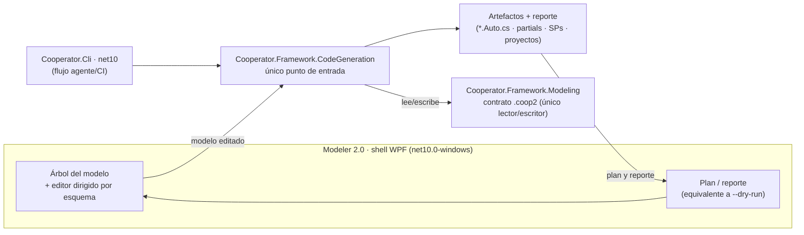

<!-- §3.15 language policy: YAML keys, status enums, IDs and section headings (##) in English (the schema);
     ADR title and prose in the project's content_language (devflow/LANGUAGE); `AITL-ADR-Approval` is never translated.
     ⚠️ AITL-ADR-Approval: this ADR stays a DRAFT — it cannot govern a SPEC, establish an NFR or authorize an
     exception — until an Architect / Tech Lead records the decision in the `review` block (§2.8, §3.5); no
     approval is inherited from related artifacts.
     ⚠️ ADR conflicts (§2.8): check the decision log for active ADRs contradicting this one before approval; a
     conflict is declared in `conflicts_with` and resolved by a superseding ADR.
     ⚠️ Content scope (§2.8): an ADR records architecture decisions and constraints, not functional behaviour —
     functional requirements live in the feature US and its ACs. -->

# ADR-009 — Shell del Modeler de Cooperator 2.0

| Field          | Value |
|----------------|-------|
| **Status**     | accepted |
| **Decision-makers** | architect, tech_lead |
| **Sources**    | REV-001 (aprobado 2026-10-15), ADR-001/ADR-002/ADR-003 (accepted) y ADR-004/ADR-007 (mismo ciclo) |
| **Supersedes** | None |
| **Conflicts with** | None — cierra el slot que ADR-001 §3.6 reservó (ítem 14) y el §3.6 de ADR-003, sin decidir la interfaz del motor (ADR-003) ni el formato del modelo (ADR-002); la suerte de F-34 (`SqlDataSourceEnumerator`) **no** se decide acá (DISC pendiente). La suerte de `ConnectionStringEncriptor` **sí** se decide acá (§3.6, revisada en la consolidación): sobrevive como shell delgado, **alineada con ADR-001 §3.1/§3.5**, que lo lista entre las aplicaciones que sobreviven |

---

## 1. Context

`REV-001` §6 ítem 14 ruteó a un ADR el camino del Modeler, con los hallazgos **F-33** (es una app WinForms clásica: `[STAThread]`, `Application.Run`, `TreeView` + `PropertyGrid`, `MessageBox` por doquier, metadata **ClickOnce**, `System.Deployment` referenciado y sin uso, serialización binaria del modelo), **F-35** (asociación de la extensión `.coop` escribiendo **HKCR** en runtime, con `System.Windows.Forms.Application.ExecutablePath` en el comando de apertura y el icono resuelto con `Library.IO.Path.AppPath`) y **F-38** (`Properties/Settings.Designer.cs` derivado de `System.Configuration.ApplicationSettingsBase`, un modelo de *settings* de usuario que **no existe** en .NET Core: no hay `user.config` ni almacén análogo).

**Contexto del dueño (fijo)**: el Modeler migra a **.NET 10**, uso **solo Windows**, con **WPF** como candidato de UI. Y del ciclo anterior: es **tooling `net10.0-windows`** (ADR-001 §3.1); el **motor es headless + CLI** y el Modeler es su **host**, de modo que la generación **no se reimplementa** en la UI ni el shell puede divergir del CLI (ADR-003 §3.1/§3.6); la configuración del shell sigue el modelo del ADR-004 §3.4 (`appsettings.json` + entorno, sin `ApplicationSettingsBase`); el conversor de connection strings pasa a **shell delgado o comando del CLI** (ADR-007 §3.5); y la distribución es `dotnet publish` self-contained, **sin ClickOnce**, con MSIX como opción para instalación y asociación (ADR-001 §3.5), dentro del canal cuyo dueño y fecha fijó ADR-001 §3.6.

**Dos hechos verificados que condicionan la decisión**:

- **La UX de edición legacy no es retargeteable tal cual.** El `PropertyGrid` del Modeler 1.4 mostraba el modelo *porque las clases del modelo llevaban atributos de diseñador* (`[Editor(typeof(...UITypeEditor))]`, `[Description]`, `[DefaultValue]`, `DesignerSerializationVisibility`) — y esos atributos **se eliminan** justamente para que el modelo sea portable (ADR-002 §3.1, F-27/F-28). Retargetear WinForms conservaría el control pero **no** la UX: el `PropertyGrid` aparecería casi vacío, sin los editores que hacían usable la edición. La decisión de UI tiene que ser explícita, no un arrastre.
- **Lo que sí es portable del tool viejo es poco y puntual**: abrir la solución generada (`GenerationDialog.cs:176/207` con `Process.Start`) y el link de "acerca de" (`About.cs:156`); ambos siguen funcionando en `net10.0-windows`, con la advertencia de que en .NET Core `UseShellExecute` cambia de default y debe declararse.

**Contexto de alcance**: **F-34** (enumerador `SqlDataSourceEnumerator`, Windows/SQL-Browser) está ruteado a un **DISC**: su suerte no se decide acá, pero el diseño **no puede depender** de esa respuesta. Las operaciones largas del tool (la enumeración y la generación) corrían en el hilo de UI; el shell no repite eso (NFR `shell-ui-responsiveness`).

**Frontera**: decide el stack del shell, cómo hospeda el flujo editar→generar del motor, la UX de edición del modelo, el estado/settings del usuario, la asociación del `.coop2`, la integración con el sistema y el empaquetado del tool. **No** decide el motor (ADR-003), el formato (ADR-002), la configuración del framework (ADR-004), la política criptográfica (ADR-007) ni F-34 (DISC).

---

## 2. Alternatives considered

### Alternative A — WPF (`net10.0-windows`) con editor dirigido por el esquema, sobre el motor headless (✅ Selected)

| Aspect   | Detail |
|----------|--------|
| **Pros** | Es la dirección del dueño y la que mejor encaja con un modelo que ya es **dato con esquema**: el editor se construye leyendo el contrato del `.coop2` (tipos, campos, valores) en lugar de depender de atributos de diseñador en las clases — que ya no existen. El shell queda como **host delgado**: edita el modelo, invoca el motor, muestra el reporte; cero lógica de generación. WPF es in-box en `net10.0-windows` (sin dependencias nuevas), moderno para layouts/DPI y sin el lastre de ClickOnce/`ApplicationSettingsBase`. |
| **Cons** | Se pierde lo que el `PropertyGrid` daba gratis (categorización, editores por tipo, "browsable"): hay que construir el editor y su validación en vivo. Es una UI **nueva**, no un retarget: el trabajo no es "portar pantallas" sino rediseñar la edición. |

### Alternative B — WinForms retarget a `net10.0-windows` (camino rápido)

| Aspect   | Detail |
|----------|--------|
| **Pros** | El camino de menor esfuerzo aparente: `Application.Run` y el `TreeView` sobreviven; el `PropertyGrid` está in-box; el equipo conoce el stack; los `Process.Start` son portables. |
| **Cons** | **La UX se rompe igual**: sin atributos de diseñador en el modelo, el `PropertyGrid` muestra propiedades sin editores ni descripciones, y reconstruir esa experiencia exige descriptores de tipo manuales — es decir, el mismo trabajo del editor propio, pero dentro de un stack que arrastra resolución de `EnableVisualStyles`/DPI, `ApplicationSettingsBase` (F-38) y el acoplamiento histórico UI↔modelo que este ciclo desarmó. Se cambia de plataforma sin ganar el rediseño. |

### Alternative C — CLI-only para 2.0.0 (postergar el shell)

| Aspect   | Detail |
|----------|--------|
| **Pros** | Máxima economía: el flujo agente y los pipelines quedan cubiertos por el CLI (ADR-003), y un modelo `.coop2` es texto editable con cualquier editor; el shell se decide más adelante con el motor ya probado. |
| **Cons** | El producto pierde su herramienta de edición: el árbol de entidades/propiedades/queries y la validación en vivo no tienen reemplazo en un editor de texto, y el dueño espera un Modeler. Posterga el problema en lugar de resolverlo, y con él la reescritura del editor (que no se abarata por esperar). |

### Alternative D — Shell sobre navegador (ASP.NET Core local + Blazor/servidor)

| Aspect   | Detail |
|----------|--------|
| **Pros** | UI moderna y multiplataforma; sirve a futuro si el modelo se editara en otro SO; reutiliza componentes web y el mismo motor headless. |
| **Cons** | Mete un servidor local y un navegador en una herramienta de escritorio **solo Windows** que debe instalarse y funcionar offline; complica el empaquetado (ADR-001 §3.5), la asociación de archivos y el arranque, y agrega una superficie de red local sin necesidad. Contradice la simplicidad buscada para un shell delgado. |

### Alternative E — WPF con el `PropertyGrid` de WinForms hosteado (`WindowsFormsHost`)

| Aspect   | Detail |
|----------|--------|
| **Pros** | "Lo mejor de ambos": UI nueva y el control de edición que ya existía, sin escribir el editor. |
| **Cons** | El control necesita los mismos atributos/descriptores que ya no están en el modelo, así que el ahorro es ilusorio; y a cambio se arrastra WinForms **dentro** de WPF (mensajería, DPI, temas) para un único control. Es la peor combinación de las dos alternativas anteriores. |

---

## 3. Decision

Se adopta la **Alternativa A**: el Modeler 2.0 es un **shell WPF (`net10.0-windows`)** que **hospeda el motor headless** y edita el modelo con un **editor dirigido por el esquema del `.coop2`**; su estado de usuario es **JSON por usuario**, la asociación del `.coop2` la aporta el **instalador** (nunca el runtime), y el tool se distribuye por `dotnet publish` self-contained con MSIX opcional.

### 3.1 Stack y arquitectura del shell

- **Stack**: WPF sobre `net10.0-windows` (ADR-001 §3.1). **Sin dependencias de terceros por defecto**: binding de WPF + view-models propios alcanzan para editar un modelo y disparar la generación; si un Bolt concluye que necesita un toolkit MVVM o un control de terceros, es una dependencia que entra con las reglas de ADR-001 §3.4 (licencia permisiva, versión fijada y centralizada) — no cambia el stack.
- **El shell es un host, no un motor**: referencia `Cooperator.Framework.CodeGeneration` **en proceso** y usa **el mismo punto de entrada tipado que el CLI** (ADR-003 §3.1). No hay `Process` intermedio para el camino normal, no hay lógica de generación en la UI y no puede existir una segunda implementación de generación.
- **El flujo es el del motor**: cargar/editar `.coop2` → pedir el **plan** (equivalente al `--dry-run`: qué se crea, qué se actualiza, qué se omite por ser editable, qué huérfanos se eliminan) → confirmar → generar → mostrar el **reporte** (con el mismo contenido que el reporte del CLI). La operación es **asíncrona y cancelable**: la lista de archivos se produce fuera del hilo de UI y la ventana nunca se congela (NFR `shell-ui-responsiveness`).
- **Handoff agente/humano**: el shell puede mostrar el **comando CLI equivalente** de lo que acaba de hacer (y copiarlo), para que quien quiera automatizar vea exactamente qué invocar; es el puente entre el flujo humano y el flujo agente de ADR-003, sin duplicar funcionalidad.

### 3.2 Edición del modelo

- **Forma**: árbol del modelo (entidades → propiedades/queries/relaciones) + panel de detalle del nodo seleccionado. El árbol sale del contrato del `.coop2` (ADR-002), no de atributos en las clases.
- **Editor dirigido por el esquema**: los tipos y campos editables se derivan del contrato de `Modeling`; se editan **valores**, nunca derivados (`fullGenerateAs`, predicados, conteos: se recalculan al leer, ADR-002 §3.1). Un campo que el esquema no declara no se puede inventar desde la UI.
- **Fuente de verdad del editor = el contrato versionado de `Modeling`** (no tipos hardcodeados en la UI): la lista de campos, sus tipos, sus opciones y sus enums salen del contrato del `.coop2` que expone el paquete, y se leen en tiempo de ejecución. Si el editor hardcodea un campo o un rango, queda desincronizado en la próxima subida de `schemaVersion` (ADR-002 §3.1) y el shell miente sobre lo que el formato admite; por eso la regla es dura: **cero duplicación del esquema en la UI**.
- **Cadena `Modeling` ↔ editor (criterio de aceptación del Bolt de `Modeling`)**: el editor **no puede degenerar en campos de texto libre**. Es **criterio de aceptación del Bolt de `Modeling`** que el contrato exponga lo necesario para editar de verdad: **enums reales** (no strings libres) para los campos enumerados del modelo, y la **tabla de mapeo tipos SQL↔CLR** (ADR-001 §3.1: fuente única del mapeo, dato portable) accesible para que el editor ofrezca y valide los tipos nativos/CLR de una propiedad. Si esa exposición faltara, el editor pierde fidelidad y el Bolt de `Modeling` **no está terminado** — la dependencia es explícita y con dueño.
- **Lectura/escritura por `Modeling`**: el shell **no** parsea ni escribe el JSON a mano (es el único lector/escritor del formato, ADR-002 §3.4). Así el archivo que produce el shell es byte-compatible con el que produce el CLI y con el que verifica el test bilateral.
- **Validación en vivo con las reglas del motor**: los chequeos que la UI muestra temprano (claves primarias que no resuelven, `childOf` fuera de candidatos, colisiones de nombre generado) son **los mismos** que valida el motor (ADR-003 §3.1); no se duplican reglas ni se inventan mensajes paralelos.
- **Límite declarado**: la fidelidad objetivo es "cubre lo que el esquema declara editable", **no** la paridad con el `PropertyGrid` de diseñador del 1.4 (categorías, atributos, editores por tipo). Esa experiencia estaba construida sobre atributos que el modelo ya no lleva; recuperarla entera no es un objetivo de la 2.0 y debe decirlo la documentación del tool.

### 3.3 Estado del usuario y settings (F-38)

- **`settings.json` por usuario**, junto a los datos del usuario (`%APPDATA%\<producto>\settings.json`, UTF-8 sin BOM), leído y escrito **por el shell** (ni por el framework ni por las librerías). Se elimina `ApplicationSettingsBase`, `Settings.Designer.cs` y toda expectativa de `user.config`.
- **Qué guarda**: estado de UI (tamaño/posición de ventanas, columnas), último modelo abierto y **lista de recientes**, carpeta de plantillas *override* (ADR-003 §3.5), preferencias de generación (p. ej. si pedir confirmación), y el **label** del último servidor/entorno usado si se decide ofrecerlo como comodidad.
- **Qué NO guarda** (NFR `shell-state-secret-free`): **ningún secreto** — ni connection strings, ni valores protegidos, ni material de claves (ADR-007 §3.2). La cadena de conexión se resuelve por la **configuración portable** (ADR-004 §3.2) o por un valor protegido (ADR-007), y el shell la pide **en memoria** para conectarse; si el usuario quiere recordarla, la recordará el almacén de configuración, no el archivo de estado de la UI.
- **Nada de Registro** para estado de la aplicación: el shell no escribe HKCU/HKLM para sus preferencias (la única interacción con el sistema es la de §3.5).
- **Formato de configuración de la aplicación**: la del **shell** es la del ADR-004 §3.4 (`appsettings.json` + variables de entorno, precedencia entorno > archivo); el shell la arma y la pasa al motor y a `Modeling` cuando haga falta, igual que una app generada.

### 3.4 Asociación del `.coop2` y rutas (F-35)

- **La asociación la aporta el instalador**, no la aplicación: se elimina `FileExtensionAssociation` y con él la escritura de **HKCR** en runtime (que hoy exige privilegios y ata la asociación a la ejecución del tool). Con MSIX la asociación es declarativa; si la distribución es "carpeta + zip" (ADR-001 §3.5), la asociación es un paso **documentado de instalación** para el usuario o el administrador.
- **El shell funciona sin asociación**: siempre se puede abrir un `.coop2` por el diálogo de archivos o por argumento de línea de comandos (el único punto de automatización que el tool tenía en 1.4, `MainForm.cs:509-512`, ahora es el CLI y el argumento sigue siendo una comodidad).
- **Rutas por BCL, no por la API de WinForms**: `Environment.ProcessPath` para el ejecutable y `AppContext.BaseDirectory` para la carpeta de la aplicación. Se retiran `Application.ExecutablePath` (F-35) y cualquier uso de `Assembly.Location` (que devuelve vacío en escenarios single-file, F-25) — y `Library.IO.Path.AppPath` deja de ser necesaria para el tooling (la librería es portable, ADR-001).
- **El icono y el ProgID** son recursos del paquete de instalación, no valores que la app escriba en el Registro.

### 3.5 Integración con el sistema y `Process.Start` (F-33)

- **Se conserva** lo portable y útil: abrir la **solución/carpeta generada** y el enlace de "acerca de" (licencia/proyecto). Ambos pasan a `Process.Start` con **`UseShellExecute = true` explícito**: en .NET Core el default es `false` y sin declararlo el comportamiento cambia (no se resuelve con el shell del SO). Sin asumir Visual Studio: se abre con la asociación del SO, y si no hay ninguna, el shell lo dice.
- **Se elimina** lo que era Windows-only innecesario o dependiente de APIs muertas: `Application.EnableVisualStyles`, `Application.DoEvents`, `System.Deployment`/ClickOnce, `System.Windows.Forms` en el tooling, y las referencias muertas que el ADR-001 §3.3 ya ordena limpiar en todo el árbol.
- **Diagnóstico**: los errores se muestran en el shell **y** se registran en un archivo de log por usuario (`%LOCALAPPDATA%`), con la abstracción de logging que reemplazó al Event Log (ADR-001 §3.5: el Event Log se elimina; el shell nunca escribe en él). El registro es lo que permite diagnosticar un fallo de generación sin pedirle al usuario que reproduzca la sesión.

### 3.6 Empaquetado y distribución

- **`dotnet publish` self-contained `win-x64`** como canal primario (ADR-001 §3.5), en la carpeta/zip que ya define la distribución del tooling; **MSIX** queda como opción cuando se necesiten instalación y asociación declarativa de archivos. **Sin ClickOnce** (F-36) y sin instalador propio.
- **El shell viaja con el motor**: referencia los paquetes `CodeGeneration`/`Modeling` y las librerías, y el **CLI** puede distribuirse junto al shell (mismo payload) para que el flujo agente esté disponible en la misma instalación. El folder feed con los `.nupkg` para las apps generadas lo define ADR-001 §3.1.
- **La firma/Authenticode y el canal** no se deciden acá: son de la capa de empaquetado, con dueño y fecha en ADR-001 §3.6.
- **`ConnectionStringEncriptor` sobrevive como aplicación**: es un **shell delgado `net10.0-windows`** sobre el mismo motor de protección (ADR-007 §3.5) —protege escribiendo un valor `aesgcm:` con la clave activa, sin clave embebida— y **no** se retira; ADR-001 §3.1/§3.5 lo listan entre las aplicaciones que sobreviven al ciclo (junto con el shell del Modeler y el migrador `net48`). El **comando del CLI es aditivo**, no sustituto: existe para agentes y pipelines (donde una app de escritorio no sirve), y ambos consumen la misma implementación de protección — no hay dos implementaciones ni dos formatos. Su UI se mantiene mínima (su función es de un solo paso) y sigue sin decidirse acá el detalle de pantallas.

### 3.7 F-34 (no decidido acá) y operaciones largas

- El shell **no depende** del enumerador de servidores: la **entrada manual** de servidor/base/conexión es la línea base funcional, y el diseño del flujo de conexión no se bloquea si el DISC concluye que la función no se conserva.
- Si el DISC la confirma, se implementa como **conveniencia Windows-only detrás de un chequeo de sistema** (el equivalente moderno es `Microsoft.Data.Sql.SqlDataSourceEnumerator`, ADR-005 §3.1) y **fuera del hilo de UI** (era el otro punto de bloqueo del tool legacy, F-34): la enumeración corre en background con cancelación, como la generación de §3.1.

### 3.8 Interplay con ADR-001, ADR-002, ADR-003, ADR-004 y ADR-007

- **ADR-001**: consume el slot del shell (§3.6), respeta el TFM y la política de dependencias (§3.1/§3.4) y no agrega paquetes a la capa portable.
- **ADR-002**: el shell es un **cliente del contrato**, no un segundo lector del formato; el editor no edita derivados (la regla de "los derivados se recalculan al leer" es lo que hace posible el editor dirigido por esquema) y **toma del contrato versionado de `Modeling`** la lista de campos, tipos, opciones y enums (§3.2). La cadena es de doble mano y está explícita: la **riqueza del contrato** (enums reales + tabla de mapeo SQL↔CLR accesible) es **criterio de aceptación del Bolt de `Modeling`**, porque sin ella el editor de este ADR degenera en campos de texto libre; y el editor **no** hardcodea el esquema, porque eso lo deja mintiendo en cada subida de `schemaVersion`.
- **ADR-003**: el shell **hospeda** el motor; su UI y sus comandos no se duplican (§3.4 de ADR-003) y el set de plantillas sigue siendo del motor.
- **ADR-004**: la configuración del shell y el estado del usuario siguen su §3.4 (JSON + entorno, sin `ApplicationSettingsBase`).
- **ADR-007**: nada de secretos en el estado del shell; la protección de valores es del resolutor, y `ConnectionStringEncriptor` **sobrevive** como shell delgado del mismo motor (§3.6).

---

## 4. Consequences

**Positive:**

- El shell queda **delgado y sin lógica de generación**: la misma implementación produce lo que produce el CLI, y el humano ve el plan y el reporte antes y después de generar.
- La edición se apoya en el **esquema del `.coop2`** en lugar de atributos de diseñador: es la única forma coherente con un modelo que el ciclo anterior volvió portable, y el editor gana la validación del motor en lugar de tener reglas propias.
- Desaparecen tres lastres del tool legacy: el estado en Registro (`ApplicationSettingsBase`/`user.config`), la escritura de asociaciones en HKCR desde la aplicación, y las APIs de WinForms/ClickOnce.
- El usuario ve su estado recordado en un archivo JSON legible, y **ningún secreto** en él: la separación entre "preferencias de UI" y "credenciales" queda explícita.
- El trabajo se puede paralelizar y verificar por partes (editor, flujo de generación, settings, empaquetado) con el motor ya probado, sin que la UI bloquee el resto.

**Trade-offs:**

- **No es un retarget, es una UI nueva**: el esfuerzo del editor dirigido por esquema es trabajo real y hay que asumirlo como tal; el camino WinForms parecía más corto sólo hasta que se comprueba que el `PropertyGrid` ya no tiene de dónde leer su experiencia.
- Los usuarios actuales del Modeler pierden comodidades del tool viejo (categorías de propiedades, editores específicos por campo, orden histórico del árbol si cambiara): hay que documentar la diferencia para que no se lea como regresión.
- La asociación de archivos deja de ser una acción del usuario dentro de la app: quien no instale por MSIX tiene que hacer el paso de asociación a mano (documentado).
- Se agrega un archivo de log por usuario (y su política de tamaño/rotación) como parte del tool.
- El shell no puede resolver por sí solo un modelo que el esquema no pueda expresar: si la edición necesitara un campo nuevo, el camino es el ADR-002 (subida de `schemaVersion`), no un campo oculto en la UI.

**Technical debt:**

- El **editor dirigido por esquema** es nuevo y sin historial: su fidelidad y sus bordes (campos opcionales, valores inválidos, edición concurrente con el CLI) se descubren en uso; el arnés debe cubrir el round-trip editar→guardar→generar sobre el modelo de referencia (F-50).
- La UI no tiene paridad declarada con el tool 1.4: hasta que exista documentación de diferencias, cada usuario la descubrirá por su cuenta.
- Los *settings* del shell quedan con formato propio (versionado por el propio archivo): su evolución no está gobernada por ningún esquema, así que un cambio de forma debe manejar el archivo viejo o descartarlo explícitamente.
- La integración con el shell del SO (`UseShellExecute` + asociaciones del usuario) es dependiente del entorno: sin VS ni asociación, "abrir la solución" degrada a "abrir la carpeta", y eso debe estar previsto en el mensaje.
- F-34 sigue abierto como DISC: si su conclusión es "se conserva", su implementación entra como feature con su propio Bolt sobre este diseño (background + check de SO), sin reabrir el shell.

---

## 5. Applicable NFRs

| NFR | Description | Threshold | How it is measured |
|-----|-------------|-----------|-------------------|
| Shell UI responsiveness | El shell nunca bloquea su hilo de UI en operaciones largas (generación, enumeración, E/S de modelo) y permite cancelarlas | **0** operaciones de generación o de E/S prolongada ejecutadas en el hilo de UI; toda operación larga es cancelable y reporta progreso | Revisión de código (patrón asíncrono + `CancellationToken` en el punto de entrada del motor) + prueba de aceptación manual sobre el modelo de referencia: la ventana responde y la cancelación deja el workspace consistente |
| Shell state secret-free | El estado persistido del shell no contiene credenciales ni material secreto | **0** connection strings, valores protegidos o claves en `settings.json` y en los logs del shell | Test del arnés que opera el flujo (abrir, conectar, generar y cerrar) e inspecciona el archivo de estado y el log buscando material de conexión/clave; revisión de los campos persistidos |

---

## 6. References

- [`REV-001`](../reviews/REV-001-analisis-migracion-cooperator.md) — revisión aprobada el 2026-10-15; §6 ítem 14; hallazgos F-33 (WinForms + Registro + ClickOnce + serialización binaria; `Process.Start` portable en `GenerationDialog.cs:176/207`), F-35 (asociación `.coop` en HKCR con `Application.ExecutablePath` e `Library.IO.Path.AppPath`), F-38 (`ApplicationSettingsBase`, sin modelo equivalente en .NET Core) y F-34 (enumerador de servidores, **DISC**, fuera de alcance); F-25 (`Assembly.Location` vacío en single-file) y F-27/F-28 (modelo desacoplado de la UI) como contexto.
- [`ADR-001`](ADR-001-layout-y-empaquetado-cooperator-2.md) — accepted: shell como tooling `net10.0-windows` (§3.1), política de dependencias (§3.4), distribución sin ClickOnce y MSIX opcional con dueño y fecha del canal (§3.5/§3.6).
- [`ADR-002`](ADR-002-formato-coop2-y-migrador.md) — accepted: el contrato `.coop2`, los derivados recalculados al leer y `Modeling` como único lector/escritor.
- [`ADR-003`](ADR-003-motor-scriban-headless-y-cli.md) — accepted: motor headless + CLI con un único punto de entrada tipado, plan/`--dry-run`, reporte y determinismo; el Modeler como host (§3.6).
- [`ADR-004`](ADR-004-cache-y-configuracion.md) — configuración por `appsettings.json` + entorno (§3.4) y vencimiento de la excepción transitoria.
- [`ADR-007`](ADR-007-politica-criptografica.md) — el conversor de connection strings se resuelve como comando del CLI (aditivo) y `ConnectionStringEncriptor` sobrevive como shell delgado (§3.5/§3.6); nada de secretos en estado/archivos (§3.2).
- Evidencia de código 1.4: `Tools/CooperatorModeler/FileExtensionAssociation.cs` (HKCR, `Application.ExecutablePath`, icono por `Path.AppPath`), `Properties/Settings.Designer.cs` (`ApplicationSettingsBase`), `GenerationDialog.cs:176/207` y `About.cs:156` (`Process.Start`), `Program.cs:44` (`EnableVisualStyles`), `MainForm.cs:509-512` (apertura por argumento).

---

## 7. AITL-ADR-Approval

> **AITL-ADR-Approval** (Avenga DevFlow §2.8, §3.0, §3.5). An ADR does not
> become `accepted` — and therefore governing — without the approval of an
> Architect / Tech Lead. This ADR is the **source of truth for its own
> approval** (recorded in the `review` frontmatter block with review
> evidence); when it governs a SPEC revision, its path appears in that
> revision's `sources`. ADR approvals are never copied to the Bolt manifest.

| Field | Value |
|-------|-------|
| **Architect / Tech Lead** | `human:eugenioserrano` |
| **Role** | tech_lead |
| **Decision** | **approved** |
| **review_ready_at** | `2026-10-15T23:06:38-03:00` |
| **review.started_at** | `2026-10-15T23:11:40-03:00` |
| **review.decided_at** | `2026-10-15T23:11:40-03:00` |
| **Findings** | Sin hallazgos adicionales — `acknowledged_without_comment: true` (motivo en el frontmatter) |
