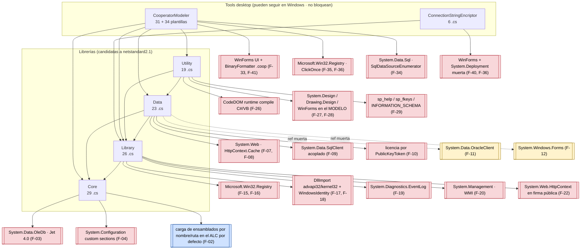

<!--
  LANGUAGE POLICY (§3.15): YAML keys, status enums, IDs y headings (##) en
  inglés (el schema). La prosa va en content_language = es.

  ⚠️ AITL-REV-Approval (§2.14, §3.0): los findings quedan DRAFT hasta que un
  humano calificado registre AITL-REV-Approval. La aprobación NO aprueba
  ningún artefacto aguas abajo. Todo cambio de código requiere Bolt aprobado
  (T10 — nunca REV → SPEC directo).
-->

# REV-001 — Análisis de migración de Cooperator 1.4 a .NET Standard 2.1 — inventario de bloqueantes Windows

| Field           | Value |
|-----------------|-------|
| **Scope**       | Las 4 librerías del framework (`Core`, `Data`, `Library`, `Utility`) y las 2 herramientas desktop (`CooperatorModeler`, `ConnectionStringEncriptor`) de `1.4/` |
| **Methodology** | Inspección estática de fuente + barrido de referencias/API con grep + lectura de csproj/sln/app.config + clasificación A/B/C/D contra la superficie de .NET Standard 2.1 |
| **Criteria**    | Superficie de API de .NET Standard 2.1 (lente de la 2.0), regla del humano "Modeler/Encriptor pueden seguir en Windows y no bloquean las librerías", y los 5 datos de dependencias provistos como hipótesis a verificar |

---

## 1. Purpose

Antes de abrir el ciclo de la **versión 2.0 sobre .NET Standard 2.1**, necesitamos saber exactamente qué parte del código de Cooperator 1.4 es **portable tal cual**, qué parte es **portable con cambios**, qué parte es **Windows-exclusiva y no migrable**, y qué parte es **herramienta desktop Windows** que no bloquea a las librerías. Este REV existe para producir ese inventario de forma verificable (archivo + línea + evidencia), de modo que las decisiones posteriores (TFM, particionado de paquetes, formato `.coop`) puedan resolverse con datos y no con supuestos.

Segundo objetivo: caracterizar el **mecanismo real de persistencia del modelo del Modeler (`.coop`)** y evaluar el pedido explícito del humano de migrarlo a un **formato texto agente-amigable (JSON)** para dejar de versionar binarios imposibles de mergear.

Este REV **no** decide la arquitectura de la 2.0 ni propone SPECs: clasifica y rutea.

---

## 2. Artifacts reviewed

| Artifact | Files | Notes |
|----------|-------|-------|
| `Cooperator.Framework.Core` | 29 `.cs` + 1 `.csproj` + `CooperatorFramework.snk` | Firmado (`SignAssembly=true`), TFM v4.8. |
| `Cooperator.Framework.Data` | 23 `.cs` + 1 `.csproj` + `.snk` | Firmado, TFM v4.8. Depende de Core y Library. |
| `Cooperator.Framework.Library` | 26 `.cs` + 1 `.csproj` + `.snk` | Firmado, TFM v4.8. Depende de Core. |
| `Cooperator.Framework.Utility` | 19 `.cs` + 1 `.csproj` + `.snk` | **No firmado** (`SignAssembly=false`) pero con `AssemblyOriginatorKeyFile`; TFM v4.8. Depende de Data y Library. |
| `Tools/CooperatorModeler` | 31 `.cs` no-plantilla + 34 `.cs` de plantilla + csproj/sln/resx/ico | `WinExe`, TFM v4.8, metadata ClickOnce. |
| `Tools/ConnectionStringEncriptor` | 6 `.cs` + csproj/sln | `WinExe`, TFM v4.8, metadata ClickOnce. |
| Solución / build | `Framework.sln`, 6 `.csproj`, `app.config` ×2, `Templates\**` (`.csproj`, `.vbproj`, `.sln`, SQL, VB) | VS 2022/18 format 12.00; configs `Any CPU/x86/Mixed Platforms/.NET`. |
| Total fuente real | **168 `.cs`** (excluye `bin/`, `obj/`, `.vs/`) | Coincide con la estimación del run. |

---

## 3. Severity legend

| Category | Meaning |
|----------|---------|
| **Compliant** | Implementado correctamente per ADR / estándar (acá: ya portable a netstandard2.1 sin cambios) |
| **Documented deviation** | Diferencia justificada, registrada en MEM |
| **Minor gap** | Inconsistencia sin impacto funcional, reduce calidad (acá: referencia muerta, fricción de migración trivial) |
| **Major gap** | Problema que puede causar errores en runtime o exposición de seguridad (acá: bloqueante de compilación/runtime sobre netstandard2.1 o Windows-exclusividad no aislada) |

> Nota de uso: en este REV la etiqueta "Major gap" se aplica también a **bloqueantes de portabilidad verificados** (compilación imposible o API inexistente en el TFM objetivo), porque su consecuencia práctica es un runtime roto si se retargetea sin resolverlos. La severidad propuesta es opinable y el aprobador puede corregirla (§2.16).

---

## 4. Findings

### 4.1 — Cooperator.Framework.Core

#### F-01 [Compliant] — El Core es la única capa sin superficie Windows en código

**Location:** `1.4/Cooperator.Framework.Core/**` (29 `.cs`)
**Actual:** Ningún archivo usa WinForms, Registry, WMI, DllImport, `System.Web` ni CodeDOM. Sólo `System`, `System.Data` (DataSet/DataTable), `System.ComponentModel`, `System.Reflection`, `System.Runtime.Serialization` y `System.Security.Cryptography` en `Utility`/`ValuesGenerator`.
**Expected:** Se mantiene como el paquete base `netstandard2.1` de la 2.0.
**Impact:** Ninguno — es el punto de partida más barato de la migración.
**Recommendation:** Retargetear Core primero como piloto; sirve de "canario" para validar el pipeline de build de la 2.0.

#### F-02 [Major gap] — Resolución de ensamblados por nombre/ruta: riesgo de fallo silencioso del LazyLoad en el modelo de carga de .NET Core

**Location:** `1.4/Cooperator.Framework.Core/Factory/Factories.cs` línea 70 (`Assembly.LoadFrom(assemblyPath + assemblyName)`) y línea 53 (`Assembly.Load(assemblyName)`); consumidor aguas arriba: `LazyLoad/LazyProviderFactory.cs:46-49` → `FactoryCache.Get(...)`
**Actual:** `SingleFactory.CreateObject(path, assemblyName, className)` carga por ruta con `Assembly.LoadFrom`, y `FactoryCache` (líneas 100+) resuelve `ILazyProvider` **por nombre simple** (sin `AssemblyName` completo, sin ruta) vía `Assembly.Load(assemblyName)`. `Assembly.LoadFrom(String)` **sí existe** en la superficie de netstandard2.0/2.1 — esto **no** es un bloqueante de compilación; la revisión pre-aprobación lo confirmó.
**Expected:** Carga explícita y verificable en el TFM objetivo (`AssemblyLoadContext.Default.LoadFromAssemblyPath(...)` con ruta absoluta, o `Assembly.Load(AssemblyName)` con nombre calificado), con error diagnóstico cuando el provider no se encuentra.
**Impact:** El problema es **comportamental, no de compilación**: (1) `Assembly.Load("miAssembly")` construye un `AssemblyName` parcial que se resuelve contra el ALC por defecto y **no sondea `BaseDirectory`/directorio de la app** como hacía el modelo de `AppDomain` de .NET Framework — el LazyLoad configurado por nombre puede dejar de encontrar providers; (2) si el provider no resuelve, la cadena actual falla al instanciar en un punto lejano al de la configuración, dificultando el diagnóstico; (3) el `AssemblyLoadContext` efectivo cambia según el host (IIS, plugin, test runner, single-file). Sigue siendo **Major gap** por el criterio del propio REV (§3: "puede causar errores en runtime"): el fallo es silencioso y aparece en producción, no en el build.
**Recommendation:** ADR sobre el mecanismo de carga de providers Lazy en la 2.0 (nombre calificado + ruta explícita + `AssemblyLoadContext` bien elegido), encapsulado detrás de una interfaz propia en lugar de exponer `Assembly` en la API; **Bolt** que lo implemente junto con un test que verifique la resolución del provider en el ALC del host (incluye el caso single-file). *(El LazyLoad por configuración es F-04.)*

#### F-03 [Major gap] — Export a Excel con `System.Data.OleDb` + provider Jet 4.0 (Windows y 32-bit)

**Location:** `1.4/Cooperator.Framework.Core/ObjectListHelper.cs` líneas 30, 117-135 (`OleDbConnection`, `Provider=Microsoft.Jet.OLEDB.4.0; … Extended Properties="Excel 8.0;HDR=YES"`)
**Actual:** `ObjectListHelper<T,T2>.CreateExcelFile()` crea un archivo Excel abriendo una conexión OleDb contra `*.xls` con el driver Jet, bajo lock estático (línea 104, 112).
**Expected:** Export a Excel sin dependencia de OLE DB Jet (p. ej. `ClosedXML`/`OpenXml`/`System.Text.Json`+CSV), o moverlo a un paquete `Cooperator.Framework.Core-windows`.
**Impact:** `System.Data.OleDb` no está en netstandard2.1 y Jet es 32-bit-only; además, sobre hosts de 64 bits falla en runtime aunque compile. Es el único bloqueante Windows del Core.
**Recommendation:** **Decisión OQ-005 (2026-10-15): la feature se depreca en la 2.0** — `CreateExcelFile` se retira del framework (no hay paquete `-windows` ni reescritura; quien necesite exportar lo resuelve en su capa). Efecto colateral buscado: Core queda 100% portable.

#### F-04 [Major gap] — `System.Configuration` con secciones custom + `OpenMappedExeConfiguration` para el LazyLoad

**Location:** `1.4/Cooperator.Framework.Core/LazyLoad/LazyProviderFactoryConfigHelper.cs` líneas 293-341 (`ProvidersSection : ConfigurationSection`), 405-416 (`Configuration.Save(Full)`), 423-466 (`ConfigurationManager.OpenMappedExeConfiguration` + `ExeConfigurationFileMap`)
**Actual:** El Core lee/escribe el `.config` del ejecutable host (grupo "LazyLoad" + sección "ProvidersSection"), y si no existe la **crea y la persiste** (`CreateEmpty()`), usando `AppDomain.CurrentDomain.BaseDirectory`/`FriendlyName` para derivar la ruta (líneas 449-451).
**Expected:** Configuración portable (JSON + `Microsoft.Extensions.Configuration`) o, si se conserva `.config`, limitarse a APIs soportadas fuera de Windows.
**Impact:** `OpenMappedExeConfiguration`/`ExeConfigurationFileMap` son desktop-Windows: en netstandard2.1/NuGet `System.Configuration.ConfigurationManager` no están disponibles. Además, **una librería que reescribe el `.config` de la app host** es un side-effect invasivo que en .NET Core (sin `app.config` real para librerías) no tiene equivalente.
**Recommendation:** ADR de configuración para la 2.0 (se propone `Microsoft.Extensions.Configuration` con un archivo JSON propio del Modeler); sacar del Core la escritura de configuración.

#### F-05 [Minor gap] — `[Serializable]` + constructores `SerializationInfo` en toda la jerarquía de objetos y excepciones

**Location:** `1.4/Cooperator.Framework.Core/BaseObject.cs:64`; `Exceptions/*.cs` (7 archivos, patrón `protected Xxx(SerializationInfo, StreamingContext)` + `[Serializable]`); mismo patrón replicado en Data, Library y Utility.
**Actual:** Publicación de serialización binaria histórica como parte de la superficie pública.
**Expected:** En la 2.0, o bien se mantiene sólo por compatibilidad (consciente de `SYSLIB0051`), o se migra a serialización explícita (JSON/contratos).
**Impact:** Compila en netstandard2.1, pero emite obsolescencia y perpetúa la dependencia conceptual de `BinaryFormatter` (bloqueante real en .NET 8/9 — ver F-42/F-43).
**Recommendation:** Decisión de compatibilidad de API en el ADR de la 2.0; `[Serializable]` puede permanecer si no hay intención de romper binarios, pero **no** debe ser el mecanismo de persistencia de nada nuevo.

#### F-06 [Compliant] — `ObjectListView<T>` (IBindingListView), `ValuesGenerator`, `UniqueIdentifierHelper`, `SecurityRights`, `ObjectState*`

**Location:** `BaseObjectListView.cs`, `ValuesGenerator.cs`, `UniqueIdentifierHelper.cs`, `SecurityRights.cs`, `ObjectState.cs`, `ObjectStateHelper.cs`, `DescriptionFieldEventArg.cs`
**Actual:** Sólo usan `System.ComponentModel` (`IBindingListView`, `ListSortDescription`, `PropertyDescriptor`), `Reflection` y tipos BCL presentes en netstandard2.1. La sobrecarga `Sort(string property, bool descending)` y el filtro por expresión textual (`"deleted=false"`, `BaseObjectListView.cs:68`) son portables.
**Expected:** Migran sin cambios.
**Impact:** Ninguno.
**Recommendation:** Ninguna acción.

---

### 4.2 — Cooperator.Framework.Data

#### F-07 [Major gap] — Caché de colecciones acoplada a `System.Web` (variante web compartida; variante de escritorio en memoria)

**Location:** `1.4/Cooperator.Framework.Data/BaseGateway.cs` líneas 36, 112, 316-338, 363-468; `1.4/Cooperator.Framework.Data/BaseLoader.cs` líneas 34, 183-289
**Actual:** El caché de `GetAll` / `GetAllDictionary` tiene **dos variantes según el host**: en web usa `HttpContext.Current.Cache` (compartido entre instancias, expiración 1 h, `CacheItemPriority.High`); **en escritorio (sin `HttpContext`) usa campos de instancia en memoria** — el setter asigna `_getAllCache = value` / `_getAllCacheDictionary = value` cuando `HttpContext.Current == null` (líneas 391-394, 445-448), sin expiración ni compartición entre instancias. La invalidación replica el corte en ambos caminos (líneas 316-338).
**Expected:** Abstracción de caché propia (`ICacheProvider`) con una implementación **en memoria por defecto** para todos los hosts y adaptadores intercambiables (Redis, etc.).
**Impact:** `System.Web` no existe en netstandard2.1 — es el bloqueante más grande de Data: sin extraer esta dependencia, el paquete no compila. *(Corrección factual 2026-10-15 — señalada por el dueño del producto y verificada en código: el caché de escritorio **sí ocurre** en memoria, por instancia; al unificar bajo un provider compartido cambian su alcance (entre instancias) y su TTL — cambio de comportamiento a documentar.)*
**Recommendation:** ADR de caché (`ICacheProvider` + implementación en memoria por defecto + adaptadores por configuración: Redis, etc.) + Bolt que lo introduzca y sustituya los ~40 puntos de uso en Data.

#### F-08 [Major gap] — `System.Web.Caching` también en el helper de acceso a datos (`SQLHelper`, `SqlHelperParameterCache`)

**Location:** `1.4/Cooperator.Framework.Data/SQLHelper.cs` líneas 31, 66-76; `1.4/Cooperator.Framework.Data/SqlHelperParameterCache.cs` líneas 30, 46-63
**Actual:** El timeout de comandos se lee de `ConfigurationManager.AppSettings["CooperatorCommandTimeOut"]` y se cachea en `HttpContext.Current.Cache`; el caché de parámetros de SP es un **`Hashtable` estático sincronizado** (`_paramCache`) que funciona en cualquier host y, **cuando hay `HttpContext`, además se registra/lee en `HttpContext.Current.Cache`** (clave `"Cooperator_DAL_SP_Params_Cache"`, expiración 1 día — líneas 46-63). *(Corrección factual 2026-10-15: el caché de parámetros no depende de web para funcionar; la dependencia de `System.Web` es de compilación/retargeteo.)*
**Expected:** Igual que F-07 — caché abstracta (`ICacheProvider`); el timeout desde una fuente de configuración portable.
**Impact:** El `SQLHelper` (2532 líneas, derivado del Data Access Application Block de MS) arrastra `System.Web` y `System.Configuration` en su núcleo → mismo bloqueo de compilación.
**Recommendation:** Igual que F-07; este archivo es además candidato a reemplazo por `Microsoft.Data.SqlClient` + un helper propio (ver F-09).

#### F-09 [Major gap] — Acoplamiento duro a `System.Data.SqlClient` y casts de `DbTransaction`→`SqlTransaction`

**Location:** `BaseRule.cs` líneas 33, 168-436; `BaseGateway.cs` líneas 32, 640 (`SqlHelper.ExecuteNonQuery((SqlTransaction)transaction, …)`), 653, 1371 (`catch (SqlException)`); `SQLHelper.cs`/`SqlHelperParameterCache.cs` (todo el archivo)
**Actual:** Aunque existen `IBaseGateway.cs` y `BaseRule` con `DbTransaction`/`DbConnection` (líneas 141-157), las firmas públicas reciben `DbTransaction` y hacen **cast duro** a `SqlTransaction` para llamar a `SqlHelper`; los tipos `SqlConnection`/`SqlParameter` aparecen en toda la API.
**Expected:** O bien proveedor único declarado explícitamente (`Microsoft.Data.SqlClient` en la 2.0), o abstracción vía `DbProviderFactory` con los `SqlHelper` genéricos.
**Impact:** El cast rompe el propósito del `DbProviderFactory` y hace que cualquier provider alternativo (Oracle, SQLite) explote en runtime; además `System.Data.SqlClient` está en modo de mantenimiento (recomendado `Microsoft.Data.SqlClient`), con cambio de namespace y de comportamiento en tipos de parámetros.
**Recommendation:** ADR "provider de datos de la 2.0" (recomiendo `Microsoft.Data.SqlClient` único + eliminar los casts y tipar `SqlHelper` sobre `DbCommand`/`SqlCommand` de forma explícita). Es prerequisito de cualquier soporte multi-DB.

#### F-10 [Major gap] — Gate de licenciamiento por `PublicKeyToken` del assembly de entrada (strong-name)

**Location:** `1.4/Cooperator.Framework.Data/BaseGateway.cs` líneas 94-137 (`CheckForToken`, `GetAssemblyToken`) y 139-155 (`GetEntryAssemblyTokenString`); contraparte en las plantillas: `Templates/CSharpClasses/Gateway.Auto.cs` (implementa `GetAssemblyToken`) y `Snapshot.GenerateCheckForToken`
**Actual:** Con un contador estático que corta el chequeo luego de 200 llamadas, cada Gateway compara el `PublicKeyToken` del assembly de entrada contra un token embebido en el código generado y lanza `InsufficientSecurityRightsException` si no coincide; si `Assembly.GetEntryAssembly()` es null (tests, IIS, algunos hosts), el chequeo se saltea silenciosamente.
**Expected:** Un mecanismo de licenciamiento explícito y portable (o su remoción) en la 2.0.
**Impact:** Depende de strong-naming y del concepto de "assembly de entrada", que se comporta distinto en .NET Core/5+ (null en IIS/hosts con carga dinámica, `Assembly.GetEntryAssembly()` cambia en single-file/AOT). Riesgo de **falsos positivos y falsos negativos**: apps legítimas podrían quedar bloqueadas o, peor, el gate podría saltearse entero. El strong-name en sí sigue soportado, pero la **identidad por token es una decisión de arquitectura**, no un detalle.
**Recommendation:** **Decisión OQ-003 (2026-10-15): el gate se retira en la 2.0** (era detección de manipulación, no licenciamiento comercial). El retiro lo documenta el ADR de empaquetado (naming/firma/coexistencia — ver F-45); la firma de ensamblados se mantiene como identidad.

#### F-11 [Minor gap] — Referencia muerta a `System.Data.OracleClient` (Oracle nunca se implementó)

**Location:** `1.4/Cooperator.Framework.Data/Cooperator.Framework.Data.csproj` (`<Reference Include="System.Data.OracleClient" />`); contraparte `1.4/Tools/CooperatorModeler/ScriptorProviders/OracleScriptor.cs:43` (`// falta implementar`), `CooperatorModeler.csproj` compila `OracleScriptor.cs` y no referencia OracleClient
**Actual:** Cero usos de tipos `Oracle*` en los 168 `.cs` (verificado con grep). La clase `OracleScriptor` es un esqueleto vacío.
**Expected:** Sin referencias a ensamblados que el runtime objetivo no provee.
**Impact:** `System.Data.OracleClient` está **deprecado y removido** del ecosistema moderno; al retargetear es un error de compilación/port trivial de eliminar, pero deja una promesa de producto sin cumplir (¿la 2.0 soporta Oracle?).
**Recommendation:** Eliminar la referencia; si Oracle es alcance de la 2.0, es una feature nueva a decidir (independiente del acoplamiento actual).

#### F-12 [Minor gap] — Referencia muerta a `System.Windows.Forms` en Data

**Location:** `1.4/Cooperator.Framework.Data/Cooperator.Framework.Data.csproj` (`<Reference Include="System.Windows.Forms" />`)
**Actual:** Ningún `.cs` de Data usa `System.Windows.Forms` (verificado con grep sobre `Forms`, `MessageBox`, `Application.`).
**Expected:** Sin referencias a UI en la capa de datos.
**Impact:** Bloquea el retargeteo a netstandard2.1 por una línea de csproj; contaminación de la capa de datos (dependencia conceptual UI→DA).
**Recommendation:** Eliminar. Es un cambio de una línea, sin riesgo.

#### F-13 [Major gap] — Connection string desde `ConfigurationManager.ConnectionStrings` con descifrado heurístico

**Location:** `1.4/Cooperator.Framework.Data/BaseRule.cs` líneas 35, 104-122 (`ConfigurationManager.ConnectionStrings[...]`, `Library.Cryptography.Decrypt`)
**Actual:** La connection string se lee de la sección `<connectionStrings>` del `.config` y, si el texto no contiene `initial catalog`/`database`/`data source`, se intenta descifrar con `Cryptography.Decrypt` y se valida por heurística de substrings; se cachea en un `Dictionary` estático (línea 85) con clave por `ConnectionStringKeyName` (`"CooperatorConnectionString"`, línea 57).
**Expected:** Fuente de configuración portable y detección explícita de "está cifrado / no lo está" (sin heurística sobre el contenido).
**Impact:** `ConfigurationManager.ConnectionStrings` sobrevive vía `System.Configuration.ConfigurationManager` en .NET Core, pero **`app.config`/`web.config` no es el modelo de configuración** del runtime moderno (salvo ASP.NET Core compat shim); el caché estático impide cambiar la connection string en caliente y la heurística puede fallar si la cadena cifrada "parece" contener una clave por casualidad (o si una cadena válida no la contiene, como una con solo `Server=`).
**Recommendation:** ADR de configuración (compartido con F-04) + Bolt que reemplace la heurística por un flag explícito (cifrado sí/no) en la 2.0.

#### F-14 [Minor gap] — `Thread.Sleep(0)` como primitiva de "dejar pasar" y otros usos de sincronización

**Location:** `1.4/Cooperator.Framework.Data/BaseRule.cs:185` (`System.Threading.Thread.Sleep(0)` tras liberar una transacción, con el comentario de workaround del error `SqlTransaction.Zombie()`); `1.4/Cooperator.Framework.Core/ObjectListHelper.cs:282` (`Thread.Sleep(100)` bajo lock)
**Actual:** Espera activa para mitigar un bug de `SqlTransaction`.
**Expected:** Manejo determinista de transacciones (dispose/commit correctos) o un retry explícito con política.
**Impact:** Portable, pero frágil y costoso: `Sleep(0)` no garantiza el efecto buscado bajo carga, y `Sleep(100)` con lock serializa el export. El bug de fondo (`SqlTransaction.Zombie`) es de `System.Data.SqlClient` — cambia de comportamiento con `Microsoft.Data.SqlClient`.
**Recommendation:** Revisar en el Bolt de F-09; documentar como deuda técnica si no se puede reproducir.

---

### 4.3 — Cooperator.Framework.Library

#### F-15 [Major gap] — Acceso directo al Registro de Windows (`Microsoft.Win32.Registry`)

**Location:** `1.4/Cooperator.Framework.Library/IO/Registry.cs` líneas 41, 78 (`Registry.CurrentUser`), 102-302 (Read/Write/DeleteKey/CreateSubKey a lo largo del archivo)
**Actual:** Clase `Registry` propia (adaptada de CodeProject) que lee/escribe/borra claves bajo una `BaseRegistryKey` configurable.
**Expected:** Ausencia de acceso al Registro en el ensamblado portable.
**Impact:** `Microsoft.Win32.Registry` es Windows-exclusivo (en .NET Core requiere el paquete `Microsoft.Win32.Registry`, que sólo funciona en Windows). Bloquea la compilación del paquete portable.
**Recommendation:** Separar a un paquete `Cooperator.Framework.Library-windows` o condicionar con `#if`; la 2.0 necesita además un reemplazo de almacenamiento (JSON en `%APPDATA%`/`Environment.SpecialFolder.ApplicationData`).

#### F-16 [Major gap] — El "Repository" de la Library persiste en el Registro

**Location:** `Repository/RepositoryMapper.cs` líneas 34, 95-107 (`myReg.SubKey = "SOFTWARE\\Cooperator Framework\\Repository"`); `Repository/RepositoryMapper.cs:100,103` (`Registry.CurrentUser` / `Registry.LocalMachine`); `Repository/RegistryRepository.cs` (API pública `SaveItem`/`GetItemAsString`, líneas 54-97+); `RepositoryEntity.cs`
**Actual:** Los valores de aplicación (fecha/número/booleano/texto por `ownerName`+`parameterName`) se serializan a string y se guardan bajo `HKCU`/`HKLM\SOFTWARE\Cooperator Framework\Repository`; hay un caché en `Dictionary` estático.
**Expected:** Persistencia de configuración de usuario portable.
**Impact:** Windows-exclusivo y **no funciona sin permisos de escritura en HKLM**; en .NET Core no hay Registro fuera de Windows. Bloquea el retargeteo.
**Recommendation:** Igual que F-15; el Modeler lo usa para recordar "CurrentServer"/"CurrentConnectionString" (`ConnectForm.cs:118-128`) → la 2.0 debería guardarlo en un JSON de usuario.

#### F-17 [Major gap] — P/Invoke a `advapi32` + `WindowsIdentity` para impersonation y nombre de usuario

**Location:** `IO/CurrentUserInfo.cs` líneas 17 (`[DllImport("Advapi32.dll", EntryPoint="GetUserName")]`), 39-41 (`[DllImport("advapi32.dll")] LogonUser`), 50 (`[PermissionSetAttribute(SecurityAction.Demand, Name="FullTrust")]`), 81 (`new WindowsIdentity(tokenHandle)`)
**Actual:** Se obtiene el nombre del usuario por `GetUserName` y se puede impersonar con `LogonUser` + `WindowsIdentity`.
**Expected:** Identidad de usuario portable (o explícitamente Windows-only, aislada).
**Impact:** DllImport + `System.Security.Principal.WindowsIdentity` son Windows-only; el `PermissionSet(SecurityAction.Demand)` es un no-op en .NET Core (CAS eliminado) y mantiene una promesa de seguridad falsa. Bloquea el retargeteo del paquete portable.
**Recommendation:** Mover a `-windows`; si la 2.0 corre en Linux, usar `Environment.UserName` para el caso simple y deprecar la impersonation (a verificar si algún consumidor la usa).

#### F-18 [Major gap] — P/Invoke a `kernel32` para reducir el working set

**Location:** `IO/NativeMethods.cs` líneas 46-47 (`[DllImport("kernel32.dll")] SetProcessWorkingSetSize`); `IO/Memory.cs:48` (`NativeMethods.SetProcessWorkingSetSize(Process.GetCurrentProcess().Handle, -1, -1)`)
**Actual:** `Memory.SaveMemory()` (método real, línea 47) fuerza la liberación del working set invocando la API nativa en la línea 48.
**Expected:** Alternativa administrada (`GC.Collect()`/`GC.WaitForPendingFinalizers`/`GCSettings`) o aislamiento `-windows`.
**Impact:** DllImport Windows-only, y con efectos discutidos en runtimes modernos; bloquea el paquete portable.
**Recommendation:** Mover a `-windows` o eliminar (probablemente innecesario hoy).

#### F-19 [Major gap] — Escritura al Event Log de Windows

**Location:** `IO/EventViewer.cs` líneas 48-55 — `new System.Diagnostics.EventLog()` en 50, `myLog.Log = "MSFramework"` en **51**, `myLog.WriteEntry(message, logType)` en 53, `myLog.Close()` en 54
**Actual:** Logging de aplicación al Event Log con un log hardcodeado.
**Expected:** Logging portable (p. ej. `Microsoft.Extensions.Logging` con sink a archivo) inyectable.
**Impact:** `System.Diagnostics.EventLog` es Windows-only y requiere permisos/registro del source; en .NET Core sólo existe vía el paquete `System.Diagnostics.EventLog` (Windows). Bloquea el retargeteo.
**Recommendation:** Reemplazar por abstracción de logging en la 2.0 (afecta también al Modeler, que captura errores en `ShowError`).

#### F-20 [Major gap] — WMI (`System.Management`) para el número de serie de disco

**Location:** `Library/Utility.cs` líneas 498-507 (`new System.Management.ManagementObject("win32_logicaldisk.deviceid=\"…\"")`)
**Actual:** `Utility.GetDriveSerialNumber(driveLetter)` consulta WMI y devuelve `VolumeSerialNumber`.
**Expected:** Fuente portable de identidad de máquina, o feature explícitamente Windows-only.
**Impact:** `System.Management` es Windows-only y **no existe para netstandard2.1**; bloquea el retargeteo. Si `GetDriveSerialNumber` se usa para licenciamiento/machine-binding (patrón habitual), su pérdida tiene impacto funcional real.
**Recommendation:** Mover a `-windows`; en la 2.0 definir explícitamente una abstracción `IMachineIdentity` (a verificar los consumidores reales de esta API antes de decidir el reemplazo).

#### F-21 [Minor gap] — `using System.Windows.Forms` sin uso + referencia muerta en el csproj de Library

**Location:** `1.4/Cooperator.Framework.Library/IO/Registry.cs:43` (`using System.Windows.Forms;`); `Cooperator.Framework.Library.csproj` (`<Reference Include="System.Windows.Forms" />`)
**Actual:** Ningún tipo de WinForms se usa en los 26 `.cs` de Library (verificado con grep).
**Expected:** Sin dependencia de UI en Library.
**Impact:** Un `using` y una referencia que impiden el retargeteo sin aportar nada; además contradice la separación de capas.
**Recommendation:** Eliminar ambos.

#### F-22 [Major gap] — `System.Web.HttpContext` en la firma pública de `SmtpMail` (y arranque estático frágil)

**Location:** `1.4/Cooperator.Framework.Library/SmtpMail.cs` línea 106 (`SendMailViaCDONTS(…, System.Web.HttpContext currentHttpContext, …)`) y línea 112 (`throw new NotImplementedException("Esta funcion no esta implementada en esa version")`); línea 45 (`private static string _SmtpServerName = ConfigurationManager.AppSettings["SMTPServerName"].ToString();`)
**Actual:** La clase expone un método con `System.Web.HttpContext` **totalmente calificado** en la firma (línea 106: `SendMailViaCDONTS(…, System.Web.HttpContext currentHttpContext, …)`) que **siempre lanza** `NotImplementedException` (línea 112); `SmtpMail.cs` **no tiene `using System.Web`** — la dependencia entra por el tipo calificado, no por un import. Además hay un inicializador estático que dereferencia `AppSettings["SMTPServerName"]` sin chequeo de null (línea 45) y una dependencia de `System.Configuration`.
**Expected:** API pública sin tipos de `System.Web`; inicialización tolerante a configuración ausente.
**Impact:** El tipo `System.Web.HttpContext` escrito en la firma —aunque sin `using`— obliga a que **todo consumidor** de Library resuelva el ensamblado `System.Web` (sumado a la `<Reference Include="System.Web" />` del csproj de Library, ver F-44) → bloquea el retargeteo incluso si el método nunca se llama; el inicializador estático lanza `NullReferenceException` en el type-initializer (error poco diagnosticable) si la clave falta.
**Recommendation:** Eliminar `SendMailViaCDONTS` (código muerto) en la 2.0 y hacer `_SmtpServerName` perezoso con default/validación. La parte útil (`SendMailViaCDSYS` con `System.Net.Mail`) es portable salvo `System.Configuration`.

#### F-23 [Major gap] — Clave e IV de cifrado hardcodeados (el cifrado de connection strings es ofuscación)

**Location:** `1.4/Cooperator.Framework.Library/Cryptography.cs` líneas 44 (`_CryptoKey = @"*1Am|9Kh)+/?sfGq88"`), 47 (`_Iv = {241,0,34,19,23,32,44,151}`), 70-77 y 102-109 (`TripleDESCryptoServiceProvider` + `MD5CryptoServiceProvider` con `MD5.ComputeHash(key)`)
**Actual:** `Encrypt`/`Decrypt` usan TripleDES con clave e IV constantes compiladas en el ensamblado; el Modeler/encriptor cifra la connection string y `BaseRule` (F-13) la descifra en runtime.
**Expected:** Sin secretos embebidos; si el objetivo es proteger credenciales, DPAPI (Windows) o un secreto provisto por el entorno / variable / key-vault en la 2.0.
**Impact:** **Exposición de seguridad verificada**: cualquiera con el binario puede descifrar cualquier cadena (la clave está en el IL). Al mismo tiempo, la "protección" es lo único que separa las credenciales de la DB de un `app.config` en claro, y `BaseRule` autodetecta el formato.
**Recommendation:** Findings con dos destinos: (a) tratamiento como defecto de seguridad (BUG) con severidad a confirmar, y (b) ADR de política criptográfica de la 2.0 (algoritmo, gestión de claves, compatibilidad con strings ya cifrados → requiere plan de migración, no sólo cambio de algoritmo).

#### F-24 [Minor gap] — Uso de tipos `*CryptoServiceProvider` obsoletos en lugar de los factory `*.Create()`

**Location:** `Cryptography.cs:70,71,102,103`
**Actual:** Se usan `TripleDESCryptoServiceProvider` y `MD5CryptoServiceProvider` (no los factory `TripleDES.Create()`/`MD5.Create()`).
**Expected:** Uso de los factory (`*.Create()`), la ruta soportada y agnóstica de implementación.
**Impact:** **No es un bloqueante**: ambos tipos concretos **sí existen** en netstandard2.1 (confirmado en la revisión), pero están **obsoletos** y emiten `SYSLIB0020`/`SYSLIB0021` en targets modernos; con "warnings as errors" o análisis de calidad, romperían el build.
**Recommendation:** Al retargetear, sustituir por `TripleDES.Create()`/`MD5.Create()` — cambio mecánico y de bajo riesgo que además prepara el terreno de F-23 (política criptográfica).

#### F-25 [Compliant] — `TimeFunctions`, `Utility.NumberToWords`/`IsEmailValid`, `TaxIDVerification.Argentina`, `IO/File`, `IO/Path`, `Resources`, excepciones

**Location:** `TimeFunctions.cs`, `Utility.cs` (líneas 42-485), `TaxIDVerification/Argentina.cs` (`IsValidCuit`, algoritmo DGI puro, líneas 10-45), `IO/File.cs`, `IO/Path.cs`, `Resources.cs`, `Exceptions/*.cs`
**Actual:** Sólo BCL portable: `DateTime`, `StringBuilder`, `Regex`, `System.IO`, `Assembly.GetCallingAssembly().Location` (líneas 50, 60, 73), `GetManifestResourceStream`.
**Expected:** Migran sin cambios.
**Impact:** Ninguno. `IsValidCuit` es destacable por ser lógica de negocio argentina valiosa y 100% portable.
**Recommendation:** Ninguna. Nota: `Assembly.Location` devuelve `""` en escenarios single-file/AOT → revisar sólo si la 2.0 publica así (menor).

---

### 4.4 — Cooperator.Framework.Utility

#### F-26 [Major gap] — El motor de plantillas compila código C#/VB en runtime con `CodeDomProvider` (no existe fuera de .NET Framework)

**Location:** `CodeGenerator/ScriptingHost.cs` líneas 35-36 (`System.CodeDom`, `System.CodeDom.Compiler`), 100-131 (`CompileExecutable`: `CompilerParameters`, `GenerateInMemory = true`, `provider.CompileAssemblyFromSource`), 173/175 (`new Microsoft.VisualBasic.VBCodeProvider()`), 275/277 (`new Microsoft.CSharp.CSharpCodeProvider()`)
**Actual:** El mecanismo central de generación de código es: parsear plantillas `<% %>` (líneas 210-258) → resolver lenguaje → compilar un assembly **en memoria** con el `CodeDomProvider` del lenguaje (líneas 264-280) → instanciar y ejecutar la clase generada. **Y el motor lo consume directamente la herramienta**: `Tools/CooperatorModeler/CodeGenerator.cs:32` (`using System.CodeDom.Compiler`) instancia `ScriptingHost` y lo compila (usos en 517/527), de modo que **el Modeler está acoplado al motor** y la decisión de F-26 condiciona también el camino de migración del tool (F-33).
**Expected:** Motor de plantillas portable — Roslyn (`Microsoft.CodeAnalysis.CSharp` + `…VisualBasic`) o un motor de plantillas real, o reescritura a generación por código.
**Impact:** `Microsoft.CSharp.CSharpCodeProvider` y `Microsoft.VisualBasic.VBCodeProvider` **no están implementados en .NET Core/5+** (los `CodeDomProvider` de C#/VB son exclusivos de .NET Framework; en Core lanzan/`PlatformNotSupported`). Nada de la generación de código de la 2.0 puede funcionar sin reescritura de este punto. Es el bloqueante arquitectónico más profundo del inventario (junto con F-33).
**Recommendation:** ADR "motor de generación de código de la 2.0" (Roslyn assembly-loading vs generación sin compilar). Recomiendo evaluar primero **eliminar la compilación en runtime**: las plantillas hoy son C# con `<% %>` que necesita compilarse porque operan sobre el modelo; una opción superadora es mover la lógica a providers en el producto (`IScriptor`) y dejar las plantillas como datos puros.

#### F-27 [Major gap] — El modelo (`DomainTree`) está acoplado a diseñadores WinForms/`System.Drawing.Design`

**Location:** `DBReverseHelper/DomainTree.cs` líneas 37, 39, 41 (`System.ComponentModel.Design`, `System.Windows.Forms.Design`, `System.Drawing.Design`), 1616, 1672, 2630 (`[EditorAttribute(typeof(PropertyEditors.…), typeof(System.Drawing.Design.UITypeEditor))]`), 1646 (`[DesignerSerializationVisibility(Content)]`); implementaciones en `DBReverseHelper/PropertyEditors/DropDownListEditor.cs:15,41-60`, `StringEditor.cs:15,36-55`, `ToStringInfoEditor.cs:12,18-28`
**Actual:** Las clases del **modelo de datos** (`EntityNode`, `PropertyNode`, `DatabaseQuery`) llevan atributos de diseñador y editors `UITypeEditor` que implementan con `IWindowsFormsEditorService`, más `[Description]`/`[Browsable]`/`[DefaultValue]` para el `PropertyGrid`.
**Expected:** Modelo como POCO portable; atributos de UI y editors fuera del modelo (en la capa del Modeler).
**Impact:** Es la razón por la que el modelo del Modeler —el que queremos serializar como JSON (F-41)— **hoy no puede vivir en una librería portable**. Bloquea el objetivo de "formato agente-amigable" a menos que se parta el proyecto.
**Recommendation:** Extraer un proyecto nuevo `Cooperator.Framework.Modeling` (netstandard2.1) con las clases del modelo sin atributos de UI; dejar los `PropertyEditors` en `Cooperator.Framework.Utility-windows` o directamente en el Modeler. Es prerequisito del formato `.coop2` (F-41/F-42).

#### F-28 [Major gap] — Diálogos WinForms dentro de la librería del framework

**Location:** `DBReverseHelper/PropertyEditors/StringEditorForm.cs` + `.Designer.cs` + `.resx`; `DBReverseHelper/PropertyEditors/ToStringInfoEditorForm.cs` + `.Designer.cs` + `.resx` (el csproj declara 2 pares de `EmbeddedResource` + `<SubType>Form</SubType>`)
**Actual:** `Framework.Utility` contiene Forms completos (con `System.Data` + `System.Drawing` + `System.Windows.Forms`) que embeben recursos.
**Expected:** UI sólo en el ejecutable desktop; librería sin Forms.
**Impact:** Junto a F-27, impide que `Utility` sea netstandard2.1 (referencias `System.Design`, `System.Drawing`, `System.Windows.Forms` en el csproj), y arrastra la dependencia transitiva de Data→Core al mundo UI.
**Recommendation:** Mover Forms al Modeler; dejar en el paquete portable sólo el modelo y los servicios.

#### F-29 [Major gap] — El reverse-engineering de esquema es SQL Server-específico y depende de `Framework.Data`

**Location:** `DBReverseHelper/Providers/MSSQLProvider.cs` líneas 34 (`System.Data.SqlClient`), 152-154 (`exec sp_help`), 166-173 (`INFORMATION_SCHEMA.TABLES`), 407-410 (`EXEC sp_help`), 427-444 (`EXEC sp_fkeys`), 499-520 (clase privada `DataAccess : Cooperator.Framework.Data.BaseRule`); `DBReverseHelper/Providers/MSSQLCommon.cs` (conversor de tipos, `SP_HelpTablesEnum` líneas 39-79)
**Actual:** La lectura del esquema usa procedimientos de sistema de SQL Server y ejecuta las queries a través de `BaseRule.DataBaseHelper.FillDataSetBySQLText`.
**Expected:** Si la 2.0 pretende multi-DB, un provider por motor detrás de `IDBReverseProvider`/`IDBTypeConverter` (ya existen, `DBReverseHelper/DBReverseHelper.cs:40-80`).
**Impact:** Cualquier cambio de provider de datos (F-09) impacta directamente este archivo; y la dependencia `Utility → Data` hace que **el Modeler también pague** el bloqueante `System.Web` (F-07/F-08) por transitividad.
**Recommendation:** Mantener SQL Server como provider de la 2.0 y aislar; `IDBReverseProvider` ya está bien diseñado (punto Compliant parcial). Aprovechar el Bolt de F-09 para decidir si `Utility` deja de heredar de `BaseRule`.

#### F-30 [Minor gap] — `using System.Runtime.Serialization.Formatters.Binary` sin uso en el modelo

**Location:** `1.4/Cooperator.Framework.Utility/DBReverseHelper/DomainTree.cs:36`
**Actual:** El `using` de `BinaryFormatter` está presente pero `DomainTree.cs` no lo usa (el binario se serializa en el Modeler, `MainForm.cs:215`).
**Expected:** Sin imports muertos; y si se elimina el formato binario (F-33), que no quede ni el rastro.
**Impact:** Cosmético/calidad; señala el punto de acoplamiento donde la serialización binaria se "asumía" del lado del modelo.
**Recommendation:** Eliminar en el Bolt de F-33.

#### F-31 [Minor gap] — Firmas de ensamblado inconsistentes: `Utility` no está firmado pero declara el `.snk`

**Location:** `1.4/Cooperator.Framework.Utility/Cooperator.Framework.Utility.csproj` (`<SignAssembly>false</SignAssembly>` + `<AssemblyOriginatorKeyFile>CooperatorFramework.snk</AssemblyOriginatorKeyFile>`); Core/Data/Library con `SignAssembly=true`
**Actual:** Tres ensamblados firmados con los tokens `8f7f403e20325116` (referenciados con `Version=1.4.5.0` en las plantillas de proyecto), y uno sin firmar; el modelo del Modeler vive justamente en el no firmado.
**Expected:** Política de firma explícita y consistente para la 2.0.
**Impact:** Afecta el gate de licenciamiento (F-10) y la compatibilidad binaria de los consumidores existentes (`SpecificVersion=False` + `HintPath` en las plantillas). Con el nuevo formato de proyecto SDK, la firma se expresa distinto (no es un bloqueante, pero es una decisión).
**Recommendation:** ADR de empaquetado/firma compartido con F-45.

#### F-32 [Compliant] — `DBReverse.cs` (modelo de esquema) y `DBReverseHelper.cs` (interfaces) son POCO portables

**Location:** `DBReverseHelper/DBReverse.cs` (`DBObject`, `DBField`, `DBTable`, `DBForeignKey`, enums), `DBReverseHelper/DBReverseHelper.cs` líneas 34-202 (`IDBReverseProvider`, `IDBTypeConverter`, `DBReverseEngine`, `DBReverseEngineFactory`)
**Actual:** Sólo `System`/`Collections.Generic`/`Text`; cero dependencias Windows.
**Expected:** Migran sin cambios al proyecto portable propuesto en F-27.
**Impact:** Ninguno — es el otro activo portable valioso además de `TaxIDVerification`.
**Recommendation:** Mover a `Cooperator.Framework.Modeling` junto con la parte de modelo de `DomainTree.cs`.

---

### 4.5 — Tools

#### F-33 [Major gap] — `CooperatorModeler` es WinForms + Registry + ClickOnce + binary serialization: herramienta desktop Windows (no bloqueante, por regla del humano)

**Location:** `Tools/CooperatorModeler/*.cs` (Whole app: `Program.cs:44-48` `Application.Run`, `MainForm.cs`, `ConnectForm.cs`, `GenerationDialog.cs`, `ShowError.cs`, `About.cs`, `PostGenerationScriptDialog.cs` + `.Designer.cs`/`.resx`); csproj `OutputType=WinExe`, `Prefer32Bit=false`, configs `x86`
**Actual:** Aplicación Windows Forms clásica con `[STAThread] Main`, `Application.EnableVisualStyles/DoEvents`, `TreeView` + `PropertyGrid` como UI del modelo, `Clipboard`, `MessageBox.Show` por doquier. Usos de `Process.Start`: `About.cs:156` (link de licencia) y **`GenerationDialog.cs:176` y `:207`** (abrir la solución generada) — **estos dos son portables** (`Process.Start` sigue existiendo en `net10.0-windows`; sólo cambia el comportamiento de `UseShellExecute`) y **no bloquean**; se listan para que el Bolt del Modeler los contemple.
**Expected:** (D) Puede seguir en Windows sin bloquear librerías; su migración es un work-item propio.
**Impact:** No bloquea el `netstandard2.1` de las librerías, pero **bloquea el uso del generador en cualquier host no-Windows** y, al depender de `Framework.Utility` (F-29/F-07), hereda los bloqueantes de las librerías.
**Recommendation:** Contexto del dueño (2026-10-15): migra a **.NET 10**, uso **solo Windows**, con **WPF** como candidato de UI. Candidatos para el ADR: (A) WinForms-retarget a `net10.0-windows` (camino rápido — el `PropertyGrid` sobrevive; cambios menores: `Application.EnableVisualStyles` deprecado, `ApplicationSettingsBase` ver F-38, `System.Data.Sql` ver F-34, ClickOnce ver F-36); (B) **WPF** (UI rediseñada — WPF no trae `PropertyGrid` in-box: la UX de edición se rediseña, y encaja con el desacople modelo↔UI de OQ-001); (C) **CLI/motor headless primero** — dirección del dueño: el generador se separa del Modeler como componente headless + CLI (el agente edita el `.coop2` y regenera; la UI queda como shell opcional sobre el motor). El migrador `.coop → .coop2` es UI-agnostic y no espera esta decisión; la decisión de UI ordena los Bolts del shell.

#### F-34 [Major gap] — `SqlDataSourceEnumerator` para enumerar servidores (Windows/SQL-Browser only)

**Location:** `Tools/CooperatorModeler/ConnectForm.cs` líneas 38 (`using System.Data.Sql`), 100-112 (`SqlDataSourceEnumerator.Instance.GetDataSources()`), 77-79 (`SqlConnection.GetSchema("Databases")`), 52 (connection string `Integrated Security=SSPI`)
**Actual:** "Buscar más" enumera instancias de SQL Server en la red vía el provider de Windows (requiere SQL Browser / UDP 1434) y arma la connection string con `Integrated Security=SSPI`.
**Expected:** En la 2.0, o `SqlDataSourceEnumerator` (que en .NET Core vive en `Microsoft.Data.SqlClient` y sigue siendo Windows-only) o entrada manual.
**Impact:** Enumera sólo en Windows; `SSPI` limita la autenticación a Windows/AD. Es una feature de conveniencia, no crítica, pero **a verificar** si el flujo de trabajo del equipo depende de ella.
**Recommendation:** Mantener detrás de un check de OS en el Bolt del Modeler; no toca a las librerías.

#### F-35 [Minor gap] — Asociación de extensión `.coop` en el Registro + `Application.ExecutablePath`

**Location:** `Tools/CooperatorModeler/FileExtensionAssociation.cs` líneas 33, 43-46 (`Registry.ClassesRoot.CreateSubKey(".coop")` → ProgID `coopmodelerfile`), 50-54 (`…\shell\open\command` con `Application.ExecutablePath`), 58-64 (`DefaultIcon` con `Library.IO.Path.AppPath(true)`)
**Actual:** "Register file extension" escribe HKCU/HKCR para asociar `.coop` al Modeler y le fija el ícono `ico\Cooperator.ico`.
**Expected:** En la 2.0, si el formato pasa a texto (F-33/§4.6), evaluar si la asociación sigue siendo responsabilidad de la app.
**Impact:** Windows-only y requiere permisos; **no** afecta a las librerías.
**Recommendation:** Mover a un instalador/MSIX o envolver en un check de OS.

#### F-36 [Minor gap] — Metadata ClickOnce en ambos `.csproj` (y `System.Deployment` referenciado sin uso)

**Location:** `Tools/CooperatorModeler/CooperatorModeler.csproj` y `Tools/ConnectionStringEncriptor/ConnectionStringEncriptor.csproj`: `PublishUrl`, `Install`, `InstallFrom`, `UpdateEnabled`, `UpdateMode`, `ApplicationVersion`, `BootstrapperEnabled`, `ApplicationRevision`, y `<Reference Include="System.Deployment" />`
**Actual:** Ambos tools fueron publicados con ClickOnce (hipervínculo de instalación, bootstrap de .NET 3.5/Windows Installer en `BootstrapperPackage`); el ensamblado `System.Deployment` está referenciado pero **no se usa en ningún `.cs`** (verificado con grep).
**Expected:** Estrategia de distribución moderna (MSIX, `dotnet publish`, self-contained) y sin referencias muertas.
**Impact:** ClickOnce **no está soportado** para .NET Core/5+ (`System.Deployment` no existe); las plantillas de proyecto generadas también arrastran el mismo bloque `BootstrapperPackage` (v3.5) y `TargetFrameworkVersion v4.0`. `System.Deployment` es el único bloqueo de TFM en los tools y es una línea.
**Recommendation:** Eliminar la referencia y las propiedades ClickOnce en el Bolt de packaging; definir MSIX o `dotnet publish` como distribución de la 2.0.

#### F-37 [Major gap] — Plantillas de proyecto y de config generan artefactos .NET Framework 3.5/4.0, `System.Web` y connection string en claro

**Reclasificación (ver §5):** de **Minor** a **Major gap** — el impacto no se limita a la calidad de los artefactos: **bloquea el objetivo declarado de la 2.0**, porque aunque las cuatro librerías se migren a netstandard2.1, **todo** proyecto de cliente seguirá siendo .NET Framework + `System.Web` (el `Mapper.Auto` generado usa `HttpContext.Items` como singleton por request, lo que obliga a IIS/.NET Framework) hasta que estas plantillas se corrijan. Un hallazgo que impide el resultado de negocio buscado y no tiene workaround del lado del consumidor es Major gap por el criterio de §3.

**Location:** `Templates/CSharpProjects/{AppProject,DataProject,EntitiesProject,RulesProject}.csproj` (`<TargetFrameworkVersion>v4.0</TargetFrameworkVersion>`, `BootstrapperPackage` 3.5, `HintPath ..\CooperatorAssemblies\*.dll`, `Version=1.4.5.0`, `ProviderName System.Data.SqlClient`), `Templates/VisualBasicProjects/*.vbproj`, `Templates/CSharpProjects/Solution.sln`, `Templates/ConfigFiles/App.config.cs` (líneas 4-6: connection string cruda + `providerName="System.Data.SqlClient"`), `Templates/CSharpClasses/Gateway.Auto.cs:20` y `Templates/CSharpClasses/Mapper.Auto.cs:2047-2053` (emiten `using System.Web` + `HttpContext.Current.Items[…]`), `Templates/VisualBasicClasses/{Gateway.Auto,Mapper.Auto}.cs:19-20, 1912-1918`
**Actual:** El código generado por el Modeler es **.NET Framework 4.0 + `System.Web`** (el `Mapper.Auto` usa `HttpContext.Items` como singleton por request), y la connection string se escribe en `App.config` (en claro o cifrada, F-23).
**Expected:** Plantillas de la 2.0 que emitan proyectos SDK-style con TFM moderno y sin `System.Web`.
**Impact:** Aunque las librerías se migren, **todo proyecto generado seguirá siendo Windows/web-bound** hasta que se corrijan las plantillas; y el `HttpContext.Items` del mapper es una dependencia de `System.Web` en el código de la app del cliente (peor que en la librería, porque obliga a IIS).
**Recommendation:** Tratar las plantillas como parte del alcance de la 2.0 (no como artefacto accesorio); el Bolt de F-26/F-33 debe actualizarlas. Notar además que las plantillas de VB **usarán** `System.Web` en la firma (`Mapper.Auto.cs:1912`).

#### F-38 [Minor gap] — `Settings.Designer.cs` (`ApplicationSettingsBase`) en ambos tools

**Location:** `Tools/CooperatorModeler/Properties/Settings.Designer.cs:15-30`, `Tools/ConnectionStringEncriptor/Properties/Settings.Designer.cs:15-30` (+ `Settings.settings`)
**Actual:** Settings de usuario generados por el diseñador de VS sobre `System.Configuration.ApplicationSettingsBase`.
**Expected:** Settings propios (JSON) en la 2.0.
**Impact:** En .NET Core **no existe el modelo de settings de usuario** (`user.config`/ClickOnce isolated storage): los settings de usuario de WinForms sobre `net10.0-windows` no se persisten igual. Compila con el paquete `System.Configuration.ConfigurationManager` pero el comportamiento cambia.
**Recommendation:** Reemplazar por un almacén propio en el Bolt del Modeler (coherente con F-16).

#### F-39 [Minor gap] — `OracleScriptor` compilado y vacío; selección de provider por nombre string

**Location:** `Tools/CooperatorModeler/ScriptorProviders/OracleScriptor.cs:37-46` (`public abstract class OracleScriptor: DBBaseScriptor` + `// falta implementar`); `CodeGenerator.cs:125` (`GenerateFromTemplate("SqlServerScriptor", script, snapshot, false)`), `ScriptorProviders/RealScript.cs` (`//{PROVIDERCLASSNAME}//`), `DBBaseScriptor.cs`, `SqlServerScriptor.cs:37-56` (`CORRECT_TABLENAME` con `[schema].[table]` y default `[dbo]`)
**Actual:** El provider real es SQL Server; el nombre de la clase provider se sustituye por string en la plantilla `RealScript.cs`; Oracle existe como esqueleto abstracto.
**Expected:** Provider explícito y, si hay multi-DB, implementaciones completas.
**Impact:** `SqlServerScriptor` asume T-SQL (`[dbo]`, `timestamp`, `ntext`, `sp_help`) y las plantillas SQL emiten `dbo.sysobjects`/`OBJECTPROPERTY` (ver §4.6); sin Oracle real, la referencia de F-11 es sólo ruido.
**Recommendation:** **Decisión OQ-005 (2026-10-15): SQL Server es el único motor de la 2.0; el esqueleto `OracleScriptor` (y la referencia de F-11) se eliminan** — sin Bolt de Oracle.

#### F-40 [Compliant] — `ConnectionStringEncriptor` es trivial y desacoplado

**Location:** `Tools/ConnectionStringEncriptor/{Program.cs, MainForm.cs, MainForm.Designer.cs}` (líneas 26 `Clipboard.SetText`, 31 `Cryptography.Encrypt`)
**Actual:** Un form con un textbox que llama a `Library.Cryptography.Encrypt` y copia al clipboard; única dependencia de producto: `Cooperator.Framework.Library`.
**Expected:** Migra a `net10.0-windows` con costo casi nulo, o se convierte en comando CLI (útil para pipelines/agentes).
**Impact:** Ninguno para las librerías.
**Recommendation:** Candidato ideal para "probar el pipeline" de la 2.0 en un tool; considerar exponerlo también como `dotnet tool`/CLI.

---

### 4.6 — Transversal / `.coop`

#### F-41 [Major gap] — Mecanismo real del `.coop`: serialización **binaria** (`BinaryFormatter`) de un objeto `Snapshot`

**Location (mecanismo, evidencia):**
- Guardar: `1.4/Tools/CooperatorModeler/MainForm.cs` líneas 203-222 — `savemodel()` abre `FileStream(fileName, Create, Write, None)` y hace `new BinaryFormatter().Serialize(fstream, this.currentSnapshot)` (líneas 214-217).
- Cargar: `MainForm.cs` líneas 261-302 — `OpenCoopFile()` hace `new BinaryFormatter().Deserialize(fstream) as Snapshot` (líneas 269-271), valida `ModelerVersion` (líneas 280-284) y atrapa todo con `"File not valid or file corrupt."`.
- Extensión: `MainForm.cs:184` (`DataBaseName + ".Coop"`), 188/243-244 (`Filter = "Cooperator's generator model files (*.Coop)|"`), asociación en `FileExtensionAssociation.cs:43`; el botón "File Association" (`MainForm.cs:560-566`) reporta `".Coop file extension associated successfully"`.
- Contenido serializado: `Snapshot.cs:40` (`[Serializable] public class Snapshot`) con `_DomainTree` (línea 218) y todos los flags; el grafo `BaseTreeNode`/`EntityNode`/`PropertyNode`/`RelatedField`/`ToStringStruct`/`DatabaseQuery` es `[Serializable]` (`DomainTree.cs:1061, 1143, 1698, 2305, 2444, 2559`).

**Actual:** El modelo es un **blob binario** propietario (formato `BinaryFormatter`, dependiente del layout de campos de las clases, con back-references `EntityNode.Parent`) que contiene también propiedades con semántica de UI (`[DesignerSerializationVisibility(Content)]`, F-27). No hay esquema, no hay versión del formato (sólo un string `ModelerVersion` que se "actualiza" a la fuerza, líneas 280-281), y no hay merge posible.
**Expected:** Un formato **texto, versionado y agente-amigable (JSON)** — pedido explícito del humano ("*que el .coop se guarde en un formato más fácil de editar por un agente, onda un JSON … dejar de subir binarios (el .coop) que después es imposible de mergear*").
**Impact:** Tres problemas convergentes: (1) **merge/versionado imposible** (motivación del humano); (2) **`BinaryFormatter` está deshabilitado por defecto en .NET 8 y eliminado en .NET 9+** → el Modeler migrado a un target moderno **no puede leer ni escribir `.coop` binario** sin opt-in inseguro; (3) **deserialización insegura** (el binario se deserializa de un archivo que un humano o un agente puede recibir de terceros → gadget-chain risk). Ojo: la superficie de netstandard2.1 *podría* exponer `BinaryFormatter` (a verificar), pero eso no ayuda: el runtime del Modeler moderno no lo tendrá.
**Recommendation:** ADR "formato del archivo de modelo de la 2.0" con: JSON (System.Text.Json) + `schemaVersion` + conversor one-shot `.coop (binario) → .coop2 (JSON)` (migrador requerido, decisión OQ-004; con detección por magic bytes, dado que hoy `OpenCoopFile` sólo puede fallar con "file corrupt"), y **prerequisito** F-27 (extraer el modelo a un paquete portable, porque hoy el modelo arrastra atributos de diseñador WinForms que no queremos en un JSON limpio).
**Prerequisito operativo de secuencia (agregado en la revisión):** el conversor binario→JSON **debe construirse y ejecutarse sobre .NET Framework 4.8, con el Modeler 1.4 tal como está hoy**, y **antes** de tocar el TFM del Modeler. Motivo: una vez que el Modeler corra en un runtime moderno, `BinaryFormatter.Deserialize` no está disponible sin el opt-in inseguro (`EnableUnsafeBinaryFormatterSerialization`, eliminado directamente en .NET 9+), con lo cual **los `.coop` históricos quedarían ilegibles para siempre**. Es un paso **irreversible**: migrar primero y convertir después perdería todos los modelos existentes. Orden: (1) conversor + batch de conversión de todos los `.coop` en 4.8, (2) verificación de round-trip, (3) recién entonces la migración del Modeler.

#### F-42 [Major gap] — Consecuencia de F-41: sin JSON portable no hay "flujo agente" ni merge

**Location:** derivado de F-27 + F-41; puntos de dependencia: `MainForm.cs:509-512` (apertura por argumento de línea de comandos → único punto de automatización hoy), `MainForm.cs:570-586` (guardado al cerrar), `HaveChanges` en `Snapshot.cs:229-270` (detección de cambios por comparación de nodos — no por hash de contenido)
**Actual:** La única vía de edición programática del modelo hoy es abrir el binario; no hay diff/merge, y `HaveChanges` es un flag en memoria (se pierde al reabrir; el `Snapshot` guarda `_haveChanges` pero se resetea).
**Expected:** Modelo serializado como JSON estable (orden de propiedades y de colecciones determinista) para que dos ramas puedan mergearse y para que un agente pueda editar/validar el archivo.
**Impact:** Es exactamente el objetivo de negocio declarado por el humano y hoy **no es alcanzable**; cualquier intento de "que el agente edite el .coop" choca contra el binario.
**Recommendation:** Incluir en el mismo ADR de F-41: (a) orden canónico de las colecciones (entities/properties/queries ordenados por nombre), (b) `Indent` + `\n` fijo, (c) decisión sobre los campos derivados (p. ej. `HaveChanges`, `_Parent`, `ParentCandidates`) — **no** deben serializarse, y (d) política de compatibilidad de `schemaVersion`.

#### F-43 [Major gap] — `BinaryFormatter` como dependencia de formato + `[Serializable]` en todo el grafo = riesgo de deserialización

**Location:** `MainForm.cs:40,215,270` (`System.Runtime.Serialization.Formatters.Binary`), `Snapshot.cs:33,40`, `DomainTree.cs:36,1061-2560`, `Templates/CSharpClasses/Entity.cs:20` y `Object.cs:20` (`[Serializable]`, replicado en las plantillas VB `Entity.cs:20`/`Object.cs:19`)
**Actual:** La serialización binaria no es sólo del modelo: las **plantillas generan** entidades `[Serializable]`, de modo que los proyectos de los clientes también heredan esa superficie.
**Expected:** Serialización explícita y segura; `[Serializable]` sólo si hay compatibilidad que preservar.
**Impact:** (a) `BinaryFormatter` removed/disabled en runtimes modernos; (b) deserializar un archivo de terceros con `BinaryFormatter` es una vulnerabilidad conocida (arbitrary type instantiation); (c) las apps generadas quedan con esa marca. Todo esto sin ningún beneficio funcional que justifique el riesgo.
**Recommendation:** Dentro del ADR de F-41: erradicar `BinaryFormatter` del Modeler y de las plantillas (las entidades generadas son POCOs; si necesitan persistencia, JSON).

#### F-44 [Major gap] — Mapa de dependencias Windows por proyecto (resumen verificable del inventario)

**Location:** los 6 `.csproj` + los usos citados en F-02…F-22
**Actual:** Verificación de las referencias provistas por el humano, con correcciones:
- `Core`: `System` ✅, `System.configuration` ✅ (usado en `LazyProviderFactoryConfigHelper.cs`), `System.Data` ✅, `System.Xml` ✅ **sí se usa** — `System.Xml.XmlReader` calificado en `LazyLoad/LazyProviderFactoryConfigHelper.cs:321` (corrección de revisión: se retira el "uso no detectado"), **`System.Web` ⚠️ referenciado pero SIN USO en código** (corrección al dato provisto), **`System.Data.OleDb` no declarado en el csproj pero usado** (`ObjectListHelper.cs:30`, resuelve por ser parte de `System.Data` en .NET Framework).
- `Data`: `System.Web` ✅ usado intensivamente (F-07/F-08), `System.Xml` ✅ (`SQLHelper.cs:34`), `System.Data.SqlClient` ✅ (implícito en `System.Data`, F-09); `System.Data.OracleClient` ⚠️ **referencia muerta**, `System.Windows.Forms` ⚠️ **referencia muerta** (correcciones al dato provisto: ambas existen en el csproj pero **no** en el código).
- `Library`: `System.Management` ✅ usado (`Utility.cs:500`), **`System.Web` ✅ declarado en el csproj Y usado** — `System.Web.HttpContext` calificado en `SmtpMail.cs:106` (agregado de revisión: es un bloqueante real, ver F-22), `System.Windows.Forms` ⚠️ sólo un `using` sin uso (`Registry.cs:43`).
- `Utility`: `System.Design` ✅ **sí está declarado** y es el que **aporta** `System.Windows.Forms.Design` (`DomainTree.cs:39`); `System.Drawing` ✅; **`System.Drawing.Design` ⚠️ se usa en código pero NO está declarado como referencia propia** — entra transitivamente vía `System.Design` (quien lo declara explícitamente es el Modeler); para el particionado de F-27 esto importa: el paquete portable no puede depender de un tipo que sólo llega por una referencia transitiva de diseñador; `System.Windows.Forms` ✅ (Forms + editors).
- `ConnectionStringEncriptor`: `System.Deployment` ⚠️ **referencia muerta**, `System.Drawing`/`System.Windows.Forms` ✅ (WinForms designer).
- `Modeler`: `System.Deployment` ⚠️ **referencia muerta**, `System.Design` + `System.Drawing.Design` + `System.Drawing` + `System.Windows.Forms` ✅; **adicional no listado: `System.Data.Sql`** (`ConnectForm.cs:38`, `SqlDataSourceEnumerator`) y `System.Data.Common`.

**Expected:** Un inventario único, sin referencias muertas, con la frontera `-windows` explícita.
**Impact:** Las referencias muertas no son peligrosas hoy, pero al retargetear **cada una es un error de compilación** y confunden la lectura del alcance; y las Windows reales cortan la portabilidad en 5 proyectos.
**Recommendation:** Ver §6 — tabla de ruteo. Ver el diagrama siguiente para la vista consolidada.

#### F-45 [Minor gap] — Strong-name, `AssemblyInfo` y versionado de los ensamblados en la 2.0

**Location:** `Core|Data|Library|Utility/Properties/AssemblyInfo.cs` (`[assembly: AssemblyVersion("1.4.5.0")]`, `[assembly: ComVisible(false)]`, `using System.Runtime.ConstrainedExecution;` sin uso aparente); `*.snk` (`CooperatorFramework.snk`); plantillas `Templates/CSharpProjects/*.csproj` (`Reference … Version=1.4.5.0, PublicKeyToken=8f7f403e20325116` con `SpecificVersion=False` + `HintPath`)
**Actual:** Assemblies firmados con versión fija 1.4.5.0 y token conocido; la 2.0 romperá el binding por TFM (los `netstandard2.1` no son consumibles desde un `v4.0` sin shims).
**Expected:** Política de versionado/empaquetado (NuGet, versionado semántico, firma) para la 2.0.
**Impact:** Todo consumidor actual referencia por `HintPath` + `SpecificVersion=False` (frágil: resuelve por nombre/token). La coexistencia 1.4/2.0 en el mismo proceso no es posible con el mismo identity → hay que decidir naming (`Cooperator.Framework.*` v2 con `AssemblyVersion 2.x`).
**Recommendation:** ADR de empaquetado (F-31/§6 ítem 1) que cubra: nombres de paquete, `AssemblyVersion`/`FileVersion`, firma y estrategia de coexistencia con 1.4 (contexto OQ-006: las apps .NET Framework permanecen en 1.4; la 2.0 se consume desde .NET 10+). `System.Runtime.ConstrainedExecution` y `ComVisible` son inofensivos pero conviene limpiarlos.

#### F-46 [Minor gap] — SQL de las plantillas de stored procedures: T-SQL y objetos de sistema legacy

**Location:** `Templates/StoredProcedures/Insert.cs:7-8` (`dbo.sysobjects`, `object_id`, `OBJECTPROPERTY(id, N'IsProcedure')`), `Update.cs`, `Delete.cs`, `DeleteByParents.cs`, `GetOne.cs`, `GetAll.cs`, `GetByParent.cs`, `GetByParents.cs`, `DescriptionFunction.cs`, `Queries.cs`; `SqlServerScriptor.cs:44-56,62-96,101+` (`[dbo]`, `ntext`/`text`/`timestamp`, `SET_GUID_VALUES`, `SET_IDENTITY_VALUES`, `SET_ROWVERSION`); separador de lotes `GO` (`CodeGenerator.cs:156-160`)
**Actual:** Generación de stored procedures sólo para SQL Server, con checks de existencia obsoletos (`sysobjects`) en lugar de `sys.objects`/`IF OBJECT_ID(...) IS NOT NULL`, y split del script de post-generación por `"GO"` por string matching.
**Expected:** T-SQL moderno y versionado; separación de lotes robusta.
**Impact:** `sysobjects` y `OBJECTPROPERTY` siguen funcionando en SQL Server moderno (deprecados desde 2005 pero presentes) → **no hay impacto runtime hoy verificado**, pero el split por `GO` es frágil (un `GO` dentro de un literal rompe el script). Es deuda de calidad, no bloqueante de TFM.
**Recommendation:** Bolt de modernización del generador SQL (fuera del alcance estricto de TFM, pero es el momento barato para hacerlo junto con F-26). Marcar "a verificar" si Azure SQL Database impone restricciones adicionales.

#### F-47 [Minor gap] — `ObjectListHelper.FillDataSet` y `BaseObjectList` usan `Type.GetProperty`/`Type.GetType` sobre strings de configuración

**Location:** `Core/ObjectListHelper.cs:69` (`typeof(T).GetProperty(column.ColumnName)`), `Core/BaseObjectList.cs:415` (`System.Type.GetType(strPropType2)`), `Core/BaseObjectListView.cs:97`, y el parseo de `Filter` por substring (`"deleted=false"`, línea 68)
**Actual:** Mapeo DataSet↔objetos y filtros por reflexión y comparación textual.
**Expected:** Portable y funcional en netstandard2.1 (lo es); a futuro, expresiones tipadas.
**Impact:** Portable, pero `Type.GetType(string)` sin assembly qualifier falla de forma silenciosa/`null` en .NET Core cuando el tipo vive en otro ensamblado (comportamiento de resolución distinto al de .NET Framework). Es un riesgo de runtime latente tras el retargeteo.
**Recommendation:** Verificar los valores reales de `strPropType2` en el Modeler/plantillas y, si son tipos de negocio, usar `Type.GetType` con nombre calificado. No bloquea.

#### F-48 [Minor gap] — Codificación mixta CP1252/UTF-8 en la fuente (y un separador de clave no-ASCII que es contrato de datos del Registro)

**Location (caracteres verificados byte a byte):**

| Ubicación | Bytes | Carácter real | Codificación |
|---|---|---|---|
| `Utility/DBReverseHelper/DomainTree.cs:205` | `F1` | `ñ` (U+00F1) → "engañar" | CP1252 |
| `Modeler/CodeGenerator.cs:534` | `F3` | `ó` (U+00F3) → "posición" | CP1252 |
| `Library/Repository/RepositoryMapper.cs:92` | `A1` | `¡` — inverted exclamation mark **U+00A1** | CP1252 |
| `Core/Data/Library/Properties/AssemblyInfo.cs` | `A9` | `©` (U+00A9) | CP1252 |
| `Utility/Modeler/Encriptor/Properties/AssemblyInfo.cs` | `C2 A9` | `©` (U+00A9) | **UTF-8** |

**Actual:** El árbol 1.4 convive con dos codificaciones incompatibles (`CP1252` y `UTF-8`) —lo que explica cualquier mojibake según el editor— y, más importante, `RepositoryMapper.GenKey` usa un separador de clave **funcional** codificado en CP1252 (`0xA1` = `¡`), no un carácter decorativo.
**Expected:** Fuentes UTF-8 uniformes (§3.15/W23), preservando **sólo** el carácter que forma parte de un contrato de datos.
**Impact:** Comentarios y `AssemblyCopyright` son cosméticos (Minor gap). El separador de `GenKey` en `RepositoryMapper.cs:92` **no lo es**: es **parte del contrato de datos** del Registro — si al migrar se "normaliza" a otro carácter (o se reescribe en UTF-8 sin cuidar el byte), las claves guardadas dejan de encontrarse y el fallo es **silencioso** (el camino de lectura atrapa `RegistryIOErrorException` y cae al caso "nuevo").
**Recommendation:** Al migrar F-16, **preservar exactamente el `0xA1`** (o escribir una migración explícita de claves con doble lectura y backfill). Si se convierte la fuente a UTF-8, verificar el round-trip contra un Registro real de 1.4 antes de dar por buena la conversión. La higiene general (comentarios y `AssemblyCopyright`) va en un Bolt aparte, de bajo riesgo.

#### F-49 [Compliant] — Separación de capas y contratos ya orientados a portabilidad

**Location:** `Core/IGateway.cs`, `IGenericGateway.cs`, `IObject.cs`, `IObjectList.cs`, `IValidable.cs`, `IRowVersion.cs`, `IUniqueIdentifiable.cs`, `Data/IBaseGateway.cs`, `Utility/DBReverseHelper/DBReverseHelper.cs` (`IDBReverseProvider`/`IDBTypeConverter`), `Modeler/ScriptorProviders/ScriptorBaseProvider.cs`
**Actual:** Existen interfaces para gateway, provider de datos, conversor de tipos y scriptor; `BaseRule` ya expone `DbConnection`/`DbTransaction` en vez de tipos de SQL Server puros en varios puntos.
**Expected:** La 2.0 puede apoyarse en estos contratos para aislar lo Windows y lo SQL-específico.
**Impact:** Positivo: reduce el costo de mover `System.Web`/SqlClient detrás de abstracciones (F-07/F-09), y `DBReverseHelper` ya admite providers.
**Recommendation:** Aprovechar; el trabajo de ADR es "rellenar" implementaciones (caché, provider, logging), no rediseñar los contratos.

#### F-50 [Minor gap] — Ausencia de tests y de gates verificables en el árbol 1.4

**Location:** `1.4/**` — no hay proyecto de tests, ni `Directory.Build.props`, ni CI (no se encontró ningún `.yml`/`.props`/`xunit`/`nunit`); tampoco existe `devflow/adrs/` con decisiones previas (`adrs_checked: []`)
**Actual:** No hay red de seguridad automatizada sobre la que apoyar una migración de 168 archivos.
**Expected:** Para un cambio de TFM de esta magnitud, una línea base de caracterización (tests de contrato de `SQLHelper`, `DomainTree`, `Cryptography`, `IsValidCuit`, generación de plantillas) antes de tocar el TFM.
**Impact:** Cualquier migración sin tests no puede demostrar "el comportamiento no cambió"; con `BinaryFormatter` y CodeDOM desapareciendo, el riesgo de regresión silenciosa es alto.
**Recommendation:** El primer Bolt de la 2.0 debería establecer el arnés (proyecto de tests + build reproducible) **antes** de migrar; y emitir el ADR de TFM. Ver §6.

---

## 5. Summary

El Core es prácticamente portable (una referencia muerta, `Assembly.LoadFrom`, un export a Excel por Jet y la configuración custom del LazyLoad), pero de `Library` en adelante la portabilidad se rompe: la Library es Windows-exclusiva por Registro, P/Invoke, EventLog y WMI (y arrastra `System.Web` en su API pública, F-22); Data es Windows/web-exclusiva por `System.Web.HttpContext.Cache` en el corazón del cacheo (`BaseGateway`, `BaseLoader`, `SQLHelper`) y por el licenciamiento por `PublicKeyToken`; y `Utility` —donde vive el **modelo** y el **motor de plantillas**— no puede ser netstandard2.1 porque arrastra `System.Design`, `System.Drawing.Design` y `System.Windows.Forms`, y porque **compila plantillas en runtime con los providers C#/VB de `CodeDomProvider`**, que no existen fuera de .NET Framework (F-26). Se agrega el bloqueante de las **plantillas de proyecto** (F-37): aunque las librerías se migren, todo proyecto generado seguiría siendo .NET Framework + `System.Web`.

De los 50 findings: **6 Compliant**, **0 Documented deviation**, **17 Minor gap** y **27 Major gap**. La mayor parte de los Minor gap son referencias muertas o fricción trivial (mitigable con un cambio de una línea); los Major gap se concentran en cuatro decisiones que hay que tomar antes de escribir código: **(1)** particionado de `Utility` en modelo portable + tooling windows (habilita todo lo demás), **(2)** estrategia de caché en reemplazo de `System.Web`, **(3)** motor de generación de código sin CodeDOM runtime, y **(4)** formato del archivo de modelo, donde el `.coop` resulta ser **un blob `BinaryFormatter` de un `Snapshot`** — exactamente el binario imposible de mergear que el humano quiere eliminar, y además un formato que **el runtime objetivo de la 2.0 ya no soporta**. *(Las cuatro quedaron direccionadas el 2026-10-15 — ver §7 «Resueltas».)*
Nota de trazabilidad del conteo: la revisión pre-aprobación fijó el conteo real de encabezados en 6 Compliant · 18 Minor · 26 Major, y el autor reclasificó **F-37 de Minor a Major gap** (las plantillas bloquean el objetivo aunque las librerías se migren), quedando el total final en **6 · 0 · 17 · 27**. Los 6 Compliant son F-01, F-06, F-25, F-32, F-40 y F-49 (§6 ítem 22).

Sobre las dependencias provistas como hipótesis: **se confirman** para Data (`System.Web` intensivo + `SqlClient`), Library (`System.Management`) y Utility (`System.Design`/`System.Drawing`/`System.Windows.Forms`), **más** las que la revisión precisó (ver F-44). **Se desmienten cuatro**, todas **referencias muertas en el csproj** sin uso en código: `System.Web` en Core, `System.Data.OracleClient` en Data, `System.Windows.Forms` en Data y `System.Windows.Forms` en Library más allá de un `using`; a ellas se suma `System.Deployment` en ambos tools (también muerta). **Se agregan dos no listadas:** `System.Data.Sql` (`SqlDataSourceEnumerator`, `ConnectForm.cs:38`) en el Modeler, y **`System.Web` en Library** — declarada en el csproj **y** usada (`SmtpMail.cs:106`), un bloqueante real y no un falso positivo (F-22). **Se corrigen dos lecturas:** `System.Xml` en Core **sí se usa** (`LazyProviderFactoryConfigHelper.cs:321`) y `System.Data.OleDb`, **no declarado** en Core, **sí se usa** (`ObjectListHelper.cs:30`, resuelto por formar parte de `System.Data` en .NET Framework).

---

## 6. Action plan

> Aplica sólo después de `AITL-REV-Approval`. Cada destino sigue su propio ciclo y su propia aprobación AITL (código → Bolt aprobado primero, T10).

| # | Finding | Severity | Action | Routes to |
|---|---------|----------|--------|-----------|
| 1 | F-44, F-45, F-31 | Major/Minor | Decidir TFM(s), layout de solución, particionado de paquetes (`-windows`), naming, firma y versionado de la 2.0 (firma/versión/coexistencia con 1.4 = una sola decisión de empaquetado) | **ADR** |
| 2 | F-27, F-28 | Major | Extraer `Cooperator.Framework.Modeling` (netstandard2.1): modelo de `DomainTree.cs` sin atributos de UI ni Forms (arrastra el contenido Compliant de F-32) | **ADR** (layout) → **BOLT→SPEC** |
| 3 | F-41, F-42, F-43 | Major | Formato del archivo de modelo: **`.coop2`** (JSON) + `schemaVersion` + **migrador `.coop` → `.coop2`** **ejecutado en .NET Framework 4.8 antes de migrar** + erradicar `BinaryFormatter` (Modeler y plantillas) — decisión OQ-004 | **ADR** → **BOLT→SPEC** |
| 4 | F-07, F-08, F-13 | Major | Abstracción de caché (`ICacheProvider` con **default en memoria** e intercambiables — OQ-002) y de configuración; eliminar `System.Web` de Data | **ADR** → **BOLT→SPEC** |
| 5 | F-09, F-14, F-29 | Major/Minor | Provider de datos de la 2.0 (`Microsoft.Data.SqlClient`), eliminar casts `DbTransaction→SqlTransaction`, decidir si `Utility` deja de heredar de `BaseRule` | **ADR** → **BOLT→SPEC** |
| 6 | F-26, F-30, F-39 | Major/Minor | Motor de generación sin compilación runtime, **separado del Modeler como componente headless + CLI** (dirección del dueño: un agente edita el `.coop2` y regenera SPs y `*.Auto` — desarrollo asistido por agentes): rediseño a providers `IScriptor` + plantillas como datos con **Scriban** (el ADR documentará alternativas y plan de PoC); **sin VB** y **sin Oracle** (OQ-005) | **ADR** → **BOLT→SPEC** |
| 7 | F-15, F-16, F-17, F-18, F-19, F-20, F-21, F-22, F-48 | Major/Minor | Library 100% portable: **sin paquete `-windows` por ahora** (decisión del dueño) — en la migración se evalúa **eliminar/deprecar** las features Windows-only (Registro/Repository, P/Invoke/impersonation, EventLog, WMI) según uso real; el paquete `-windows` queda como último recurso documentado. Reemplazar el "Repository" por almacén portable preservando el byte `0xA1` del contrato de claves (si la feature sobrevive a la evaluación); `SmtpMail.SendMailViaCDONTS` (código muerto) se elimina | **BOLT→SPEC** |
| 8 | F-03 | Major | Export a Excel (OleDb/Jet) **retirado del alcance de la 2.0** (decisión OQ-005) | **BOLT→SPEC** (limpieza) |
| 9 | F-04 | Major | Reemplazar la configuración custom del LazyLoad; quitar del Core la escritura del `.config` | **ADR** → **BOLT→SPEC** |
| 10 | F-02 | Major | Carga de ensamblados: nombre calificado + ruta/ALC explícito y error diagnóstico para los providers Lazy | **ADR** → **BOLT→SPEC** |
| 11 | F-10 | Major | **Retirar** el gate por `PublicKeyToken` (decisión OQ-003; era anti-manipulación, no licencia) — el ADR de empaquetado documenta el retiro y la firma como identidad | **ADR** |
| 12 | F-23 | Major | Clave/IV hardcodeados: defecto de seguridad + política criptográfica y plan de migración de las strings ya cifradas | **BUG (security)** + **ADR** |
| 13 | F-05 | Minor | Política de compatibilidad de `[Serializable]`/`SerializationInfo` en la API pública (SYSLIB0051) | **ADR** |
| 14 | F-33, F-35, F-38 | Major/Minor | Camino del Modeler (contexto del dueño: migra a **.NET 10**, uso **solo Windows**, candidato **WPF**; el **motor queda separado y headless** — ver ítem 6): WinForms-retarget vs **WPF** como shell del motor vs CLI-only; reemplazo de `ApplicationSettingsBase`; asociación `.coop2`; contempla los `Process.Start` portables de `GenerationDialog.cs:176/207` | **ADR** → **BOLT→SPEC** |
| 15 | F-36, F-37 | Major/Minor | Eliminar `System.Deployment`/ClickOnce y modernizar las plantillas de proyecto y de `App.config` (incluye el `System.Web` que emite `Mapper.Auto`) | **BOLT→SPEC** |
| 16 | F-11, F-12 | Minor | Limpiar las referencias muertas (`OracleClient` y `WinForms` en Data, `WinForms` en Library, `System.Web` en Core, `System.Deployment` en ambos tools) | **BOLT→SPEC** |
| 17 | F-24 | Minor | Sustituir `TripleDESCryptoServiceProvider`/`MD5CryptoServiceProvider` por `TripleDES.Create()`/`MD5.Create()` (obsoletos: SYSLIB0020/0021) | **BOLT→SPEC** |
| 18 | F-46 | Minor | Modernizar el T-SQL generado: `sysobjects`/`OBJECTPROPERTY` → `sys.objects`/`IF OBJECT_ID`, y split de lotes `GO` robusto (no por substring) | **BOLT→SPEC** |
| 19 | F-47 | Minor | Verificar la resolución de `Type.GetType` por nombre simple tras el retargeteo | **BOLT→SPEC** |
| 20 | F-50 | Minor | Establecer el arnés de tests de caracterización + build reproducible **antes** de migrar | **BOLT→SPEC** |
| 21 | F-34 | Major | Incógnita operativa: dependencia real del equipo en el enumerador de servidores del Modeler (`SqlDataSourceEnumerator`, Windows/SQL-Browser) | **DISC** |
| 22 | F-01, F-06, F-25, F-32, F-40, F-49 | Compliant | Registro del estado correcto (portables a netstandard2.1 sin cambios); sin acción | Ninguno (queda en el REV) |

> Nota de ruteo: **un solo destino por finding**. F-34 sale del bloque del Modeler (es DISC, no un cambio de código); F-45 va al ADR de empaquetado (ítem 1); F-46 va al Bolt de modernización (ítem 18); F-24 sale del BUG de seguridad (ítem 12) y va a portabilidad (ítem 17).
>
> **Encuadre funcional vs no-funcional:** este §6 rutea la migración → **non-functional Bolts bajo `US-000`**. Si el equipo eleva capacidades **nuevas** de la 2.0 a features de producto (p. ej. el flujo agente/CLI de generación, UX nueva del shell), esas partes se rutean como **feature US → `AITL-US-Approval` → Bolt funcional** — lo decide el dueño al proponer cada Bolt.

---

## 7. Conclusions

**Se puede proceder, pero no directo al retargeteo.** El inventario es completo y verificable a nivel de archivo y línea, y el veredicto estructural es claro: **dos de las cuatro librerías (`Core` y una `Utility` partida) pueden alcanzar netstandard2.1 con cambios acotados; `Library` y `Data` hoy no pueden** —no por una API suelta, sino por decisiones de diseño (caché atada a `HttpContext`, persistencia en el Registro, P/Invoke, licenciamiento por token) que exigen ADR antes que Bolt.

El hallazgo de mayor valor arquitectónico es el **acoplamiento del modelo a la UI y a la serialización binaria**: `DomainTree` (el modelo) y `ScriptingHost` (el motor) viven en la librería que no puede ser portable, y el `.coop` es un `BinaryFormatter` de todo eso. Por eso **F-27/F-28 (particionar `Utility`) es el desbloqueante de F-41/F-42 (JSON)** y, a la vez, la condición para el flujo "un agente edita y mergea el modelo" que pidió el humano. Recomiendo ese orden.

Segundo hallazgo de peso: `System.Web.HttpContext.Cache` aparece en **cuatro archivos centrales de Data**, incluyendo el `SQLHelper` de 2532 líneas; no es un detalle de un módulo, es el mecanismo de caché del framework. Y `BinaryFormatter` no es sólo un formato: desaparece del runtime objetivo, con lo cual **el Modeler migrado literalmente no puede abrir sus propios archivos** —lo que convierte el pedido del humano en una necesidad técnica, no sólo de ergonomía.

**Otro ciclo de revisión: no es necesario para los hallazgos técnicos, sí para dos incógnitas operativas.** Las dos afirmaciones que este REV había dejado "a verificar" **quedaron cerradas por la revisión pre-aprobación**: `Assembly.LoadFrom(String)` sí existe en netstandard2.0/2.1 (el bloqueante de F-02 es comportamental, no de compilación) y los `*CryptoServiceProvider` sí existen en netstandard2.1 (sólo obsoletos, F-24). Lo único que sigue abierto es de naturaleza operativa, no técnica: **(a)** la **dependencia real del equipo** en el enumerador de servidores del Modeler (F-34) y **(b)** las **restricciones de Azure SQL Database** sobre el T-SQL que generan las plantillas (F-46). Ninguno de los Major gap es una sorpresa de diseño: todos tienen una salida conocida; el trabajo real es decidir **cuántos paquetes** queda la 2.0 y **con qué formato de archivo**.

**Preguntas abiertas derivadas de esta revisión** — [`OQ-001` … `OQ-006` en el backlog de análisis](../analysis/open-questions/INDEX.md), **todas resueltas el 2026-10-15:**
- OQ-001 → **opción A**: particionar `Utility` (nuevo `Cooperator.Framework.Modeling` portable + tooling Windows).
- OQ-002 → **opción C (variante «default en memoria»)**: `ICacheProvider` con implementación en memoria por defecto (activa en todos los hosts, TTL configurable) y adaptadores intercambiables (Redis, etc.); `System.Web` fuera del core.
- OQ-003 → **opción A**: retirar el gate por `PublicKeyToken` (era detección de manipulación, no licenciamiento; la firma de ensamblados se mantiene como identidad).
- OQ-004 → **decisión propia**: extensión **`.coop2`** para el JSON y **migrador `.coop` → `.coop2`** como entregable requerido (corre sobre .NET Framework 4.8 antes de la migración — prerequisito F-41).
- OQ-005 → **opción B ampliada**: se deprecan las tres features en la 2.0 — VB.NET (motor solo C#), Oracle (solo SQL Server) y el export a Excel.
- OQ-006 → **opción A (moderno-only)**: Cooperator 2 se consume con **.NET 10+**; sin puente multi-target; las apps .NET Framework permanecen en 1.4 hasta su migración de runtime.

---

## 8. AITL-REV-Approval

> **Avenga DevFlow §2.14, §3.0.** Este Review queda como borrador hasta que un humano calificado —**el autor incluido**— registre `AITL-REV-Approval` (en el bloque `review` del frontmatter). La aprobación vuelve accionables los findings; no aprueba ningún artefacto aguas abajo. El checkpoint del V-Bounce es `AITL-MEM-Approval` (registrado en `checkpoint_approvals[]` del manifest del Bolt) — un REV y un V-Bounce son eventos distintos.

| Field | Value |
|-------|-------|
| **Reviewer** | `human:eugenioserrano` (tech-lead) |
| **Decision** | **approved** |
| **review_ready_at** | `2026-10-15T01:52:19-03:00` |
| **review.started_at** | `2026-10-15T21:38:52-03:00` |
| **review.decided_at** | `2026-10-15T21:38:52-03:00` |
| **Findings** | Sin hallazgos adicionales — `acknowledged_without_comment: true` (motivo en el frontmatter) |

---

## 9. History

| Date | Change | Author |
|------|--------|--------|
| 2026-10-15 | Initial review (draft) — creado por el run ARUN-261015-0022, fase 1 (arquitecto .NET) | `agent:dotnet-architect-agent` |
| 2026-10-15 | Revisión pre-aprobación (fase 2): `agent:dotnet-architect-reviewer-agent` + `agent:dotnet-developer-reviewer-agent` → AGREE CON NOTAS; correcciones aplicadas y **confirmadas** (consenso de ambos) | `agent:dotnet-architect-agent` |
| 2026-10-15 | Resolución de OQ-001 registrada (opción A: partición de `Utility`) y propagada a §7 | human:eugenioserrano |
| 2026-10-15 | Corrección factual F-07/F-08 (el caché de escritorio existe: en memoria por instancia) — señalada por el dueño del producto al responder OQ-002; verificada en `BaseGateway.cs:363-468` y `SqlHelperParameterCache.cs:46-63` | agent:avenga-devflow |
| 2026-10-15 | Resolución de OQ-002 registrada (opción C variante «default en memoria») y propagada a §7 | human:eugenioserrano |
| 2026-10-15 | Resolución de OQ-003 registrada (opción A: retirar el gate por token) y propagada a §7 | human:eugenioserrano |
| 2026-10-15 | Resolución de OQ-004 registrada (extensión `.coop2` + migrador requerido) y propagada a §7 | human:eugenioserrano |
| 2026-10-15 | Resolución de OQ-005 registrada (VB.NET, Oracle y export a Excel se deprecan) y propagada a §7/§6 | human:eugenioserrano |
| 2026-10-15 | Resolución de OQ-006 registrada (compatibilidad: moderno-only .NET 10+) y propagada a §7 | human:eugenioserrano |
| 2026-10-15 | Contexto del Modeler fijado por el dueño (net10, solo Windows, WPF candidato) reflejado en §6 ítem 14 | agent:avenga-devflow |
| 2026-10-15 | Dirección del motor de plantillas fijada por el dueño (**Scriban**) — reflejada en §6 ítem 6 | agent:avenga-devflow |
| 2026-10-15 | Dirección del dueño: **separar el generador (C#/SP) del Modeler como componente headless + CLI** para el flujo agente sobre `.coop2` — reflejada en §6 ítems 6/14 y F-33 | agent:avenga-devflow |
| 2026-10-15 | Nota de encuadre agregada a §6 (a pedido del dueño): capacidades nuevas de producto → feature US + `AITL-US-Approval`; migración → non-functional bajo `US-000` | agent:avenga-devflow |
| 2026-10-15 | Decisión del dueño: **sin paquete `-windows` por ahora** — la suerte de las features Windows-only de Library (Registro, P/Invoke, EventLog, WMI) se evalúa durante la migración (prioridad: eliminarlas según uso) — reflejada en §6 ítem 7 | agent:avenga-devflow |
| 2026-10-15 | **`AITL-REV-Approval` registrado** — decision: `approved` (reviewer: `human:eugenioserrano`; transcripción: `agent:avenga-devflow`) → findings accionables; ruteo §6 activo | human:eugenioserrano |
