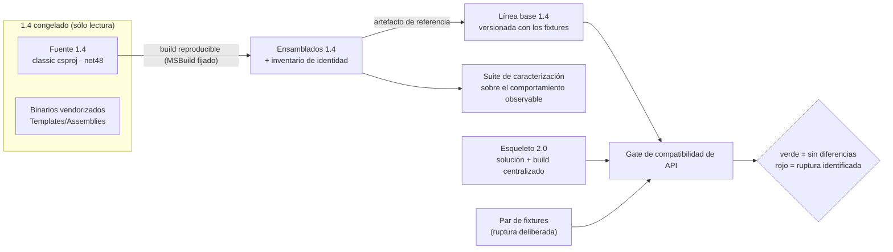

<!--
  LANGUAGE POLICY (§3.15): YAML keys, status enums, IDs and section headings stay in English;
  all prose goes in the project's content_language (devflow/LANGUAGE = es).
  ⚠️ SPEC = HOW (§2.4.1). Este documento NO decide arquitectura: implementa el Bolt aprobado bajo las
  restricciones de ADR-001 y ADR-008. Toda micro-decisión que no merezca un ADR queda en §14.
  ⚠️ AITL-SPEC-Approval (§2.4.1, §3.0): este SPEC es un DRAFT hasta que el Dev-validator (y los dueños de
  dominio aplicables) registre la decisión en el bloque `review`. Un cambio material en una fuente gobernada
  invalida la aprobación → parar, revisar el SPEC canónico y re-aprobar (G15).
-->

# SPEC-261016-0000 — Arnés de tests de caracterización, build reproducible y gate de API-compatibilidad

| Field | Value |
|-------|-------|
| **Origin** | [REV-001](../reviews/REV-001-analisis-migracion-cooperator.md) — §6 ítem 20 (hallazgo F-50) |
| **Bolt** | [US-000.BOLT-001](../functional/bolts/US-000.BOLT-001-arnes-de-tests-y-build-reproducible.md) |
| **ADRs** | [ADR-001](../adrs/ADR-001-layout-y-empaquetado-cooperator-2.md) · [ADR-008](../adrs/ADR-008-compatibilidad-de-api.md) |
| **Risk Class** | medium |
| **Revision** | 1 |

---

## 1. Objective

Se construye la **base de verificación reproducible de Cooperator 2.0** y del árbol **1.4 congelado**, junto con el
**gate que detecta toda ruptura de la superficie pública frente a la línea base 1.4**: el esqueleto de la solución
`2.0/` con su configuración de build centralizada (ADR-001 §3.1), el **build reproducible del 1.4 sin editar una
línea de su fuente** (prerequisito que ADR-002 §3.2 declara para el migrador), la **línea base 1.4** versionada
junto a los fixtures (ADR-008 §5), la **suite de caracterización del comportamiento observable de 1.4** y la
**capacidad ejecutable de verificación contra dependencias reales** (SQL Server del 1.4 y del destino).

El problema que resuelve es el que `REV-001` F-50 dejó abierto: no existe hoy ninguna red de seguridad —ni tests,
ni `Directory.Build.props`, ni CI— sobre la que apoyar una migración de 168 archivos `.cs` que además cambia de
runtime, de TFM y de modelo de configuración. Sin esta base, ninguna de las decisiones ya aprobadas
(ADR-001…ADR-009) es **verificable**: no se puede afirmar "el comportamiento no cambió" ni demostrar que una
ruptura de superficie fue detectada y documentada. Si este Bolt no se implementa, la migración avanza a ciegas y
la política de compatibilidad de ADR-008 se degrada a buena intención (su §4 lo dice explícitamente: el registro de
rupturas "depende de que exista el gate de comparación de API").

---

## 2. Context

**Origen del trabajo.** `REV-001` (aprobado 2026-10-15) encontró en F-50 que `1.4/**` no tiene proyecto de tests,
ni propiedades de build compartidas, ni pipeline; su recomendación —ruteada como **ítem 20: BOLT→SPEC**— es
establecer el arnés **antes** de migrar. `ADR-001` §4 lo repite como deuda técnica con dueño explícito ("el primer
Bolt de la 2.0 debe establecer el arnés en `2.0/tests/` antes de migrar código, o ninguna decisión de este ADR
será verificable") y `ADR-008` §5 lo designa dueño del gate: producir la línea base 1.4 **una vez**, dejarlo en CI
como criterio de aceptación y asumir que el 1.4 nunca se distribuyó como paquete (se consumía por DLLs con
`HintPath`), razón por la cual no hay `PackageValidationBaselineVersion` que apuntar.

**Estado real del repositorio (verificado en esta sesión).**

| Hecho | Evidencia |
|---|---|
| `2.0/` existe pero está **vacío** (0 entradas) | `Get-ChildItem -Recurse -Force 2.0` |
| `1.4/` = 221 archivos versionados, proyectos **classic csproj** (`ToolsVersion="12.0"`), `TargetFrameworkVersion v4.8`, referencias entre proyectos por `ProjectReference` (sin `HintPath` interno) | `1.4/*/*.csproj`, `1.4/Tools/*/*.csproj` |
| `AssemblyVersion`/`FileVersion` **1.4.5.0** en los cuatro paquetes y en los dos tools; `Core`/`Data`/`Library` firmados con token `8f7f403e20325116`; `Utility` **sin firmar** (`SignAssembly=false`) y el Modeler sin firmar | `Properties/AssemblyInfo.cs`, `[System.Reflection.AssemblyName]::GetAssemblyName()` |
| Los binarios vendorizados `1.4/Tools/CooperatorModeler/Templates/Assemblies/*.dll` (versionados) están **desalineados con la fuente**: `Cooperator.Framework.Utility.dll` es **1.3.3.0** mientras la fuente compila 1.4.5.0 | metadatos + `git ls-files 1.4` |
| La solución del 1.4 (`Framework.sln`) cubre los cuatro paquetes; los tools tienen solución propia (`CooperatorModeler.sln`, `ConnectionStringEncriptor.sln`) | `1.4/Framework.sln`, `1.4/Tools/**` |
| Toolchain presente: .NET SDK **10.0.402** (además 9.0.319 y 10.0.113), **MSBuild 18.11.0.47511** de Visual Studio 18 Community, targeting pack **.NET Framework 4.8** instalado | `dotnet --list-sdks`, `MSBuild.exe -version`, `Reference Assemblies\…\.NETFramework` |
| No hay pipeline de CI en el repositorio (sólo `.github/agents/`) y ningún ADR decide plataforma de CI | `.github/`, ADR-001…ADR-009 |
| No hay corpus `.coop` versionado (los fixtures binarios del formato legado deberán producirlo los Bolts que los necesiten) | `git ls-files | Select-String "\.coop"` → vacío |
| No hay SPEC ni MEM previos: este es el **primer V-Bounce** del proyecto | `devflow/spec/`, `devflow/memory/` |

**Restricciones que gobiernan (no se reabren).** `ADR-001` §3.1 (layout `2.0/` paralelo a `1.4/`, solución propia,
`src/`+`tests/`, `global.json` fijando el SDK, `Directory.Build.props` y `Directory.Packages.props`, un solo TFM por
proyecto, sin `packages.config`/`HintPath`/referencias muertas), §3.3 (`2.0.0` como primera versión, `AssemblyVersion`
fijo `2.0.0.0`, firma con el **mismo** `CooperatorFramework.snk` en todos los ensamblados, sin prefijos de versión en
los IDs) y §3.4 (dependencias declaradas, versionadas y licenciadas de forma centralizada; `Core`/`Library` con cero
terceros). `ADR-008` §5 (NFR *breaking-change traceability*: 100 % de las diferencias de API cubiertas por las notas
de migración, con `Microsoft.DotNet.PackageValidation` para la línea 2.0.x anterior y el tool
**`Microsoft.DotNet.ApiCompat`** contra la línea base 1.4; el gate **no** reemplaza las notas ni autoriza rupturas)
y §3.2/§3.4 (inventario de la superficie de serialización a retirar, `SYSLIB0051` = 0, advertencias como error).

---

## 3. Source inventory and approval references

**Pre-SPEC evidence gate (§2.4.1) — resultado: PASA.** Ninguna fuente gobernada está en `draft`, `rejected` ni sin
su checkpoint; no hay dos ADR activos en conflicto, y el plan de integración declarado en el frontmatter
(`applicable`) coincide con el `test_integration: required` del Bolt (§3.2.2). No se emite reporte bloqueante.

| Source | Ref | Approval |
|--------|-----|----------|
| Bolt | `US-000.BOLT-001` (`devflow/functional/bolts/US-000.BOLT-001-arnes-de-tests-y-build-reproducible.md`) | AITL-BOLT-READY-Approval ✓ — `approved`, `agent:dotnet-architect-reviewer-agent` (architect), 2026-10-15T23:47:42-03:00; `risk_class: medium`, `test_integration: required` |
| Parent US | `US-000` (`functional/user-stories/US-000-non-functional.md`) | Contenedor permanente: **sin** ciclo de aprobación (§2.6) — no aplica checkpoint |
| ADR (gobernante) | `ADR-001` (`adrs/ADR-001-layout-y-empaquetado-cooperator-2.md`) §3.1, §3.3, §3.4, §4, §5 | AITL-ADR-Approval ✓ — `accepted`, `human:eugenioserrano` (tech_lead), 2026-10-15T22:32:47-03:00 |
| ADR (gobernante) | `ADR-008` (`adrs/ADR-008-compatibilidad-de-api.md`) §3.2, §3.4, §5 | AITL-ADR-Approval ✓ — `accepted`, `human:eugenioserrano` (tech_lead), 2026-10-15T23:11:40-03:00 |
| REV evidence | `REV-001` §4 F-50 y §6 ítem 20 | AITL-REV-Approval ✓ — aprobado 2026-10-15 |
| OQ evidence | OQ-001…OQ-006 (`analysis/open-questions/`) | `answered` 2026-10-15 (citadas por ADR-001/ADR-008; ninguna abierta) |
| ADR (de apoyo, consultados — no gobiernan este SPEC) | `ADR-002` §3.2 (prerequisito del build 1.4 reproducible y verificación de identidad: nombre + versión + hash; alternativa admitida de *build conocido-bueno vendorizado*) · `ADR-004` §3.2/§3.4/§3.5 (configuración por variables de entorno; sin `ConfigurationManager` en `Data`) · `ADR-005` §3 (el provider y **su versión** los fija el Bolt del provider; el arnés de `Data` vive en `net10.0`) | AITL-ADR-Approval ✓ — `accepted` (2026-10-15) |
| Repository baseline | commit `6aa497f793cd3ab9d83c68db7ef2c1d80d3421d4` (`devflow: ADR-004..009 accepted (routing complete, 9 ADRs) + run 3 record`) | — (el árbol de trabajo tiene además archivos sin commitear de la corrida en curso: los Bolts `US-000.BOLT-00x`, el ARUN y `agents-data/`; **ninguno** bajo `2.0/`) |

> Nota de trazabilidad para el aprobador: `associated_adrs` espeja los `sources` del Bolt (ADR-001, ADR-008).
> ADR-002/ADR-004/ADR-005 se usan como **contexto de prerequisitos y de configuración del arnés**, no como
> decisiones que este SPEC implemente; si el revisor prefiere declararlos como asociados, es una corrección de
> frontmatter, no un cambio material del plan.

---

## 4. Scope

### In scope

1. **Esqueleto de la solución 2.0** conforme ADR-001 §3.1: `2.0/Cooperator2.sln`, `global.json` (SDK fijado),
   `Directory.Build.props` (calidad y determinismo), `Directory.Packages.props` (versión centralizada de cada
   dependencia), `src/` con los cuatro proyectos portables del mapa (`Cooperator.Framework.Core`,
   `.Library`, `.Data`, `.Modeling`) y `tests/` con los proyectos del arnés, más la copia byte-idéntica del
   `CooperatorFramework.snk` de 1.4 usada como identidad de firma de la 2.0 (ADR-001 §3.3).
2. **Suite de caracterización del comportamiento observable de 1.4**, montada sobre la superficie 1.4 congelada:
   contratos de datos y estado, superficie de serialización, cifrado, validación de CUIT argentina y generación de
   artefactos (plantillas + stored procedures) contra **fixtures dorados** versionados.
3. **Build reproducible del 1.4 congelado** (prerequisito de ADR-002 §3.2) con la herramienta y las versiones
   fijadas, **sin editar una sola línea de `1.4/**`**, con su **inventario de identidad** (nombre + versión +
   `PublicKeyToken` + SHA-256 de contenido) y la verificación de reproducibilidad por **doble corrida idéntica**.
4. **Línea base 1.4** para el gate (ADR-008 §5): artefacto de referencia producido a partir de los binarios
   congelados, **versionado junto a los fixtures** con su procedencia (commit, toolchain, hashes).
5. **Gate de compatibilidad de API** con línea base 1.4: invocable de forma autónoma, con reporte legible por
   máquina, códigos de salida del vocabulario `0/1/2/3`, corrida **verde** (sin diferencias) y corrida **roja**
   sobre un par de fixtures con una ruptura introducida a propósito que el gate debe **identificar**.
6. **Capacidad de verificación contra dependencias reales**: dos slots de connection string por entorno, esquema
   y datos de fixture para SQL Server, suite de integración del 1.4 (contrato de `SQLHelper`, gateway/loader,
   reverse del esquema) escrita y compilada en este V-Bounce y ejecutada en el ciclo de integración.

### Out of scope

- **Migrar o reescribir código de producto.** No se mueven archivos fuera de `1.4/`, no se retargetean TFMs, no se
  disuelve `Utility`, no se implementa `Modeling` como partición real. Los cuatro proyectos en `2.0/src` son
  **proyectos sin fuentes**: existen para fijar TFM/firma/empaquetado y como punto de montaje de los Bolts de
  migración (ADR-001 §3.1), no para contener código.
- **Cambiar el mapa de paquetes/TFMs o la política de dependencias** de ADR-001 §3.1/§3.4, ni retirar el gate por
  `PublicKeyToken`, ni tocar `[Serializable]` (eso es el Bolt de ADR-008 §3.7 y sus pares).
- **Fijar la versión del provider ADO.NET**: ADR-005 §3 asigna esa decisión —con dos criterios de aceptación— al
  Bolt del provider. Aquí sólo se reserva el lugar y la capacidad de smoke test real.
- **El formato `.coop2`, el motor de generación y el shell**: otros Bolts. La caracterización **usa** el mecanismo
  1.4 (incluida la serialización binaria del `Snapshot`) como *observación*, no lo preserva ni lo reemplaza.
- **Verificar contra SQL Server real** el comportamiento de capas que todavía no se migran: cada Bolt responde por
  la suya. El slot 2.0 del arnés se declara **reservado y vacío** (no hay código 2.0 que verificar).
- **Escribir las notas de migración** de la 2.0 (Bolt propio): el gate las *exige* para estar verde en el futuro,
  pero este Bolt entrega el gate y su línea base, no el documento.
- **Decidir y configurar la plataforma de CI**: no hay ADR que la fije y no se inventa (ver §13 y §14). Se
  entregan puntos de entrada agnósticos de plataforma, con códigos de salida y reportes.
- **Corregir defectos que la caracterización revele.** Un comportamiento observado que sea un defecto se
  **documenta y se escala** para su `BUG`/Bolt propio (G04); no se parchea dentro de este V-Bounce.

---

## 5. Prerequisites and baseline

- **Baseline del repositorio:** commit `6aa497f793cd3ab9d83c68db7ef2c1d80d3421d4`. El árbol de trabajo contiene
  archivos sin commitear de la corrida en curso (Bolts, ARUN, `agents-data/`), ninguno bajo `2.0/`.
- **`2.0/` vacío**: este Bolt crea el árbol completo. No hay SPEC previo (`prerequisites: []`).
- **Toolchain fijado y presente:**
  - .NET SDK **10.0.402** (fijado en `global.json`, sin roll-forward automático).
  - **MSBuild 18.11.0.47511** de Visual Studio 18 Community — es el **constructor de la solución 2.0 completa**,
    porque el arnés referencia los `.csproj` *classic* del 1.4 (el mismo patrón que ADR-002 §3.2 fija para el
    migrador: `ProjectReference`, sin editar una línea). `dotnet build` queda soportado para el subconjunto
    moderno, pero **no** es el comando reproducible.
  - Targeting pack **.NET Framework 4.8** instalado (`Reference Assemblies\…\.NETFramework\v4.8`).
- **Entorno del ciclo de integración: no provisionado.** No hay pipeline ni instancia de SQL Server declarada en
  el repositorio. El plan del frontmatter es el **objetivo**: el arnés entrega la capacidad y la suite; la corrida
  ocurre en el ciclo de integración del Bolt (§3.2.2), y sin entorno su resultado queda pendiente — es una
  dependencia externa ya declarada por el propio Bolt (§4, *External*).
- **Restricción dura heredada:** `1.4/**` es **sólo lectura**. El árbol se verifica contra el commit baseline antes
  y después de construir; cualquier edición aborta la corrida.
- **Conocimiento de entrada:** los binarios vendorizados `Templates/Assemblies/*.dll` **no** son la fuente de la
  línea base (están desalineados: `Utility` 1.3.3.0); su inventario se registra como evidencia y se marca para el
  Bolt del migrador, que es quien fija su lista de identidad.

---

## 6. Phases

> Cada fase implementa el **mismo** Bolt (`US-000.BOLT-001`). El orden es de valor: A→B→C→D son la cadena
> indispensable (sin build reproducible no hay línea base; sin línea base no hay gate); E es el arnés de
> caracterización; F es la capacidad de dependencias reales. Si el V-Bounce agota su presupuesto, el MEM registra
> hasta dónde llegó y lo pendiente se retoma en un V-Bounce nuevo (el Bolt estima 1–2).

### Phase A — Esqueleto de la solución 2.0 y configuración de build centralizada

**Duration:** ~2h de ciclo — **Complexity:** Medium

#### A.1 Estructura y pinning del toolchain

Se crea el árbol `2.0/` en paralelo a `1.4/` con la forma que ADR-001 §3.1 fija. `global.json` fija el SDK exacto
(`10.0.402`, `rollForward: disable`): un cambio de SDK pasa a ser un acto deliberado y registrado, no un accidente
de la máquina. `Directory.Build.props` aplica a todos los proyectos de la solución las propiedades transversales:
`Deterministic=true`, `ContinuousIntegrationBuild=true`, `PathMap` normalizado (para que las rutas de origen no
entren en los artefactos), `TreatWarningsAsErrors=true` (ADR-008 §3.4: la política se verifica en el build, no se
silencia), `Nullable=enable`, `ImplicitUsings=enable`, `SignAssembly=true` con
`AssemblyOriginatorKeyFile=$(MSBuildThisFileDirectory)CooperatorFramework.snk`, y el versionado de ADR-001 §3.3
(`Version=2.0.0`, `AssemblyVersion=2.0.0.0` fijo para la línea 2.0.x). `Directory.Packages.props` habilita
**gestión central de paquetes** (`ManagePackageVersionsCentrally`): ningún `.csproj` declara versiones por su cuenta
(regla explícita de ADR-001 §3.1), y `RestorePackagesWithLockFile` + `packages.lock.json` versionados hacen el
restore reproducible. El `.snk` se **copia byte a byte** desde `1.4/Cooperator.Framework.Core/CooperatorFramework.snk`
para conservar la identidad de firma (mismo `PublicKeyToken`), sin referenciar la ruta del árbol congelado.

**Files created:**
- `2.0/global.json` — fijación del SDK (10.0.402)
- `2.0/Directory.Build.props` — propiedades transversales de calidad/determinismo/firma/versión
- `2.0/Directory.Packages.props` — versiones centralizadas de dependencias (CPM)
- `2.0/CooperatorFramework.snk` — copia byte-idéntica de la clave de firma 1.4 (identidad, no licenciamiento)
- `2.0/Cooperator2.sln` — solución propia de la 2.0
- `2.0/.gitignore` — exclusiones locales del árbol 2.0 (salidas, tool-restore)

#### A.2 Los cuatro proyectos portables (sin fuentes) y los proyectos del arnés

Se materializan los proyectos que el mapa de ADR-001 §3.1 fija de forma completa —nombre, TFM, firma y política de
dependencias—: `Core`, `Library`, `Data` y `Modeling`, los cuatro `netstandard2.1` y firmados, con los recursos
apuntados a la clave común. `Modeling` declara `System.Text.Json` (ADR-001 §3.4: su única dependencia de
serialización); `Core` y `Library` quedan con **cero** dependencias de terceros. `Data` **no** fija el provider:
ADR-005 §3 asigna esa decisión (con criterios de aceptación propios) al Bolt del provider, y ADR-004 §3.5 ya venció
la excepción transitoria de `System.Configuration.ConfigurationManager`, así que ese paquete **no** entra. Los
proyectos del arnés se crean en `tests/` (detalle en las fases C–F). Cada proyecto sin fuentes compila a un
ensamblado vacío —el SDK genera su `AssemblyInfo`— y su propósito en este Bolt es hacer **verificables** las
invariantes del ADR y servir de punto de montaje a los Bolts de migración; no contienen código de producto.

**Files created:**
- `2.0/src/Cooperator.Framework.Core/Cooperator.Framework.Core.csproj`
- `2.0/src/Cooperator.Framework.Library/Cooperator.Framework.Library.csproj`
- `2.0/src/Cooperator.Framework.Data/Cooperator.Framework.Data.csproj`
- `2.0/src/Cooperator.Framework.Modeling/Cooperator.Framework.Modeling.csproj`
- `2.0/tests/Cooperator.Harness.Tests/Cooperator.Harness.Tests.csproj` — invariantes del arnés y self-test del gate (`net10.0`)
- `2.0/tests/Cooperator.Framework.Characterization.Tests/Cooperator.Framework.Characterization.Tests.csproj` — superficie 1.4 (`net48`)

> Restricción de layout: **no** se crean los proyectos de tooling (`Cooperator.Framework.CodeGeneration`,
> `Cooperator.Cli`) ni los de aplicación (`CooperatorModeler`, `ConnectionStringEncriptor`). Sus identificadores,
> contenidos y decisiones (motor, shell WPF) pertenecen a ADR-003/ADR-009 y a sus Bolts; crearlos aquí sería
> pre-decidir lo que ellos poseen. El layout queda documentado en §14 y en el README del árbol `2.0/`.

---

### Phase B — Build reproducible del 1.4 congelado y su inventario de identidad

**Duration:** ~3h de ciclo — **Complexity:** High

#### B.1 Precondición de congelamiento

`frozen-1.4.ps1` verifica **antes de construir** que el árbol 1.4 está intacto: `git diff --quiet <baseline> -- 1.4`
y `git status --porcelain -- 1.4` deben estar vacíos. Si no lo están, el script aborta con código `3` (bloqueado) y
nombra los archivos; **nunca** restaura ni edita nada por su cuenta. El commit congelado se registra en un archivo
de pin (`frozen-source.json`) que es también la entrada del inventario.

#### B.2 Construcción determinista con herramienta fijada

El árbol se construye con **MSBuild 18.11.0.47511** (resuelto por `vswhere` con rango de versión explícito, no
"el último"), configuración **Release** (la configuración Debug de los `.csproj` 1.4 activa `RunCodeAnalysis` con
*rulesets* de Visual Studio 10 y rutas absolutas de aquella instalación: es una fuente de no-determinismo y de
fallos de toolchain, por eso se pasa además `/p:RunCodeAnalysis=false`), con `/p:Deterministic=true`,
`/p:PathMap=<repo>=/src` y `/p:ContinuousIntegrationBuild=true`. Se construyen las tres soluciones del 1.4
(`Framework.sln`, `Tools/CooperatorModeler/CooperatorModeler.sln`,
`Tools/ConnectionStringEncriptor/ConnectionStringEncriptor.sln`) porque el `Snapshot` del formato legado vive en
`CooperatorModeler.exe` y el grafo del modelo en `Cooperator.Framework.Utility` (ADR-002 §3.2): el 1.4 congelado que
el migrador consumirá es **ese** conjunto. Las salidas van a un directorio de artefactos **fuera** del árbol
congelado (nunca dentro de `1.4/`, para no ensuciar el *status* de git).

#### B.3 Verificación de reproducibilidad por doble corrida

El script construye dos veces desde cero, en directorios de salida distintos y con `obj/` limpio, y compara
**SHA-256 de cada ensamblado**. El resultado esperado es byte-identidad. Si algún artefacto resiste la
determinación tras fijar herramienta y propiedades, el script lo aísla, captura la causa (marca temporal, recurso
generado, orden de ítems) y aplica la alternativa que ADR-002 §3.2 ya admite —un **build conocido-bueno
vendorizado con sus hashes**—, dejando la discrepancia registrada como hallazgo del MEM; si ni el control de
hashes puede establecerse, la fase se detiene (ver §15).

#### B.4 Inventario de identidad

Se emite un inventario JSON versionado con, por cada ensamblado producido: nombre, `AssemblyVersion`,
`FileVersion`, `PublicKeyToken` (nulo donde no firma), SHA-256 de contenido, ruta relativa y configuración usada —
el vocabulario exacto que ADR-002 §3.2 usa para la verificación de identidad del migrador. Se registran además los
binarios vendorizados de `Templates/Assemblies/` con sus hashes, marcando la divergencia detectada (`Utility`
1.3.3.0 vs 1.4.5.0 del fuente) para que el Bolt del migrador **no** los adopte en silencio como lista de identidad.

**Files created:**
- `2.0/build/frozen-1.4.ps1` — construcción reproducible, doble corrida, inventario y precondiciones
- `2.0/build/frozen-source.json` — commit congelado y conjunto de rutas protegidas
- `2.0/tests/fixtures/frozen-1.4/frozen-1.4-inventory.json` — inventario de identidad (versionado)
- `2.0/tests/fixtures/frozen-1.4/PROVENANCE.md` — commit, toolchain, comandos, hashes y la divergencia de los vendorizados

---

### Phase C — Línea base 1.4 para el gate de API

**Duration:** ~2h de ciclo — **Complexity:** Medium

#### C.1 Producción del artefacto de referencia

ADR-008 §5 pide "un *reference assembly* o un paquete *baseline* sólo para el gate", producido a partir de los
binarios congelados y versionado junto a los fixtures. La vía primaria **no edita el 1.4**: se reutiliza la misma
construcción fijada de la fase B y se pide al compilador el artefacto de referencia mediante propiedades de MSBuild
en la línea de comandos (`ProduceReferenceAssembly`, `ProduceOnlyReferenceAssembly`) con `OutputPath` redirigido.
El alcance del baseline son los **cuatro ensamblados del framework** (`Core`, `Data`, `Library`, `Utility`): son
la superficie que la 2.0 reemplaza y la que las notas de migración deberán cubrir miembro por miembro. La
identidad de `CooperatorModeler.exe` y de los tools se registra en el inventario (fase B) pero **no** entra al
baseline de API. Si en la cadena fijada la propiedad de *reference assembly* no se honrara en proyectos *classic*,
el respaldo —ya previsto por el ADR— es usar los **mismos ensamblados construidos** como artefacto de referencia:
la comparación de superficie pública es válida igual y el artefacto igual queda versionado con su procedencia.

#### C.2 Versionado y procedencia

El baseline se guarda bajo `tests/fixtures/` (no bajo `artifacts/`, que está ignorado por git) con un
`PROVENANCE.md` que declara: commit de origen, toolchain, comando exacto de producción, hashes, alcance
(cuatro ensamblados) y la razón de las exclusiones. Un digest por archivo se incluye en el inventario, de modo que
cualquier manipulación posterior del baseline se detecta comparando hashes antes de correr el gate.

**Files created:**
- `2.0/tests/fixtures/api-baseline-1.4/Cooperator.Framework.{Core,Data,Library,Utility}.dll` — línea base 1.4 (o sus *reference assemblies*)
- `2.0/tests/fixtures/api-baseline-1.4/PROVENANCE.md` — procedencia y alcance
- `2.0/tests/fixtures/api-baseline-1.4/baseline-digests.json` — hashes de la línea base

---

### Phase D — Gate de compatibilidad de API (ADR-008 §5)

**Duration:** ~3h de ciclo — **Complexity:** High

#### D.1 Herramienta fijada y contrato de invocación

El gate usa el tool que el ADR nombra (`Microsoft.DotNet.ApiCompat`) resuelto por un **manifiesto de herramientas
versionado** (`2.0/.config/dotnet-tools.json`), para que la versión del comparador sea parte de la reproducibilidad.
`api-compat.ps1` expone el contrato: comparar un lado **contract** (la línea base 1.4) contra un lado
**implementation** (los ensamblados de la 2.0, o del 1.4 reproducible), en **modo estricto**, escribiendo un
reporte JSON + texto legible y devolviendo los códigos del vocabulario compartido `0/1/2/3` (idéntico al del
migrador y al del CLI del motor, ADR-002 §3.2 / ADR-003 §3.2). El nombre exacto de cada bandera del comparador se
verifica contra el `--help` de la versión fijada al implementar y se registra en el MEM: el SPEC fija el
**contrato**, no la ortografía de las banderas de una versión que no está resuelta todavía.

#### D.2 Tres corridas con propósitos distintos

1. **Verde (identidad del baseline):** baseline 1.4 ↔ ensamblados del build 1.4 reproducible → **0 diferencias**.
   Es el control que prueba dos cosas a la vez: que el pipeline del gate funciona de punta a punta y que el
   artefacto de referencia representa fielmente lo que el 1.4 congelado produce.
2. **Roja (ruptura deliberada):** un **par de fixtures sintéticos** versionados (dos ensamblados mínimos con la
   misma superficie salvo una ruptura intencional: un miembro público retirado y una firma alterada) → el gate debe
   **fallar** y el reporte debe **nombrar** el miembro retirado y la firma cambiada. Los fixtures son sintéticos a
   propósito: no se inventan tipos del framework ni se muta el baseline real.
3. **Informativa (brecha real 1.4 → 2.0):** baseline 1.4 ↔ los ensamblados vacíos del esqueleto 2.0 → el gate
   reporta la brecha completa (todo miembro del baseline ausente). No es un resultado de gate: es la evidencia
   que muestra, desde el primer día, la forma del insumo que las notas de migración deberán cubrir.

#### D.3 Self-test automatizado del gate

`Cooperator.Harness.Tests` invoca el gate sobre el par de fixtures y **asserta**: código de salida ≠ 0, presencia del
nombre calificado del miembro retirado en el reporte y existencia del reporte JSON. Así el "debe fallar
identificando la ruptura" del Bolt queda verificado por un test hermético y reproducible, no por una observación
manual.

#### D.4 Camino a la línea anterior de la 2.0 (declarado, no activo)

`Directory.Build.props` habilita `EnablePackageValidation` para los proyectos empaquetables, según ADR-008 §5, pero
**`PackageValidationBaselineVersion` queda sin valor**: no existe ninguna versión anterior de la 2.0 que comparar
(2.0.0 es la primera). El mecanismo queda cableado y su activación es un acto de la primera release 2.0.x. Se
declara explícitamente al aprobador que la mitad "contra la línea anterior de la 2.0" del criterio del Bolt es
**inactiva por construcción** en este punto de la historia (ver §14 y §15).

**Files created:**
- `2.0/build/api-compat.ps1` — gate: modos `Baseline`/`Current`, `-FixturePair`, reporte y códigos de salida
- `2.0/.config/dotnet-tools.json` — manifiesto con la versión fijada del comparador
- `2.0/tests/fixtures/api-compat-fixtures/` — par sintético baseline/roto + resultado esperado
- `2.0/tests/Cooperator.Harness.Tests/ApiCompatGateTests.cs` — self-test del gate (verde y rojo)

---

### Phase E — Suite de caracterización del comportamiento observable de 1.4

**Duration:** ~4h de ciclo — **Complexity:** High

Se monta un proyecto de tests `net48` que referencia **los proyectos 1.4 tal como están** (`ProjectReference`, sin
editar una línea) y `CooperatorModeler.exe`, exactamente el patrón que ADR-002 §3.2 fija para el migrador. Los
casos se organizan por área en carpetas, de modo que un Bolt posterior pueda montar las **mismas fuentes** contra
la superficie 2.0 mediante `<Compile Include="…/**/*.cs" />` sin reescribirlas: la caracterización nace siendo
reutilizable por la migración, que es su razón de existir. Las áreas y sus casos mínimos:

1. **Contratos de datos y estado (`Core`).** `ObjectState`/`ObjectStateHelper` (transiciones y estados válidos),
   `BaseObject`/`BaseObjectList`/`BaseObjectListView` (alta/baja, filtros, ordenamientos, eventos),
   `ValuesGenerator`, `UniqueIdentifierHelper`, jerarquía y mensajes de excepciones, `SecurityRights` y la
   resolución de providers Lazy por nombre (contrato observable: acierto y error diagnóstico).
2. **Superficie de serialización (`Core`/`Data`/`Library`/`Utility`).** Inventario del estado *antes*:
   `[Serializable]`, implementaciones de `ISerializable`/`GetObjectData` y constructores
   `(SerializationInfo, StreamingContext)` por ensamblado, más el round-trip binario de un `Snapshot`. Este
   inventario es el "antes" contra el que ADR-008 §3.2/§3.4 y su NFR de *serialization surface* (0 atributos,
   0 `SYSLIB0051`) se medirán cuando sus Bolts retiren la superficie.
3. **Cifrado (`Library.Cryptography`).** Round-trip de `Encrypt`/`Decrypt`, casos de error (nulo, vacío, texto
   alterado) y **vectores heredados**: se generan una vez, con el build 1.4, muestras de texto cifrado y su
   texto claro esperado, y se versionan como fixture. Son el insumo que ADR-007 necesita para migrar valores
   **ya cifrados**; el material de clave de 1.4 no se copia a ningún fixture de la 2.0.
4. **Validación de CUIT argentina (`Library.TaxIDVerification.Argentina`).** CUIT válidos e inválidos por dígito
   verificador, con y sin separadores, longitudes de borde y casos de dígitos repetidos. Todos los números de los
   fixtures son **sintéticos**.
5. **Generación de artefactos.** Se construye en código un `Snapshot` mínimo (con `StampDateAndTimeOnAutoFiles`
   desactivado para eliminar la marca temporal) y se invocan los puntos de entrada públicos de generación
   (`GenerateStoredProcedures`, `GenerateClasses`) hacia un directorio temporal, comparando el resultado con
   **fixtures dorados** versionados (scripts de stored procedures y clases generadas). Se caracteriza también el
   determinismo del render entre dos corridas. Si algún camino de generación exige un catálogo real, ese caso se
   marca `Category=Integration` y se ejecuta en el ciclo de integración — no se simula ni se inventa un sustituto.

**Criterio de "caracterización", no de "corrección":** cada caso registra el comportamiento **observado** del 1.4
congelado. Si lo observado es un defecto (por ejemplo un round-trip de cifrado que no cierra), el test **no** lo
arregla ni lo aprueba: se documenta como hallazgo y se escala (ver §15, G04).

**Files created:**
- `2.0/tests/Cooperator.Framework.Characterization.Tests/Contracts/*.cs` — área 1
- `2.0/tests/Cooperator.Framework.Characterization.Tests/Surface/*.cs` — área 2
- `2.0/tests/Cooperator.Framework.Characterization.Tests/Cryptography/*.cs` — área 3
- `2.0/tests/Cooperator.Framework.Characterization.Tests/TaxId/*.cs` — área 4
- `2.0/tests/Cooperator.Framework.Characterization.Tests/Generation/*.cs` — área 5
- `2.0/tests/fixtures/legacy-crypto/*.json` — vectores heredados de cifrado
- `2.0/tests/fixtures/golden-generation/**` — artefactos dorados de generación
- `2.0/tests/Cooperator.Framework.Characterization.Tests/app.config` — sólo si la resolución LazyLoad/config del 1.4 lo requiere

---

### Phase F — Capacidad de verificación contra dependencias reales (nivel de integración)

**Duration:** ~2h de ciclo — **Complexity:** Medium

#### F.1 Slots de conexión y esquema de fixture

El arnés resuelve la conexión **por variables de entorno**, no por archivos versionados (ADR-004 §3.4/§3.2: nada
de credenciales en un archivo del repositorio). Dos slots: `COOPERATOR_IT_LEGACY_CONNECTIONSTRING` (superficie 1.4,
usado en este Bolt) y `COOPERATOR_IT_TARGET_CONNECTIONSTRING` (superficie 2.0, **reservado y vacío**: todavía no hay
código 2.0 que verificar). El esquema y los datos de fixture (`schema.sql` + `seed.sql`, sintéticos y mínimos: un
par padre/hijo con identidad, `rowversion` y tipos representativos) viven versionados y se aplican sólo contra una
base cuyo nombre contenga `cooperator_it`: el arnés **aborta** contra cualquier otra base. Esta guarda es la
diferencia entre un fixture y un accidente.

#### F.2 Suite de integración del 1.4

Los casos `Category=Integration` ejercitan el comportamiento que **sólo** se puede observar contra SQL Server real:
contrato de `SQLHelper`/`SqlHelperParameterCache` (parámetros, `DataSet`/`DataTable`, transacciones, excepciones),
`BaseGateway`/`BaseLoader` (consulta, alta/modificación con `rowversion`), y el reverse del esquema
(`MSSQLProvider`/`sp_help`, mapeo de tipos SQL↔CLR) contra el catálogo. Se escriben y compilan **en este V-Bounce**
y se ejecutan en el ciclo de integración del Bolt, nunca en el lazo hermético: la corrida hermética filtra por
categoría (`--filter "Category!=Integration"`), de modo que "waiting for an environment" no consume presupuesto de
turnos (§3.3).

**Files created:**
- `2.0/tests/Cooperator.Framework.Characterization.Tests/Integration/SqlHelperContractTests.cs`
- `2.0/tests/Cooperator.Framework.Characterization.Tests/Integration/GatewayTransactionTests.cs`
- `2.0/tests/Cooperator.Framework.Characterization.Tests/Integration/DbReverseSchemaTests.cs`
- `2.0/tests/Cooperator.Framework.Characterization.Tests/Integration/GenerationWithCatalogTests.cs`
- `2.0/tests/fixtures/sqlserver/schema.sql` · `2.0/tests/fixtures/sqlserver/seed.sql`

---

### Phase G — Comando reproducible único y empaquetado de evidencia

**Duration:** ~1h de ciclo — **Complexity:** Low

#### G.1 Punto de entrada

`build.ps1` es **el** comando reproducible que el Bolt exige: localiza el SDK por `global.json` y MSBuild por
`vswhere` con rango de versión fijado, restaura (con lock file), construye la solución completa, corre la suite
hermética y deja los reportes en `2.0/artifacts/<timestamp>/`. Parámetros: `-Scope Hermetic|Integration|All`
(default `Hermetic`), `-Configuration Release`, `-ApiCompatDemo` (corre las tres corridas de la fase D),
`-VerifyReproducibility` (doble corrida del 1.4). Los códigos de salida son el vocabulario compartido `0/1/2/3`
(ok / error / diferencias o fallo de gate / bloqueado por prerequisito o entorno), de modo que un pipeline futuro
lo trate igual que al migrador.

#### G.2 Documentación y evidencia

`2.0/README.md` documenta la invocación, la matriz de proyectos/TFMs (ADR-001 §3.1), qué constructor usar en cada
subconjunto y cómo interpretar los reportes; la evidencia del V-Bounce (salida de la corrida reproducible, doble
corrida del 1.4, corridas verde/roja del gate, listado de paquetes por proyecto) se referencia desde el MEM.

**Files created:**
- `2.0/build/build.ps1` — punto de entrada único (restore, build, suites, gate, reportes, códigos de salida)
- `2.0/README.md` — invocación, layout, toolchain fijado y lectura de reportes

---

## 7. Acceptance criteria

> Bolt no funcional (parent `US-000`, sin ACs): los criterios son los **resultados medibles** del Bolt (§2) y las
> restricciones de los ADR gobernantes, expresados como Given/When/Then verificables.

### AC-1: Corrida reproducible del árbol 2.0

**Given** el repositorio en el commit baseline y el toolchain fijado instalado
**When** se ejecuta `pwsh -File 2.0/build.ps1 -Scope Hermetic`
**Then** la solución 2.0 se restaura y compila sin advertencias (tratadas como error) y la suite hermética termina
verde, con reporte y `artifacts/<timestamp>/` generados, y código de salida `0`.

### AC-2: Caracterización del comportamiento observable de 1.4

**Given** el 1.4 congelado y los fixtures versionados
**When** corre la suite de caracterización (áreas 1–5)
**Then** los cinco conjuntos pasan sobre el 1.4 y los fixtures dorados/sintéticos quedan versionados con sus
digests, sin ninguna edición bajo `1.4/**`.

### AC-3: Build reproducible del 1.4 y su inventario

**Given** el árbol 1.4 congelado en el commit pinneado y MSBuild en la versión fijada
**When** se construye dos veces desde cero en directorios distintos
**Then** cada ensamblado producido tiene el mismo SHA-256 en ambas corridas y existe el inventario de identidad
(nombre, `AssemblyVersion`, `FileVersion`, `PublicKeyToken`, hash) versionado junto a su procedencia.

### AC-4: Gate verde contra la línea base 1.4

**Given** la línea base 1.4 versionada con sus digests
**When** se corre el gate en modo verde
**Then** no hay diferencias de API (código de salida `0`) y el reporte queda registrado con el alcance comparado.

### AC-5: Gate rojo ante una ruptura deliberada

**Given** el par de fixtures con la ruptura intencional
**When** se corre el gate sobre el par
**Then** el gate falla (código ≠ 0), el reporte **identifica** el miembro público retirado y la firma alterada, y el
self-test de `Cooperator.Harness.Tests` lo verifica de forma automática.

### AC-6: Invariantes del build centralizado

**Given** los proyectos del esqueleto 2.0
**When** corren los tests de invariantes
**Then** los cuatro portables son `netstandard2.1`, firmados con una copia **byte-idéntica** del `.snk` de 1.4,
con conteo de dependencias de terceros conforme ADR-001 §5 (0 en `Core`/`Library`, `System.Text.Json` en
`Modeling`, sin `System.Configuration.ConfigurationManager` en `Data`), versiones declaradas **sólo** en
`Directory.Packages.props` y lock files presentes.

### AC-7: Capacidad de dependencias reales disponible y contenida

**Given** el arnés con sus slots de conexión
**When** corre la suite hermética (sin entorno) y luego la suite `Category=Integration` en el ciclo de integración
**Then** la primera **excluye** los casos de integración por filtro y queda verde; la segunda está escrita,
compilada y estáticamente verificada, y sólo se ejecuta contra una base cuyo nombre contiene `cooperator_it`
(abortando contra cualquier otra).

### AC-8: `1.4/**` intacto

**Given** el commit baseline
**When** termina el V-Bounce
**Then** no hay diferencias ni archivos sin seguimiento bajo `1.4/**` (`git diff --quiet <baseline> -- 1.4` y
`git status --porcelain -- 1.4` vacíos) y ningún artefacto de build se escribió dentro del árbol congelado.

### AC mapping to source (functional) / measurable outcome (non-functional)

| Source outcome (Bolt §2) | How this SPEC satisfies it | Verifying test/evidence |
|--------------------------|----------------------------|--------------------------|
| "el árbol 2.0 compila y ejecuta su suite desde un comando reproducible" | Fases A y G: esqueleto + `build.ps1` con toolchain fijado y lock files | AC-1 · salida de la corrida reproducible (evidencia del MEM) |
| "la suite de caracterización sobre el comportamiento observable del 1.4 pasa" | Fase E: cinco áreas montadas sobre la superficie 1.4 vía `ProjectReference` | AC-2 · corrida de la suite + fixtures versionados |
| "build reproducible del 1.4 congelado (prerequisito ADR-002 §3.2)" | Fase B: MSBuild fijado, propiedades deterministas, doble corrida, inventario | AC-3 · dos corridas idénticas + `frozen-1.4-inventory.json` |
| "el gate corre contra la línea base 1.4" | Fases C y D: baseline versionada + gate con modo verde | AC-4 · reporte del gate + digest del baseline |
| "falla ante una ruptura introducida deliberadamente, identificándola" | Fase D.2/D.3: par de fixtures sintéticos + self-test | AC-5 · reporte rojo con el miembro nombrado + test automático |
| "estructura de solución y configuración de build compartida como base (ADR-001 §3.1)" | Fase A: `global.json`, `Directory.Build.props`, `Directory.Packages.props`, layout `src/`+`tests/`, firma común | AC-6 · tests de invariantes |
| "verificación ejecutable contra dependencias reales (SQL Server 1.4 y destino) como capacidad del arnés" | Fase F: slots de conexión + fixture DB + guarda de nombre + suite `Category=Integration` | AC-7 · corrida del ciclo de integración (pendiente de entorno) |
| "no migra ni reescribe código de producto" (exclusiones del Bolt) | Fase A: proyectos sin fuentes; precondición de congelamiento en B.1 | AC-8 · `git diff/status` bajo `1.4/**` |

---

## 8. Testing strategy

### 8.1 V-Bounce level (hermetic — run by the agent)

- **Caracterización del 1.4 (áreas 1–5 de la fase E):** casos `Fact`/`Theory` por área (mínimos: ≥8 por área),
  ejecutados sobre la superficie 1.4 congelada. Golden fixtures comparados por contenido normalizado; vectores de
  cifrado comparados por texto claro esperado.
- **Invariantes del arnés (`Cooperator.Harness.Tests`, `net10.0`):** TFM y firma por proyecto, `.snk` byte-idéntico
  al de 1.4, conteo de dependencias por proyecto según ADR-001 §5, ausencia de `Version=` en los `.csproj`, presencia
  del `global.json` y de los lock files, y el **self-test del gate** (verde + rojo con la ruptura identificada).
- **Reproducibilidad:** doble corrida del build 1.4 con comparación de hashes; doble corrida de la suite hermética
  con resultados idénticos (evidencia de *behavioral reproducibility* y de *determinism* del build).
- **Exclusión explícita:** la corrida hermética usa `--filter "Category!=Integration"`; los casos de integración
  **no** se ejecutan ni se marcan como omitidos silenciosamente (no hay `Skip`): se filtran por categoría, y su
  corrida real es la del ciclo de integración.
- **Edge cases:** archivos con nombre inválido en el perímetro del arnés (rutas de reporte), ausencia de la variable
  de entorno del slot de integración, ausencia de `vswhere`/MSBuild fuera de rango, `2.0/artifacts` inexistente,
  baseline manipulado (digest distinto) → el gate debe abortar con `3`, no comparar contra un baseline alterado.
- **BUG evidence:** `n/a` — el Bolt no corrige un BUG (no hay TDD rojo→verde obligatorio; la evidencia roja de este
  Bolt es la del **gate** sobre la ruptura deliberada, que es un control del arnés, no un defecto de producto).

### 8.2 Integration test level (written in a V-Bounce, executed in the integration test cycle)

- **Integration tests (real dependencies):** los cuatro archivos de la fase F, `Category=Integration`, contra
  **SQL Server real** con la base de fixture `cooperator_it_*`. Escritos y compilados en este V-Bounce; ejecutados
  en el ciclo de integración del Bolt (§3.2.2), que hoy depende de un entorno **no provisionado**.
- **Contract / E2E against the real providers:** el contrato relevante de este Bolt es el de la capa de acceso a
  datos del 1.4 (`SQLHelper`/gateway/loader) contra el motor real; no hay providers externos de terceros en el
  alcance. La comparación de **API pública** (gate de la fase D) es hermética y no sustituye a estos tests: son
  ejes distintos.
- **Edge cases:** transacción revertida, `rowversion` desactualizado, parámetro con tipo incompatible (error
  tipado), tabla inexistente en el reverse, base de fixture ausente o con nombre no autorizado (aborta).
- **BUG evidence (a defect that reproduces only in integration tests):** `n/a` — no hay defecto en corrección.

---

## 9. Quality gates

> Los estados son el **resultado esperado** de cada gate en su nivel; el resultado real se registra en el MEM del
> V-Bounce (V-Bounce) y en `integration_test_runs[]` del manifiesto (ciclo de integración) (§3.6, §3.12).

| Gate | Level | Threshold | Status |
|------|-------|-----------|--------|
| Build / lint / type checks | V-Bounce | Compilación limpia de la solución 2.0 y de las tres soluciones 1.4 con `TreatWarningsAsErrors` y determinismo activado | `pass` — esperado (fases A/B/G) |
| Unit / component tests | V-Bounce | Suite hermética verde (caracterización de 1.4 + invariantes del arnés) | `pass` — esperado (AC-2, AC-6) |
| Consumer-side contract tests (test doubles) | V-Bounce | El arnés no define superficie de consumo propia; su contrato verificable es el de la API pública, cubierto por el gate | `n/a` — no hay frontera de componente consumida con dobles en este Bolt |
| API-compat con la línea base 1.4 (ADR-008 §5) | V-Bounce | 0 diferencias en modo verde; ruptura identificada en modo rojo | `pass` — esperado (AC-4, AC-5) |
| SAST | V-Bounce | Sin código de producto nuevo; el arnés es configuración de build, scripts de orquestación y tests | `n/a` — no hay superficie de producto introducida |
| Dependency scanning / licenses | V-Bounce | Toda dependencia declarada, fijada y con licencia permisiva (ADR-001 §3.4); listado versionado | `pass` — esperado (AC-6) |
| OWASP Top 10 — static review | V-Bounce | No se expone ni altera interfaz alcanzable desde fuera del proceso | `n/a` — sin superficie externa |
| Prompt-injection scan | V-Bounce | No hay construcción de prompts ni consumo de entrada no confiable en el producto | `n/a` — no aplica al arnés |
| Secret-leak scan | V-Bounce | Ningún secreto en archivos versionados: sin claves/IV en fixtures 2.0, sin credenciales (conexión por entorno) | `pass` — esperado (fase E.3, fase F.1) |
| Hallucination lint | V-Bounce | Toda ruta, herramienta y archivo referenciado existe y se verifica en el build/tests | `pass` — esperado (invariantes del arnés) |
| IP / license provenance | V-Bounce | No se incorpora código de terceros copiado; las dependencias se declaran con licencia | `pass` — esperado |
| PII / DLP | V-Bounce | `data_classification: internal`; fixtures sintéticos (CUIT y datos de seed), sin datos personales reales | `pass` — esperado |
| Dependency-confusion | V-Bounce | Versiones fijadas centralmente + lock files; sin nombres de paquete ambiguos | `pass` — esperado (AC-6) |
| Test-first evidence | V-Bounce | No es un Bolt de corrección de BUG | `n/a` — sin TDD rojo→verde obligatorio |
| Behavioral reproducibility (hermetic suite) | V-Bounce | Dos corridas con resultado idéntico; ensamblados del 1.4 byte-idénticos | `pass` — esperado (AC-3) |
| Bolt-manifest validation | V-Bounce | El manifiesto del Bolt valida contra `manifest-v5-bolt.schema.json` con la entrada `v_bounces[]` completa | `pass` — esperado (cierre del V-Bounce) |
| Integration tests (real dependencies) | Integration test | Suite `Category=Integration` verde contra SQL Server real con base de fixture | `pass` — **en el ciclo de integración (entorno por provisionar)** |
| Contract / E2E against the real providers | Integration test | Contrato de la capa de datos 1.4 contra el motor real | `pass` — **en el ciclo de integración** |
| DAST / OWASP Top 10 — dynamic | Integration test | No hay servicio desplegable en el alcance | `n/a` — sin superficie ejecutable |
| Perf-smoke (p95/p99) | Integration test | No hay endpoint ni carga crítica afectada (el arnés no es producto) | `n/a` — sin umbral aplicable |
| Observability (logs / metrics / traces) | Integration test | El arnés no instrumenta un servicio; su observabilidad son reportes y códigos de salida (§11) | `n/a` — sin servicio |

> Coherencia del plan (§3.2.2): al menos un gate del nivel de integración aplica → `integration_test_plan.applicability: applicable`,
> en acuerdo con el `test_integration: required` del Bolt. Los gates de release (mutation testing, E2E cross-Bolt,
> SBOM del distribuible) no se seleccionan por Bolt (§3.6).

---

## 10. Security and data

- **Sin secretos en el repositorio:** la clave y el IV de 1.4 permanecen **sólo** dentro del árbol congelado (que no
  se toca); los fixtures de la 2.0 guardan **texto cifrado** y su texto claro esperado, nunca material de clave. La
  conexión a SQL Server llega por variables de entorno, no por archivos versionados (ADR-004 §3.2/§3.4, ADR-007
  §3.5): nada de credenciales en un archivo del repositorio.
- **Guarda de datos del ciclo de integración:** el arnés sólo opera sobre bases cuyo nombre contiene `cooperator_it`
  y aborta en cualquier otro caso; el esquema y los datos son sintéticos y mínimos. El riesgo de dirigir un test de
  integración contra una base real de un cliente es el riesgo principal de esta fase y se controla por
  construcción, no por disciplina.
- **Sin superficie externa:** este Bolt no introduce endpoints, autenticación, autorización ni procesamiento de
  entrada no confiable; por eso los gates de SAST/DAST/OWASP se declaran `n/a` con razón y no se fabrican resultados.
- **Clasificación y manejo:** `data_classification: internal` (espeja el Bolt). Los fixtures no contienen datos
  personales; los CUIT de prueba son sintéticos; el inventario de binarios sólo expone metadatos públicos
  (nombres, versiones, tokens, hashes) que ya están en el repositorio.
- **Integridad del baseline:** los digests de la línea base se verifican antes de cada corrida del gate; un baseline
  alterado no se compara, se reporta como bloqueo (`3`). Es el control anti-manipulación que acompaña a la retirada
  del gate por `PublicKeyToken` (ADR-001 §3.3), en la capa de empaquetado.

---

## 11. Monitoring and observability

- **Reportes legibles por máquina** en `2.0/artifacts/<timestamp>/`: inventario de identidad del 1.4, resultado de
  la doble corrida, reporte del gate (JSON + texto) con el detalle de cada diferencia, listado de paquetes por
  proyecto (`dotnet list package`) y resultado de cada suite.
- **Códigos de salida `0/1/2/3`** en los tres puntos de entrada (`build.ps1`, `frozen-1.4.ps1`, `api-compat.ps1`),
  con el mismo vocabulario que el migrador y el CLI del motor (ADR-002 §3.2, ADR-003 §3.2): un pipeline futuro los
  trata de forma homogénea sin parsear texto.
- **Sin telemetría de servicio:** no hay logs, métricas ni trazas de producto que agregar; el arnés no define
  alertas. `n/a` con esa razón en la tabla de gates.

---

## 12. Migration, compatibility and rollback

- **Migration:** `n/a` — no hay cambio de esquema, migración de datos ni bandera de funcionalidad. Todo lo que este
  Bolt agrega es **aditivo**: el árbol `2.0/` nuevo, fixtures y scripts. El 1.4 no se modifica ni se mueve.
- **Compatibility:** el esqueleto 2.0 respeta el mapa de ADR-001 §3.1 (un solo TFM por proyecto, firma con la misma
  clave, sin `packages.config`/`HintPath`); el arnés referencia el 1.4 por `ProjectReference` —exactamente el
  mecanismo que ADR-002 §3.2 fija para el migrador— y no consume los binarios vendorizados desalineados. La
  comparación de API contra el baseline **no autoriza** rupturas: una diferencia no documentada **falla** en los
  Bolts que toquen superficie (ADR-008 §5).
- **Rollback:** revertir el commit de este Bolt. Nada depende todavía del arnés; la línea base 1.4 y los fixtures
  son inertes fuera del gate. Un rollback parcial no es válido: la línea base sin build reproducible (o el gate sin
  baseline) no verifican nada, y ese estado intermedio no debe quedar declarado verde.

---

## 13. Risk matrix

| Risk | Probability (1-5) | Impact (1-5) | Mitigation |
|------|-------------------|--------------|------------|
| El árbol 1.4 no compila con el toolchain moderno sin editar su fuente (referencias obsoletas, *rulesets* de VS 10, `System.Data.OracleClient`) | 3 | 3 | Construir **Release** con `/p:RunCodeAnalysis=false`; fijar MSBuild por rango de versión; si algo falla, **no** se edita `1.4/**`: se aísla el artefacto, se captura la causa y se detiene la fase (§15) |
| El build 1.4 no es byte-reproducible (marcas temporales, recursos generados, PDB con rutas) | 3 | 3 | `Deterministic`, `PathMap`, `ContinuousIntegrationBuild`, `obj/` limpio, doble corrida; alternativa admitida por ADR-002 §3.2 (build conocido-bueno vendorizado con hashes) con el hallazgo en el MEM |
| El artefacto de *reference assembly* no se honra en proyectos *classic* | 3 | 2 | Respaldo ya previsto: usar los ensamblados construidos como artefacto de referencia, con la misma validez de comparación y su procedencia registrada |
| Advertencias heredadas del código 1.4 tratadas como error por las propiedades transversales de la 2.0 | 2 | 2 | Las propiedades transversales aplican al árbol 2.0; el 1.4 se construye con su propia configuración y **no** hereda `TreatWarningsAsErrors` |
| Fricción del runner en `net48` (xUnit v3 en modo vstest) | 2 | 2 | Modo vstest documentado (template oficial de xUnit v3); si el host del runner falla, se cambia al runner autocontenido de xUnit v3 registrando la decisión en el MEM (cambio mecánico, no arquitectónico) |
| La caracterización se apoya en expectativas inventadas en lugar de comportamiento observado | 2 | 4 | Regla explícita: el caso registra lo observado; un defecto observado se documenta y se escala a `BUG`, nunca se parchea ni se "arregla" el test |
| El gate queda como script sin dueño de ejecución y la política se degrada (ADR-008 §4) | 3 | 4 | El gate nace invocable de forma autónoma, con reporte y códigos de salida; la plataforma de CI se declara pendiente (§14) y los Bolts que toquen superficie pública deben correrlo y documentar su ruptura |
| La lista de identidad del migrador adopta los binarios vendorizados desalineados (`Utility` 1.3.3.0) | 2 | 4 | El inventario de la fase B registra el hash y la divergencia respecto de la fuente; el Bolt del migrador fija su lista contra el **build reproducible** y verifica la identidad de los binarios que carga (ADR-002 §3.2) |
| Alcance del Bolt mayor que su presupuesto de turnos (esqueleto + arnés + 1.4 + baseline + gate + integración) | 4 | 3 | Orden de fases por valor; el MEM registra el progreso y lo pendiente se retoma en un V-Bounce nuevo (el Bolt estima 1–2); no se entrega un verde falso por apurar una fase |
| Entorno de integración inexistente (sin pipeline ni SQL Server) | 4 | 2 | El plan es el objetivo declarado; el arnés entrega capacidad + suite y el resultado se registra en el ciclo de integración; ninguna corrida se simula ni se marca como pasada |

---

## 14. Decisions and trade-offs

| Decision | Reason |
|----------|--------|
| Se usa **xUnit v3** (modo vstest: `xunit.v3` + `Microsoft.NET.Test.Sdk` + `xunit.runner.visualstudio`) en ambos niveles | Es la cadena que documenta soporte explícito para `.NET Framework 4.7.2+` y `.NET 8+`, de modo que la **misma** suite puede montarse sobre la superficie 1.4 (`net48`) y sobre la 2.0 (`net10.0`); licencia permisiva y dependencia acotada al ámbito de tests. Ningún ADR fija framework de tests: es micro-decisión del arnés |
| La versión exacta de cada paquete se fija **en el V-Bounce** (en `Directory.Packages.props` + lock files) y se registra en el MEM | Fijar números inventados en el SPEC sería declarar lo no verificable. La reproducibilidad la da el mecanismo —versión centralizada, sin `Version=` en los `.csproj`, `packages.lock.json` versionado, restore en modo *locked*—, no la cifra escrita de memoria |
| **MSBuild de Visual Studio** es el constructor de la solución 2.0 completa; `dotnet build` vale para el subconjunto moderno | El arnés referencia los `.csproj` *classic* del 1.4 (patrón que ADR-002 §3.2 fija para el migrador) y `dotnet build` no resuelve esa cadena de destino. Un único comando reproducible (`build.ps1`) orquesta ambos mundos |
| El `.snk` se **copia** a `2.0/` en vez de referenciar la ruta del 1.4 | ADR-001 §3.3 exige la misma clave en todos los ensamblados de la 2.0; la copia evita acoplar el build de la 2.0 al árbol congelado y un test verifica la identidad byte a byte |
| El baseline de API abarca los **cuatro ensamblados del framework**, no el Modeler ni los tools | Es la superficie que la 2.0 reemplaza y la que las notas de migración deberán cubrir; los ejecutables se registran en el inventario de identidad, que es su uso real (ADR-002 §3.2) |
| El baseline y los fixtures dorados **se versionan** en git; las salidas de build quedan en `artifacts/` (ignorado) | ADR-008 §5 pide versionar la línea base junto a los fixtures; las salidas de build no son evidencia gobernada y no deben ensuciar el árbol |
| La corrida **roja** usa un par de fixtures **sintético** | Prueba el mecanismo del gate de forma determinista y hermética, sin mutar el baseline real ni inventar tipos del framework. La corrida informativa contra los ensamblados vacíos del esqueleto aporta, además, la forma real de la brecha 1.4→2.0 |
| La suite de integración vive en el mismo proyecto `net48` de caracterización, separada por `Category=Integration` | Un solo montaje sobre el 1.4 evita duplicar la cadena de referencias *classic*; el nivel se controla por filtro, y el ciclo de integración ejecuta sólo esa categoría |
| Los proyectos de tooling y de aplicación **no** se materializan en este Bolt | Sus identificadores, contenidos y decisiones (motor Scriban, shell WPF) pertenecen a ADR-003/ADR-009 y a sus Bolts; crearlos aquí pre-decidiría lo ajeno. El layout queda documentado en el README del árbol |
| Los cuatro proyectos portables se crean **sin fuentes** | Fijan TFM, firma, versión y política de dependencias —lo que ADR-001 §3.1/§3.3/§3.4 determina— y son el punto de montaje de cada Bolt de migración. Si la cadena fijada exigiera al menos un archivo por proyecto, se agrega un archivo marcador documentado por proyecto (ajuste mecánico, registrado en el MEM) |
| `PackageValidationBaselineVersion` queda **sin valor** | No existe ninguna versión anterior de la 2.0: el mecanismo se cablea y su activación es un acto de la primera release 2.0.x. La mitad "línea anterior de la 2.0" del criterio del Bolt es inactiva por construcción y así se declara |
| La **plataforma de CI** no se elige aquí | Ningún ADR la decide y no se inventa una. Se entregan puntos de entrada agnósticos con códigos de salida y reportes; el dueño de infraestructura la fija (ver §15) |
| El provider ADO.NET **no** se declara en `Data` | ADR-005 §3 asigna la elección de versión —con dos criterios de aceptación, incluido un smoke test de conexión real— al Bolt del provider; ADR-004 §3.5 ya venció la excepción transitoria de `System.Configuration.ConfigurationManager`, que por eso no entra |

---

## 15. Stop conditions

1. **Cambio material en una fuente gobernada** (Bolt, ADR-001/ADR-008 o el REV usado, baseline de código):
   detener el V-Bounce, revisar este SPEC canónico, re-aprobar (G15). Una V-Bounce nunca abarca dos revisiones (G16).
2. **El 1.4 no compila sin editar su fuente.** `1.4/**` es inmutable en este Bolt: se aísla y documenta el
   artefacto que no compila y se escala; **no** se toca el árbol congelado ni se "arregla" su `.csproj`.
3. **No se puede establecer el control de identidad del build 1.4** (ni byte-reproducibilidad, ni hash de un build
   conocido-bueno vendorizado): detener la fase y escalar — sin ese control el prerequisito de ADR-002 §3.2 y la
   línea base de ADR-008 §5 quedan sin sustento.
4. **El gate no se puede expresar con la herramienta que el ADR nombra** (`Microsoft.DotNet.ApiCompat`): detener y
   escalar — cambiar la herramienta es cambiar una decisión de arquitectura, y exige un ADR.
5. **La caracterización revela un defecto de producto** (por ejemplo un round-trip de cifrado que no cierra): **no**
   se corrige aquí (G04). Se documenta como hallazgo con su reproducción y se escala para su `BUG` y su Bolt.
6. **Un caso de caracterización exige el catálogo real y no puede caracterizarse herméticamente:** no se simula: se
   mueve al nivel de integración, y si tampoco es ejecutable sin entorno, se registra como pendiente del ciclo.
7. **Falta un prerequisito de entorno o de toolchain** (MSBuild fuera del rango fijado, targeting pack 4.8, SDK
   10.0.402, SQL Server para el ciclo de integración): detener con el bloqueo en el MEM; nunca sustituir por una
   versión "parecida" sin registrarlo.
8. **Aparece una ambigüedad del Bolt o del ADR que sólo se resolvería inventando** (por ejemplo, qué conjunto
   exacto de binarios es "el 1.4 congelado" si aparecieran dos builds válidos en conflicto): parar y reportar —
   no se rellena el hueco con una suposición (§2.4.1).

---

## 16. Definition of Done (DoD)

- [ ] Todas las fases implementadas (A–G) o, si el presupuesto se agota, el progreso registrado en el MEM y lo
      pendiente explícito para un V-Bounce nuevo
- [ ] Todos los criterios de aceptación (AC-1…AC-8) verificados
- [ ] Suite hermética verde (§8.1); suite de integración escrita, compilada y estáticamente verificada (§8.2),
      ejecutada en el ciclo de integración
- [ ] El código y la configuración siguen ADR-001 (§3.1/§3.3/§3.4) y ADR-008 (§3.2/§3.4/§5)
- [ ] Gates aplicables en `pass` (o `waived`/`n/a` con su razón) en la tabla de §9
- [ ] MEM creado en `devflow/memory/` (exactamente uno para este V-Bounce)
- [ ] Entrada `v_bounces[]` agregada al manifiesto en `devflow/metrics/bolts/` (ocho campos completos)
- [ ] AITL-MEM-Approval registrado
- [ ] Plan de integración satisfecho antes de la aceptación: corrida de cobertura pasante / `n/a` con razón /
      `waived` por ADR / waiver humano tardío (§3.2.2)
- [ ] `1.4/**` intacto respecto del commit baseline (AC-8)

---

## 17. References

- Bolt: [`US-000.BOLT-001`](../functional/bolts/US-000.BOLT-001-arnes-de-tests-y-build-reproducible.md) y su manifiesto [`devflow/metrics/bolts/US-000.BOLT-001-arnes-de-tests-y-build-reproducible.json`](../metrics/bolts/US-000.BOLT-001-arnes-de-tests-y-build-reproducible.json)
- Parent: [`US-000`](../functional/user-stories/US-000-non-functional.md) — contenedor no funcional (sin ciclo de aprobación)
- ADRs gobernantes: [`ADR-001`](../adrs/ADR-001-layout-y-empaquetado-cooperator-2.md) · [`ADR-008`](../adrs/ADR-008-compatibilidad-de-api.md)
- ADRs de apoyo (prerequisitos y configuración): [`ADR-002`](../adrs/ADR-002-formato-coop2-y-migrador.md) §3.2 · [`ADR-004`](../adrs/ADR-004-cache-y-configuracion.md) §3.2/§3.4/§3.5 · [`ADR-005`](../adrs/ADR-005-provider-de-datos.md) §3
- Revisión origen: [`REV-001`](../reviews/REV-001-analisis-migracion-cooperator.md) — F-50 y §6 ítem 20
- OQs resueltas: [`OQ-001`](../analysis/open-questions/OQ-001-particion-de-utility.md) … [`OQ-006`](../analysis/open-questions/OQ-006-politica-de-compatibilidad.md)
- Evidencia de código 1.4 (inventario verificado en esta sesión): `1.4/Framework.sln`, `1.4/*/*.csproj`,
  `1.4/*/Properties/AssemblyInfo.cs`, `1.4/Tools/CooperatorModeler/Templates/Assemblies/*.dll`,
  `1.4/Tools/CooperatorModeler/CodeGenerator.cs` (`GenerateStoredProcedures`/`GenerateClasses`, estáticos y
  públicos), `1.4/Tools/CooperatorModeler/Snapshot.cs` (POCO serializable con `StampDateAndTimeOnAutoFiles`)
- Normativo: `devflow/avenga-devflow/Avenga-DevFlow.md` §2.4.1, §3.2.2, §3.3, §3.6 · `devflow/GUARDRAILS.md`
  (G07, G10, G13, G14, G15, G16, G17, G21, G23, W02, T05, T11)

---

## 18. Revision history

| Date | Author | Change |
|------|--------|--------|
| 2026-10-16 | `agent:dotnet-developer-agent` (transcripción de `human:eugenioserrano`) | Revision 1 — SPEC inicial del Bolt `US-000.BOLT-001`: esqueleto 2.0, build reproducible del 1.4, línea base 1.4, gate de compatibilidad de API, caracterización y capacidad de dependencias reales |

---

## 19. AITL-SPEC-Approval

> **Avenga DevFlow §2.4.1, §3.0.** This SPEC remains a draft until the
> Dev-validator (+ applicable domain owners) records `AITL-SPEC-Approval`
> (in the `review` frontmatter block). Bolt approval (`AITL-BOLT-READY-Approval`)
> authorizes SPEC preparation; **SPEC approval** authorizes the code-run /
> V-Bounce. A material source change invalidates this approval — stop,
> revise, re-approve (G15).

| Field | Value |
|-------|-------|
| **review.reviewers** | [Dev-validator + dueños de dominio aplicables: arquitectura (layout/firma/gate) e infraestructura (toolchain, entornos)] |
| **review.written_by** | [opcional — quien escribe este registro: el revisor, o el agente que transcribe la decisión; al lado de los revisores, nunca entre ellos — escribir no es firmar (§3.0)] |
| **review.decision** | approved / changes_requested / rejected |
| **review_ready_at** | `YYYY-MM-DDTHH:mm:ss±HH:MM` |
| **review.started_at** | `YYYY-MM-DDTHH:mm:ss±HH:MM` |
| **review.decided_at** | `YYYY-MM-DDTHH:mm:ss±HH:MM` |
| **Findings** | [hallazgos o `acknowledged_without_comment` + motivo] |

### Reviewer notes (puntos explícitos para la decisión)

1. **Mitad "línea anterior de la 2.0" del criterio del Bolt:** inactiva por construcción — no existe versión previa
   de la 2.0. El mecanismo queda cableado; se pide confirmar que la evidencia exigible en este Bolt es la
   comparación contra la línea base 1.4 (§14).
2. **Plataforma de CI:** no hay ADR que la decida ni pipeline en el repositorio. El SPEC entrega puntos de entrada
   agnósticos con códigos de salida y reportes; se pide confirmar que fijar la plataforma queda fuera de este Bolt
   (o indicar dónde se decide).
3. **Copia del `.snk`** a `2.0/` (byte-idéntica) en lugar de referenciar la ruta del 1.4 — identidad de firma según
   ADR-001 §3.3.
4. **Alcance del layout materializado:** sólo los cuatro proyectos portables (sin tooling ni aplicaciones), por
   pertenecer sus decisiones a ADR-003/ADR-009 y a sus Bolts (§4, §6.A.2).
5. **`associated_adrs`** espeja los `sources` del Bolt (ADR-001, ADR-008); ADR-002/ADR-004/ADR-005 se citan como
   apoyo en §3. Confirmar si el revisor quiere declararlos asociados.
