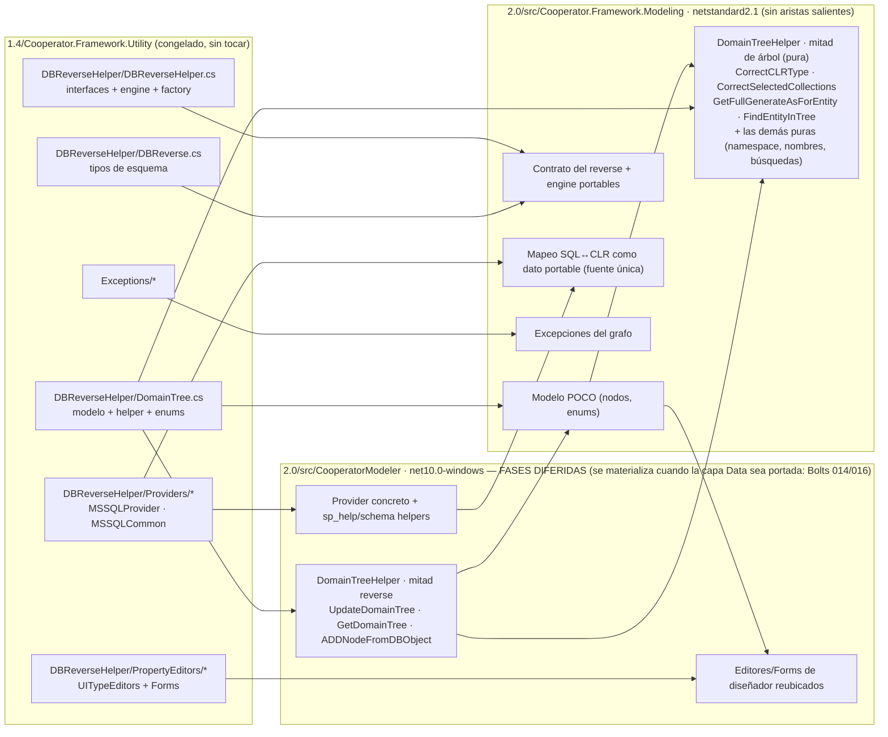

<!--
  LANGUAGE POLICY (§3.15): YAML keys, status enums, IDs and section headings (##) stay in English (the schema);
  all prose goes in the project's content_language (devflow/LANGUAGE).

  ⚠️ PRE-SPEC EVIDENCE GATE (§2.4.1): corrida antes de escribir esta revisión — §3 registra cada fuente gobernada
     usada, su checkpoint de aprobación y la línea base del repositorio. Ninguna fuente quedó en borrador.
  ⚠️ AITL-SPEC-Approval: esta revisión es un DRAFT. Un V-Bounce o code-run no puede empezar hasta que un
     Dev-validator (+ dueños de dominio aplicables) registren la decisión en el bloque `review` de arriba.
     Un cambio material en una fuente gobernada o en la línea base invalida la aprobación: parar, revisar el
     mismo SPEC canónico y re-aprobar (G15).
  ⚠️ UN BOLT POR SPEC: todas las fases de este documento implementan `US-000.BOLT-003`. El esquema `.coop2` y su
     serialización son del Bolt 004; el retiro de `[Serializable]` de la superficie del framework es del Bolt
     007; el reverse que deja de heredar de la capa de datos es el Bolt 016; el motor es el Bolt 017.
  ⚠️ INTEGRATION TEST PLAN (§3.2.2): `n/a` porque el Bolt declaró `test_integration: not-required`; plan y Bolt
     coinciden y esa coincidencia es parte del gate de §3. Un desajuste sería reporte bloqueante.
  ⚠️ REVISIÓN 4 — REVISIÓN MATERIAL (G15/G16) DEL SPEC DE `US-000.BOLT-003`, disparada por el V-Bounce N°3
     registrado en `devflow/memory/MEM-261016-0125-particion-modeling.md` (`execution_outcome: blocked`). **El
     porteo de las fases A–C volvió a reproducirse y compila `EXIT=0`** (0 errores, 0 advertencias, con la
     directiva de §A.3 sólo en los ocho archivos portados); el bloqueo es de **una línea**: la invariante de
     conteo del arnés del Bolt 001 (`BuildInvariantsTests.Every_project_of_the_tree_has_a_versioned_lock_file`)
     asserta **exactamente 8** proyectos y el proyecto de pruebas que ordena §E.1 sería el **9.º** —medido:
     `Failed: 1, Passed: 48, Total: 49`, `Expected: 8 / Actual: 9`—. Esta revisión **autoriza, como ÚNICA
     excepción documentada a la regla «no se toca ningún archivo del Bolt 001», la corrección de esa línea del
     guard** —de *exactamente 8* a *al menos 8*, preservando el `foreach` de los lock files y la intención de la
     invariante— con **comentario de procedencia** en el archivo y **referencia cruzada** en la constancia y el
     MEM del ejecutor (§5, §6/A.4, §9, §13, §14, §16). **La excepción se toma una sola vez para toda la ola**: la
     colisión se repetiría en cada Bolt que agregue una suite o un fixture (004, 013, 017…).
     Ajusta §1, §3, §4, §5, §6/A·E, §7/AC-8, §8.1, §9, §13, §14, §15, §16, §17 y §18.
     ⚠️ **La fase D sigue diferida** (obligación registrada, §D.3), la **política de nulabilidad** de §A.3 sigue
     vigente, la **partición de `DomainTreeHelper`** no se reabre y **las decisiones (a) y (b) siguen en vigor**.
     ⚠️ (Histórica) **REVISIÓN 3 — REVISIÓN MATERIAL (G15/G16) DEL SPEC DE `US-000.BOLT-003`**, disparada por el V-Bounce N°2
     registrado en `devflow/memory/MEM-261016-0107-particion-modeling.md` (`execution_outcome: blocked`). **La
     partición de la revisión 2 funciona y quedó demostrada** (el paquete portable compiló limpio, con 0 aristas
     salientes y exactamente una dependencia de terceros); el bloqueo está **entero en la fase D**: reubicar
     `MSSQLProvider.cs` «como está» conserva `DataAccess : Cooperator.Framework.Data.BaseRule` —un tipo que no
     existe en el árbol 2.0— y `System.Data.SqlClient`, cuyo reemplazo y versión son de ADR-005 §3.1. Esta
     revisión **difiere la fase D** (la salida (b) del MEM, con la disciplina de obligación registrada) y fija la
     **política de nulabilidad del código portado**: el entregable pasa a ser **`Modeling` completo y verificado**
     —fases A–C + la evidencia portable de E—, y la **reubicación del tooling** se materializa cuando la capa
     `Data` sea portada por sus Bolts (materialmente el **014**, `SPEC-261016-0020`, y el **016**,
     `SPEC-261016-0027`), con **obligación registrada**. Ajusta §4, §6/A·D·E, §7, §8.1, §9, §12, §13, §14, §15,
     §16 y §17.
     ⚠️ **Las decisiones (a)** (base `System.Exception` para las excepciones del grafo), **(b)** (reubicación de
     los `PropertyEditors/*` al tooling) y **la partición de `DomainTreeHelper`** siguen **en vigor**: esta
     revisión no las reabre (su registro queda en §18).
     ⚠️ (Histórica) **REVISIÓN 2 — REVISIÓN MATERIAL (G15/G16) DEL SPEC DE `US-000.BOLT-003`**, disparada por el
     V-Bounce N°1 registrado en `devflow/memory/MEM-261016-0046-particion-modeling.md`. Cambió dos cosas y
     **nada** más: (1) el `DomainTreeHelper` **se parte** —la mitad de lógica de árbol que el **modelo** usa
     (8 sitios) entra a `Modeling`, la mitad que instancia la factory concreta y usa la cadena de conexión queda
     en el tooling—, y (2) el presupuesto de dependencias de `Modeling` se **alinea con ADR-001 §3.4**: admite
     **exactamente `System.Text.Json`** (y nada más de terceros), de modo que la invariante entregada por el
     arnés del Bolt 001 quede verde — sin tocar ningún archivo del Bolt 001.
     Lo que la revisión 1 no vio y la revisión 2 resolvió: el acoplamiento modelo↔helper se había descrito en un
     solo sentido (el helper *usa* el modelo); el sentido contrario (el modelo *llama* al helper) dejaba al
     paquete portable con 8 referencias a un tipo que la propia clasificación ponía en el tooling.
-->

# SPEC-261016-0004 — Partición de `Cooperator.Framework.Modeling`: modelo portable como POCO, fuente única del mapeo de tipos y rotura del acoplamiento con el provider y la UI

| Field | Value |
|-------|-------|
| **Origin** | REV-001 (§6 ítem 2) |
| **Bolt** | [US-000.BOLT-003](../functional/bolts/US-000.BOLT-003-particion-modeling.md) |
| **ADRs** | [ADR-001](../adrs/ADR-001-layout-y-empaquetado-cooperator-2.md) · [ADR-008](../adrs/ADR-008-compatibilidad-de-api.md) · [ADR-002](../adrs/ADR-002-formato-coop2-y-migrador.md) |
| **Risk Class** | medium |
| **Revision** | 4 |

---

## 1. Objective

Se construye el paquete **`Cooperator.Framework.Modeling`** (`netstandard2.1`): el **modelo del producto** y su
**contrato de datos** como un ensamblado **portable**, sin ninguna dependencia hacia la interfaz de usuario ni
hacia el acceso a datos, junto con la **fuente única** del mapeo de tipos SQL↔CLR como **dato portable** y con la
**lógica de árbol que el modelo mismo usa** (la mitad pura de `DomainTreeHelper`, que sus setters invocan en ocho
sitios). Lo que hoy vive pegado al modelo pero **no** es modelo —el **provider concreto de base de datos**, la
mitad del **reverse-engineering** que instancia su factory y usa la cadena de conexión, y los **editores/Forms de
diseñador**— queda **del lado del tooling**.

El problema que resuelve está documentado con evidencia (REV-001 F-27/F-28/F-29, §6 ítem 2): el modelo
(`DBReverseHelper/DomainTree.cs`) lleva atributos de diseñador (`System.ComponentModel.Design`,
`System.Windows.Forms.Design`, `System.Drawing.Design`) y editores `UITypeEditor`, y **importa el provider
concreto de SQL Server** (`DomainTree.cs:35`), mientras el provider consume el modelo: un acoplamiento
**bidireccional**. Mientras ese `using` exista, el modelo **no puede vivir en una librería portable**, y sin
modelo portable no hay `.coop2` que un agente pueda editar y mergear (F-41/F-42). En paralelo, el mapeo de
tipos SQL↔CLR vive dentro del archivo del provider (`MSSQLCommon.cs`), de modo que el reverse y el motor de
generación podrían divergir sobre qué tipo CLR corresponde a un tipo nativo.

Si no se implementa: el formato vigente no puede existir fuera de Windows, el consumo del modelo sigue atado a
la UI del diseñador, el reverse sigue arrastrando la maquinaria de reglas y transacciones de la capa de datos, y
el mapeo de tipos queda duplicado por construcción.

Este SPEC entrega la **partición** y su evidencia verificable: el ensamblado portable compilando, la suite de
caracterización verde sobre los tipos movidos, el **reporte de dependencias por ensamblado** sin las aristas
prohibidas y el **mapeo de tipos localizado en un único artefacto**, consumido desde el reverse ya relocalizado.
**No** implementa el contrato `.coop2` (Bolt 004), **no** reescribe el motor (Bolts 017/018), **no** cambia la
suerte del reverse frente a la capa de datos (Bolt 016) ni la interfaz del shell (Bolt 025).

**Alcance entregable y su secuencia (revisión 3).** El entregable de este Bolt es **`Modeling` completo y
verificado**: el paquete portable (fases A–C) con su **evidencia portable** (fase E: reporte de dependencias por
proyecto y por ensamblado, mapa tipo→destino del modelo, POCOs sin metadata de diseñador ni serialización binaria,
y el mapeo SQL↔CLR como artefacto único). La **reubicación del tooling** (fase D: `MSSQLProvider`/
`MSSQLReverseFactory`, el resto de `MSSQLCommon`, la **mitad reverse** de `DomainTreeHelper` y los
`PropertyEditors/*`) **no es alcance de este Bolt**: los archivos a reubicar conservan `DataAccess :
Cooperator.Framework.Data.BaseRule` —un tipo que **no existe** en el árbol 2.0— y `System.Data.SqlClient`, cuyo
reemplazo y **versión** son de ADR-005 §3.1; se materializa **cuando la capa `Data` sea portada por sus Bolts**
(materialmente el **014**, `SPEC-261016-0020`, y el **016**, `SPEC-261016-0027`), con **obligación registrada**
(§4, §6/D, §6/E.2, §7/AC-6, §12). La entrega **sin** la fase D **es válida** y no crea una segunda fuente del
modelo: el modelo vive **sólo** en `Modeling`. Además se fija la **política de nulabilidad del código portado**
(§6/A.3): `#nullable disable` **por archivo portado del 1.4** —medido: sin ella el porteo produce 28 diagnósticos
`CS86xx` que el árbol convierte en errores; con ella, `EXIT=0`, 0 errores y 0 advertencias—, **nunca** en código
nuevo ni a nivel de proyecto.

**Única excepción autorizada a la regla «no se toca ningún archivo del Bolt 001» (revisión 4).** Esta revisión
autoriza **una** intervención sobre el arnés del Bolt 001, y **una sola vez para toda la ola**: la corrección de
**una línea** del guard de conteo de `2.0/tests/Cooperator.Harness.Tests/BuildInvariantsTests.cs`
(`Every_project_of_the_tree_has_a_versioned_lock_file`), que hoy asserta **exactamente 8** proyectos del árbol
—`Assert.Equal(Portables.Length + 4, projects.Length)`— y que impediría que **este Bolt** (y cualquiera que agregue
una suite o un fixture: 004, 013, 017…) cierre su gate de tests en `pass`. El guard pasa a exigir **al menos** esos
proyectos (`Assert.True(projects.Length >= Portables.Length + 4, …)`), conservando su **intención** —el `foreach`
que verifica el `packages.lock.json` de **cada** proyecto queda **intacto**, y el proyecto nuevo también deberá
tenerlo—. Es la corrección de un **invariante excesivamente estricto** de la fase 1, **no** un cambio de contrato;
va con **comentario de procedencia** en el archivo y **referencia cruzada** en la constancia y el MEM del ejecutor
(§5, §6/A.4, §14). El resto del archivo y **cualquier otro** archivo del Bolt 001 siguen **intocables**.

---

## 2. Context

**De dónde viene la necesidad.** `REV-001` §4.2 dejó tres hallazgos mayores que este Bolt ejecuta:
**F-27** (el modelo acoplado a diseñadores WinForms/atributos de diseñador: `DomainTree.cs:1616/1672/2630`
`[EditorAttribute]`, `:1646` `[DesignerSerializationVisibility(Content)]`, y los `PropertyEditors/*` que
implementan `IWindowsFormsEditorService`), **F-28** (diálogos WinForms completos dentro de la librería del
framework: `StringEditorForm`, `ToStringInfoEditorForm` con sus recursos) y **F-29** (el
reverse-engineering es SQL Server-específico y **hereda** de la capa de datos: `MSSQLProvider.cs` usa
`exec sp_help`, `INFORMATION_SCHEMA`, `sp_fkeys` a través de una clase privada `DataAccess : BaseRule`). El §6
ítem 2 rutea F-27/F-28 a este Bolt vía ADR-001.

**Qué quedó decidido aguas arriba** (no se reabre):

- **ADR-001 §3.1** — el paquete nuevo `Cooperator.Framework.Modeling` es `netstandard2.1`; contiene el modelo
  como **POCO** (sin atributos de editor ni tipos de UI), `DBReverse` (`DBObject`, `DBField`, `DBTable`,
  `DBForeignKey`, enums), `IDBReverseProvider`, `IDBTypeConverter` y el contrato de lectura/escritura del
  `.coop2`; **no depende de `Data`**; `Cooperator.Framework.Utility` **no existe** en la 2.0; `Providers/*` y
  los editors/Forms van al **tooling**; y la **dirección de dependencias** está fijada en el diagrama de
  direcciones permitidas, donde `Modeling` **no tiene ninguna arista saliente**.
- **ADR-001 §3.1/§3.6 (dos puntos duros)** — (a) hay que **extraer el `using`
  Cooperator.Framework.Utility.DBReverseHelper.Providers.MSSQL` del modelo** y **reubicar el reverse**
  (`MSSQLProvider`, el resto de `MSSQLCommon`) en el tooling: no es "mover archivos"; (b) el **mapeo de tipos
  SQL↔CLR** (`IDBTypeConverter`, hoy `MSSQLTypeConverter.NativeType2CLRType`) vive en `Modeling` **como dato
  portable** (la interfaz + la tabla) y lo consumen **el reverse y el motor**; por eso `MSSQLCommon.cs` **no
  migra completo**: la tabla se **extrae** y el resto (`sp_help`, queries de schema y helpers de lectura) va al
  tooling.
- **ADR-008 §3.2/§3.4** — los tipos del grafo que migran a `Modeling` **nacen como POCOs, sin `[Serializable]`
  ni `SerializationInfo`**; su persistencia es el `.coop2`, con los derivados recalculados al leer; en la
  superficie de la 2.0 no hay `ISerializable`/`GetObjectData` y no se emite `SYSLIB0051`.
- **ADR-002 §3.1** — el modelo del archivo de modelo es **POCO, sin atributos de editor ni tipos de UI**, y los
  valores derivados **no se serializan**: se recalculan al leer. El esquema y el lector/escritor son del Bolt
  004.
- **ADR-003 §3.5** y **ADR-005 §3.6** — el motor **consume** el mapeo de `Modeling` y **no** lo redefine; el
  reverse deja de heredar de la capa de datos en **su** Bolt, no acá.

**Qué decide este SPEC, dentro de esas restricciones.** La **clasificación tipo por tipo** (modelo vs tooling),
el **destino físico** de cada archivo portado, la **rotura del acoplamiento** en los dos sentidos, la **forma
del artefacto único del mapeo de tipos**, la **partición de `DomainTreeHelper`** —mitad de lógica de árbol al
paquete portable, mitad de reverse (factory + cadena de conexión) al tooling—, la **política de nulabilidad del
código portado** (§6/A.3) y el **proyecto del tooling** que hospeda lo reubicado mientras el shell del Modeler no
existe (es del Bolt 025). Por la revisión 3, **lo que este Bolt entrega es el subgrafo portable** (modelo,
contrato, mapeo y la mitad de árbol del helper) y **la reubicación del tooling queda declarada como fase
diferida con obligación registrada** (§6/D), porque depende de la capa `Data` que portan los Bolts 014/016.

**Diagrama de la partición:**



> **Direcciones del reparto:** el **modelo llama a la mitad pura** (`M1 → M5`, las ocho invocaciones de
> `CorrectCLRType`/`CorrectSelectedCollections`/`GetFullGenerateAsForEntity`/`FindEntityInTree`), y la **mitad
> reverse llama a la pura** (`T2 → M5`) porque `ADDNodeFromDBObject`, `GetDomainTree` y `UpdateDomainTree` se
> apoyan en ellas: tooling → `Modeling` es una dirección **permitida** (ADR-001 §3.1), y lo que **no** puede
> existir es lo contrario (`M5`/`M1` hacia `T2`).
>
> **Qué se materializa en este Bolt (revisión 3):** el **subgrafo `MOD`** —con las aristas `M1 → M5` resueltas
> **dentro** del paquete y sin ninguna saliente— y la **extracción** del `using` del provider desde el modelo. El
> **subgrafo `TOOL`** queda **diferido**: sus tres cajas (`T1`, `T2`, `T3`) y las aristas `PR → T1`, `DT → T2`,
> `ED → T3` y `M1 → T3` se ejecutan cuando la capa `Data` sea portada (Bolts 014/016), con la **obligación
> registrada** (§6/D, §7/AC-6, §12). Que `TOOL` no exista hoy **no** deja aristas colgando: el modelo no nombra
> a la UI ni al provider (su acoplamiento al editor de `DomainTree.cs` se retira en §B.1).

---

## 3. Source inventory and approval references

> Pre-SPEC evidence gate (§2.4.1) corrido el `2026-10-16` antes de escribir esta revisión. Resultado: **gate
> pasa** — ninguna fuente gobernada usada está en borrador, rechazada ni vencida, y el plan de integración
> coincide con el `test_integration` del Bolt.

La **revisión 3** vuelve a correr el gate: **PASA**. Las fuentes gobernadas siguen aprobadas y **sin cambio
material** —el V-Bounce N°2 lo verificó explícitamente (`MEM-261016-0107` §8.4): el Bolt conserva su
`AITL-BOLT-READY-Approval`, `REV-001` sigue `approved`, los ADR siguen `accepted` y `1.4/**` está intacto frente a
la baseline— y lo que cambia es de **alcance/secuencia** (la fase D pasa a obligación registrada) más una
**política de build** que el árbol hereda y que el porteo colisiona (la nulabilidad de §6/A.3). Ninguna de las dos
es un cambio de fuente: son **hallazgos de ejecución** de los V-Bounces N°1 y N°2.

La **revisión 4** vuelve a correr el gate: **PASA**. Las fuentes gobernadas siguen aprobadas y **sin cambio
material** —el V-Bounce N°3 lo verificó (`MEM-261016-0125` §8.3): el Bolt conserva su `AITL-BOLT-READY-Approval`,
`REV-001` sigue `approved`, los ADR siguen `accepted`, la baseline es la misma y `1.4/**` está intacto—. Lo que
cambia es una **corrección del arnés del Bolt 001** (la **única excepción** de §1/§5/§14) y el ajuste coherente de
§E.1/§9/AC-8: un hallazgo de **ejecución** —una invariante de la fase 1 demasiado estricta para las fases
siguientes—, no un cambio de fuente gobernada.

| Source | Ref | Approval |
|--------|-----|----------|
| Bolt | [`US-000.BOLT-003`](../functional/bolts/US-000.BOLT-003-particion-modeling.md) — `status: ready`, `risk_class: medium`, `data_classification: internal`, `test_integration: not-required` | `AITL-BOLT-READY-Approval` ✓ (2026-10-15T23:47:42-03:00, agent:dotnet-architect-reviewer-agent) |
| Parent (container) | [`US-000`](../functional/user-stories/US-000-non-functional.md) | Contenedor permanente — sin ciclo de aprobación (§2.6) |
| Review finding | [`REV-001`](../reviews/REV-001-analisis-migracion-cooperator.md) — F-27, F-28, F-29 (y F-32 Compliant como base del destino portable), §6 ítems 2 y 5 | `AITL-REV-Approval` ✓ (aprobado 2026-10-15) |
| ADR | [`ADR-001`](../adrs/ADR-001-layout-y-empaquetado-cooperator-2.md) — §3.1 (mapa de paquetes/TFMs, contenido de `Modeling`, direcciones permitidas, los dos puntos duros de la partición), §3.3 (naming/firma), §3.4 (dependencias), §3.5 (deprecaciones), §3.6 (frontera del mapeo de tipos) | `AITL-ADR-Approval` ✓ (`accepted`, 2026-10-15T22:32:47-03:00) |
| ADR | [`ADR-008`](../adrs/ADR-008-compatibilidad-de-api.md) — §3.2 (el grafo migra como POCOs; `[Serializable]`/`SerializationInfo` fuera), §3.4 (prohibición y verificación de `SYSLIB0051`), §3.1 (política de rupturas documentadas) | `AITL-ADR-Approval` ✓ (`accepted`, 2026-10-15T23:11:40-03:00) |
| ADR | [`ADR-002`](../adrs/ADR-002-formato-coop2-y-migrador.md) — §3.1 (el modelo es POCO sin atributos de UI; los derivados se recalculan al leer) y §3.4 (el contrato y la serialización viven en `Modeling`; el migrador `net48` los duplica) | `AITL-ADR-Approval` ✓ (`accepted`, 2026-10-15T22:32:47-03:00) |
| Previous Bolt (dependency, no fuente gobernada) | [`US-000.BOLT-001`](../functional/bolts/US-000.BOLT-001-arnes-de-tests-y-build-reproducible.md) — arnés de tests, configuración de build compartida y versiones centralizadas | `AITL-BOLT-READY-Approval` ✓ (2026-10-15T23:47:42-03:00) |
| SPECs de la capa `Data` (relación de **secuencia**, no prerrequisito — revisión 3) | [`SPEC-261016-0020-…`](./SPEC-261016-0020-provider-de-datos.md) (Bolt 014) y [`SPEC-261016-0027-…`](./SPEC-261016-0027-reverse-sin-baserule.md) (Bolt 016) | Ambos **en disco**; aportan la capa `Data` y su reverse, y con ella **materializan y cierran la fase D** de este SPEC (§4, §6/D, §7/AC-6) |
| Artefacto del Bolt 001 intervenido por **excepción autorizada** (revisión 4) | `2.0/tests/Cooperator.Harness.Tests/BuildInvariantsTests.cs` — guard `Every_project_of_the_tree_has_a_versioned_lock_file` (L195; `Assert.Equal(Portables.Length + 4, projects.Length)`, L198; `TreeProjects()`, L217) | La **única** línea autorizada a cambiar en el arnés del Bolt 001: de conteo exacto a **mínimo** (§5, §6/A.4, §14). Medición del conflicto: `MEM-261016-0125` §8.1/§9.3 (`Expected: 8 / Actual: 9`, `Failed: 1, Passed: 48, Total: 49`) |
| Repository baseline | `git` commit **`6aa497f793cd3ab9d83c68db7ef2c1d80d3421d4`** (`6aa497f`, "devflow: ADR-004..009 accepted (routing complete, 9 ADRs) + run 3 record") | — |

**Contexto de código usado como evidencia** (árbol `1.4/` **congelado**, sólo lectura, sin editar una línea):
`1.4/Cooperator.Framework.Utility/Cooperator.Framework.Utility.csproj` (referencias `System.Design`,
`System.Drawing`, `System.Windows.Forms`, `System.Drawing.Design` transitiva — F-27/F-28/F-44);
`DBReverseHelper/DomainTree.cs` (`using …Providers.MSSQL` en la línea 35; atributos de diseñador en
1616/1646/1672/2630; **anatomía verificada del archivo** (2360 líneas): `enum CollectionTypeEnum` en L44-75,
**`static class DomainTreeHelper` en L76-1056 con 14 métodos**, `BaseTreeNode` en L1058, `EntityNode` en L1144,
`PropertyNode` en L1699, `RelatedField` en L2306, `ToStringStruct` en L2445, `enum DatabaseQueryReturnType` en
L2527 y `DatabaseQuery` en L2560 — y las **ocho invocaciones del modelo a `DomainTreeHelper`** en L1226
(`CorrectCLRType`, en `EntityNode.GenerateAs`), L1635 (`CorrectSelectedCollections`, en
`EntityNode.GenerateAsChildOf`), L1838 (`CorrectCLRType`, en el setter de tipo de `PropertyNode`), L2187/2206/2215
(`GetFullGenerateAsForEntity`, en `PropertyNode.GenerateAsType`) y L2191/2222 (`FindEntityInTree`, en el mismo
setter); el helper contiene además `GetDomainTree(string connectionString, …)` instanciando `MSSQLReverseFactory`
en la línea 201; nodo raíz sintético `"Model"`; las vistas agregadas como tablas en las líneas 204-207),
`DBReverseHelper/DBReverse.cs` (`OrderEnum`, `DBObject`, `DBField`, `DBFieldKey`,
`DBFieldFKey`, `DBKey<T>`, `DBPrimaryKey`, `DBForeignKey`, `DBTable`, `DataBase`),
`DBReverseHelper/DBReverseHelper.cs` (`IDBReverseProvider`, `IDBTypeConverter`, `DBReverseEngine`,
`DBReverseEngineFactory`, `IncludedEnum`, `DBParentsHelper`), `DBReverseHelper/Providers/MSSQLCommon.cs`
(`SP_HelpTablesEnum`, `MSSQLTypeConverter : IDBTypeConverter` con la tabla `NativeType2CLRType`),
`DBReverseHelper/Providers/MSSQLProvider.cs` (`MSSQLReverseFactory`, `MSSQLProvider`, `DataAccess : BaseRule`),
`DBReverseHelper/PropertyEditors/*` (`DropDownListEditor`, `StringEditor`, `StringEditorForm` + `.Designer` +
`.resx`, `ToStringInfoEditor`, `ToStringInfoEditorForm` + `.Designer` + `.resx`) y `Exceptions/*`
(`UtilityException : Cooperator.Framework.Library.Exceptions.BaseException`, `UnknownDBTypeExeception`,
`NodeAlreadyExistException`, `CannotAddOrRemoveItemException`, `CompilerException`).

**Coherencia del plan de integración:** el Bolt declara `test_integration: not-required` (§3.2.2) y este SPEC
declara `integration_test_plan.applicability: "n/a"` con su razón. **No hay desajuste** y por lo tanto no hay
reporte bloqueante.

---

## 4. Scope

### In scope

- El proyecto **`2.0/src/Cooperator.Framework.Modeling/`**: `netstandard2.1`, un solo TFM, SDK-style,
  firmado como el resto de la 2.0, con **exactamente una dependencia de terceros —`System.Text.Json`—** (ADR-001
  §3.4, versión fijada centralmente) y **cero referencias salientes**.
- El **porte del modelo** como POCO: los nodos del grafo (`BaseTreeNode`, `EntityNode`, `PropertyNode`,
  `RelatedField`, `ToStringStruct`, `DatabaseQuery`) y sus enums (`CollectionTypeEnum`,
  `DatabaseQueryReturnType`), **sin atributos de editor/diseñador** y **sin `[Serializable]` ni
  `SerializationInfo`**.
- El **contrato portable del reverse**: `IDBReverseProvider`, `IDBTypeConverter`, `DBReverseEngine`,
  `DBReverseEngineFactory`, los tipos de esquema (`DBObject`, `DBField`, `DBFieldKey`, `DBFieldFKey`,
  `DBKey<T>`, `DBPrimaryKey`, `DBForeignKey`, `DBTable`, `DataBase`), `OrderEnum`, `IncludedEnum` y el helper
  portable que corresponda.
- La **fuente única del mapeo de tipos SQL↔CLR**: la tabla como **dato portable** en `Modeling`, extraída de
  `MSSQLTypeConverter.NativeType2CLRType`, con su implementación de `IDBTypeConverter` sobre esa tabla, y su
  **consumo desde el reverse relocalizado**.
- Las **excepciones del grafo** en `Modeling` como POCOs (`UtilityException`, `UnknownDBTypeExeception`,
  `NodeAlreadyExistException`, `CannotAddOrRemoveItemException`).
- La **rotura del acoplamiento bidireccional**: el modelo deja de importar el provider (se extrae el `using` de
  `DomainTree.cs:35`) y el provider deja de consumir tipos del modelo fuera del paquete portable; además, el
  **tercer acoplamiento que la revisión 1 no vio** —las **ocho** invocaciones del modelo a `DomainTreeHelper`— se
  resuelve **dentro** del paquete, porque la mitad del helper que el modelo usa entra a `Modeling` (§B.2).
- **La declaración de la partición del tooling (fase D diferida, con obligación registrada):** el destino de cada
  archivo a reubicar —el provider concreto (`MSSQLProvider`, `MSSQLReverseFactory`), el resto de `MSSQLCommon.cs`
  (`SP_HelpTablesEnum`, `sp_help`, queries de schema y helpers de lectura), la **mitad reverse** de
  `DomainTreeHelper` (`UpdateDomainTree`, `GetDomainTree`, `ADDNodeFromDBObject`) y los `PropertyEditors/*` con sus
  Forms y recursos— queda **especificado** en §6/D.1 tipo por tipo, y su **ejecución** —con el **proyecto del
  tooling** que los hospeda (`2.0/src/CooperatorModeler/`, `net10.0-windows`, ADR-001 §3.1)— se materializa cuando
  la capa `Data` sea portada por sus Bolts (014/016). Crear ese proyecto ahora exigiría compilar el reverse «como
  está» sobre `Data.BaseRule` (ausente en `2.0/`) y `System.Data.SqlClient` (retirado por ADR-005 §3.1): el
  bloqueo del V-Bounce N°2, `MEM-261016-0107` §8.1.
- La **política de nulabilidad del código portado** (§6/A.3): `#nullable disable` **por archivo portado del 1.4**,
  con su evidencia medida, y **nunca** en código nuevo ni a nivel de proyecto.
- **La corrección autorizada del guard del arnés del Bolt 001** —la **única** excepción a la regla de no tocar sus
  archivos (§1, §5, §6/A.4, §14)—: pasar `Assert.Equal(Portables.Length + 4, projects.Length)` (L198 de
  `BuildInvariantsTests.cs`) a `Assert.True(projects.Length >= Portables.Length + 4, …)`, con **comentario de
  procedencia**, para que el proyecto de pruebas de §E.1 —el **9.º** proyecto del árbol— pueda existir y el gate de
  tests cierre en `pass`. **Ninguna otra línea** de ese archivo, ni ningún otro archivo del Bolt 001, se modifica.
- La **evidencia portable**: build del paquete `Modeling` y de su proyecto de pruebas, **reporte de dependencias
  por proyecto (lock file) y por ensamblado**, suite de caracterización verde sobre los tipos movidos, mapa
  tipo→destino **del modelo** con la constancia de lo que dejó de existir, y la lista de rupturas de superficie
  para las notas de migración (Bolt 028, ADR-008 §3.1).

### Out of scope

- El **esquema del `.coop2`**, su `schemaVersion`, su lector/escritor y su test bilateral: **Bolt 004**
  (ADR-002 §3.1/§3.4). Este Bolt deja el paquete **listo** para ese contrato: declara `System.Text.Json` con la
  versión centralizada (ADR-001 §3.4) pero **no** agrega código de serialización, que es de ese Bolt.
- **La salida 2 del bloqueo del V-Bounce N°3** —plegar las pruebas de §E.1 dentro de un proyecto existente del árbol,
  o montar sus fuentes por `<Compile Include>`—: **descartada** (revisión 4). El árbol **debe** poder hospedar un
  proyecto de pruebas por paquete: es lo que §E.1 lista (`…/Cooperator.Framework.Modeling.Tests.csproj`) y lo que
  AC-8 mide con «su **proyecto de pruebas**». Además, la colisión del guard se repetiría igual en cada Bolt que
  agregue una suite o un fixture (004, 013, 017…), así que se resuelve **una sola vez** corrigiendo el guard
  (§6/A.4) en lugar de deformar el entregable.
- **La reubicación de los archivos del tooling y el proyecto que los hospeda** (`2.0/src/CooperatorModeler/`):
  **fase D diferida** (revisión 3). Se materializa cuando la capa `Data` sea portada por sus Bolts —materialmente
  el **014** ([`SPEC-261016-0020`](./SPEC-261016-0020-provider-de-datos.md), provider de ADR-005) y el **016**
  ([`SPEC-261016-0027`](./SPEC-261016-0027-reverse-sin-baserule.md), el reverse que deja de heredar)—. Motivo
  **verificado por sonda** en el V-Bounce N°2: `MSSQLProvider.cs` conserva `private class DataAccess :
  Cooperator.Framework.Data.BaseRule` (tipo ausente: `2.0/src` tiene cero `.cs` y el stub de `Data` no lo
  contiene) y `System.Data.SqlClient` exige un paquete que ADR-005 §3.1 **retira** con versión y *smoke test* de
  conexión real asignados al 014 (`MEM-261016-0107` §8.1). Queda como **obligación registrada** (§6/D, §7/AC-6,
  §12, §13).
- El **reverse que deja de heredar** de la capa de datos, su acceso por el proveedor único y su toma de la
  cadena de conexión de la configuración portable: **Bolt 016** (ADR-005 §3.6). Acá el reverse **se reubica
  como está** (conserva su comportamiento y su herencia actual): es una partición, no una reescritura.
- El **motor de generación** y su set de plantillas: Bolts 017/018/019/020/021 (ADR-003). El `ScriptingHost`,
  `ScriptsEnvironment` y `CompilerException` **no** entran en este Bolt: su destino es el slot del motor.
- El **shell del Modeler** (WPF), su editor dirigido por esquema, su estado de usuario y su empaquetado:
  Bolts 025/026/027 (ADR-009).
- El **reemplazo del proveedor de datos** de la capa `Data` y su borde de conversión: **Bolt 014** (ADR-005).
- El **retiro de `[Serializable]`/`SerializationInfo` de la superficie del framework** restante (las
  excepciones de `Core`/`Data`/`Library` y la base `BaseException`): **Bolt 007**. Este Bolt sólo garantiza
  que **los tipos que migran a `Modeling`** nazcan POCOs (Bolt 003 §2, ADR-008 §3.2).
- Las **notas de migración** como documento: **Bolt 028**. Este Bolt aporta su lista de rupturas.
- Cualquier **edición del árbol `1.4/`** o de sus proyectos (se referencian o se copian como fuente; nunca se
  modifican).

---

## 5. Prerequisites and baseline

- **Bolt 001 (`US-000.BOLT-001`, `ready`)** y su SPEC canónica
  ([`SPEC-261016-0000-arnes-tests-y-build-reproducible.md`](./SPEC-261016-0000-arnes-tests-y-build-reproducible.md),
  redactada en la misma ola): la estructura de solución, la configuración de build compartida
  (`Directory.Build.props`: analizadores, determinismo, warnings como error, `AssemblyVersion` `2.0.0.0`, firma
  con `CooperatorFramework.snk`) y la **versión centralizada** de cada paquete (`Directory.Packages.props`),
  más el arnés de tests sobre el que corre la caracterización. Su SPEC es el `prerequisites` declarado en el
  frontmatter y el Bolt ya lo registra en `dependencies`. Si al iniciar el V-Bounce esa infraestructura no
  existe, **parar y reportar** (§15).
- **La suite de caracterización del Bolt 001** ejecutable y verde **antes** de la partición: es la red que hace
  verificable una reubicación de tipos (el Bolt la nombra como evidencia). Si la suite no ejercita los tipos
  movidos, este V-Bounce **extiende la cobertura** y lo registra en el MEM (§14): no se declara paridad sin
  medirla.
- **El paquete `Modeling` tal como lo dejó el Bolt 001 (stub) y las invariantes del arnés:** el stub ya declara
  `System.Text.Json` y la suite del arnés (`Cooperator.Harness.Tests`,
  `BuildInvariantsTests.Modeling_declares_exactly_system_text_json`) asserta **exactamente** esa dependencia
  directa de terceros. Esta revisión **se alinea con esa invariante** en lugar de contradecirla (§A.1 y §14): el
  presupuesto del paquete pasa a ser "`System.Text.Json`, y nada más de terceros". **No se toca ningún archivo
  del Bolt 001** — la alineación es de este SPEC *(única excepción: la corrección del guard de conteo que autoriza
  la revisión 4, §6/A.4 — ver la cláusula de excepción al final de este apartado)*.
- **Árbol `1.4/` presente y congelado** en la línea base registrada en §3, y las fuentes del modelo/reverse
  disponibles para el porte (`1.4/Cooperator.Framework.Utility/DBReverseHelper/**`, `Exceptions/**`).
- **Toolchain .NET 10 (SDK pinneado por el Bolt 001)**: el paquete portable se compila con `netstandard2.1` y
  el proyecto del tooling con `net10.0-windows`; el build corre en Windows (el shell y el tooling son
  Windows-only por decisión, ADR-001 §3.5).
- **Pack de referencia de `netstandard2.1`**: provisto por el SDK pinneado; **no** se agrega ningún paquete de
  compatibilidad (ADR-001 §3.2: sin shims, sin multi-target).
- **Estado medido del árbol 2.0 al escribir esta revisión:** `2.0/` existe con la solución, el comando
  reproducible, el arnés y los cuatro `.csproj` portables del Bolt 001, y **cero archivos `.cs`** en `2.0/src`
  (verificado por el V-Bounce N°2, `MEM-261016-0107` §9). El `.csproj` de `Modeling` ya declara `netstandard2.1` +
  **exactamente** `System.Text.Json` + **cero** `ProjectReference`, que es lo que §A.1 pide: **no se toca**.
- **Política de build heredada del Bolt 001 (hallazgo del V-Bounce N°2):** `2.0/Directory.Build.props` fija
  `Nullable=enable` **y** `TreatWarningsAsErrors=true`; el código del 1.4 es previo a nullable y produce **28
  diagnósticos** (`21× CS8618`, `4× CS8603`, `3× CS8625`) que se convierten en errores. La respuesta autorizada es
  **§6/A.3** (directiva por archivo portado). **No se toca ningún archivo del Bolt 001** *(única excepción: la
  corrección del guard de conteo, §6/A.4)*.
- **La capa `Data` y sus Bolts (014/016) — relación de secuencia, declarada (revisión 3):**
  [`SPEC-261016-0020`](./SPEC-261016-0020-provider-de-datos.md) (Bolt 014, provider de ADR-005) y
  [`SPEC-261016-0027`](./SPEC-261016-0027-reverse-sin-baserule.md) (Bolt 016, el reverse que deja de heredar)
  están **en disco**. Son quienes **aportan la capa `Data`** y su reverse, y con ella **materializan la fase D**
  de este SPEC (§4, §6/D, §7/AC-6). No es un prerrequisito de este Bolt —la relación se cierra **al revés**:
  este Bolt entrega el paquete portable que ellos consumen— y por eso la reubicación se **registra** como
  obligación en lugar de bloquear.
- **Decisión de ejecución registrada (no es supuesto):** nada de este Bolt se verifica contra una base de datos
  real; el reverse conserva su comportamiento actual y su verificación contra una base real es del Bolt 016.
  De ahí el plan de integración `n/a`.
- **Excepción única y explícita a la regla «no se toca ningún archivo del Bolt 001» (revisión 4).** Todas las
  cláusulas de ese tipo en este SPEC (§1, §5, §14) tienen **una sola** excepción, acotada y documentada: la
  corrección de **una línea** del guard `Every_project_of_the_tree_has_a_versioned_lock_file` de
  `2.0/tests/Cooperator.Harness.Tests/BuildInvariantsTests.cs` (§6/A.4). La razón es de **secuencia del árbol**, no
  de diseño: la invariante asserta **exactamente 8** proyectos y las fases siguientes agregan proyectos **por
  diseño** (este Bolt, el 004, el 013, el 017…), de modo que sin la corrección **ningún** Bolt que agregue una
  suite o un fixture puede cerrar su gate de tests en `pass` (medición: `MEM-261016-0125` §8.1/§9.3). La excepción
  **no** habilita: tocar otra línea de ese archivo, tocar cualquier otro archivo del Bolt 001, ni debilitar la
  verificación del `packages.lock.json` de **cada** proyecto —el `foreach` de la invariante queda **intacto**—.

---

## 6. Phases

> Todas las fases implementan **el mismo Bolt** (`US-000.BOLT-003`). Nada de este SPEC se implementa antes de
> `AITL-SPEC-Approval` (G14). **En la revisión 3, las fases entregables son A–C y la evidencia portable de E; la
> fase D queda diferida como obligación registrada (§D.3)**: su **especificación** sigue siendo de este Bolt y su
> **ejecución** la cierran los Bolts que aportan la capa `Data`.

### Phase A — El paquete portable `Cooperator.Framework.Modeling`

**Duration:** 2h total cycle — **Complexity:** Low

#### A.1 Proyecto, TFM y política de dependencias

Se crea `2.0/src/Cooperator.Framework.Modeling/Cooperator.Framework.Modeling.csproj`: **SDK-style**, un solo
`TargetFramework` (`netstandard2.1`), firma strong-name como el resto de la 2.0 (ADR-001 §3.3), sin
`Packages.config`, sin `HintPath`, sin referencias muertas, **sin `ProjectReference`** y con **exactamente una
`PackageReference`: `System.Text.Json`** con la versión **fijada centralmente** en `Directory.Packages.props`
(ADR-001 §3.4: «`System.Text.Json` como única dependencia de serialización»). Ninguna otra dependencia de
terceros es admisible en este paquete, y el umbral del gate de dependencias se lee así (§9, §14): **STJ y nada
más**. Esta es la alineación con la invariante del arnés del Bolt 001 (§5) y **no** un cambio de la política del
ADR. Se agrega el proyecto a `2.0/Cooperator2.sln` (creado por el Bolt 001).

**Files created:**
- `2.0/src/Cooperator.Framework.Modeling/Cooperator.Framework.Modeling.csproj` — el ensamblado portable del modelo y su contrato de datos

**Files modified:**
- `2.0/Cooperator2.sln` — alta del proyecto

#### A.2 Regla de porteo (cómo se portan los archivos)

Las fuentes portadas viven **en el árbol 2.0** como archivos nuevos: **no** se crea una copia paralela del
proyecto 1.4 ni se lo retargetea (el 1.4 queda congelado). Cada archivo portado conserva su **nombre de
archivo** y su **estructura interna** respecto del original —para que la revisión sea un diff legible contra la
fuente— y cambia sólo: el **namespace** (la regla de ADR-001 §3.3: namespace = ensamblado = nombre del paquete),
la directiva de nulabilidad de **§A.3** cuando corresponda, lo que este SPEC ordena retirar, y nada más. Los tipos
**no** cambian de nombre.

**Files created:**
- `2.0/src/Cooperator.Framework.Modeling/Model/DomainTree.cs` — nodos del modelo y enums, portados como POCOs (**sin** el helper, que se parte en §B.2)
- `2.0/src/Cooperator.Framework.Modeling/Model/DomainTreeHelper.cs` — la **mitad de árbol** de `DomainTreeHelper` (L76-1056 del 1.4), portada como lógica pura del modelo (§B.2)
- `2.0/src/Cooperator.Framework.Modeling/Reverse/DBReverse.cs` — tipos de esquema y `OrderEnum`
- `2.0/src/Cooperator.Framework.Modeling/Reverse/DBReverseHelper.cs` — interfaces, `DBReverseEngine`, `DBReverseEngineFactory`, `IncludedEnum`
- `2.0/src/Cooperator.Framework.Modeling/Reverse/TypeMapping.cs` — **la** fuente única del mapeo SQL↔CLR (dato + implementación de `IDBTypeConverter`)
- `2.0/src/Cooperator.Framework.Modeling/Exceptions/UtilityException.cs` — base de las excepciones del grafo
- `2.0/src/Cooperator.Framework.Modeling/Exceptions/UnknownDBTypeExeception.cs` — tipo desconocido en el mapeo
- `2.0/src/Cooperator.Framework.Modeling/Exceptions/NodeAlreadyExistException.cs` — alta de nodo duplicado
- `2.0/src/Cooperator.Framework.Modeling/Exceptions/CannotAddOrRemoveItemException.cs` — operación inválida sobre la colección de nodos

#### A.3 Política de nulabilidad del código portado (`#nullable disable` por archivo)

El árbol 2.0 hereda de `2.0/Directory.Build.props` (Bolt 001) `Nullable=enable` **y**
`TreatWarningsAsErrors=true`, mientras que el código del 1.4 es anterior a las anotaciones de nulabilidad. Medido
en el V-Bounce N°2 (`MEM-261016-0107` §8.2): portar los archivos **tal cual** produce exactamente **28
diagnósticos** —`21× CS8618`, `4× CS8603`, `3× CS8625`, y **cero** errores estructurales (ni un `CS0234`/`CS0246`)—
que el árbol convierte en errores; con una directiva `#nullable disable` al frente de cada archivo portado, el
mismo build da **`EXIT=0`, 0 errores y 0 advertencias**.

**Mecanismo autorizado (decidido por esta revisión):** cada archivo **portado del 1.4** empieza con la directiva
`#nullable disable` (primera línea útil, antes de los `using`), y **sólo** esos archivos la llevan:

- **Sí la llevan:** los archivos con código del 1.4 de §A.2 —medido sobre cuatro: `Model/DomainTree.cs`,
  `Model/DomainTreeHelper.cs`, `Reverse/DBReverse.cs`, `Reverse/DBReverseHelper.cs`— y cualquier otro archivo
  **portado del 1.4** que las fases A–C incorporen (los de `Exceptions/`). La directiva **apaga el análisis**, no
  cambia una instrucción de IL: la semántica del 1.4 queda intacta.
- **No la llevan:** el **código nuevo** de este Bolt (`Reverse/TypeMapping.cs` y las pruebas) conserva la
  nulabilidad **activa** del árbol —está escrito para el mundo anotado y no hereda el defecto histórico—, y queda
  **prohibido** `<Nullable>disable</Nullable>` en el `.csproj` del paquete o de cualquier proyecto: apagaría el
  análisis para el paquete entero, incluido el contrato del Bolt 004.

Es **una línea por archivo**, está **documentada** acá y en `MIGRATION-PARTITION.md` (§E.2), y su alcance se
verifica automáticamente (§7/AC-8, §8.1, §13, §15).

#### A.4 Corrección autorizada del guard del arnés del Bolt 001 (una línea, una sola vez para la ola)

El guard `Every_project_of_the_tree_has_a_versioned_lock_file` de
`2.0/tests/Cooperator.Harness.Tests/BuildInvariantsTests.cs` asserta que el árbol tiene **exactamente**
`Portables.Length + 4` proyectos:

```csharp
// antes — Bolt 001, BuildInvariantsTests.cs L198
Assert.Equal(Portables.Length + 4, projects.Length); // 4 portables + 2 suites + 2 fixtures
```

El árbol tiene **8** hoy (4 portables + 2 suites + 2 fixtures) y **todo Bolt que agregue una suite o un fixture lo
lleva a 9** —éste es el primero, con el proyecto de pruebas de §E.1—, de modo que el gate «Unit / component tests:
100 % verdes» **no puede cerrar en `pass`** (medido con el proyecto presente y nada más cambiado: `Failed: 1,
Passed: 48, Total: 49`, `Expected: 8 / Actual: 9`; `MEM-261016-0125` §8.1/§9.3).

**Esta revisión autoriza el cambio de esa única línea**, conservando la intención de la invariante:

```csharp
// después — la misma ubicación
Assert.True(projects.Length >= Portables.Length + 4,
    $"El árbol tiene {projects.Length} proyectos: menos de los {Portables.Length + 4} esperados.");
// y sigue, intacto, el foreach que exige packages.lock.json en cada proyecto
```

**Reglas de la corrección (bounded):**

1. **Es una línea, en un archivo.** No se toca ninguna otra línea de `BuildInvariantsTests.cs` ni ningún otro
   archivo del Bolt 001. La otra aserción de conteo —`Assert.Equal(Portables.Length, projects.Length)` (L181), que
   enumera **sólo** `2.0/src`— **no** se toca: sigue pasando y no es parte del problema.
2. **Se conserva la intención:** el `foreach` que exige `packages.lock.json` versionado en **cada** proyecto del
   árbol queda **intacto**, y el proyecto nuevo deberá tenerlo como cualquier otro. El conteo pasa a ser un
   **mínimo** —una garantía contra una enumeración débil que perdiera proyectos—, no una igualdad que impida crecer.
3. **Comentario de procedencia obligatorio** junto a la línea corregida: por qué cambió, con el hallazgo medido y la
   referencia a este SPEC (p. ej. `// Bolt 003 (SPEC-261016-0004 §A.4): el árbol crece por diseño; el conteo exacto
   impedía agregar proyectos (V-Bounce N°3, MEM-261016-0125 §8.1). El foreach de lock files y la intención no
   cambian.`).
4. **Referencia cruzada en el cierre:** el MEM y la constancia (`api-removals`) del V-Bounce que la ejecute declaran
   la corrección —archivo, línea y **antes/después**—; es la única evidencia admisible de por qué se tocó un
   artefacto del Bolt 001.
5. **No se reabre nada más del Bolt 001:** ni su `.csproj`, ni `Directory.Build.props`/`Directory.Packages.props`,
   ni las suites, ni el stub de `Modeling` (§5, §14, §15).
6. **Es un acto único para la ola:** la colisión se repetiría en cada Bolt que agregue una suite o un fixture
   (004, 013, 017…); corregida la invariante, ninguno de ellos vuelve a toparse con ella ni necesita otra excepción.

---

### Phase B — El modelo como POCO: qué se retira y qué no se porta

**Duration:** 4h total cycle — **Complexity:** High

#### B.1 Retiro de la metadata de diseñador y de la serialización binaria

Sobre los tipos del modelo portados se retira, con el inventario de la evidencia:

1. **Atributos de editor/diseñador** (`[EditorAttribute]`, `[DesignerSerializationVisibility]`, `[Description]`,
   `[Browsable]`, `[DefaultValue]`, `[Category]` y cualquier otro con esa función) y los `using` de
   `System.ComponentModel.Design`, `System.Windows.Forms*`, `System.Drawing*` y del serializador binario. El
   modelo queda **POCO** (ADR-001 §3.1, ADR-002 §3.1): la edición de la 2.0 se hace **dirigida por el esquema
   del contrato**, no por atributos en las clases (ADR-009 §3.2).
2. **`[Serializable]` y todo `SerializationInfo`/`ISerializable`/`GetObjectData`** en los tipos que migran —
   incluidos los del grafo y las excepciones del grafo—: nacen POCOs y su persistencia es el `.coop2`
   (ADR-008 §3.2). El retiro equivalente en el resto de la superficie del framework es del Bolt 007.
3. **Los imports muertos**: en particular el `using System.Runtime.Serialization.Formatters.Binary` del modelo,
   que no se usa (F-30): si el formato binario se retira del camino (F-33/Bolt 002), no puede quedar ni el
   rastro.
4. **El acoplamiento del modelo al editor** (`DomainTree.cs` L1621, dentro del getter `GenerateAsChildOf` de
   `EntityNode`): la sentencia `PropertyEditors.DropDownListEditor.stringList = _ParentCandidates;` **se retira**
   junto con los atributos de editor —es el mismo acoplamiento a la UI, y dejarla sería una arista del modelo
   hacia el tooling, es decir el propio §15—. Es un retiro que las revisiones 1 y 2 **no enumeraban literalmente**
   (supuesto declarado con su justificación en `MEM-261016-0107` §8.6), y por eso entra **también** en la
   constancia de rupturas (§6/E.2) para que las notas del Bolt 028 lo recojan.

**Qué NO se toca en esta fase:** el comportamiento observable de los tipos (miembros, nombres, semántica de
recalculo de derivados) y la **jerarquía de las excepciones entre sí** (`UnknownDBTypeExeception`,
`NodeAlreadyExistException`, `CannotAddOrRemoveItemException` siguen derivando de `UtilityException`).

**Files modified:** los de §A.2 (el contenido portado es el de esta fase).

#### B.2 `DomainTreeHelper` **se parte**: la mitad de árbol entra al modelo, la mitad reverse queda en el tooling

`DomainTreeHelper` (L76-1056 de `DomainTree.cs`, **14 métodos**) no es portable **entero** —contiene
`GetDomainTree(string connectionString, …)`, que **instancia `MSSQLReverseFactory` y usa la cadena de conexión**
(L198-207, incluida la agregación de vistas como tablas)— pero su **mitad de árbol sí lo es**, y el **modelo la
usa**: hay **ocho invocaciones del modelo a `DomainTreeHelper`** (evidencia de código del V-Bounce N°1 bloqueado,
`MEM-261016-0046` §8.1):

| # | Sitio | Tipo del modelo contenedor | Método invocado |
|---|---|---|---|
| 1 | L1226 | `EntityNode` (setter `GenerateAs`) | `CorrectCLRType` |
| 2 | L1635 | `EntityNode` (setter `GenerateAsChildOf`) | `CorrectSelectedCollections` |
| 3 | L1838 | `PropertyNode` (setter de tipo) | `CorrectCLRType` |
| 4 | L2187 | `PropertyNode` (setter `GenerateAsType`) | `GetFullGenerateAsForEntity` |
| 5 | L2191 | `PropertyNode` (setter `GenerateAsType`) | `FindEntityInTree` |
| 6 | L2206 | `PropertyNode` (setter `GenerateAsType`) | `GetFullGenerateAsForEntity` |
| 7 | L2215 | `PropertyNode` (setter `GenerateAsType`) | `GetFullGenerateAsForEntity` |
| 8 | L2222 | `PropertyNode` (setter `GenerateAsType`) | `FindEntityInTree` |

Por eso la clasificación de la revisión 1 —helper entero al tooling— dejaba al paquete portable con ocho
referencias a un tipo que ya no estaba en él (y `netstandard2.1` no puede referenciar `net10.0-windows`: el árbol
**no compilaba**). **Esta revisión parte el helper con un criterio objetivo y verificable**:

> **Criterio de la partición:** si el método instancia la factory concreta, recibe una **cadena de conexión** o
> toma **tipos del esquema de base de datos** (`DataBase`, `DBTable`) ⇒ **tooling**. Si sólo recorre el árbol
> (`BaseTreeNode`, `EntityNode`, `PropertyNode`, `RelatedField`, cadenas) ⇒ **`Modeling`**.

**Reparto resultante (los 14 métodos, por línea de la fuente congelada):**

| Destino | Métodos |
|---|---|
| **`Modeling`** — mitad de árbol (11) | `GetDescriptionFieldNameForEntity` (L840) · `GetGenerateAsForEntity` (L855) · **`GetFullGenerateAsForEntity`** (L866) · `GetGenerateAsForProperty` (L876) · `FindPropertyInTree` (L898) · `GetNamespaceCollection` (L922) · `ResetNamespaceCollection` (L942) · **`FindEntityInTree`** (L953) · **`CorrectCLRType`** (L969) · **`CorrectSelectedCollections`** (L1011) · `CorrectGenerationNamesForRelatedFields` (L1036) — con el campo `private static Dictionary<string,string> _NamespaceCollectionDictionary` (L917), del que **sólo** dependen los dos métodos de namespace (verificado: 0 usos más) |
| **Tooling** — mitad reverse (3) | `UpdateDomainTree(string connectionString, …)` (L85) · `GetDomainTree(string connectionString, …)` (L198) · `ADDNodeFromDBObject(DataBase, EntityNode, DBTable)` (L312, privado) |

En negrita, los **cuatro** que el modelo invoca: quedan **dentro** del paquete, y con ellos los ocho sitios de la
tabla de arriba se resuelven **sin ninguna arista saliente**.

**Fronteras verificadas contra la fuente congelada (V-Bounce N°2, `MEM-261016-0107` §2):** la mitad portable es
`L834–1056` —el doc-comment L834-839 más los 11 métodos— y la mitad reverse es `L76–L833` (`UpdateDomainTree`
L85–197 · `GetDomainTree` L198–311 · `ADDNodeFromDBObject` L312–832). El reparto de 11/3 y las cuatro llamadas
cruzadas (`L184`, `L222`, `L292`, `L297`) quedaron confirmados línea por línea.

**Direcciones del reparto (verificadas en la fuente):** la mitad reverse **llama a la mitad de árbol** —L184
(`CorrectGenerationNamesForRelatedFields`, desde `UpdateDomainTree`), L222/L297 (`FindEntityInTree`, desde
`GetDomainTree`/`ADDNodeFromDBObject`) y L292 (`CorrectSelectedCollections`)— y eso está **permitido**: tooling →
`Modeling` es la dirección de ADR-001 §3.1. Lo que **no** existe (ni puede existir) es lo contrario: ningún tipo
del modelo llama a la mitad reverse del helper.

**Dos detalles que la partición declara en lugar de esconder:**
1. **El estado estático del caché de namespaces** (`_NamespaceCollectionDictionary` + sus dos métodos) viaja tal
   cual con la mitad portable: es preexistente, **no** se rediseña acá (cambiarlo alteraría el comportamiento que
   AC-3 mide) y su caveat de concurrencia queda **heredado y declarado** (§13), no introducido por este Bolt.
2. **El mismo nombre de clase en dos ensamblados** (`DomainTreeHelper` en `Modeling` y en el tooling): es
   deliberado —los tipos **no** cambian de nombre (§A.2)— y cada mitad vive en el namespace de su ensamblado
   (ADR-001 §3.3), de modo que la mitad reverse referencia a la portable por su nombre calificado.

**Files created:** `2.0/src/Cooperator.Framework.Modeling/Model/DomainTreeHelper.cs` (mitad portable, §A.2) en
este Bolt; `2.0/src/CooperatorModeler/DBReverseHelper/DomainTreeHelper.cs` (mitad reverse) se crea **con la fase
D, diferida** (§D.1) — no en este Bolt.

**Evidencia de esta fase:** el inventario de tipos con su destino y la constancia de los atributos retirados
(§E.2, §7/AC-2 y AC-3), más la prueba de que los ocho sitios del modelo se resuelven **dentro** del paquete
(§7/AC-4, §8.1) y el reporte de dependencias por ensamblado sin aristas del modelo hacia el tooling (§E.1).

---

### Phase C — Contrato portable del reverse y el artefacto único del mapeo de tipos

**Duration:** 4h total cycle — **Complexity:** High

#### C.1 Tipos portables del reverse (sin cambios de comportamiento)

`Reverse/DBReverse.cs` y `Reverse/DBReverseHelper.cs` se portan **sin cambios de comportamiento** (F-32: son
POCO portables con cero dependencias Windows): `IDBReverseProvider`, `IDBTypeConverter`, `DBReverseEngine`,
`DBReverseEngineFactory`, `OrderEnum`, `IncludedEnum`, `DBObject`, `DBField`, `DBFieldKey`, `DBFieldFKey`,
`DBKey<T>`, `DBPrimaryKey`, `DBForeignKey`, `DBTable`, `DataBase` y el helper estático portable
(`DBParentsHelper`). El motor de generación los **consume** (ADR-003 §3.1) y el reverse concreto los implementa
(§D.1).

#### C.2 La fuente única del mapeo SQL↔CLR

Se **extrae** la tabla de `MSSQLTypeConverter.NativeType2CLRType` (`MSSQLCommon.cs`) como **dato portable** en
`Modeling` (ADR-001 §3.1/§3.6) y se deja **una sola** declaración de la correspondencia tipo nativo → tipo CLR,
con la misma información que hoy resuelve el `switch` del 1.4: existencia del tipo nativo, tipo CLR y la
longitud por defecto (`GetLength`). `TypeMapping.cs` contiene:

- la **tabla** como dato de solo lectura (una entrada por tipo nativo soportado, orden estable por nombre de
  tipo nativo para que su lectura sea determinista);
- la **implementación de `IDBTypeConverter`** que responde sobre esa tabla (sin `switch` duplicado y sin
  reflexión);
- **nada más**: no hay acá conocimiento de SQL Server más allá de los nombres de tipo nativo (el quoting de
  identificadores, `sp_help` y las queries de schema son del tooling y del motor).

**Regla verificable:** en el árbol entregado por este Bolt hay **una sola** declaración del mapeo —la tabla
portable de `Modeling`— y ningún otro proyecto del árbol la redefine (ADR-003 §3.5). El **consumo desde el
reverse relocalizado** (que debe responder por **esta** implementación y no por una tabla propia) pertenece a la
**fase D diferida** y se verifica al materializarse (§D.3, §7/AC-5, obligación registrada).

**Files modified:** `Reverse/TypeMapping.cs` (§A.2).

---

### Phase D — Reubicación al tooling y rotura del acoplamiento — **DIFERIDA (obligación registrada)**

**Duration:** 4h total cycle — **Complexity:** Medium — **Estado en la revisión 3: NO se ejecuta en este Bolt.**

> **Por qué se difiere (revisión 3).** Reubicar `Providers/MSSQLProvider.cs` «como está» conserva
> `private class DataAccess : Cooperator.Framework.Data.BaseRule` (L499 de la fuente) —un tipo que **no existe**
> en el árbol 2.0— y `System.Data.SqlClient`, que en `net10.0-windows` exige declarar un paquete **retirado** por
> ADR-005 §3.1 (cuya versión y cuyo *smoke test* de conexión real son del Bolt 014). Las dos únicas salidas
> —reescribir el reverse (Bolt 016) o aportar la capa `Data` (Bolts 012/013/014) más decidir el provider— **no
> son del ejecutor**, y así lo declaró el V-Bounce N°2 (`MEM-261016-0107` §8.1). Por eso este SPEC **difiere la
> fase D** con el patrón de **obligación registrada**: lo que sigue **es la especificación** de lo que hay que
> hacer (tipo por tipo), y su **ejecución** se materializa cuando la capa `Data` sea portada por sus Bolts —el
> **014** ([`SPEC-261016-0020`](./SPEC-261016-0020-provider-de-datos.md)) y el **016**
> ([`SPEC-261016-0027`](./SPEC-261016-0027-reverse-sin-baserule.md))—.

#### D.1 El host del tooling y lo que se reubica en él (**especificación de la obligación**)

Cuando la obligación se materialice (§D.3), se crea `2.0/src/CooperatorModeler/CooperatorModeler.csproj`
(`net10.0-windows`, SDK-style) como **host del tooling** del árbol 2.0 —el slot que ADR-001 §3.1 asigna a la
aplicación Modeler y donde el ADR ubica explícitamente "los editors/Forms movidos desde `Utility`" y los
`Providers/*`—. La creación del **proyecto** forma parte de la fase D; el shell WPF, su editor dirigido por
esquema, su estado de usuario y su empaquetado son del Bolt 025 (y del 026/027), que trabajan **sobre** este
proyecto.

Se reubican acá, **sin reescribir su comportamiento**:

| Tipo/archivo de origen | Destino | Qué se hace |
|---|---|---|
| `Providers/MSSQLProvider.cs` (`MSSQLReverseFactory`, `MSSQLProvider`) | `2.0/src/CooperatorModeler/DBReverseHelper/Providers/MSSQLProvider.cs` | Reubicar; su conversor de tipos pasa a ser el de `Modeling` (§C.2); conserva su acceso a datos tal como está (el retiro de la herencia de la capa de datos es del Bolt 016). **Condición de secuencia:** requiere que `Data.BaseRule` exista en el árbol o que el Bolt 016 haya retirado ya la herencia — es la dependencia que difiere esta fase |
| `Providers/MSSQLCommon.cs` — resto: `SP_HelpTablesEnum`, `sp_help`/`INFORMATION_SCHEMA`/`sp_fkeys` y helpers de lectura | `2.0/src/CooperatorModeler/DBReverseHelper/Providers/MSSQLCommon.cs` | Reubicar; **la tabla de mapeo ya no está acá** (§C.2) |
| `DomainTree.cs` — **mitad reverse** de `DomainTreeHelper` (`UpdateDomainTree`, `GetDomainTree`, `ADDNodeFromDBObject`) | `2.0/src/CooperatorModeler/DBReverseHelper/DomainTreeHelper.cs` | Reubicar **sólo la mitad reverse** (§B.2): es la que instancia `MSSQLReverseFactory`, usa la cadena de conexión y toma tipos del esquema; llama a la mitad portable de `Modeling` (dirección permitida) |
| `PropertyEditors/*` (`DropDownListEditor`, `StringEditor`, `StringEditorForm` + `.Designer` + `.resx`, `ToStringInfoEditor`, `ToStringInfoEditorForm` + `.Designer` + `.resx`) | `2.0/src/CooperatorModeler/DBReverseHelper/PropertyEditors/*` | Reubicar como están, con sus recursos, para que dejen de estar en el paquete portable |

**Files created:** los de la tabla (cada uno con su namespace según la regla de §A.2) — **creados cuando la
obligación se materialice**, no en este Bolt.

#### D.3 La obligación registrada (revisión 3): qué se difiere, quién lo cierra y con qué recordatorios

**Qué queda diferido y dónde se registra.** La **ejecución** de la fase D —la creación del proyecto del tooling
y la reubicación de los cuatro destinos de §D.1— se registra como **obligación** en la constancia de rupturas de
este Bolt (`2.0/docs/api-removals/US-000.BOLT-003.json`), en `MIGRATION-PARTITION.md` (§E.2) y en el MEM del
V-Bounce que entregue, **con referencia cruzada** a `SPEC-261016-0020` (Bolt 014) y `SPEC-261016-0027`
(Bolt 016): son esos Bolts —al aportar la capa `Data` y reescribir el reverse— quienes la **cierran**. Mientras
la capa `Data` no exista, la obligación **no se puede cumplir** y su incumplimiento **no** es un defecto de este
Bolt: está declarada, medida y acotada.

**Recordatorios obligatorios para quien la ejecute** (insumos verificados, `MEM-261016-0107` §2 y §13):

1. **Calificar las cuatro llamadas cruzadas**: la mitad reverse debe invocar
   `Cooperator.Framework.Modeling.Model.DomainTreeHelper.X` en `CorrectGenerationNamesForRelatedFields` (L184),
   `FindEntityInTree` (L222/L297) y `CorrectSelectedCollections` (L292), porque el tooling tendrá una clase con
   **el mismo nombre** (§B.2, detalle 2).
2. **La lista de rupturas del MEM §13** es insumo de la constancia: tipos que cambian de ensamblado **y de
   namespace** (`Cooperator.Framework.Utility.DBReverseHelper` → `Cooperator.Framework.Modeling.Model`/`.Reverse`;
   `…Utility.Exceptions` → `….Modeling.Exceptions`); atributos de diseñador retirados; `[Serializable]` retirado
   de los tipos que migran; base de las excepciones del grafo cambiada a `System.Exception`; `DomainTreeHelper`
   partido en dos ensamblados con el mismo nombre de tipo; `CompilerException` fuera de la partición; y **el
   acoplamiento del modelo al editor retirado** (§B.1.4, `DomainTree.cs` L1621) — que la revisión 2 **no**
   enumeraba literalmente.
3. **`DependencyReportTests`**: el presupuesto de dependencias se mide en el **proyecto/lock file** (la invariante
   del arnés del Bolt 001 asserta `System.Text.Json`) y las **aristas prohibidas** en el **ensamblado** (hoy
   referencia sólo `netstandard`, porque todavía no hay código de serialización: es del Bolt 004).

#### D.2 La rotura del acoplamiento bidireccional (el punto que "mover archivos" no resuelve)

- **Sentido modelo → provider:** el paquete `Modeling` **no** contiene ninguna referencia al provider concreto:
  se extrae el `using Cooperator.Framework.Utility.DBReverseHelper.Providers.MSSQL` del modelo y **no** existe
  ningún tipo del modelo que dependa de `MSSQLProvider`, `MSSQLReverseFactory` ni `MSSQLCommon`
  (ADR-001 §3.1: mientras ese `using` exista, `Modeling` no puede ser portable).
- **Sentido provider → modelo:** el provider concreto consume **sólo** los tipos portables del contrato
  (`IDBReverseProvider`, `IDBTypeConverter`, `DBObject`/`DBField`/`DBTable`/`DataBase`, la tabla de mapeo) que
  ahora viven en `Modeling`, más lo que ya usaba de la capa de datos (que el Bolt 016 le retirará).
- **Tercer acoplamiento (el que la revisión 1 no vio): modelo → `DomainTreeHelper`.** Se resuelve **dentro** del
  paquete: los cuatro métodos que el modelo invoca entran a `Modeling` con la mitad de árbol del helper (§B.2), y
  ningún tipo del modelo referencia la mitad reverse reubicada. La verificación es doble: el **build** (un paquete
  `netstandard2.1` que referenciara el proyecto `net10.0-windows` del tooling **no compila**) y el **reporte de
  dependencias por ensamblado**.
- **Estado de esta rotura en la revisión 3 (fase D diferida):** el **sentido modelo → provider** y el **tercer
  acoplamiento** quedan rotos **en el entregable portable** —el `using` se extrae y ningún tipo del modelo nombra
  al provider, al editor ni a la mitad reverse— y eso **ya está medido** (el ensamblado referencia sólo
  `netstandard`). El **sentido provider → modelo** y la **existencia del tooling** pertenecen a la fase D
  diferida (§D.3): su verificación se hace al materializarse la obligación, no en este V-Bounce.
- **Consecuencia verificable:** `Modeling` queda **sin aristas salientes** (ni `Data`, ni `Library`, ni `Core`,
  ni UI, ni el tooling) — es el paquete "hoja" del diagrama de direcciones permitidas de ADR-001 §3.1 — y, en
  particular, **0 aristas del modelo hacia el tooling** con las ocho invocaciones resueltas dentro del paquete. Su
  verificación es el **reporte de dependencias por ensamblado** de §E.1, no una inspección visual.

**Files modified:** los archivos portados de §A.2 (el modelo y su contrato portable). Los de §D.1 no se crean ni
se modifican en este Bolt: son la **obligación registrada** de §D.3.

---

### Phase E — Evidencia: dependencias, paridad y mapa de tipos

**Duration:** 3h total cycle — **Complexity:** Medium

#### E.1 Reporte de dependencias por ensamblado

Se produce el reporte de dependencias del árbol 2.0 afectado, en dos niveles complementarios:

1. **Nivel de proyecto (lock file):** `Modeling` sin `ProjectReference` y con **exactamente** `System.Text.Json`
   como `PackageReference` (ADR-001 §3.4) —es lo que asserta la invariante del arnés del Bolt 001—. El **host del
   tooling** y sus referencias declaradas y permitidas (`Modeling`, `Core`, `Library`, `Data`) pertenecen a la
   fase D diferida (§D.3): no se miden en este Bolt.
2. **Nivel de ensamblado:** sobre el `Cooperator.Framework.Modeling.dll` construido, la lista de ensamblados
   referenciados contiene **sólo** BCL/`netstandard` —medido así en el V-Bounce N°2: `netstandard 2.1.0.0` y
   ninguno más, porque todavía **no hay código de serialización** (es del Bolt 004) y por eso el ensamblado aún no
   referencia `System.Text.Json`, que sí está declarado en el proyecto—. Ni `Cooperator.Framework.Data`, ni
   `Cooperator.Framework.Library`, ni `Cooperator.Framework.Core`, ni ningún ensamblado de UI, **ni el ensamblado
   del tooling** (que no existe todavía).

El reporte es un artefacto de evidencia del V-Bounce (se pega al MEM) y se sostiene con las pruebas de §8.1, de
modo que una arista prohibida introducida más adelante **falla** en lugar de pasar desapercibida.

**Files created:**
- `2.0/tests/Cooperator.Framework.Modeling.Tests/Cooperator.Framework.Modeling.Tests.csproj` — proyecto de pruebas `net10.0` (nivel del árbol 2.0; framework y versiones los fija el Bolt 001). **Es el 9.º proyecto del árbol: su creación exige el guard corregido de §A.4** (y el proyecto tendrá su propio `packages.lock.json`, como todos)
- `2.0/tests/Cooperator.Framework.Modeling.Tests/DependencyReportTests.cs` — produce y asserta el reporte de dependencias **en los dos niveles** (§8.1): proyecto/lock file (presupuesto) y ensamblado (aristas)
- `2.0/tests/Cooperator.Framework.Modeling.Tests/TypeMappingTests.cs` — el mapeo es único, completo y coincide con la tabla de referencia del 1.4; **no existe una segunda declaración en el árbol entregado** (la del reverse relocalizado se verifica cuando la fase D se materialice, §D.3)
- `2.0/tests/Cooperator.Framework.Modeling.Tests/ModelPocoTests.cs` — los tipos del modelo no llevan atributos de editor/diseñador y no hay `[Serializable]`/`ISerializable`/`SerializationInfo` en el paquete
- `2.0/tests/Cooperator.Framework.Modeling.Tests/DomainTreeHelperPartitionTests.cs` — la partición del helper: la mitad de árbol está en `Modeling` (los 11 métodos y el caché de namespaces), la mitad reverse **no**, y los **cuatro métodos que el modelo invoca** se resuelven dentro del paquete
- `2.0/tests/Cooperator.Framework.Modeling.Tests/ModelCharacterizationTests.cs` — paridad observable de los tipos movidos (construcción del grafo, derivados recalculados, orden de colecciones, `ToString`, claves y relaciones) contra el comportamiento de referencia

#### E.2 Lista de tipos reubicados, constancia de lo que dejó de existir y rupturas

El MEM lleva la **lista tipo → destino** (modelo / tooling; la columna del tooling queda como **obligación
registrada**, §D.3), la constancia de **lo que dejó de existir** en la 2.0 (`Cooperator.Framework.Utility` como
paquete y su namespace; el helper **entero** como una sola clase —ahora partido en dos mitades, la portable en
este Bolt y la reverse en la fase D—; los atributos de diseñador; la serialización binaria en los tipos que
migran) y la **lista de rupturas** que este Bolt introduce, como insumo de las **notas de migración** (ADR-008
§3.1) cuyo documento es del **Bolt 028**:

| Ruptura | Qué cambia | Decisión que la ordena |
|---|---|---|
| Tipos que cambian de ensamblado **y** de namespace | `Cooperator.Framework.Utility.DBReverseHelper` → `Cooperator.Framework.Modeling.Model` / `.Reverse`; `…Utility.Exceptions` → `….Modeling.Exceptions` | ADR-001 §3.1/§3.3 |
| Atributos de diseñador retirados | `[EditorAttribute]`, `[DesignerSerializationVisibility]`, `[Description]`, `[Browsable]`, `[DefaultValue]`, `[Category]` | ADR-001 §3.1, ADR-002 §3.1, ADR-009 §3.2 |
| **Acoplamiento del modelo al editor retirado** | la sentencia `PropertyEditors.DropDownListEditor.stringList = _ParentCandidates;` (`DomainTree.cs` L1621, getter `GenerateAsChildOf`) desaparece del modelo | ADR-001 §3.1 (§B.1.4 · `MEM-261016-0107` §8.6) |
| `[Serializable]` / `SerializationInfo` retirados | de los tipos del grafo y de las excepciones que migran; su persistencia es el `.coop2` | ADR-008 §3.2 |
| Base de las excepciones del grafo | `Library.Exceptions.BaseException` → `System.Exception` (`UtilityException` y sus derivadas) | ADR-001 §3.1 (§14 (a)) |
| `DomainTreeHelper` partido | dos tipos con el mismo nombre en dos ensamblados; la mitad reverse se reubica con la fase D | ADR-001 §3.3 (§B.2, §D.3) |
| `CompilerException` fuera de la partición | no migra a `Modeling`: su slot es el motor | ADR-003 (§4) |
| **Política de nulabilidad del código portado** | los archivos portados del 1.4 declaran `#nullable disable`; el código **nuevo** mantiene la nulabilidad activa | §A.3 (decisión de la revisión 3) |
| **Fase D diferida (obligación registrada)** | la reubicación del tooling y el proyecto `CooperatorModeler` **no** se entregan en este Bolt: los cierra el porte de la capa `Data` (Bolts 014/016) | §4, §D.3 |

**Files created:**
- `2.0/src/Cooperator.Framework.Modeling/MIGRATION-PARTITION.md` — mapa tipo → destino (con la obligación registrada de la fase D), constancia de lo retirado, lista de rupturas y la directiva de nulabilidad de §A.3, versionado junto al paquete (el documento de notas del consumidor es del Bolt 028)

---

## 7. Acceptance criteria

> El Bolt es no-funcional (contra `US-000`): estos criterios son el **resultado medible** de su §2 y sus
> restricciones son los ADR que lo gobiernan.

### AC-1: El ensamblado del modelo compila sin aristas salientes

**Given** el proyecto `Cooperator.Framework.Modeling` en `netstandard2.1`
**When** se construye el paquete y se leen sus dependencias en **los dos niveles**
**Then** **(a) a nivel de ensamblado**, la lista de ensamblados referenciados por
`Cooperator.Framework.Modeling.dll` contiene **sólo** BCL/`netstandard` —medido así: `netstandard 2.1.0.0` y
ninguno más—, sin ninguna referencia a UI, a `Data`, a `Library`, a `Core` ni **al tooling**; y **(b) a nivel de
proyecto**, no declara `ProjectReference` y declara **exactamente `System.Text.Json`** como única dependencia de
terceros (ADR-001 §3.4), coherente con la invariante del arnés del Bolt 001 (§5). Las dos lecturas son
complementarias: el **ensamblado** prueba las aristas y el **proyecto/lock file** prueba el presupuesto.

### AC-2: El modelo es POCO

**Given** los tipos portados del modelo
**When** se inspeccionan sus atributos, sus miembros y las sentencias que invocan tipos externos
**Then** no hay atributos de editor/diseñador ni tipos de UI en su superficie, no hay `[Serializable]`,
`ISerializable`, `GetObjectData` ni constructores `(SerializationInfo, StreamingContext)` en los tipos que
migran, y **ninguna sentencia del modelo nombra un tipo del editor o de la UI** (el acoplamiento de
`DomainTree.cs` L1621 se retira, §B.1.4)

### AC-3: El comportamiento observable de los tipos movidos no cambia

**Given** la suite de caracterización verde **antes** de la partición
**When** se corre sobre los tipos ya movidos
**Then** pasa sin cambios de expectativa, incluyendo la construcción del grafo, el recálculo de los derivados,
el orden de las colecciones, la clave primaria, las relaciones y el formato de `ToString`

### AC-4: No existe ninguna arista del modelo hacia fuera del paquete — en particular, ninguna hacia el tooling

**Given** el `Modeling` entregado (el modelo, su contrato portable y la mitad de árbol del helper)
**When** se corre el reporte de dependencias por ensamblado y se construye el paquete
**Then** no existe ninguna arista del modelo hacia el provider concreto, hacia la UI, hacia el editor ni **hacia
el tooling** (las **ocho invocaciones** del modelo a `DomainTreeHelper` se resuelven **dentro** de `Modeling`,
porque los cuatro métodos invocados —`CorrectCLRType`, `CorrectSelectedCollections`,
`GetFullGenerateAsForEntity`, `FindEntityInTree`— viven ahí por la partición de §B.2), ni arista del contrato
portable hacia la capa de datos. **Que el provider concreto y la mitad reverse del helper compilen fuera del
paquete no es criterio de este Bolt**: pertenece a la fase D diferida (§D.3) y se verifica cuando esa fase se
materialice; la garantía que el build prueba hoy es la inversa y es suficiente: este paquete `netstandard2.1`
**no puede** referenciar el proyecto `net10.0-windows` del tooling.

### AC-5: Hay un solo artefacto con el mapeo de tipos en el árbol entregado

**Given** el `Modeling` construido y el árbol 2.0 entregado por este Bolt
**When** se busca la correspondencia tipo nativo → tipo CLR
**Then** aparece **una sola** declaración (la tabla portable de `Modeling`) y ningún otro proyecto del árbol la
redefine ni la duplica; el **consumo desde el reverse relocalizado** —que debe resolver por **esa**
implementación y no por una tabla propia— se verifica al materializarse la fase D (§D.3, obligación registrada),
porque ese reverse todavía no vive en el árbol

### AC-6: El paquete portable contiene la mitad de árbol del helper y **ninguno** de los tipos del tooling

**Given** el `Modeling` entregado
**When** se inventaría su contenido frente a la partición de §B.2/§D.1
**Then** la **mitad de árbol** del helper (los 11 métodos de §B.2, incluidos los cuatro que el modelo invoca) está
**en `Modeling`**; y **ninguno** de los tipos que la fase D reubica —`MSSQLProvider`, `MSSQLReverseFactory`, el
resto de `MSSQLCommon`, la **mitad reverse** de `DomainTreeHelper` (`UpdateDomainTree`, `GetDomainTree`,
`ADDNodeFromDBObject`) y los `PropertyEditors/*` con sus Forms y recursos— está en el paquete portable: su
destino está **especificado** en §D.1 y su ejecución queda por la **obligación registrada** de §D.3

### AC-7: La lista de destinos y la constancia de lo retirado existe y está completa

**Given** el entregable
**When** se lee `MIGRATION-PARTITION.md`, el MEM y el fragmento `api-removals`
**Then** cada tipo de los archivos involucrados tiene su destino declarado (modelo / tooling —esta última como
**obligación registrada**— / motor), lo que dejó de existir y las rupturas están listadas con su reemplazo
—**incluido el acoplamiento del modelo al editor** de §B.1.4 y la **política de nulabilidad** de §A.3—, y la
obligación de la fase D está registrada con su dueño y su referencia cruzada a los SPECs de la capa `Data`
(Bolts 014/016), listos todos para las notas del Bolt 028

### AC-8: El árbol afectado compila y la suite queda verde

**Given** el árbol 2.0 construido con el paquete portable entregado
**When** se corre el build del **árbol afectado** (el paquete `Modeling` y su proyecto de pruebas) y la suite
completa (caracterización + las pruebas nuevas)
**Then** todo compila **sin errores ni warnings** —con advertencias tratadas como error, y con la directiva de
nulabilidad de §A.3 presente **sólo** en los archivos portados del 1.4—, la suite queda verde —**incluida la
invariante de conteo del árbol del arnés del Bolt 001, con el guard corregido de §A.4** y el proyecto de pruebas
como 9.º proyecto— y el build no emite ningún `SYSLIB0051`

### AC mapping to source (functional) / measurable outcome (non-functional)

| Source AC / outcome | How this SPEC satisfies it | Verifying test/evidence |
|---------------------|----------------------------|--------------------------|
| Bolt §2 — el ensamblado del modelo compila en el TFM decidido sin referencias a UI ni a datos | §6/A.1, §6/D.2 | AC-1, AC-4 · `DependencyReportTests` |
| Bolt §2 — el helper de árbol que el modelo usa queda **dentro** del paquete portable (partición por criterio objetivo) | §6/B.2 | AC-4, AC-6 · `DomainTreeHelperPartitionTests` + `ModelCharacterizationTests` |
| Bolt §2 — la suite de caracterización pasa sobre los tipos movidos | §6/B, §6/E.1 | AC-3, AC-8 · `ModelCharacterizationTests` + corrida del arnés |
| Bolt §2 — la arista modelo↔provider no existe en ninguna dirección **y el modelo no llama a nada del tooling** | §6/B.2, §6/D.2 | AC-4, AC-6 · `DependencyReportTests` + `DomainTreeHelperPartitionTests` |
| Bolt §2 — un solo artefacto con el mapeo de tipos en el árbol entregado (su consumo desde el reverse es de la fase D) | §6/C.2, §6/D.3 | AC-5 · `TypeMappingTests` + verificación al materializarse la obligación |
| Bolt §2 — tipos con destino declarado (modelo / tooling-obligación) y constancia de lo que dejó de existir, **incluido el acoplamiento del modelo al editor** | §6/B.1.4, §6/E.2 | AC-7 · `MIGRATION-PARTITION.md` y MEM |
| Revisión 3 — el modelo se independiza **también** del editor (no sólo de sus atributos) | §6/B.1.4 | AC-2, AC-4 · `ModelPocoTests` + inspección del modelo portado |
| Revisión 3 — la política de nulabilidad del código portado queda acotada y verificada | §6/A.3 | AC-8 · chequeo de la directiva por archivo + build del paquete |
| Revisión 3 — la reubicación del tooling queda **especificada y registrada como obligación** (fase D diferida) | §6/D.1, §6/D.3 | AC-6, AC-7 · constancia de rupturas + MEM + referencia cruzada a `SPEC-261016-0020`/`SPEC-261016-0027` |
| Bolt §2 — `Modeling` como POCOs sin `[Serializable]` ni `SerializationInfo` (ADR-008 §3.2) | §6/B.1 | AC-2 · `ModelPocoTests` |
| Bolt §2 — la suite de caracterización verde antes y después (red de la reubicación) | §6/B, §6/E.1 | AC-3, AC-8 · `ModelCharacterizationTests` |
| ADR-001 §3.1/§3.6 — la fuente única del mapeo y la frontera del mismo | §6/C.2 | AC-5 · `TypeMappingTests` |
| Bolt §2 — constancia de rupturas para las notas de migración (ADR-008 §3.1) | §6/E.2 | AC-7 · lista de rupturas en el MEM |

---

## 8. Testing strategy

### 8.1 V-Bounce level (hermetic — run by the agent)

- **Unit tests:** por tipo movido, una prueba de su comportamiento observable (nodos del modelo: construcción,
  hijos, derivados recalculados, `ToString`, claves y relaciones; tipos de esquema: `DBField`/`DBTable`/
  `DBForeignKey`; `DBReverseEngine` con una factory de prueba —**doble de prueba**, nivel V-Bounce, nunca nivel
  de integración—); por entrada de la tabla de mapeo, la resolución nativo → CLR y la longitud por defecto;
  casos negativos del mapeo: tipo nativo desconocido produce el error del contrato y no una coerción silenciosa.
- **Component tests:** el paquete construido como unidad: proyección de un grafo de modelo a memoria y vuelta
  (con el contrato del Bolt 004 ausente, la prueba es sobre el grafo, no sobre el documento JSON); el reporte de
  dependencias **en los dos niveles** (§E.1: el **ensamblado** para las aristas —sólo `netstandard`— y el
  **proyecto/lock file** para el presupuesto —`System.Text.Json` exactamente, como lo asserta la invariante del
  arnés del Bolt 001—); la ausencia de atributos de diseñador y de serialización en la superficie pública del
  paquete (inspección por reflexión sobre `Cooperator.Framework.Modeling.dll`).
- **Política de nulabilidad del código portado (§A.3):** chequeo por lectura de los archivos entregados —cada
  **archivo portado del 1.4** empieza con `#nullable disable` y **ningún archivo nuevo** (`Reverse/TypeMapping.cs`,
  las pruebas) la lleva—, más el `build` con `TreatWarningsAsErrors=true` (la prueba real: con la directiva mal
  puesta, el build falla con los 28 diagnósticos `CS86xx`). Se verifica además que **no** hay
  `<Nullable>disable</Nullable>` en ningún `.csproj`.
- **Guard del arnés y conteo del árbol (§A.4, revisión 4):** la suite del arnés del Bolt 001 corre **100 % verde**
  sobre el árbol **con el proyecto de pruebas creado** —es decir, con **9** proyectos—; la prueba
  `BuildInvariantsTests.Every_project_of_the_tree_has_a_versioned_lock_file` pasa con el guard corregido, y el
  proyecto nuevo tiene su `packages.lock.json` como cualquier otro. Se verifica además que la corrección **no** tocó
  nada más: el `foreach` de lock files y la aserción de conteo de `2.0/src`
  (`Assert.Equal(Portables.Length, projects.Length)`) siguen **intactos**, y la línea corregida lleva su
  **comentario de procedencia** (§A.4.3).
- **Partición del helper (el defecto que esta revisión corrige):** (a) los **cuatro** métodos que el modelo invoca
  existen en `Modeling` y la **mitad reverse no** (`UpdateDomainTree`, `GetDomainTree`, `ADDNodeFromDBObject` no
  están en el ensamblado portable); (b) ejercitar los **ocho sitios** del modelo —los setters `GenerateAs` y
  `GenerateAsChildOf` de `EntityNode` y el setter de tipo y `GenerateAsType` de `PropertyNode`— resuelve los
  cuatro métodos **dentro** del paquete y produce el **mismo resultado observable** que el 1.4 (recalculado de
  `CLRType` y de colecciones seleccionadas incluido); (c) el caché de namespaces
  (`GetNamespaceCollection`/`ResetNamespaceCollection` con su campo estático) se comporta como en el 1.4.
- **Consumer-side contract tests (test doubles):** una factory/stub del contrato portable (`IDBReverseProvider`
  + `IDBTypeConverter`) que devuelve un esquema conocido: es lo que demuestra que el **contrato** —y no una
  implementación— es lo que el modelo y el motor consumen. `n/a` para el **provider real**: verlo contra SQL
  Server es del Bolt 016 y sería nivel de integración (que este Bolt no tiene).
- **Edge cases:** entidad sin propiedades; propiedad sin relación; relación sin `relatedName` resoluble;
  `primaryKey` vacía; `childOf` fuera de candidatos; nombres con acentos y con mayúsculas (colisión de
  `generateAs`); `ToString` sin argumentos y con argumentos repetidos (orden preservado); tipos nativos
  *alias* de SQL Server (`varchar`/`nvarchar`/`char`/`nchar`, `datetime`/`smalldatetime`, `numeric`/`decimal`,
  `identity`/`rowversion`); colecciones vacías; grafo con una sola entidad; orden de colecciones con nombres que
  difieren sólo en mayúsculas.
- **BUG evidence:** `n/a` — no es un Bolt de BUG; no hay RED previo que exhibir ni protocolo TDD estricto
  (ese protocolo rige BUG Bolts, §3.3.1).
- **Evidencia que produce el V-Bounce:** el build del paquete y del árbol afectado (sin warnings);
  el **reporte de dependencias por ensamblado**; la corrida de la **suite de caracterización antes y después**
  de la partición; la salida de las pruebas nuevas —incluida la **partición del helper**—; la lista tipo → destino
  y la constancia de lo retirado. Todo se pega al MEM.

### 8.2 Integration test level (written in a V-Bounce, executed in the integration test cycle)

> El frontmatter declara `applicability: "n/a"` porque el Bolt declaró `test_integration: not-required`
> (§3.2.2). Esta sección explicita por qué no hay nada que ejecutar en ese nivel.

- **Integration tests (real dependencies):** `n/a` — el Bolt es `refactor`: reubica tipos y datos portables
  entre ensamblados del repositorio. La lectura del esquema contra una base real **no cambia** en este Bolt (el
  reverse se conserva y sigue heredando de la capa de datos hasta el Bolt 016, cuya corrida contra SQL Server
  sí es nivel de integración). El `DBReverseEngine` se ejerce con un doble de prueba, que **nunca** cuenta como
  nivel de integración (§3.6).
- **Contract / E2E against the real providers:** `n/a` — el único contrato que cambia es el de **dependencias**
  entre ensamblados, y se verifica herméticamente con el reporte por ensamblado (AC-1/AC-4). El contrato del
  `.coop2` es del Bolt 004 y su conformidad se cierra con su test bilateral (ADR-002 §3.2).
- **Edge cases:** los de §8.1, ejecutados herméticamente; no hay una segunda clase de bordes que sólo aparezca
  con dependencias reales.
- **BUG evidence (a defect that reproduces only in integration tests):** `n/a` — no es un Bolt de BUG.

---

## 9. Quality gates

> Gates seleccionados por este SPEC (§3.6) con su nivel. Cada uno termina `pass` / `waived` (ADR-NNN) /
> `n/a` (con razón). Las filas de nivel *Integration test* no aplican porque el plan de integración es `n/a`
> (§8.2) y **esa ausencia es la que hace coherente el `n/a` del frontmatter**.

| Gate | Level | Threshold | Status |
|------|-------|-----------|--------|
| Build / lint / type checks | V-Bounce | Sin errores ni warnings en el paquete portable y en su proyecto de pruebas (warnings como error, Bolt 001); la directiva de nulabilidad de §A.3 presente **sólo** en los archivos portados del 1.4; cero `SYSLIB0051` (ADR-008 §3.4) | pass |
| Unit / component tests | V-Bounce | 100 % verdes, incluida la suite de caracterización antes/después, **corriendo sobre el árbol con el proyecto de pruebas creado (9 proyectos) y el guard de conteo corregido (§A.4)** | pass |
| Consumer-side contract tests (test doubles) | V-Bounce | El modelo y el motor consumen el **contrato** portable: una factory/stub del contrato produce un esquema conocido y el engine lo procesa sin conocer implementación alguna | pass |
| SAST | V-Bounce | 0 hallazgos altos en el código portado; el porteo no introduce código nuevo de terceros | pass |
| Dependency scanning / licenses | V-Bounce | `Modeling`: **exactamente `System.Text.Json`** como única dependencia de terceros (ADR-001 §3.4), con la versión centralizada; `Core`/`Library` siguen con 0; dependencias nuevas: **ninguna**. Código propio del repositorio | pass |
| OWASP Top 10 — static review | V-Bounce | `n/a` — el paquete no tiene superficie expuesta: no lee entrada externa ni abre conexiones; su entrada son datos ya validados por el consumidor (el contrato del Bolt 004 y el motor) | n/a (razón) |
| Prompt-injection scan | V-Bounce | `n/a` — el entregable no interpreta contenido textual como instrucciones ni procesa material externo en runtime; el comentario XML portado del 1.4 se conserva como documentación, no como instrucción | n/a (razón) |
| Secret-leak scan | V-Bounce | 0 secretos en el paquete y en las fuentes portadas: la cadena de conexión **no** es un dato del modelo (vive en la configuración, y el `.coop2` la excluye por ADR-002 §3.1); 0 credenciales en fixtures o constantes | pass |
| Hallucination lint | V-Bounce | Cada tipo reubicado tiene su origen verificable en `1.4/` y su destino declarado; 0 tipos inventados, 0 afirmaciones de paridad sin corrida registrada | pass |
| IP / license provenance | V-Bounce | Código propio del proyecto (encabezado BSD del 1.4 conservado en los archivos portados); ninguna dependencia de terceros **nueva** más allá de la admitida (`System.Text.Json`, ADR-001 §3.4); 0 código copiado de otra procedencia | pass |
| PII / DLP | V-Bounce | `internal`: el modelo es estructura, **no** contiene filas ni datos de negocio, ni datos personales, ni credenciales; 0 material sensible en fixtures o en el paquete | pass |
| Dependency-confusion | V-Bounce | `Modeling` declara **una sola** `PackageReference` (`System.Text.Json`, ID calificado y versión fijada centralmente) y ningún `ProjectReference`; el proyecto del tooling y sus paquetes pertenecen a la fase D diferida (§D.3) | pass |
| Test-first evidence | V-Bounce | La suite de caracterización del Bolt 001 corre **verde antes** de mover los tipos y se vuelve a correr después; las expectativas no se ajustan a la implementación (AC-3). Las pruebas agregadas para cubrir los tipos movidos se escriben antes de la reubicación y su ampliación queda registrada en el MEM | pass |
| Behavioral reproducibility (hermetic suite) | V-Bounce | Dos corridas del build y de la suite producen el mismo resultado; el orden de la tabla de mapeo es estable y determinista | pass |
| Bolt-manifest validation | V-Bounce | El manifiesto del Bolt valida contra `manifest-v5-bolt.schema.json` tras registrar la revisión y el V-Bounce | pass |
| Integration tests (real dependencies) | Integration test | No aplica: plan de integración `n/a` (Bolt `not-required`) | n/a (razón) |
| Contract / E2E against the real providers | Integration test | No aplica: el único contrato verificado es el de ensamblados (hermético); el del formato es del Bolt 004 | n/a (razón) |
| DAST / OWASP Top 10 — dynamic | Integration test | No aplica: sin superficie desplegada ni servicio | n/a (razón) |
| Perf-smoke (p95/p99) | Integration test | No aplica: sin superficie desplegada; la partición no cambia ningún camino de ejecución medible en runtime | n/a (razón) |
| Observability (logs / metrics / traces) | Integration test | No aplica: la biblioteca no agrega telemetría (§11) | n/a (razón) |

---

## 10. Security and data

- **Clasificación declarada por este SPEC: `internal`** (espeja el Bolt). El modelo describe la **estructura**
  del negocio del consumidor (nombres de entidades, propiedades, relaciones, tipos): información interna del
  proyecto, sin datos personales, sin filas y sin credenciales.
- **Sin secretos en el modelo:** la cadena de conexión **no** forma parte del modelo ni del `.coop2`
  (ADR-002 §3.1); en la 2.0 vive en el catálogo de configuración portable (ADR-004). Que el paquete portable
  **no** dependa de la capa de datos ni de la UI reduce además la superficie de exposición: no hay conexión,
  no hay registro del sistema, no hay P/Invoke y no hay entrada externa que validar.
- **Reducción de riesgo como objetivo secundario:** retirar los atributos de diseñador y la serialización
  binaria de los tipos que migran elimina del camino del modelo el vocabulario de `BinaryFormatter` —que es la
  vulnerabilidad conocida que ADR-002 erradicó del formato y ADR-008 §3.4 prohíbe (la única excepción es el
  migrador del Bolt 002, con fecha de retiro).
- **Firma e integridad:** el paquete se firma como el resto de la 2.0 (ADR-001 §3.3; firma = identidad, ya no
  gate). El retiro del gate por `PublicKeyToken` es del Bolt 015 y no se anticipa acá: si el código portado
  conserva algo de ese mecanismo, se **reporta** y se deja al Bolt que lo posee (§15).
- **Datos de entrada del tooling (cuando la fase D se materialice, §D.3):** el provider concreto reubicado seguirá
  leyendo esquema de una base real con la cadena que recibe; este Bolt **no** cambia de dónde viene esa cadena
  (Bolt 016) ni la expone en logs, reportes ni mensajes —y como la reubicación no ocurre aquí, tampoco introduce
  esa ruta en el árbol—. La regla de no imprimir credenciales se mantiene al mover los archivos.
- **Higiene del porteo:** ningún archivo portado conserva `using` de serialización binaria, `System.Design`,
  `System.Windows.Forms` ni `System.Drawing` en el paquete portable; la verificación es automática (§8.1).

---

## 11. Monitoring and observability

- **`n/a`** — el entregable es una biblioteca portable sin runtime propio: no emite logs, métricas ni trazas a
  ningún colector y **no** se le agrega instrumentación (sería alcance inventado: ninguna fuente lo pide y el
  modelo no tiene ciclo de vida que observar).
- **La observabilidad de este Bolt es su evidencia de ingeniería:** el **reporte de dependencias por
  ensamblado** (que hace visible en cada corrida futura una arista prohibida), el **build sin warnings**, la
  **suite de caracterización verde antes y después** y el **mapa tipo → destino**. Un revisor audita la
  partición leyendo esos artefactos, no un tablero.
- **Instrumentación de otros:** la del shell, el motor y el CLI son de sus Bolts (025/026, 017/018); la de la
  capa de datos y la caché, de los Bolts 013/014. Nada de eso se toca acá.

---

## 12. Migration, compatibility and rollback

- **Migration:** **no hay migración de datos ni de artefactos.** Es una **partición de código**: los tipos
  cambian de ensamblado y de namespace, y el árbol `1.4/` permanece **congelado y sin tocar** (es la línea base
  del migrador del Bolt 002 y de la comparación de API del Bolt 001). No se mueve ni se transforma ningún
  archivo del consumidor en este Bolt.
- **Compatibility:** la ruptura es **real y está acotada, y se declara**: `Cooperator.Framework.Modeling` es un
  paquete nuevo; el modelo ya no vive en `Cooperator.Framework.Utility` (que **no existe** en la 2.0); los
  atributos de diseñador desaparecen de la superficie (la edición pasa a ser dirigida por el esquema, ADR-009
  §3.2); `[Serializable]`/`SerializationInfo` desaparecen de los tipos que migran; y las excepciones del grafo
  cambian su base (§14). Cada una de esas rupturas entra en las **notas de migración** con sus tres datos
  obligatorios —qué desaparece, qué decisión lo ordena y con qué se reemplaza— porque ADR-008 §3.1 lo exige y
  el **Bolt 028** es el dueño del documento; este SPEC entrega la lista (§6/E.2). La compatibilidad que **sí**
  se promete es la de fuente y acotada a la meta de ADR-008 §3.1: el código del consumidor que no usa las
  features cortadas compila y opera con cambios mínimos —y ese criterio se evalúa en el gate de API del Bolt
  001, que compara la superficie contra la línea base 1.4.
- **Rollback:** revertir el commit del V-Bounce. No hay estado que deshacer fuera del árbol 2.0: ningún
  archivo de `1.4/` fue modificado, ninguna base de datos fue tocada y ningún artefacto del consumidor fue
  reescrito. Los consumidores que no puedan migrar permanecen en el **1.4 congelado**, que es una opción
  soportada y explícita (ADR-008 §3.1), no un accidente.
- **Entrega válida tras la revisión 3 (y por qué no es un "estado intermedio").** Entregar **`Modeling` completo
  y verificado, sin la reubicación del tooling**, **es** una entrega válida y **completa** de este Bolt: la fase D
  depende de que la capa `Data` exista (Bolts 014/016) y su ejecución queda **registrada como obligación**
  (§D.3). **No hay dos fuentes del modelo**: el modelo vive **sólo** en `Cooperator.Framework.Modeling` —lo
  diferido es el **lugar del tooling**, no la fuente de verdad— y el paquete entregado ya prueba que no tiene
  aristas salientes. Un rollback total sigue siendo limpio: revertir el commit devuelve el árbol 2.0 al estado del
  Bolt 001 sin tocar `1.4/**`.

---

## 13. Risk matrix

| Risk | Probability (1-5) | Impact (1-5) | Mitigation |
|------|-------------------|-------------|------------|
| **"Mover archivos" no compila**: el `using` bidireccional modelo ↔ provider se descubre recién al construir | 4 | 4 | Es el trabajo declarado (ADR-001 §3.1): extracción del `using` y reubicación del reverse en la misma fase (D.2); verificación por el reporte de dependencias por ensamblado (AC-4) y no por inspección |
| **Licencia involuntaria de código entre ensamblados**: un tipo del modelo termina dependiendo del provider o de la UI | 3 | 4 | AC-1/AC-4 con assert de ensamblados referenciados + `ModelPocoTests` (atributos de editor prohibidos); el paquete se construye **antes** de reubicar el tooling para que el error aparezca temprano |
| **Duplicación del mapeo de tipos**: queda una segunda tabla en el tooling o el motor la redefine | 3 | 4 | `TypeMappingTests`: unicidad de la declaración y consumo desde el provider relocalizado; ADR-003 §3.5 lo prohíbe explícitamente y el motor es de otro Bolt (no puede introducir una tabla acá) |
| **Pérdida de fidelidad al retirar los atributos de UI** del modelo | 3 | 3 | AC-3: la suite de caracterización corre verde antes y después; el límite se declara (la paridad con la rejilla de propiedades del 1.4 **no** es objetivo, ADR-009 §3.2) y las rupturas van a las notas |
| **Que la partición del helper se invierta o derive**: una mitad cruza de lado (lógica pura al tooling, o la mitad reverse al paquete) y el modelo vuelve a llamar a algo que no está en su ensamblado | 3 | 4 | §B.2 fija el **criterio objetivo** (factory, cadena de conexión o tipos de esquema ⇒ tooling) con los **14 métodos mapeados por línea**; `DomainTreeHelperPartitionTests` verifica el lado de cada mitad y la resolución de los **8 sitios**; y el **build** lo detecta igual: un paquete `netstandard2.1` que referenciara el proyecto `net10.0-windows` del tooling **no compila** |
| **El estado estático del caché de namespaces** (`_NamespaceCollectionDictionary`) viaja al paquete portable con su caveat de concurrencia | 3 | 2 | Es **preexistente** y se porta tal cual: rediseñarlo alteraría el comportamiento que AC-3 mide. Queda **declarado** (§B.2) con su caveat y su dueño natural (el Bolt que modernice el modelo), no escondido |
| **Efectos en cadena sobre los paquetes que consumen el modelo** (compilación del árbol afectado) | 3 | 3 | La partición se hace con la suite verde antes y después; el build del árbol afectado es parte de AC-8; los consumidores del modelo son proyectos del mismo árbol 2.0 y el motor es de su propio Bolt |
| **La extracción de la tabla de mapeo cambia el comportamiento para tipos nativos exóticos** | 3 | 3 | La tabla se extrae **entera** del `switch` del 1.4 y se prueba entrada por entrada contra su comportamiento de referencia (`TypeMappingTests`); un tipo nativo desconocido conserva el error del contrato |
| **Dependencia de terceros colada en el paquete portable** (más allá de la admitida) | 2 | 3 | El presupuesto es **`System.Text.Json` y nada más** (ADR-001 §3.4): AC-1 y el gate de dependencias lo miden del lado del proyecto, y la invariante del arnés del Bolt 001 lo asserta de su lado |
| **La frontera con el shell** cuando se materialice la fase D | 3 | 3 | §D.1 declara la frontera: la fase D crea el **proyecto** `CooperatorModeler` y reubica código; el shell WPF, su editor, su estado y su empaquetado son del 025/026/027, que trabajan sobre el proyecto |
| **La suerte de los editores WinForms reubicados** frente a la limpieza de `System.Windows.Forms` del tooling (ADR-009 §3.5) | 4 | 2 | Está a la vista del aprobador (§14 y §15): la **fase D** los **reubica como están** porque el Bolt lo ordena y ADR-001 §3.1 los asigna al tooling —y esa fase está **diferida** (§D.3)—; retirarlos o reescribirlos es de la UI nueva y de su Bolt, y no se decide por silencio |
| **Cambio de base de las excepciones del grafo** no advertido por el consumidor | 3 | 2 | Es una ruptura documentada con su reemplazo (§14, §6/E.2) y el informe de rupturas alimenta las notas del Bolt 028; el compilador del consumidor la detecta |
| **Pérdida de cobertura al mover los tipos** (la suite del Bolt 001 no los ejercita) | 3 | 3 | §5 y §14: este V-Bounce **extiende** la cobertura de caracterización sobre los tipos movidos y lo registra en el MEM; nunca se declara paridad sin medirla |
| **Alcance que se corre al motor o a la capa de datos** (el porte arrastra `ScriptingHost` o la herencia de `BaseRule`) | 2 | 3 | §4 excluye explícitamente el motor (Bolts 017/018) y el retiro de la herencia (Bolt 016); el reverse no se reubica en este Bolt —la fase D está diferida (§D.3)— y el `CodeGenerator/*` no entra en este Bolt |
| **La fase D diferida no se cierra nunca** (nadie la ejecuta cuando la capa `Data` se porte) | 3 | 4 | La obligación queda **registrada** en el fragmento `api-removals`, en `MIGRATION-PARTITION.md` y en el MEM, con **dueño** declarado (los Bolts que aportan la capa: 014/016) y **referencia cruzada** a `SPEC-261016-0020`/`SPEC-261016-0027` (AC-6/AC-7); y el destino está **especificado tipo por tipo** en §D.1, de modo que ejecutarla no exige rediseño |
| **La directiva de nulabilidad se aplica de más** (a código nuevo o al `.csproj`) y apaga el análisis de un paquete entero —o **de menos**, y el build falla con los 28 `CS86xx` | 3 | 3 | §A.3 la acota a **archivo portado del 1.4**; §8.1/AC-8 la verifican por lectura de los archivos entregados **y** por el build (con `TreatWarningsAsErrors=true`, una aplicación incorrecta se ve de inmediato); `<Nullable>disable</Nullable>` en el `.csproj` queda **prohibido** |
| **La corrección del guard del arnés del Bolt 001** (de *exactamente 8* a *al menos 8*) relaja la invariante y deja pasar una **pérdida** de proyectos | 2 | 4 | La corrección **conserva la intención**: el `foreach` que exige `packages.lock.json` en **cada** proyecto queda **intacto** y el conteo pasa a ser un **mínimo** —sigue siendo una garantía contra una enumeración débil—; la aserción de conteo de `2.0/src` no se toca; y la excepción está acotada a **una línea de un archivo** (§A.4). Riesgo residual: que la excepción se lea como «el Bolt 001 es editable» → declarado como **única** en §1/§5/§14 y como condición de parada en §15 |

---

## 14. Decisions and trade-offs

> Micro-decisiones de este SPEC que no merecen un ADR propio. Las decisiones de arquitectura estaban tomadas en
> ADR-001/002/005/008/009; acá se aplican. **(a) y (b) fueron aprobadas en el `AITL-SPEC-Approval` de la
> revisión 1 y siguen en vigor** (su registro queda en §18). Las filas marcadas **(⚠ aprobador)** son las que cada
> revisión dejó a la vista: la **partición del helper** y el **presupuesto de dependencias** (revisión 2), y —en la
> **revisión 3**— la **fase D diferida** con su obligación registrada y la **política de nulabilidad** del código
> portado (revisión 4: la **corrección acotada del guard del arnés del Bolt 001**, §A.4).

| Decision | Reason |
|----------|--------|
| **(a) Las excepciones del grafo cambian su base a `System.Exception`** al mudarse a `Modeling`, conservando su jerarquía entre sí (`UnknownDBTypeExeception`, `NodeAlreadyExistException`, `CannotAddOrRemoveItemException : UtilityException`) | ADR-001 §3.1 fija las direcciones **permitidas** y en ese diagrama `Modeling` **no tiene aristas salientes**; la base actual de `UtilityException` es `Cooperator.Framework.Library.Exceptions.BaseException`, lo que crearía la arista `Modeling → Library`. Se elige **no inventar un tipo base nuevo** en el paquete: el cambio de base es una ruptura **documentada** (ADR-008 §3.1) y no un shim. **Lectura alterna que el aprobador puede preferir:** conservar `BaseException` como base y aceptar la arista `Modeling → Library`. Si esa es la decisión, este SPEC se revisa (revisión material) y la evidencia de AC-1 se ajusta: **la parada es de la aprobación, no del ejecutor** |
| **(b) Los `PropertyEditors/*` (WinForms) se reubican al tooling tal como están**, con sus Forms y recursos, y **no** se retiran ni se reescriben acá | El Bolt lo ordena explícitamente ("la reubicación de los editores/Forms de diseño … del lado del tooling") y ADR-001 §3.1 los asigna al tooling; el Bolt fue redactado y aprobado **después** de ADR-009. ADR-009 §3.2/§3.5 declara que la edición de la 2.0 es dirigida por esquema y que el `System.Windows.Forms` del **shell** se elimina: la suerte final de estos editores —consumo, retiro o reemplazo— es un acto de la UI nueva (Bolt 025), no de esta partición. **Lectura alterna:** quien lea ADR-009 §3.5 como una orden de no tener WinForms en el tooling a partir de ahora puede fallar la revisión: en ese caso se decide **entre retirarlos o reubicarlos** en la aprobación del SPEC, nunca por decisión del ejecutor (§15) |
| **(⚠ aprobador) El paquete portable declara `System.Text.Json` como su única dependencia de terceros**, con la versión fijada centralmente | ADR-001 §3.4 la nombra como la **única dependencia de serialización** de `Modeling` (paquete necesario en `netstandard2.1`), y la invariante que el arnés del Bolt 001 ya entregó (`Modeling_declares_exactly_system_text_json`) asserta exactamente eso: la alineación es con el ADR **y** con el artefacto existente. El umbral del NFR `dependency-footprint` de ADR-001 §5 ("0 dependencias de terceros") se lee **junto con** §3.4 —una sola dependencia de terceros, nombrada por la propia política— y así queda medido (§9). Consecuencia: el **Bolt 004 ya no "trae" el paquete**, sólo lo usa para el contrato. **No se toca ningún archivo del Bolt 001** *(única excepción: el guard de conteo —fila siguiente y §6/A.4—)* |
| El porte **replica el nombre de archivo y la estructura** del origen en lugar de repartir los tipos por archivo | Hace la revisión un diff legible contra `1.4/` y deja a la vista, en un solo lugar, lo que se retira (atributos, `using` y el `DomainTreeHelper` excluido) |
| El **namespace** de cada archivo portado pasa a ser `<ensamblado>.<carpeta>` | Regla de ADR-001 §3.3 (namespace = ensamblado = `PackageId`), aplicada igual al tooling |
| El **host del tooling** es el proyecto `CooperatorModeler` (`net10.0-windows`), creado **sin shell** por la **fase D diferida** (§D.1/§D.3) | Es el slot que ADR-001 §3.1 asigna a la aplicación y el destino que el ADR nombra para los editors/Forms y los `Providers/*`. El shell es del Bolt 025 y trabaja sobre el mismo proyecto; la creación del proyecto va con la ejecución de la obligación, no antes (no compilaría sin la capa `Data`) |
| **(⚠ aprobador) El `DomainTreeHelper` SE PARTE**: la mitad de árbol (11 métodos) entra a `Modeling`; la mitad reverse (3) queda en el tooling | Es la corrección del defecto que detuvo el V-Bounce N°1 (`MEM-261016-0046` §8.1): el modelo invoca **cuatro** de esos métodos en **ocho** sitios, de modo que un helper entero en el tooling dejaba al paquete portable con ocho referencias a un tipo ausente (y **sin compilar**, porque `netstandard2.1` no referencia `net10.0-windows`). El criterio es **objetivo** (factory, cadena de conexión o tipos de esquema ⇒ tooling) y **no** requiere seam de inyección: cada mitad queda del lado que le corresponde y la dirección tooling → `Modeling` ya está permitida (ADR-001 §3.1). La revisión 1 vetaba esta salida; **esta revisión la adopta** |
| La mitad reverse conserva el nombre `DomainTreeHelper` en su ensamblado, igual que la portable | §A.2 fija que los tipos **no** cambian de nombre y ADR-001 §3.3 que el namespace = ensamblado: son dos tipos distintos, cada uno en el namespace de su ensamblado, y la mitad reverse referencia a la portable por su nombre calificado. Renombrar inventaría un nombre nuevo sin necesidad |
| La **implementación de `IDBTypeConverter` sobre la tabla** viaja con la tabla en `Modeling` | Es una búsqueda pura sobre el dato portable: no toca base de datos ni UI, y así el reverse **consume** la fuente única en lugar de reimplementarla (ADR-001 §3.1/§3.6) |
| El **reporte de dependencias** se implementa como prueba + artefacto del MEM, no como herramienta nueva | El Bolt 001 ya posee el arnés y sus gates de build; una herramienta propia sería alcance duplicado. La prueba hace que la arista prohibida **falle** en lugar de depender de una revisión manual |
| Si la suite del Bolt 001 **no** ejercita los tipos movidos, este V-Bounce **la amplía** | El Bolt pide "suite de caracterización verde sobre los tipos movidos": sin cobertura no hay paridad demostrable, y declarar paridad sin medirla sería evidencia fabricada. La ampliación se registra en el MEM |
| La constancia de la partición vive en `MIGRATION-PARTITION.md` **dentro del paquete** | Es documentación del paquete para quien lo consuma; las **notas de migración** del consumidor son un documento gobernado y su dueño es el Bolt 028, que recibe de acá su lista de rupturas |
| **(⚠ aprobador) La fase D (reubicación al tooling) se DIFIERE con obligación registrada** | Es la salida **(b)** del análisis del bloqueo (`MEM-261016-0107` §8.1/§13). La salida **(a)** —secuenciar el porte de la capa `Data` **antes** de la fase D— **no es de este Bolt**: exige el provider de ADR-005 con su versión y su *smoke test* de conexión real (Bolt 014) y la reescritura del reverse (Bolt 016). La salida **(c)** —"si el tooling debe compilar ya, decidir qué pasa con el acceso a datos de `MSSQLProvider`"— implicaría **reescribir el reverse acá**, que §15 y ADR-005 §3.6 asignan al Bolt 016. La fase D queda **especificada** (§D.1, tipo por tipo) y **registrada** (§D.3) con dueño y referencia cruzada: diferirla **no** la borra |
| **(⚠ aprobador) Política de nulabilidad del código portado: `#nullable disable` por archivo portado del 1.4** | Es la opción **medida** por el V-Bounce N°2 (`MEM-261016-0107` §8.2): sin directiva, el porteo del 1.4 produce **28 diagnósticos** (`21× CS8618`, `4× CS8603`, `3× CS8625`) que el árbol convierte en errores; con ella, `EXIT=0` con 0 errores y 0 advertencias. Preserva la **semántica exacta** del 1.4 (apaga el análisis, no cambia el IL), es de **una línea por archivo** y su efecto queda **acotado a los archivos portados**: el código nuevo sigue con `Nullable=enable`. Se **descarta** `<Nullable>disable</Nullable>` por proyecto (apagaría el análisis del paquete entero, incluido el contrato del Bolt 004) y no se deja el hueco sin decidir |
| La constancia registra el **acoplamiento del modelo al editor** (`DomainTree.cs` L1621) como ruptura de superficie | El supuesto estaba declarado en el MEM (`MEM-261016-0107` §8.6) pero **no** enumerado en el SPEC: dejarlo fuera de la constancia haría que las notas del Bolt 028 no avisaran de un cambio observable del modelo. §B.1.4 lo retira y §E.2 lo lista |
| **(⚠ aprobador) Se autoriza la corrección de UNA línea del guard del arnés del Bolt 001**: de `Assert.Equal(Portables.Length + 4, projects.Length)` a `Assert.True(projects.Length >= Portables.Length + 4, …)` en `BuildInvariantsTests.Every_project_of_the_tree_has_a_versioned_lock_file` | Es la **salida 1** del V-Bounce N°3 (`MEM-261016-0125` §8.4.1) y la única forma de que el entregable que este SPEC **ya ordena** —el proyecto de pruebas de §E.1, que es el 9.º proyecto del árbol— pueda existir: sin ella el gate de tests no cierra en `pass` (medido: `Failed: 1, Passed: 48, Total: 49`, `Expected: 8 / Actual: 9`) y **ningún** Bolt que agregue una suite o un fixture podría cerrar el suyo (004, 013, 017…). Es la corrección de un **invariante excesivamente estricto de la fase 1**, no un cambio de contrato: el `foreach` de lock files y la intención quedan **intactos**, la excepción es **una línea de un archivo** con comentario de procedencia (§A.4) y se toma **una sola vez** para toda la ola. **La salida 2** —plegar las pruebas de §E.1 en otro proyecto o `<Compile Include>`— se **descarta**: contradice el listado de §E.1 y AC-8, y deformaría el entregable para esquivar un guard que está mal calibrado |

---

## 15. Stop conditions

- **La tensión de §14(a) o §14(b) se resuelve en contra de la lectura de este SPEC** durante la aprobación: no
  se ejecuta; el SPEC se revisa (revisión material) y se re-aprueba. El ejecutor **no** decide por sí mismo ni
  deja el árbol en un estado intermedio.
- **Un tipo del modelo resulta depender de algo fuera del paquete** más allá de los acoplamientos **declarados**
  (el provider concreto y la UI —ambos retirados— y la **mitad de árbol del helper**, que por esta revisión vive
  **dentro** de `Modeling`): parar y reportar. La clasificación no se "arregla" moviendo el tipo de lugar sin
  evidencia — el caso ya ocurrió una vez (V-Bounce N°1, `MEM-261016-0046` §8.1) y se resolvió por **revisión
  material del SPEC**, no por decisión del ejecutor.
- **La suite de caracterización del Bolt 001 no existe o no corre** al iniciar el V-Bounce: sin red no hay
  paridad demostrable. Parar y reportar.
- **El mismo mapeo de tipos aparece exigido por dos consumidores con formas incompatibles** (el reverse y el
  motor pidiendo tablas distintas): parar y reportar; la respuesta es una sola tabla que ambos consuman
  (ADR-001 §3.6), nunca una segunda declaración.
- **Al reubicar aparece la tentación de "aprovechar" y reescribir el reverse** (quitarle la herencia, cambiarle
  el acceso a datos o su configuración): parar. Eso es el Bolt 016; acá el reverse se mueve **como está**.
  *(Es la condición que detuvo el V-Bounce N°2 —`MEM-261016-0107` §8.1— y la que esta revisión atiende: la
  reubicación **ya no se ejecuta en este Bolt**, sino que queda especificada y registrada como obligación en
  §D.3.)*
- **El tooling necesita que este Bolt entregue el shell, el editor o el empaquetado** para compilar: parar y
  reportar; esas piezas son de los Bolts 025/026/027 y la frontera está declarada en §D.1.
- **Aparece código del motor (`ScriptingHost`, `ScriptsEnvironment`, `CompilerException`) entre los archivos a
  reubicar**: parar y reportar; su destino es el slot del motor (Bolt 017).
- **Una ruptura de superficie nueva aparece y no está en la lista de §6/E.2**: agregarla a la lista **antes** de
  cerrar el V-Bounce (ADR-008 §3.1) o parar si no se puede describir su reemplazo.
- **Cambia materialmente una fuente gobernada** (el Bolt, un ADR asociado, REV-001, la línea base de código):
  parar, revisar esta misma SPEC canónica y re-aprobar (G15).
- **Un gate de §9 no cierra en `pass`**: si la única salida fuera una excepción de gate, exige un ADR aprobado
  por `AITL-ADR-Approval` (G21) — nunca una decisión del ejecutor. *(Es la condición que detuvo el V-Bounce N°3
  por la invariante de conteo del árbol; su salida la resolvió **esta** revisión —§A.4— y no el ejecutor.)*
- **Alguien extiende la excepción de §A.4** —otra línea de `BuildInvariantsTests.cs`, cualquier otro archivo del
  Bolt 001, o una relajación del `foreach` que exige los `packages.lock.json`—: parar y reportar. La autorización
  es de **una línea**, acotada en §A.4 y declarada como única en §1/§5/§14.
- **El proyecto del tooling aparece antes de que la capa `Data` esté portada** (alguien intenta ejecutar la fase
  D en este V-Bounce): parar y reportar. La fase D es la **obligación registrada** de §D.3, no la entrega de este
  Bolt: ejecutarla exige que `Data.BaseRule` exista o que el Bolt 016 haya retirado la herencia, más la decisión
  de provider/versión de ADR-005 §3.1 (Bolt 014).
- **Un archivo portado del 1.4 no compila por nulabilidad**: aplicar la directiva de **§A.3** a ese archivo
  **portado** —y sólo a él— es lo autorizado (medido y documentado). Si el que no compila es un archivo **nuevo**,
  parar: la directiva **no** se le pone (el código nuevo conserva `Nullable=enable`) y **nunca** se apaga la
  nulabilidad a nivel de proyecto o solución.

---

## 16. Definition of Done (DoD)

- [ ] Fases **entregables** implementadas: A, B, C y la evidencia portable de E (la fase D es la **obligación registrada** de §D.3, no una fase entregable)
- [ ] All acceptance criteria pass (AC-1…AC-8)
- [ ] Hermetic tests GREEN (§8.1); integration tests written, built and statically checked (§8.2) — executed in the integration test cycle; BUG: red + green evidence recorded — **`n/a` para este Bolt: no es un BUG y su plan de integración es `n/a`**
- [ ] Code follows applicable ADRs (ADR-001 §3.1/§3.3/§3.4, ADR-008 §3.2/§3.4, ADR-002 §3.1)
- [ ] Applicable gates pass / waived (ADR) / n/a (reason)
- [ ] La **política de nulabilidad** de §A.3 aplicada **sólo** a los archivos portados del 1.4, y verificada (lectura + build)
- [ ] La **corrección de §A.4** ejecutada como **una sola línea** de `BuildInvariantsTests.cs` (de conteo exacto a mínimo), con su **comentario de procedencia**, y declarada en el MEM y en la constancia con archivo, línea y antes/después
- [ ] La **obligación registrada** de la fase D está en `2.0/docs/api-removals/US-000.BOLT-003.json`, en `MIGRATION-PARTITION.md` y en el MEM, con dueño declarado y referencia cruzada a `SPEC-261016-0020`/`SPEC-261016-0027`
- [ ] MEM created in `devflow/memory/` (exactly one per V-Bounce)
- [ ] Manifest `v_bounces[]` entry appended in `devflow/metrics/bolts/`
- [ ] AITL-MEM-Approval recorded
- [ ] Integration test plan satisfied before acceptance: `n/a` con su razón (Bolt `test_integration: not-required`)

---

## 17. References

- [`US-000.BOLT-003`](../functional/bolts/US-000.BOLT-003-particion-modeling.md) — el Bolt que este SPEC implementa.
- [`US-000`](../functional/user-stories/US-000-non-functional.md) — contenedor padre (sin ciclo de aprobación).
- [`REV-001`](../reviews/REV-001-analisis-migracion-cooperator.md) — F-27 (modelo acoplado a diseñadores WinForms), F-28 (Forms dentro de la librería), F-29 (el reverse hereda de la capa de datos), F-30 (import muerto del serializador binario), F-32 (Compliant: los tipos de esquema y las interfaces ya son POCO portables), F-44 (mapa de dependencias Windows por proyecto), §6 ítems 2 y 5.
- [`ADR-001`](../adrs/ADR-001-layout-y-empaquetado-cooperator-2.md) — §3.1 (mapa de paquetes/TFMs, contenido de `Modeling`, direcciones de dependencia permitidas, los dos puntos duros y el destino de los archivos de `Utility`), §3.3 (naming, firma, SemVer), §3.4 (dependencias), §3.5 (deprecaciones, supervivencia Windows-only), §3.6 (el mapeo de tipos se fija acá y lo detalla este Bolt), §5 (NFRs de portabilidad y huella de dependencias).
- [`ADR-008`](../adrs/ADR-008-compatibilidad-de-api.md) — §3.1 (política de ruptura y su documentación), §3.2 (el grafo migra como POCOs; `[Serializable]`/`SerializationInfo` fuera), §3.4 (prohibición y verificación de `SYSLIB0051`), §5 (gate de comparación de API, dueño: el Bolt del arnés).
- [`ADR-002`](../adrs/ADR-002-formato-coop2-y-migrador.md) — §3.1 (el modelo es POCO sin atributos de UI; los derivados se recalculan al leer), §3.2 (el contrato duplicado en el migrador `net48` y el test bilateral como cierre), §3.4 (el contrato y la serialización viven en `Modeling`).
- [`ADR-003`](../adrs/ADR-003-motor-scriban-headless-y-cli.md) — §3.1 y §3.5 (el motor **consume** el mapeo de `Modeling` y no lo redefine).
- [`ADR-005`](../adrs/ADR-005-provider-de-datos.md) — §3.6 (el reverse deja de heredar y vive en el tooling: Bolt 016), §3.1 (el proveedor único de la capa de datos).
- [`ADR-009`](../adrs/ADR-009-shell-del-modeler.md) — §3.1/§3.2 (shell como host, editor dirigido por esquema, criterios con dueño sobre el contrato del Bolt 004), §3.5 (limpieza de `System.Windows.Forms` en el tooling).
- [`US-000.BOLT-001`](../functional/bolts/US-000.BOLT-001-arnes-de-tests-y-build-reproducible.md) — arnés, build reproducible y gate de compatibilidad de API (prerrequisito).
- [`US-000.BOLT-004`](../functional/bolts/US-000.BOLT-004-contrato-coop2-en-modeling.md) · [`US-000.BOLT-007`](../functional/bolts/US-000.BOLT-007-retiro-de-serializable.md) · [`US-000.BOLT-016`](../functional/bolts/US-000.BOLT-016-reverse-sin-baserule.md) · [`US-000.BOLT-025`](../functional/bolts/US-000.BOLT-025-shell-wpf.md) · [`US-000.BOLT-028`](../functional/bolts/US-000.BOLT-028-notas-de-migracion.md) — los Bolt que consumen o continúan esta partición.
- [`OQ-001`](../analysis/open-questions/OQ-001-particion-de-utility.md) — opción A: particionar `Utility` en modelo portable + tooling Windows.
- [`MEM-261016-0046`](../memory/MEM-261016-0046-particion-modeling.md) — el V-Bounce N°1 **bloqueado** de este Bolt: la evidencia de código del acoplamiento modelo → `DomainTreeHelper` (§8.1, los ocho sitios), el reconocimiento del prerequisito y el segundo hallazgo (§8.2, `System.Text.Json` frente a la invariante del Bolt 001) que esta revisión resuelve.
- [`MEM-261016-0107`](../memory/MEM-261016-0107-particion-modeling.md) — el V-Bounce N°2 **bloqueado**: la **prueba de que la partición de la revisión 2 funciona** (build limpio, 0 aristas salientes, exactamente una dependencia de terceros), el blocker de la fase D con sus sondas (§8.1), el hallazgo de nulabilidad con sus 28 diagnósticos (§8.2), el incidente declarado y contenido (§8.3) y los recordatorios para el próximo intento (§13) que la revisión 3 incorpora.
- [`SPEC-261016-0020`](./SPEC-261016-0020-provider-de-datos.md) (Bolt 014, provider de datos de ADR-005) y [`SPEC-261016-0027`](./SPEC-261016-0027-reverse-sin-baserule.md) (Bolt 016, el reverse sin `BaseRule`) — relación de **secuencia**: aportan la capa `Data` y su reverse, y con ello **materializan y cierran la fase D diferida** (§4, §D.3).
- [`MEM-261016-0125`](../memory/MEM-261016-0125-particion-modeling.md) — el V-Bounce N°3 **bloqueado**: la reproducción del porteo con `EXIT=0` (§9.2), la **medición de la colisión** con la invariante de conteo del arnés del Bolt 001 (§8.1/§9.3: `Failed: 1, Passed: 48, Total: 49`, `Expected: 8 / Actual: 9`) y las dos salidas de §8.4 —la **salida 1** es la que autoriza esta revisión y la **salida 2** la que descarta—.
- **Artefacto del Bolt 001 intervenido por excepción autorizada (revisión 4):** `2.0/tests/Cooperator.Harness.Tests/BuildInvariantsTests.cs` — guard `Every_project_of_the_tree_has_a_versioned_lock_file` (L195; aserción de conteo en L198; `TreeProjects()` en L217). **Una línea**, con comentario de procedencia (§5, §6/A.4, §14, §15).

---

## 18. Revision history

| Date | Author | Change |
|------|--------|--------|
| 2026-10-16 | `agent:dotnet-developer-agent` (llm: `deepseek/deepseek-flash`) | **Revisión 1** — redacción inicial del SPEC canónico para el Bolt aprobado `US-000.BOLT-003`: pre-SPEC evidence gate (§3), fases A–E, criterios AC-1…AC-8, estrategia de pruebas, gates, control de datos `internal` y condiciones de parada. `integration_test_plan: n/a` coherente con el Bolt. Registra dos decisiones a la vista del aprobador (§14 a/b) con su condición de parada. |
| 2026-10-16 | `agent:dotnet-developer-agent` (llm: `deepseek/deepseek-flash`) | **Revisión 2 — revisión MATERIAL (G15/G16)**, disparada por el V-Bounce N°1 de este Bolt detenido en `blocked` (`MEM-261016-0046`). Cambia exactamente dos cosas: **(1) la partición de `DomainTreeHelper`** —la mitad de árbol que el modelo usa entra a `Modeling` (11 métodos, incluidos los cuatro que el modelo invoca en ocho sitios) y la mitad reverse (3 métodos, factory + cadena de conexión + tipos de esquema) queda en el tooling; se reemplaza la decisión de la revisión 1 que la vetaba (§14)— y **(2) el presupuesto de dependencias de `Modeling`**, alineado con ADR-001 §3.4: **exactamente `System.Text.Json`** como única dependencia de terceros, en lugar de "ninguna" (§A.1, §4, §7/AC-1, §9, §14), de modo que la invariante entregada por el arnés del Bolt 001 quede verde **sin tocar ningún archivo del Bolt 001** (única excepción posterior: el guard corregido en la Revisión 4, §A.4). Se actualizan §1, §2 (diagrama y reparto), §3, §4, §5, §6/A.1-A.2/B.2/D.1/D.2/E.1-E.2, §7 (AC-1/AC-4/AC-6 y su mapeo), §8.1, §9, §13, §14, §15 y §17. **Las decisiones (a) y (b) de la revisión 1 siguen en vigor** (aprobadas entonces). `review`/`review_ready_at` volvieron a vacío: la revisión se re-aprueba por el revisor. *(Fila restituida en la Revisión 4: la Revisión 3 la había reemplazado por error al registrar su propia fila.)* |
| 2026-10-16 | `agent:dotnet-developer-agent` (llm: `deepseek/deepseek-flash`) | **Revisión 3 — revisión MATERIAL (G15/G16)**, disparada por el V-Bounce N°2 de este Bolt detenido en `blocked` (`MEM-261016-0107`). **La partición de la revisión 2 quedó demostrada** (el paquete portable compiló limpio, con 0 aristas salientes y exactamente una dependencia de terceros); el bloqueo estaba **entero en la fase D**: reubicar `MSSQLProvider.cs` «como está» conserva `DataAccess : Cooperator.Framework.Data.BaseRule` —tipo ausente en el árbol 2.0— y `System.Data.SqlClient`, cuyo reemplazo y versión son de ADR-005 §3.1 (Bolt 014). Se implementa la **salida (b)** del bloqueo y **un segundo ajuste**: **(1) la fase D (reubicación al tooling) se DIFIERE con obligación registrada** —el entregable pasa a ser **`Modeling` completo y verificado** (fases A–C + evidencia portable de E); la reubicación se **especifica** tipo por tipo (§D.1) y se **registra** (§D.3) con dueño y referencia cruzada a `SPEC-261016-0020`/`SPEC-261016-0027`, y su ejecución se materializa cuando la capa `Data` sea portada (§4, §7/AC-4/AC-5/AC-6, §12, §15, §16)— y **(2) la política de nulabilidad del código portado**: `#nullable disable` **por archivo portado del 1.4** (§A.3, medido: `EXIT=0`; sin ella, 28 diagnósticos `CS86xx`), **nunca** en código nuevo ni en el `.csproj` (§7/AC-8, §8.1, §13, §15). Se actualizan §1, §2 (diagrama: subgrafo `TOOL` diferido), §3, §4, §5, §6/A.2-A.3/B.1.4/B.2/C.2/D/E, §7 (AC-1/AC-4/AC-5/AC-6/AC-7/AC-8 y su mapeo), §8.1, §9, §12, §13, §14, §15, §16, §17 y esta §18. **Las decisiones (a), (b) y la partición de `DomainTreeHelper` siguen en vigor** (no se reabren). `status: draft`, `review_ready_at: ""` y `review` vacío: la revisión se re-aprueba por el revisor. |
| 2026-10-16 | `agent:dotnet-developer-agent` (llm: `deepseek/deepseek-flash`) | **Revisión 4 — revisión MATERIAL (G15/G16)**, disparada por el V-Bounce N°3 de este Bolt detenido en `blocked` (`MEM-261016-0125`). **El porteo de las fases A–C volvió a reproducirse y compila `EXIT=0`** (0 errores, 0 advertencias, directiva de §A.3 sólo en los ocho archivos portados); el bloqueo es de **una línea**: la invariante de conteo del arnés del Bolt 001 (`BuildInvariantsTests.Every_project_of_the_tree_has_a_versioned_lock_file`, L198) asserta **exactamente 8** proyectos y el proyecto de pruebas que ordena §E.1 sería el **9.º** (medido: `Failed: 1, Passed: 48, Total: 49`). Se implementa la **salida 1** del MEM y **nada más**: **(1) se autoriza, como ÚNICA excepción documentada a la regla «no se toca ningún archivo del Bolt 001», la corrección de esa línea del guard** —de *exactamente 8* a *al menos 8*, preservando el `foreach` de los lock files y la intención— con **comentario de procedencia** en el archivo y **referencia cruzada** en la constancia/MEM; y **(2)** se ajustan en coherencia §E.1 (el proyecto de pruebas queda permitido como 9.º), §9 (gate de tests) y AC-8. Se **descarta la salida 2** (plegar las pruebas en otro proyecto) porque contradice §E.1/AC-8 y la colisión se repetiría en cada Bolt que agregue una suite o un fixture (004, 013, 017…): **se resuelve una sola vez para toda la ola**. Se actualizan §1, §3, §4, §5, §6/A.4 (nuevo) y §6/E.1, §7/AC-8, §8.1, §9, §13, §14, §15, §16, §17 y esta §18. **La fase D sigue diferida** (obligación registrada, §D.3), la **política de nulabilidad** de §A.3 sigue vigente y **las decisiones (a), (b) y la partición del helper siguen en vigor**. `status: draft`, `review_ready_at: ""` y `review` vacío: la revisión se re-aprueba por el revisor. |

---

## 19. AITL-SPEC-Approval

> **Avenga DevFlow §2.4.1, §3.0.** Este SPEC sigue siendo un borrador hasta que el Dev-validator (+ dueños de
> dominio aplicables) registre `AITL-SPEC-Approval` en el bloque `review` del frontmatter. La aprobación del
> Bolt (`AITL-BOLT-READY-Approval`) autoriza **preparar** el SPEC; la **aprobación del SPEC** autoriza el
> code-run / V-Bounce. Un cambio material en una fuente gobernada invalida esta aprobación: parar, revisar esta
> misma SPEC y re-aprobar (G15).

**Nota al aprobador — qué cambia la revisión 4 respecto de la revisión 3, y por qué (material, G15/G16).** La
revisión 3 fue aprobada y su V-Bounce N°3 **reprodujo el entregable portable completo** (nueve archivos, la
directiva de nulabilidad en los ocho portados, el acoplamiento al editor de `L1621` retirado) con **`EXIT=0`, 0
errores y 0 advertencias**; el V-Bounce se detuvo al materializar el **proyecto de pruebas** de §E.1, porque el
árbol pasaría de **8** a **9** proyectos y la invariante del arnés del Bolt 001
(`BuildInvariantsTests.Every_project_of_the_tree_has_a_versioned_lock_file`) asserta **exactamente ocho**
(medido: `Failed: 1, Passed: 48, Total: 49`, `Expected: 8 / Actual: 9`). La revisión 4 implementa la **salida 1** y
**nada más**. Enumerado:

1. **Se autoriza la corrección de UNA línea del guard del arnés del Bolt 001** —la **única** excepción a la regla
   «no se toca ningún archivo del Bolt 001» que este SPEC repetía en §1/§5/§14—: de
   `Assert.Equal(Portables.Length + 4, projects.Length)` a
   `Assert.True(projects.Length >= Portables.Length + 4, …)` en
   `BuildInvariantsTests.Every_project_of_the_tree_has_a_versioned_lock_file`, con **comentario de procedencia** en
   el archivo y **referencia cruzada** en la constancia y el MEM. Es la corrección de un **invariante demasiado
   estricto de la fase 1** —no un cambio de contrato—: el `foreach` que exige `packages.lock.json` en cada
   proyecto queda **intacto**, la intención se conserva y el conteo pasa a ser un **mínimo** (§1, §5, §6/A.4, §13,
   §14, §15). Nuevo apartado **§6/A.4** con el antes/después y las reglas de la corrección.
2. **Coherencia del entregable:** el proyecto de pruebas de §E.1 (el **9.º**) queda **permitido** con el guard
   corregido, y el gate de tests de §9 y AC-8 se leen sobre el árbol con ese proyecto creado (§4, §6/E.1, §7/AC-8,
   §8.1, §9).
3. **Se registra la salida 2 descartada** —plegar las pruebas de §E.1 en otro proyecto o montarlas por
   `<Compile Include>`— y por qué: contradice §E.1/AC-8 y la colisión **se repetiría en cada Bolt que agregue una
   suite o un fixture** (004, 013, 017…), así que se resuelve **una sola vez para toda la ola** (§4, §14).
4. **Condición de la corrección:** va **documentada en el MEM** del V-Bounce que la ejecute (y en la constancia
   `api-removals`) con el **código del guard citado antes y después** —archivo, línea y el texto exacto—; sin esa
   constancia, la edición de un artefacto del Bolt 001 no es auditable y el cierre no es válido (§A.4.3/§A.4.4,
   §16).
5. **Lo que NO cambia:** la **fase D sigue diferida** con su obligación registrada (§D.3), la **política de
   nulabilidad** de §A.3, la **partición de `DomainTreeHelper`** (11/3), el **presupuesto de dependencias**
   (`System.Text.Json` exactamente) y **las decisiones (a) y (b)** siguen **en vigor**; el resto de los archivos
   del Bolt 001 sigue **intocable** y el `review` vuelve a vacío porque la revisión es material y se re-aprueba
   por el revisor.

**Nota al aprobador — (histórica) qué cambió la revisión 3 respecto de la revisión 2 (material, G15/G16).** La
revisión 2 fue aprobada y **su corrección quedó demostrada**: el V-Bounce N°2 portó y compiló el paquete portable
completo con **0 errores y 0 advertencias**, `Modeling` quedó como paquete hoja (referencia sólo `netstandard`),
los **ocho sitios** del modelo se resolvieron adentro y el presupuesto de dependencias quedó en exactamente una
de terceros (la invariante del arnés verde). Aun así el V-Bounce se detuvo, esta vez en la **fase D**, con la
quinta condición de parada del §15: reubicar `MSSQLProvider.cs` «como está» exige `Data.BaseRule` (que no existe
en `2.0/`) y `System.Data.SqlClient` (cuyo reemplazo y versión son de ADR-005 §3.1, Bolt 014). La revisión 3
implementa la **salida (b)** del análisis del bloqueo y un segundo ajuste. Enumerado:

1. **La fase D (reubicación al tooling) queda DIFERIDA con obligación registrada.** El entregable de este Bolt
   pasa a ser **`Modeling` completo y verificado** (fases A–C + la evidencia portable de E). La reubicación
   (`MSSQLProvider`/`MSSQLReverseFactory`, el resto de `MSSQLCommon`, la mitad reverse del helper y los
   `PropertyEditors/*`) queda **especificada tipo por tipo** (§D.1) y **registrada** como obligación (§D.3) con
   **dueño declarado** (los Bolts que aportan la capa `Data`: el **014** y el **016**) y **referencia cruzada** a
   `SPEC-261016-0020`/`SPEC-261016-0027`. La entrega **sin** la fase D **es válida** y no crea dos fuentes del
   modelo (§12). Cambian §1, §2, §3, §4, §5, §6/B.2, §6/C.2, §6/D, §6/E, §7 (AC-4/AC-5/AC-6/AC-7), §8.1, §9,
   §12, §13, §14, §15, §16 y §17.
2. **Política de nulabilidad del código portado: `#nullable disable` por archivo portado del 1.4.** Es el
   hallazgo 2 del MEM y la opción que él midió: sin la directiva, el porteo produce **28 diagnósticos**
   (`CS8618`/`CS8603`/`CS8625`) que el árbol convierte en errores; con ella, `EXIT=0`, 0 errores y 0 advertencias.
   Queda **acotada** a los archivos portados —el código nuevo conserva `Nullable=enable`— y
   `<Nullable>disable</Nullable>` por proyecto queda **prohibido**. Cambian §4, §5, §6/A.2, §6/A.3 (nueva), §6/E.2,
   §7/AC-8, §8.1, §9, §13, §14 y §15.
3. **La rotura del acoplamiento del modelo al editor entra a la constancia** (§B.1.4, `DomainTree.cs` L1621): el
   MEM §8.6 lo declaraba como supuesto y las revisiones 1 y 2 no lo enumeraban literalmente. Cambian §6/B.1,
   §6/E.2, §7/AC-7 y §14.
4. **Lo que NO cambia:** el contrato de `Modeling`, la **partición de `DomainTreeHelper`** (11 métodos al
   paquete / 3 al tooling), el **presupuesto de dependencias** (`System.Text.Json` exactamente), la decisión
   **(a)** (base `System.Exception` para las excepciones del grafo) y la decisión **(b)** (reubicación de los
   `PropertyEditors/*` al tooling) **siguen en vigor** y no se reabren. El `review` vuelve a vacío porque la
   revisión es material y se re-aprueba por el revisor.

**Nota al aprobador — (histórica) qué cambió la revisión 2 respecto de la revisión 1 (material, G15/G16).** La
revisión 1 fue aprobada y su V-Bounce N°1 se detuvo **`blocked`** antes de generar código
(`MEM-261016-0046`): el modelo invocaba ocho veces un `DomainTreeHelper` que la propia clasificación ponía en el
tooling. La revisión 2 resuelve eso y **un** hallazgo adicional, y nada más. Enumerado:

1. **`DomainTreeHelper` se parte** (era la salida vetada por la revisión 1 §14). Criterio **objetivo**: si el
   método instancia la factory concreta, recibe una **cadena de conexión** o toma **tipos de esquema de base de
   datos** ⇒ **tooling**; si sólo recorre el árbol ⇒ **`Modeling`**. Resultado: **11 métodos a `Modeling`**
   (incluidos los cuatro que el modelo invoca en ocho sitios) y **3 al tooling** (`UpdateDomainTree`,
   `GetDomainTree`, `ADDNodeFromDBObject`). Cambian en consecuencia §1, §2 (diagrama y reparto), §3 (anatomía
   verificada), §4, §6/B.2, §6/D.1, §6/D.2, §6/E.1-E.2, §7 (AC-4, AC-6 y su mapeo), §8.1, §13, §14 y §15.
2. **Presupuesto de dependencias de `Modeling` alineado con ADR-001 §3.4**: de "ninguna `PackageReference`" a
   **exactamente `System.Text.Json`** (y nada más de terceros), con la versión centralizada. Motivo: el ADR la
   nombra como la única dependencia de serialización del paquete **y** la invariante que el arnés del Bolt 001 ya
   entregó (`Modeling_declares_exactly_system_text_json`) asserta exactamente eso. Cambian §4, §5, §6/A.1, §7/AC-1,
   §9 (dos gates), §13 y §14. **No se toca ningún archivo del Bolt 001** (la alineación es de este SPEC).
3. **Lo que NO cambia:** las decisiones **(a)** (base `System.Exception` para las excepciones del grafo) y **(b)**
   (reubicación de los `PropertyEditors/*` al tooling) fueron **aprobadas** en el `AITL-SPEC-Approval` de la
   revisión 1 y **siguen en vigor**; el resto de la clasificación (modelo POCO, contrato portable, tabla de mapeo
   única, excepciones, host del tooling sin shell) queda **igual**, y el `review` de esta revisión se re-abre
   vacío porque la revisión es material y se re-aprueba por el revisor.

| Field | Value |
|-------|-------|
| **review.reviewers** | [Dev-validator + dueño de dominio aplicable (arquitectura)] |
| **review.written_by** | [opcional — quién escribió este registro: el revisor, o el agente que transcribió la decisión; al lado de los revisores, nunca entre ellos — escribir no es firmar (§3.0)] |
| **review.decision** | approved / changes_requested / rejected |
| **review_ready_at** | `YYYY-MM-DDTHH:mm:ss±HH:MM` |
| **review.started_at** | `YYYY-MM-DDTHH:mm:ss±HH:MM` |
| **review.decided_at** | `YYYY-MM-DDTHH:mm:ss±HH:MM` |
| **Findings** | [findings o acknowledged_without_comment + razón] |
