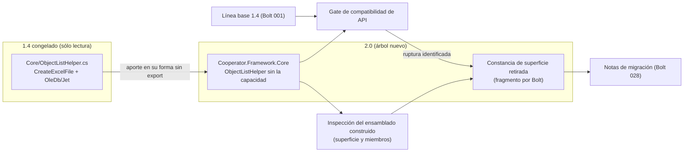

<!--
  LANGUAGE POLICY (§3.15): YAML keys, status enums, IDs and section headings stay in English;
  all prose goes in the project's content_language (devflow/LANGUAGE = es).
  ⚠️ SPEC = HOW (§2.4.1). La decisión de retiro ya está tomada en ADR-001 §3.5 (y en OQ-005): este SPEC no la
  reinterpreta, la ejecuta y la hace verificable.
  ⚠️ AITL-SPEC-Approval (§2.4.1, §3.0): este SPEC es un DRAFT hasta que el Dev-validator (y los dueños de
  dominio aplicables) registre la decisión en el bloque `review`. Un cambio material en una fuente gobernada
  invalida la aprobación → parar, revisar el SPEC canónico y re-aprobar (G15).
-->

# SPEC-261016-0012 — Retiro del export a Excel del núcleo y constancia de la superficie retirada

| Field | Value |
|-------|-------|
| **Origin** | [REV-001](../reviews/REV-001-analisis-migracion-cooperator.md) — §6 ítem 8 (hallazgo F-03) |
| **Bolt** | [US-000.BOLT-006](../functional/bolts/US-000.BOLT-006-retiro-del-export-excel.md) |
| **ADRs** | [ADR-001](../adrs/ADR-001-layout-y-empaquetado-cooperator-2.md) §3.1, §3.5 |
| **Risk Class** | low |
| **Revision** | 2 |

---

## 1. Objective

Se retira del núcleo la **capacidad de exportar a Excel** —un único método público que escribe un `.xls` por
OLE DB/Jet— y con ella el **rastro de plataforma** que arrastraba, de modo que `Cooperator.Framework.Core` quede
**100 % portable** según ADR-001 §3.5. El retiro se realiza en el árbol de la 2.0 (`2.0/`), que es la fuente de
verdad del producto nuevo, y se verifica **sobre el árbol compilado y su superficie**.

El problema que resuelve es concreto y ya está diagnosticado: esa capacidad es la **única** razón por la que el
núcleo no puede ser `netstandard2.1`. En el 1.4, `ObjectListHelper.CreateExcelFile` abre una `OleDbConnection`
con el proveedor `Microsoft.Jet.OLEDB.4.0` y escribe `Excel 8.0` (REV-001 F-03); nada de eso existe en el TFM
portable, y su presencia mantiene al núcleo atado a .NET Framework. Si no se retira, ADR-001 §3.1 no se cumple
(`Core` con cero dependencias de plataforma) y el objetivo de negocio —un modelo editable fuera de Windows—
queda bloqueado desde la primera capa.

Además, este Bolt **no sólo borra**: produce la **constancia de la superficie retirada** (qué miembro público
desaparece, por qué decisión, con qué reemplazo), que es el insumo que la política de rupturas de ADR-008 §3.1
exige y que el documento de notas de migración (Bolt 028) debe recoger sin huecos ni invenciones.

---

## 2. Context

**Origen y decisión.** `REV-001` (aprobado 2026-10-15) verificó en F-03 el uso de OleDb/Jet en el núcleo y ruteó
el retiro como **ítem 8: BOLT→SPEC (limpieza)**. La decisión de fondo ya está tomada y **no se reabre**:
`OQ-005` (deprecaciones) y **ADR-001 §3.5** establecen que el export a Excel "**se elimina** del framework; no se
reescribe ni se mueve a un paquete `-windows`. Quien necesite exportar lo resuelve en su capa, y queda
documentado en las notas de migración", con el efecto buscado declarado: `Core` **100 % portable**. El sistema de
proveedores de plataforma fue **rechazado explícitamente** por el propio ADR ("Un paquete `-windows` sólo podría
aparecer con un ADR que reemplace a éste").

**Qué existe hoy, verificado en esta sesión (evidencia de la frontera del retiro):**

| Hecho | Evidencia |
|---|---|
| La capacidad vive en **un solo archivo** del núcleo: `1.4/Cooperator.Framework.Core/ObjectListHelper.cs` | `git ls-files`/lectura del archivo |
| El miembro público es `ObjectListHelper<T,T2>.CreateExcelFile(T2 rowSet, string spreadsheetName, string targetFileName)` | `ObjectListHelper.cs:110` |
| Su implementación usa `OleDbConnection`/`OleDbCommand` y la cadena `Provider=Microsoft.Jet.OLEDB.4.0; … Extended Properties="Excel 8.0;HDR=YES"`, sobre un archivo `TMP.xls` | `ObjectListHelper.cs:117-133` |
| Un campo privado (`private static Object xlsLock`) existe **sólo** para serializar el acceso al `.xls` | `ObjectListHelper.cs:104` |
| La dependencia de plataforma **no** está declarada en el `.csproj` del núcleo: el tipo resolvía por formar parte de `System.Data` en .NET Framework | `Core.csproj` (referencias: `System`, `System.configuration`, `System.Data`, `System.Web`, `System.Xml`) + REV-001 F-44 |
| El resto de la clase **no** es Excel: `FillDataSet(DataSet, T2)` llena un `DataSet` desde un `RowSet`, y `SqlName(string)` es su auxiliar | `ObjectListHelper.cs:49`, `ObjectListHelper.cs:41-44` |
| **No hay un solo llamador** de la capacidad en el árbol: las únicas referencias restantes son líneas **comentadas** de ejemplo en el set de plantillas (`Templates/CSharpClasses/{Entity,Object}.cs` y sus equivalentes VB) | búsqueda de `CreateExcelFile`/`ObjectListHelper`/`Excel` sobre `1.4/**` |
| Ningún otro archivo del árbol usa `System.Data.OleDb` | búsqueda de `OleDb` sobre `1.4/**` (sólo `ObjectListHelper.cs`) |

**Estado del árbol 2.0 y dependencia del arnés.** `2.0/` está vacío en el repositorio: lo crea el Bolt 001, que
también entrega el comando reproducible (`2.0/build/build.ps1`), la **línea base 1.4** versionada con los fixtures
(`2.0/tests/fixtures/api-baseline-1.4/`) y el **gate de compatibilidad de API** (`2.0/build/api-compat.ps1`,
ADR-008 §5). Este Bolt depende de ese arnés: la verificación de que la superficie se retiró es,
literalmente, el gate y la inspección del ensamblado construido.

---

## 3. Source inventory and approval references

**Pre-SPEC evidence gate (§2.4.1) — resultado: PASA.** Todas las fuentes gobernadas que este SPEC usa están
aprobadas; no hay ADRs activos en conflicto (`ADR-001 §3.5` y `OQ-005` dicen lo mismo: retirar, sin reescribir y
sin paquete de plataforma), y el plan de integración declarado (`n/a`) coincide con el `test_integration:
not-required` del Bolt (§3.2.2). No se emite reporte bloqueante.

| Source | Ref | Approval |
|--------|-----|----------|
| Bolt | `US-000.BOLT-006` (`devflow/functional/bolts/US-000.BOLT-006-retiro-del-export-excel.md`) | AITL-BOLT-READY-Approval ✓ — `approved`, `agent:dotnet-architect-reviewer-agent` (architect), 2026-10-16T00:00:56-03:00; `risk_class: low`, `test_integration: not-required` |
| Parent US | `US-000` (`functional/user-stories/US-000-non-functional.md`) | Contenedor permanente: **sin** ciclo de aprobación (§2.6) — no aplica checkpoint |
| ADR (gobernante) | `ADR-001` §3.5 (deprecaciones y suerte de las features de plataforma), §3.1 (el núcleo como paquete portable), §3.4 (política de dependencias) | AITL-ADR-Approval ✓ — `accepted`, `human:eugenioserrano` (tech_lead), 2026-10-15T22:32:47-03:00 |
| REV evidence | `REV-001` §4 F-03 y §6 ítem 8 | AITL-REV-Approval ✓ — aprobado 2026-10-15 |
| OQ evidence | `OQ-005` (deprecaciones: VB.NET, Oracle, export a Excel) | `answered` 2026-10-15 (citada por ADR-001 §3.5) |
| SPEC previo (prerrequisito) | `SPEC-261016-0000-arnes-tests-y-build-reproducible.md` (Bolt 001) | SPEC aprobado por el mismo checkpoint que habilita su V-Bounce — el SPEC está **en disco**; este Bolt es su dependiente declarado |
| Repository baseline | commit `6aa497f793cd3ab9d83c68db7ef2c1d80d3421d4` | — (el árbol de trabajo tiene los artefactos de la corrida en curso; **nada** bajo `2.0/` ni bajo `1.4/`) |

---

## 4. Scope

### In scope

1. **El retiro de la capacidad de export** del núcleo: el miembro público `CreateExcelFile`, su auxiliar privado
   exclusivo (`xlsLock`) y el `using System.Data.OleDb;` que sólo existía para ella — en el árbol de la 2.0, que
   es donde el producto nuevo se construye.
2. **El retiro del rastro de plataforma**: ninguna parte del árbol 2.0 usa ni declara OLE DB / Jet / ACE
   (`System.Data.OleDb`, `Microsoft.Jet.OLEDB*`, `Microsoft.ACE.OLEDB*`), ni como referencia, ni como paquete, ni
   como cadena de conexión.
3. **La verificación sobre el árbol compilado**: la superficie del ensamblado `Cooperator.Framework.Core` de la
   2.0 se inspecciona (`MetadataLoadContext`) para constatar que el miembro no existe y que el resto de la
   superficie de la clase se conserva.
4. **La constancia de la superficie retirada** — el artefacto versionado que declara, por cada miembro perdido,
   qué desaparece, por qué decisión y con qué reemplazo (ADR-008 §3.1) — y su **cobertura verificada** contra el
   reporte del gate de compatibilidad.
5. **La entrada de ruptura** con los tres datos obligatorios de ADR-008 §3.1 («sin reemplazo dentro del
   framework; el export queda del lado del consumidor»), entregada para que el Bolt 028 la recoja.

### Out of scope

| Fuera de alcance | Dueño | Por qué |
|---|---|---|
| Los **demás puntos muertos de superficie del núcleo** (carga Lazy y configuración custom, referencias muertas del `.csproj`) | Bolts 005, 011, 012 | El Bolt los excluye expresamente: cada punto muerto tiene su Bolt |
| El retiro de `[Serializable]`/`SerializationInfo` (incluido el de `InvalidDataSetException`, que el cierre mínimo puede aportar tal cual) | Bolt 007 | Decisión y alcance de ADR-008 §3.2/§3.4 |
| **Reescribir el export** con otra librería, o moverlo a un paquete de plataforma | — (nadie) | ADR-001 §3.5 lo prohíbe expresamente; exigiría un ADR que reemplace a ADR-001 |
| Los **comentarios de ejemplo** de las plantillas que mencionan `ObjectListHelper` | Bolt del set de plantillas (ADR-003) | Es el set quien emite ese código; el 1.4 congelado no se edita |
| El **TFM y el mapa de paquetes** de la 2.0 | Bolt 001 (esqueleto) | Ya decididos en ADR-001 §3.1 |
| El **documento de notas de migración** | Bolt 028 | Este Bolt aporta su lista de rupturas, no el documento |
| Cualquier **edición de `1.4/`** | — (nadie) | ADR-001 §3.1/§3.2: el 1.4 queda congelado; se referencia o se copia como fuente, nunca se modifica |

**Regla de aporte (bounded, explícita).** El retiro se materializa sobre el árbol 2.0. Si al ejecutar el
V-Bounce el archivo que porta la capacidad **todavía no está** en `2.0/` (porque su porte lo aporta el esqueleto
o un Bolt previo), el V-Bounce lo aporta **en su forma ya retirada** —el archivo sin el miembro, sin su auxiliar
exclusivo y sin el `using`— y, para que compile, aporta además el **cierre mínimo** de tipos que necesita,
**copiados tal cual están en el 1.4** y **sin ninguna otra transformación**. Cada archivo aportado se declara
uno por uno en el MEM con su razón, sin excepciones: la regla existe para que este Bolt no absorba trabajo de
otro, no para ampliarlo.

**Excepción acotada de la regla (revisión 2 — la única transformación autorizada sobre el cierre).** El cierre
mínimo tiene **una** línea que copiada tal cual **no compila**, y está medida: `1.4/Cooperator.Framework.Core/IObject.cs:31`
lleva `using Cooperator.Framework.Core.LazyLoad;` —un `using` **demostradamente muerto** (el archivo no referencia
ningún símbolo de ese namespace: su única referencia externa es `System.ComponentModel.IEditableObject`)— y ese
namespace es entregable del **Bolt 005** (`2.0/src/Cooperator.Framework.Core/LazyLoad/**`, SPEC-0015 §6), que
todavía no aterrizó en el árbol. Copiado verbatim, el aporte falla con **un solo error** (`CS0234` sobre
`IObject.cs(31,33)`); con esa única línea quitada, el retiro y el cierre compilan **limpios** (0 errores y 0
advertencias con `TreatWarningsAsErrors=true`, medido en el V-Bounce N°1). Por eso, **al aportar el cierre, se
autoriza retirar ese `using` muerto**, documentado **línea por línea** en el MEM (archivo, línea y por qué es
muerto):

| Archivo del cierre | Línea | Transformación autorizada | Por qué |
|---|---|---|---|
| `1.4/Cooperator.Framework.Core/IObject.cs` | L31 | retirar `using Cooperator.Framework.Core.LazyLoad;` | **0 usos** en el archivo (el `using` es muerto) y el namespace es del Bolt 005: conservarlo prometería una dependencia que este Bolt no posee y, copiado tal cual, impide compilar (`CS0234`). El resto del archivo se aporta **verbatim** |

Es la **única** transformación autorizada sobre el cierre: todo lo demás sigue «copiado tal cual, sin ninguna otra
transformación», y cualquier otra transformación **reactiva** la condición de parada §15 #4. La **alternativa
sigue siendo válida y esta autorización no la invalida**: si el Bolt 005 aterriza antes, el `using` resuelve solo y
el cierre se aporta **verbatim**, sin tocar una línea; lo que cambia con esta revisión es que el desbloqueo de este
SPEC **ya no depende** de esa secuencia — el retiro puede entregarse en el próximo V-Bounce sin esperar a nadie,
con la excepción declarada.

---

## 5. Prerequisites and baseline

- **Bolt 001 y su SPEC** (`SPEC-261016-0000-…`): el **comando reproducible**, el **gate de compatibilidad de
  API**, la **línea base 1.4** con sus digests, el inventario de identidad del 1.4 y los proyectos de pruebas
  `2.0/tests/Cooperator.Harness.Tests` (`net10.0`) y `2.0/tests/Cooperator.Framework.Characterization.Tests`
  (`net48`). Sin ese arnés, la constancia de la superficie retirada no es verificable y este Bolt no se cierra.
- **Toolchain fijado por el Bolt 001:** SDK 10.0.402 (`global.json`), MSBuild 18.11.x de Visual Studio 18, targeting
  pack .NET Framework 4.8. El comando de verificación es `pwsh -File 2.0/build/build.ps1 -Scope Hermetic`.
- **Estado del árbol 2.0:** `2.0/` **ya existe** (el Bolt 001 ejecutó su V-Bounce: comando reproducible, arnés,
  línea base 1.4 y gate), pero el **núcleo todavía no tiene fuentes propias** —`2.0/src/Cooperator.Framework.Core/`
  contiene sólo su `.csproj` y su lock file, sin un solo `.cs`—. Por eso la **regla de aporte** de §4 **se aplica**,
  con su **excepción acotada**: el V-Bounce N°1 de este Bolt se detuvo `blocked` al exigir el cierre mínimo una
  transformación que la revisión 1 prohibía (MEM-261016-0059), y esta revisión autoriza **esa y sólo esa**
  transformación. El SPEC sigue siendo ejecutable tanto si el núcleo ya está portado como si hay que aportarlo.
- **`1.4/**` es sólo lectura.** Se verifica contra el commit baseline antes y después de construir
  (`git diff --quiet <baseline> -- 1.4`, `git status --porcelain -- 1.4` vacíos). Ningún artefacto se escribe
  dentro del árbol congelado.
- **Convención de constancia (alineada con los SPECs previos):** cada Bolt aporta su propia lista de rupturas
  —el documento de notas del consumidor es del Bolt 028— y la constancia de lo que dejó de existir vive
  **versionada junto al código**. Este Bolt usa un **fragmento por Bolt** en `2.0/docs/api-removals/`, con datos
  por miembro, más su lista de rupturas en el MEM.

---

## 6. Phases

> Un solo Bolt (`US-000.BOLT-006`), un solo V-Bounce esperado. El orden es el del retiro: primero desaparece la
> capacidad, después se demuestra que desapareció con su rastro, y recién entonces se firma la constancia.

### Phase A — Retiro de la capacidad y de su rastro

**Duration:** ~1,5h de ciclo — **Complexity:** Low

#### A.1 El archivo del núcleo sin la capacidad

`ObjectListHelper<T,T2>` se conserva como clase pública —su `FillDataSet` es un contrato de datos, no Excel— y
se retiran **exactamente** los tres elementos que la capacidad introdujo: el método `CreateExcelFile`, el campo
`private static Object xlsLock` que existía sólo para ella, y el `using System.Data.OleDb;`. El archivo queda sin
ninguna referencia a un proveedor de datos de plataforma; su XML-doc (`Helper methods for RowSet exportation`)
se ajusta para describir lo que la clase realmente hace, sin mencionar un export que ya no existe.

Se verifica además que ningún otro punto del archivo dependa de lo retirado (`FillDataSet` y `SqlName` no usan
`xlsLock` ni tipos de OLE DB) y que no quede código muerto por arrastre.

**Files created:**
- `2.0/src/Cooperator.Framework.Core/ObjectListHelper.cs` — el helper del núcleo sin el export
- **Cierre mínimo** (aportado tal cual desde el 1.4 y declarado archivo por archivo en el MEM): medido en el
  V-Bounce N°1 = **4 archivos / 252 líneas** —`IObject.cs`, `ObjectState.cs`, `Exceptions/CoreException.cs`
  (cuya superficie de serialización es del Bolt 007) y `Exceptions/InvalidDataSetException.cs`—, **sin ninguna
  dependencia fuera de `System.*`**. Su **única** transformación autorizada es la de §4: en `IObject.cs` se
  retira la línea L31 (`using Cooperator.Framework.Core.LazyLoad;`, `using` muerto, 0 usos), documentada línea
  por línea; el resto del cierre se aporta **verbatim**

#### A.2 El rastro de plataforma, ausente en todo el árbol 2.0

Se constata —y se deja como control automatizado— que en el **código, los proyectos, los scripts y la
documentación propios** de `2.0/` no existe OLE DB, Jet ni ACE por ninguna vía: ni `using`/tipos en el código, ni
`Reference`/`PackageReference` en los proyectos, ni una versión centralizada en `Directory.Packages.props`, ni una
cadena de conexión. La compilación del núcleo sobre `netstandard2.1` es, por construcción, la prueba dura: los
tipos de OLE DB no existen en ese TFM.

**Alcance de la búsqueda (precisión de la revisión 2).** La búsqueda **excluye** dos directorios de evidencia
congelada, por la misma razón: `1.4/**` (el árbol 1.4 que no se escanea como código propio) y
`2.0/tests/fixtures/api-baseline-1.4/**` —el binario 1.4 que el Bolt 001 versionó como **contrato del gate**, que
contiene el tipo `ObjectListHelper` y su referencia a `System.Data.OleDb`—. Sin esa exclusión, el contrato que el
propio gate necesita haría fallar AC-3 por un falso positivo (hallazgo medido en el V-Bounce N°1).

**Files modified:**
- `2.0/src/Cooperator.Framework.Core/ObjectListHelper.cs` — retiro del `using` y de los miembros (A.1)

---

### Phase B — Constancia de la superficie retirada (evidencia)

**Duration:** ~1h de ciclo — **Complexity:** Low

#### B.1 El fragmento de rupturas del Bolt

Se produce un artefacto versionado y legible por máquina —`2.0/docs/api-removals/US-000.BOLT-006.json`— con una
entrada por miembro retirado y los datos que ADR-008 §3.1 exige para cada ruptura: **(1)** qué desaparece (tipo,
miembro y firma exacta), **(2)** **por qué** (la decisión que lo ordena: ADR-001 §3.5 y OQ-005), **(3)** **con qué
se reemplaza** —en este caso explícitamente **ninguno dentro del framework**: el export queda del lado de la capa
del consumidor— más el Bolt que lo ejecuta y la evidencia de su verificación. El mismo contenido, en prosa, es la
lista de rupturas del MEM.

#### B.2 Cobertura verificable de la constancia

La constancia no se autoproclama: se **cruza contra el gate**. `Cooperator.Harness.Tests` incorpora un caso que
lee el reporte del gate de compatibilidad (línea base 1.4 ↔ superficie 2.0) y asserta que **toda** diferencia de
tipo «miembro retirado» de los ensamblados en alcance está cubierta por el fragmento. Es la parte ejecutable del
NFR de ADR-008 §5: el gate detecta la diferencia, la constancia la explica, y una diferencia sin explicación
**falla**.

**Files created:**
- `2.0/docs/api-removals/US-000.BOLT-006.json` — constancia de la superficie retirada (insumo del Bolt 028)
- `2.0/tests/Cooperator.Harness.Tests/ApiRemovalCoverageTests.cs` — cobertura de la constancia contra el gate

---

### Phase C — Verificación sobre el árbol compilado

**Duration:** ~1h de ciclo — **Complexity:** Low

#### C.1 Inspección de la superficie construida

Sobre el ensamblado realmente construido (`Cooperator.Framework.Core.dll`), y sin ejecutar su código, se inspecciona
la superficie con `MetadataLoadContext`: **no** existe ningún miembro `CreateExcelFile` en `ObjectListHelper<T,T2>`;
`FillDataSet` conserva su firma; la clase sigue siendo pública y genérica con las mismas restricciones. La
inspección es la constancia dura del retiro: no depende de que el código fuente «se vea» sin el método.

#### C.2 Búsqueda de usos residuales

La búsqueda sobre el árbol 2.0 (**código, proyectos, scripts y documentación propios**; versiones centralizadas)
no arroja **ningún uso vivo** de la capacidad ni de sus dependencias. La búsqueda **clasifica** lo que encuentra:
los comentarios de ejemplo del set de plantillas del 1.4 y cualquier mención histórica quedan registrados como
informativos —con su dueño (el Bolt del set)— y nunca como usos vivos. **No se escanea como código propio**:
`1.4/**` (árbol congelado) ni `2.0/tests/fixtures/api-baseline-1.4/**` (el **contrato del gate**: el binario 1.4
que contiene `ObjectListHelper` y su referencia a OLE DB). Sin la segunda exclusión el control daría un falso
positivo contra el propio contrato que el gate necesita — hallazgo medido en el V-Bounce N°1.

**Files created:**
- `2.0/tests/Cooperator.Harness.Tests/RetiredSurfaceTests.cs` — inspección de la superficie y búsqueda de rastro

---

## 7. Acceptance criteria

> Bolt no funcional (parent `US-000`, sin ACs): los criterios son los **resultados medibles** del Bolt (§2) y las
> restricciones de ADR-001, expresados como Given/When/Then verificables.

### AC-1: La capacidad no existe en el árbol

**Given** el árbol 2.0 con el retiro aplicado
**When** se construye el núcleo y se inspecciona su superficie
**Then** `ObjectListHelper<T,T2>` no expone ningún miembro de export y `FillDataSet` conserva su firma.

### AC-2: Ningún uso residual

**Given** el mismo árbol
**When** se busca la capacidad y sus dependencias en fuentes, proyectos y versiones centralizadas
**Then** no hay usos vivos (0), y las menciones en comentarios del set de plantillas quedan clasificadas como
informativas con su dueño.

### AC-3: Rastro de plataforma ausente en el código propio de 2.0

**Given** el árbol 2.0 y la evidencia 1.4 que el gate versiona como su propio contrato
**When** se busca OLE DB / Jet / ACE sobre el **código, los proyectos, los scripts y la documentación propios**
(excluyendo `1.4/**` y `2.0/tests/fixtures/api-baseline-1.4/**`)
**Then** 0 ocurrencias (código, referencias, paquetes, cadenas) y el núcleo compila sobre `netstandard2.1`. La
exclusión de `2.0/tests/fixtures/api-baseline-1.4/**` es **parte del criterio**, no un detalle de implementación:
ese directorio es la **evidencia 1.4 congelada** que el Bolt 001 versionó como contrato del gate
(`Cooperator.Framework.Core.dll` contiene `ObjectListHelper` y su referencia a `System.Data.OleDb`) y, sin la
exclusión, el propio contrato que el gate necesita haría fallar AC-3. Por eso `RetiredSurfaceTests` **debe**
excluirlo (hallazgo medido en el V-Bounce N°1).

### AC-4: Constancia de superficie retirada y su cobertura

**Given** el fragmento de rupturas del Bolt y el reporte del gate contra la línea base 1.4
**When** corre el caso de cobertura del arnés
**Then** el fragmento está presente y completo (qué, por qué, reemplazo, dueño, evidencia) y **toda** diferencia de
miembro retirado de los ensamblados en alcance está cubierta; una diferencia sin explicación falla el caso.

### AC-5: Entrada de ruptura con los tres datos de ADR-008 §3.1

**Given** la ruptura producida por el retiro
**When** se lee su entrada
**Then** declara el miembro retirado, la decisión que lo ordena (ADR-001 §3.5/OQ-005) y el reemplazo
(**ninguno dentro del framework**: el export es del consumidor), y esa entrada está en el MEM como lista de
rupturas para el Bolt 028.

### AC-6: Verificación reproducible y árbol congelado intacto

**Given** el toolchain fijado
**When** se ejecuta `pwsh -File 2.0/build/build.ps1 -Scope Hermetic`
**Then** el árbol compila sin advertencias tratadas como error, la suite hermética está verde, y
`git diff --quiet <baseline> -- 1.4` y `git status --porcelain -- 1.4` están vacíos.

### AC mapping to source (measurable outcome) — non-functional

| Source outcome (Bolt §2) | How this SPEC satisfies it | Verifying test/evidence |
|--------------------------|----------------------------|--------------------------|
| "la capacidad de export no existe en el núcleo de ninguna forma" | Fase A.1 + C.1: retiro en la fuente y constancia sobre el ensamblado construido | AC-1 · inspección del ensamblado |
| "ninguna parte del árbol referencia las dependencias de plataforma que usaba" | Fase A.2 + C.2: rastro ausente y búsqueda clasificada | AC-2, AC-3 · búsqueda y control automatizado |
| "el árbol compila y su suite pasa" | Fase C + comando reproducible del Bolt 001 | AC-6 · corrida hermética |
| "la superficie pública retirada está identificada y registrada" | Fases B.1/B.2: fragmento + cobertura contra el gate | AC-4, AC-5 · fragmento + `ApiRemovalCoverageTests` |
| "el núcleo 100 % portable" (objetivo, ADR-001 §3.5) | Fase A: el núcleo compila en `netstandard2.1` sin la capacidad ni su rastro | AC-3 · build del proyecto en su TFM portable |

---

## 8. Testing strategy

### 8.1 V-Bounce level (hermetic — run by the agent)

- **Inspección de superficie (`RetiredSurfaceTests`, `net10.0`):** sobre `Cooperator.Framework.Core.dll`
  construido, con `MetadataLoadContext` (inspección sin carga ni ejecución): ausencia del miembro retirado,
  presencia y firma de `FillDataSet`, y forma de la clase.
- **Búsqueda de rastro (`RetiredSurfaceTests`):** recorre `2.0/**` (código y proyectos) buscando `OleDb`,
  `Microsoft.Jet`, `Microsoft.ACE`, `CreateExcelFile` y `xlsLock`; **0 usos vivos**; las coincidencias en
  comentarios se reportan clasificadas.
- **Cobertura de la constancia (`ApiRemovalCoverageTests`):** parsea el reporte del gate
  (`2.0/build/api-compat.ps1` contra la línea base 1.4) y el fragmento `api-removals/US-000.BOLT-006.json`;
  asserta cobertura total de las diferencias de miembro retirado en los ensamblados en alcance.
- **Build y suite:** `2.0/build/build.ps1 -Scope Hermetic` verde (build sin advertencias + toda la suite).
- **Edge cases:** el fragmento sin entradas (falla: la ruptura existe y debe estar declarada); una entrada sin
  reemplazo declarado (falla); miembro retirado que reaparece con la misma firma (falla: contradice el retiro);
  coincidencia de la búsqueda dentro de un comentario (no es uso vivo — caso de clasificación); el ensamblado en
  alcance ausente del árbol (el caso lo declara como pendiente y no lo da por verde).
- **BUG evidence:** `n/a` — el Bolt no corrige un BUG; no hay TDD rojo→verde obligatorio.

### 8.2 Integration test level

- **`n/a`** — el Bolt declara `test_integration: not-required` y el plan del frontmatter dice `n/a` con su razón:
  el resultado se verifica sobre el árbol compilado y su superficie, sin alcanzar ninguna dependencia real. No
  hay tests de integración que escribir ni corrida que esperar antes de la aceptación (§3.2.2).

---

## 9. Quality gates

> Los estados son el **resultado esperado**; el resultado real se registra en el MEM del V-Bounce (§3.6).

| Gate | Level | Threshold | Status |
|------|-------|-----------|--------|
| Build / lint / type checks | V-Bounce | El árbol 2.0 compila sin advertencias (tratadas como error); `Core` en `netstandard2.1` | `pass` — esperado (§8.1) |
| Unit / component tests | V-Bounce | Suite hermética verde (inspección de superficie, rastro y cobertura de la constancia) | `pass` — esperado (AC-1…AC-5) |
| Consumer-side contract tests (test doubles) | V-Bounce | El arnés no expone superficie de consumo propia; el contrato de API lo cubre el gate | `n/a` — sin frontera de componente con dobles |
| SAST | V-Bounce | El cambio **elimina** código (no introduce superficie); es una reducción de superficie de entrada | `n/a` — sin código nuevo que analizar |
| Dependency scanning / licenses | V-Bounce | El retiro no agrega dependencias; ninguna dependencia de plataforma entra al árbol 2.0 (ADR-001 §3.4) | `pass` — esperado (AC-3) |
| OWASP Top 10 — static review | V-Bounce | No se expone ni altera interfaz alcanzable desde fuera del proceso; el retiro elimina una ruta de entrada/salida de archivos | `n/a` — sin superficie externa |
| Prompt-injection scan | V-Bounce | No hay construcción de prompts ni entrada no confiable | `n/a` — no aplica |
| Secret-leak scan | V-Bounce | Ningún secreto introducido; el retiro quita una cadena de conexión a un proveedor de archivos | `pass` — esperado |
| Hallucination lint | V-Bounce | Rutas, tipos y miembros referenciados existen (o se declaran como aportados) | `pass` — esperado (§8.1) |
| IP / license provenance | V-Bounce | No se incorpora código de terceros; el retiro no suma dependencias | `n/a` — sin código de terceros |
| PII / DLP | V-Bounce | `data_classification: internal`; no se manipulan datos personales | `pass` — esperado |
| Dependency-confusion | V-Bounce | Sin paquetes nuevos; versiones centralizadas y lock files intactos | `pass` — esperado |
| Test-first evidence | V-Bounce | No es un Bolt de corrección de BUG | `n/a` — sin TDD obligatorio |
| Behavioral reproducibility (hermetic suite) | V-Bounce | Dos corridas con resultado idéntico | `pass` — esperado |
| Bolt-manifest validation | V-Bounce | Manifiesto válido contra `manifest-v5-bolt.schema.json` con la entrada `v_bounces[]` completa | `pass` — esperado |
| API-compat con la línea base 1.4 (ADR-008 §5) | V-Bounce | La ruptura aparece **identificada** en el reporte y **cubierta** por la constancia | `pass` — esperado (AC-4) |
| Integration tests (real dependencies) | Integration test | No aplica: `test_integration: not-required` (plan `n/a`) | `n/a` — verificación sobre el árbol compilado (§3.2.2) |
| Contract / E2E against the real providers | Integration test | No hay provider externo ni entorno en el alcance | `n/a` — sin dependencias reales |
| DAST / OWASP Top 10 — dynamic | Integration test | No hay servicio desplegable | `n/a` — sin superficie ejecutable |
| Perf-smoke (p95/p99) | Integration test | No hay endpoint ni carga crítica afectada | `n/a` — sin umbral aplicable |
| Observability (logs / metrics / traces) | Integration test | No hay servicio instrumentado | `n/a` — sin telemetría de servicio |

> Coherencia con el Bolt (§3.2.2): `test_integration: not-required` → `integration_test_plan.applicability: n/a`
> con su razón. Ningún gate del nivel de integración aplica, por eso no hay corrida pendiente antes de la
> aceptación.

---

## 10. Security and data

- **El retiro reduce superficie de riesgo:** desaparece una ruta que abría un archivo con un proveedor de datos de
  plataforma sobre un nombre de archivo **recibido por parámetro** (una ruta de escritura controlada por el
  llamador). Al no existir, no hay nada que validar ni que asegurar.
- **Sin secretos y sin credenciales:** la cadena de conexión de Jet (que apuntaba a un archivo local) desaparece;
  no se introduce ninguna credencial ni ruta de configuración.
- **Datos y clasificación:** `data_classification: internal` (espeja el Bolt). No se procesan datos personales; no
  se copian datos ni fixtures del 1.4 con contenido real. La evidencia es superficie y texto de código.
- **Integridad del árbol congelado:** `1.4/**` no se modifica (control de git contra el commit baseline). Esta es
  también la garantía de que el retiro no “reescribe” el pasado: el 1.4 sigue siendo la referencia congelada.

---

## 11. Monitoring and observability

- **Reportes versionados en el árbol 2.0:** el fragmento de constancia (`2.0/docs/api-removals/US-000.BOLT-006.json`),
  el reporte del gate con la ruptura identificada y la salida de la suite en `2.0/artifacts/<timestamp>/`.
- **Códigos de salida `0/1/2/3`** del comando reproducible y del gate (Bolt 001): un CI futuro trata el retiro
  igual que cualquier otra verificación del arnés.
- **Sin telemetría de servicio:** no hay logs, métricas ni trazas de producto que agregar (`n/a` con esa razón en
  la tabla de gates).

---

## 12. Migration, compatibility and rollback

- **Migration:** `n/a` — no hay cambio de esquema ni migración de datos. El retiro afecta a una capacidad del
  núcleo que **no tiene un solo llamador en el árbol** y que no participa de ningún contrato de datos.
- **Compatibility:** es una **ruptura de superficie** frente al 1.4, decidida en ADR-001 §3.5, sin reemplazo
  dentro del framework y sin shim de compatibilidad (ADR-008 §3.1: "nada de type-forwarders, dobles superficies ni
  capas compat"). Un consumidor que usara el export lo resuelve en su propia capa (biblioteca de hojas de cálculo
  de su elección) o se queda en el **1.4 congelado**, que es una opción soportada y explícita. Otros consumidores
  no ven diferencia: la clase `ObjectListHelper<T,T2>` y su `FillDataSet` siguen exactamente donde estaban.
- **Rollback:** revertir el commit del Bolt. Es un retiro de superficie puro y aditivo respecto del esqueleto
  2.0: nada más depende aún de su resultado, salvo la constancia, que se revierte con él.

---

## 13. Risk matrix

| Risk | Probability (1-5) | Impact (1-5) | Mitigation |
|------|-------------------|--------------|------------|
| Retiro incompleto: sobrevive un rastro de la capacidad (una utilidad, un `using`, una referencia o un paquete de plataforma) | 2 | 3 | Búsqueda clasificada de rastro + compilación en `netstandard2.1` (donde los tipos no existen) como prueba dura (AC-2, AC-3) |
| El **cierre mínimo** aportado absorbe trabajo de otro Bolt o transforma código ajeno | 2 | 3 | Regla de aporte explícita (copiar tal cual, sin transformación) + **excepción acotada y documentada** (§4: sólo el `using` muerto de `IObject.cs:31`, declarado línea por línea) + declaración archivo por archivo en el MEM + revisión del SPEC |
| La búsqueda de rastro de **AC-3 da un falso positivo contra el contrato del gate** (el binario 1.4 de la línea base contiene la capacidad y su referencia a OLE DB) | 3 | 2 | El alcance de la búsqueda **excluye** `2.0/tests/fixtures/api-baseline-1.4/**` por ser evidencia 1.4 congelada —igual que `1.4/**`— (§6/A.2, §6/C.2, AC-3); sin la exclusión, el contrato del gate haría fallar AC-3 |
| Un consumidor **real** usaba el export y el retiro lo deja sin camino | 1 | 4 | Ruptura documentada con su alternativa; si aparece un consumidor **con evidencia**, se escala al escape-hatch de ADR-008 §3.6 — no se decide dentro de este Bolt |
| La constancia se produce pero no cubre lo que el gate detecta (ruptura sin entrada) | 2 | 3 | `ApiRemovalCoverageTests` falla ante una diferencia no explicada: la cobertura es verificable, no declarativa (AC-4) |
| La línea base del gate cambia o se manipula y la ruptura deja de ser identificable | 1 | 3 | El Bolt 001 verifica los digests de la línea base antes de correr el gate (control anti-manipulación) |
| El arnés del Bolt 001 no está disponible en el árbol al ejecutar | 2 | 2 | Dependencia declarada en el Bolt y en §5; si falta, se detiene y se escala la secuencia (§15) |

---

## 14. Decisions and trade-offs

| Decision | Reason |
|----------|--------|
| Se retira **sólo** `CreateExcelFile` + su `xlsLock` + su `using`, y se conserva `ObjectListHelper<T,T2>` con `FillDataSet` | `FillDataSet` es un contrato de datos (llena un `DataSet` desde un `RowSet`) y no tiene nada de Excel; borrar la clase entera sería un retiro no decidido por ningún ADR |
| El retiro del `using System.Data.OleDb` se hace en el mismo acto | Sin el miembro, el `using` es código muerto de plataforma: dejarlo mantendría exactamente el rastro que el Bolt pide eliminar |
| La verificación de la superficie se hace **sobre el ensamblado construido** (`MetadataLoadContext`), no sólo por lectura de fuente | El Bolt lo exige ("se verifica sobre el árbol compilado") y la inspección del ensamblado no se puede "ver bien" por accidente; además evita depender del TFM o de las advertencias |
| `MetadataLoadContext` como inspección del ensamblado (sin carga ni ejecución) | Inspecciona metadatos sin resolver ni ejecutar dependencias, lo que evita los problemas de resolución de assets/runtime y no requiere que el ensamblado sea cargable en el host del arnés. Es dependencia **de alcance de tests**, permisiva y fijada centralmente (mismo criterio que el framework de pruebas del Bolt 001) |
| La constancia vive en `2.0/docs/api-removals/<BOLT>.json`, versionada, y su lista se repite en el MEM | Cada Bolt aporta su lista de rupturas (convención de los SPECs 002/003) y la constancia de lo retirado se versiona junto al código; el documento de notas del consumidor es del Bolt 028. Si el Bolt 028 fija otro contenedor, el fragmento se mueve: acto mecánico |
| La constancia se **cruza** contra el reporte del gate en un caso automatizado | ADR-008 §5 mide "100 % de las diferencias cubiertas por las notas"; sin este cruce, la política es una intención. Es la parte del NFR que este Bolt puede hacer ejecutable hoy |
| Los comentarios de plantilla que mencionan `ObjectListHelper` **no** se tocan | Viven en el set de plantillas del 1.4, cuyo dueño es el Bolt del set (ADR-003); tocar el 1.4 está prohibido. Se registran como informativos con su dueño |
| No se crea ningún paquete ni *shim* de reemplazo para el export | ADR-001 §3.5 lo prohíbe de forma expresa y ADR-008 §3.1 rechaza los shims de compatibilidad |

---

## 15. Stop conditions

1. **Cambio material en una fuente gobernada** (Bolt, ADR-001, OQ-005, REV-001 usado, baseline de código):
   detener el V-Bounce, revisar este SPEC canónico y re-aprobar (G15). Una V-Bounce nunca abarca dos revisiones (G16).
2. **Aparece un consumidor con evidencia** que use la capacidad: no se decide acá. Se documenta el hallazgo y se
   escala al escape-hatch de ADR-008 §3.6 / a la decisión de ADR-001 §3.5 — jamás se resuelve ampliando el alcance
   del Bolt.
3. **El retiro exigiría editar `1.4/`** (o el árbol congelado aparece modificado): detener. El 1.4 es inmutable;
   si algo del 1.4 estorba, se resuelve en el árbol 2.0 o se escala.
4. **El cierre mínimo exigiría transformar código de otro Bolt** (no basta con copiarlo tal cual): detener y
   escalar la secuencia — este Bolt no reescribe lo ajeno. **Única excepción autorizada (§4):** el `using` muerto
   de `IObject.cs:31` (`Cooperator.Framework.Core.LazyLoad`, 0 usos) se retira **documentado línea por línea**;
   **cualquier otra** transformación del cierre —una línea, un miembro, un atributo— vuelve a disparar esta
   condición.
5. **El arnés del Bolt 001 no está disponible** (comando reproducible, línea base o gate ausentes): detener y
   escalar la secuencia; sin arnés, la constancia no es verificable.
6. **Un gate de §9 no cierra en `pass`**: detener y escalar. Una salida por excepción exige un ADR aprobado, y el
   gate se registra `waived`, nunca `pass` (G21).
7. **Ambigüedad que sólo se resolvería inventando** (por ejemplo, un miembro adicional del que no haya decisión
   que lo ordene): parar y reportar; no se rellena el hueco con una suposición (§2.4.1).

---

## 16. Definition of Done (DoD)

- [ ] Fases A–C implementadas
- [ ] Todos los criterios de aceptación (AC-1…AC-6) verificados
- [ ] Suite hermética verde (§8.1); el plan de integración es `n/a` con su razón (no hay corrida pendiente)
- [ ] La configuración y el código siguen ADR-001 (§3.1, §3.4, §3.5)
- [ ] Gates aplicables en `pass` (o `waived`/`n/a` con su razón) según §9
- [ ] MEM creado en `devflow/memory/` (exactamente uno para este V-Bounce), con la lista de rupturas
- [ ] Entrada `v_bounces[]` agregada al manifiesto en `devflow/metrics/bolts/` (ocho campos completos)
- [ ] AITL-MEM-Approval registrado
- [ ] `1.4/**` intacto respecto del commit baseline
- [ ] Constancia de superficie retirada versionada y cubierta por el gate (AC-4)

---

## 17. References

- Bolt: [`US-000.BOLT-006`](../functional/bolts/US-000.BOLT-006-retiro-del-export-excel.md) y su manifiesto
  [`US-000.BOLT-006-…json`](../metrics/bolts/US-000.BOLT-006-retiro-del-export-excel.json)
- Parent: [`US-000`](../functional/user-stories/US-000-non-functional.md) — contenedor no funcional
- ADR gobernante: [`ADR-001`](../adrs/ADR-001-layout-y-empaquetado-cooperator-2.md) §3.1, §3.4, §3.5
- SPEC prerrequisito: [`SPEC-261016-0000`](./SPEC-261016-0000-arnes-tests-y-build-reproducible.md) (arnés, línea base 1.4 y gate)
- SPECs relacionados: [`SPEC-261016-0004`](./SPEC-261016-0004-particion-modeling.md) (partición del modelo — frontera de tipos y convención de constancia) ·
  [`SPEC-261016-0015`](./SPEC-261016-0015-carga-de-providers-lazy.md) §6 (dueño del namespace `Core/LazyLoad` que la excepción acotada de §4 no aporta) ·
  [`SPEC-261016-0021`](./SPEC-261016-0021-limpieza-de-referencias.md) (dueño alternativo de un punto muerto del núcleo, si se decide tratarlo como tal)
- Revisión origen: [`REV-001`](../reviews/REV-001-analisis-migracion-cooperator.md) — F-03 y §6 ítem 8
- Evidencia de código 1.4 (verificada en esta sesión): `1.4/Cooperator.Framework.Core/ObjectListHelper.cs:30,104,110,117-133`
  (`using System.Data.OleDb;`, `xlsLock`, `CreateExcelFile`, conexión Jet/Excel), `ObjectListHelper.cs:49` (`FillDataSet`),
  `1.4/Cooperator.Framework.Core/Cooperator.Framework.Core.csproj` (referencias declaradas), y los comentarios de
  ejemplo en `1.4/Tools/CooperatorModeler/Templates/CSharpClasses/{Entity,Object}.cs`
- Normativo: `devflow/avenga-devflow/Avenga-DevFlow.md` §2.4.1, §3.2.2, §3.3, §3.6 · `devflow/GUARDRAILS.md`
  (G07, G10, G13, G14, G15, G16, G17, G21, G23, W02, T05, T11)

---

## 18. Revision history

| Date | Author | Change |
|------|--------|--------|
| 2026-10-16 | `agent:dotnet-developer-agent` (transcripción de `human:eugenioserrano`) | Revision 1 — SPEC inicial del Bolt `US-000.BOLT-006`: retiro del export a Excel y de su rastro de plataforma, verificación sobre el árbol compilado, constancia de la superficie retirada y su cobertura por el gate. **Aprobada** por `agent:dotnet-developer-reviewer-agent` (dev_validator) el `2026-10-16T00:22:23-03:00` (`AITL-SPEC-Approval`); esa aprobación queda **invalidada** por la revisión material siguiente (G15) |
| 2026-10-16 | `agent:dotnet-developer-agent` (transcripción de `human:eugenioserrano`) | **Revision 2 (material)** — desbloqueo del V-Bounce N°1, que se detuvo `blocked` (MEM-261016-0059) por el cierre mínimo: **(1)** §4 autoriza, como **excepción acotada** de la regla de aporte, retirar el `using` **muerto** de `IObject.cs:31` (`Cooperator.Framework.Core.LazyLoad`, 0 usos) al aportar el cierre, **documentado línea por línea**, sin invalidar la alternativa de esperar al Bolt 005; **(2)** §6/A.1, §6/A.2, §6/C.2, AC-3 y §13 precisan el **alcance de la búsqueda de rastro**, que excluye la evidencia 1.4 congelada de `2.0/tests/fixtures/api-baseline-1.4/**` (el contrato del gate) para no dar un falso positivo; **(3)** §5 refleja el estado real del árbol. Requiere **`AITL-SPEC-Approval` nuevo** antes de ejecutar el V-Bounce N°2 (G15/G16) |

---

## 19. AITL-SPEC-Approval

> **Avenga DevFlow §2.4.1, §3.0.** This SPEC remains a draft until the
> Dev-validator (+ applicable domain owners) records `AITL-SPEC-Approval`
> (in the `review` frontmatter block). Bolt approval (`AITL-BOLT-READY-Approval`)
> authorizes SPEC preparation; **SPEC approval** authorizes the code-run /
> V-Bounce. A material source change invalidates this approval — stop,
> revise, re-approve (G15).

| Field | Value |
|-------|-------|
| **review.reviewers** | [Dev-validator + dueño de arquitectura (superficie del núcleo)] |
| **review.written_by** | [opcional — quien escribe este registro: el revisor, o el agente que transcribe la decisión; escribir no es firmar (§3.0)] |
| **review.decision** | approved / changes_requested / rejected |
| **review_ready_at** | `YYYY-MM-DDTHH:mm:ss±HH:MM` |
| **review.started_at** | `YYYY-MM-DDTHH:mm:ss±HH:MM` |
| **review.decided_at** | `YYYY-MM-DDTHH:mm:ss±HH:MM` |
| **Findings** | [hallazgos o `acknowledged_without_comment` + motivo] |

**Qué cambia en la revisión 2 (y qué no).** Cambia **una cosa de fondo**: la **autorización acotada** de §4 para
retirar el `using` muerto de `IObject.cs:31` al aportar el cierre — es lo que desbloquea el V-Bounce detenido
`blocked` (MEM-261016-0059) sin esperar a otro Bolt. Suma **dos precisiones** que evitan defectos de verificación:
el **alcance de la búsqueda de rastro** (AC-3, §6/A.2, §6/C.2: se excluye la evidencia 1.4 congelada de
`2.0/tests/fixtures/api-baseline-1.4/**`) y la **alineación de §13/§15** con ambas (§5 refleja además el estado real
del árbol). **No** cambia: el alcance del retiro (los tres elementos de la clase), las exclusiones, la constancia y
su cobertura por el gate, la regla de aporte para el resto del cierre («copiar tal cual»), ni el plan de integración
(`n/a`). La revisión 1 fue aprobada el `2026-10-16T00:22:23-03:00`; esa aprobación queda **invalidada** por este
cambio material (G15) y hace falta un **`AITL-SPEC-Approval` nuevo** sobre esta revisión antes de re-ejecutar
(G15/G16).

### Reviewer notes (puntos explícitos para la decisión)

1. **Alcance del retiro dentro de la clase:** se conserva `ObjectListHelper<T,T2>` con `FillDataSet` y se retiran
   únicamente el miembro de export, su auxiliar exclusivo y el `using`. Confirmar que no se espera el retiro de
   la clase completa (no hay decisión que lo ordene).
2. **Regla de aporte mínimo (§4) y su excepción acotada (revisión 2):** el V-Bounce aporta el archivo en su forma
   retirada más el cierre mínimo copiado **tal cual**; la **única** transformación autorizada es retirar el `using`
   **muerto** de `IObject.cs:31` (`Cooperator.Framework.Core.LazyLoad`, 0 usos), **documentado línea por línea** en
   el MEM. Confirmar la excepción. La alternativa —esperar al Bolt 005, con el `using` resolviendo solo— sigue
   siendo válida, pero **ya no es necesaria** para desbloquear: este SPEC no depende de esa secuencia.
3. **Ubicación de la constancia** (`2.0/docs/api-removals/<BOLT>.json` + lista en el MEM). Los SPECs 002/003 usan
   "cada Bolt aporta su lista de rupturas" y el documento de notas es del Bolt 028; confirmar el contenedor.
4. **`MetadataLoadContext` como dependencia de alcance de tests** para la inspección del ensamblado (permisiva,
   fijada centralmente): mismo criterio que el framework de pruebas decidido en el Bolt 001.
5. **Clasificación de los comentarios de plantilla** que mencionan `ObjectListHelper`: informativos, con dueño
   (Bolt del set). No se tocan (el 1.4 es inmutable).
6. **Alcance de la búsqueda de rastro (AC-3, revisión 2):** `RetiredSurfaceTests` excluye `1.4/**` **y**
   `2.0/tests/fixtures/api-baseline-1.4/**` —el binario 1.4 que el Bolt 001 versionó como **contrato del gate**,
   que contiene el tipo y su referencia a OLE DB—. Sin la segunda exclusión, AC-3 fallaría por el propio contrato
   que el gate necesita. Confirmar el alcance.
7. **Secuencia (G16):** esta revisión **no** se ejecuta hasta que esté registrado el `AITL-SPEC-Approval` de la
   revisión 2; el V-Bounce N°2 arranca con MEM nuevo (el MEM-261016-0059 queda como historia inmutable del V-Bounce
   detenido).
