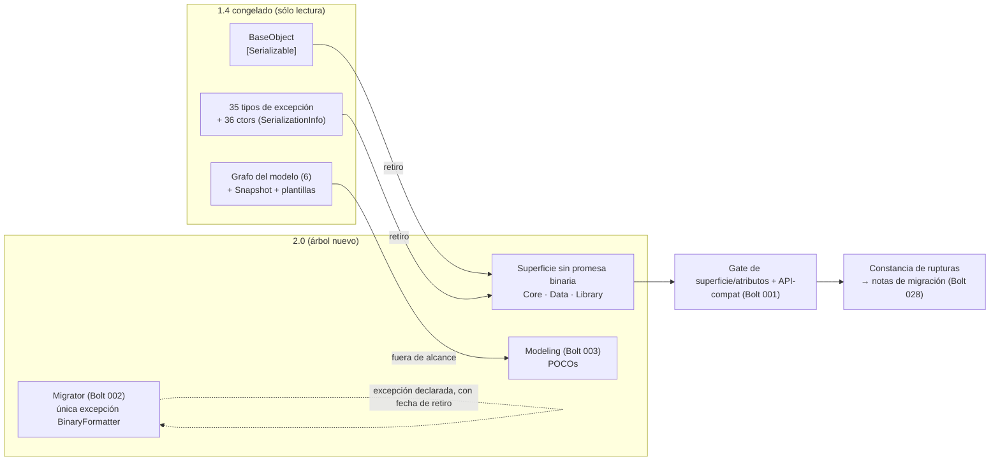

<!--
  LANGUAGE POLICY (§3.15): YAML keys, status enums, IDs and section headings stay in English;
  all prose goes in the project's content_language (devflow/LANGUAGE = es).
  ⚠️ SPEC = HOW (§2.4.1). El inventario exacto de lo que se retira y su destino ya están decididos en
  ADR-008 §3.2/§3.4; este SPEC los ejecuta y los hace verificables, sin reabrir la política.
  ⚠️ REVISIÓN 3 — REVISIÓN MATERIAL (G15/G16) DEL SPEC DE `US-000.BOLT-007`, disparada por el V-Bounce N°2
     registrado en `devflow/memory/MEM-261016-0220-retiro-de-serializable.md` (`execution_outcome: blocked`). El
     retiro y las dos autorizaciones de la revisión 2 **se ejecutaron y quedaron verdes** (0 residuos de superficie
     en `2.0/src`, `Core`/`Data`/`Library` con `EXIT=0`, la directiva de §A.3 aplicada sólo a los 2 archivos que
     produjeron diagnósticos y la arista de §B.4 en una línea); el bloqueo es **ajeno**: la aserción
     `HostConfigurationAbsenceTests.The_absence_control_states_which_layer_it_measured` —entregada por el **BOLT
     011**— es una **instantánea de su cierre** (exige que `Cooperator.Framework.Data` **no** figure entre las capas
     con fuentes) y el §B.2 de este SPEC **ordena aportar** las 16 excepciones de `Data`. Esta revisión autoriza,
     como **ÚNICA excepción al «no se toca lo ajeno»**, la **relajación mínima** de esa aserción (§C.2), con su
     comentario de procedencia y su referencia cruzada, **antes de la aceptación del Bolt 011** (hoy
     `ready-for-acceptance`). Ajusta §1, §4, §6/C.2 (nueva), §7 (AC-7/AC-8 y su mapeo), §8.1, §9, §13, §15, §16,
     §17, §18 y §19.
     ⚠️ **Nada más cambia:** el objeto del Bolt, el retiro mecánico, la política de nulabilidad de §A.3, la arista
     de §B.4, el inventario re-medido, la allowlist del rastro binario, el enforcement por superficie, el
     escape-hatch y las fronteras con 003/017/set/002-025 siguen **en vigor**; las fases **D, E y F** quedan como lo
     que resta (§6/D–F, §19). El `review` se re-abre vacío: la revisión es material y se re-aprueba.
     ⚠️ (Histórica) **REVISIÓN 2 — REVISIÓN MATERIAL (G15/G16) DEL SPEC DE `US-000.BOLT-007`**, disparada por el V-Bounce N°1
     registrado en `devflow/memory/MEM-261016-0209-retiro-de-serializable.md` (`execution_outcome: blocked`). El
     retiro mecánico **ya está medido y compila** en lo que a las 31 excepciones respecta (0 residuos de superficie,
     0 diagnósticos); lo que faltaba era el **marco** para dos mecánicas de build, ambas de **una línea**: **(1) la
     política de nulabilidad del código aportado** por la regla de §4 (`#nullable disable` por archivo aportado del
     1.4 — espejo de `SPEC-261016-0004` §A.3, que se fijó por el mismo escenario—, §A.3 de este SPEC) y **(2) la
     arista `Data → Library`** en el `.csproj` del stub de `Data` (§B.4), permitida por ADR-001 §3.1 y exigida por
     la base `BaseException` que §B.2 fija. Ajusta §1, §2 (cifras del inventario), §3, §4, §6/A·B, §7 (AC-3/AC-7/
     AC-8), §8.1, §9, §13, §14, §15, §16, §17, §18 y §19.
     ⚠️ **Nada más cambia:** el objeto del Bolt, el inventario (salvo las cifras re-medidas y declaradas), la
     allowlist del rastro binario, el enforcement por superficie, el escape-hatch y la frontera con 003/017/set/
     002-025 siguen **en vigor** (el `review` se re-abre vacío: la revisión es material y se re-aprueba).
  ⚠️ AITL-SPEC-Approval (§2.4.1, §3.0): este SPEC es un DRAFT hasta que el Dev-validator (y los dueños de
  dominio aplicables) registre la decisión en el bloque `review`. Un cambio material en una fuente gobernada
  invalida la aprobación → parar, revisar el SPEC canónico y re-aprobar (G15).
-->

# SPEC-261016-0013 — Retiro de la superficie de serialización binaria del framework y su constancia de rupturas

| Field | Value |
|-------|-------|
| **Origin** | [REV-001](../reviews/REV-001-analisis-migracion-cooperator.md) — §6 ítem 13 (hallazgo F-05), formalizado por ADR-008 §3.2 |
| **Bolt** | [US-000.BOLT-007](../functional/bolts/US-000.BOLT-007-retiro-de-serializable.md) |
| **ADRs** | [ADR-008](../adrs/ADR-008-compatibilidad-de-api.md) §3.1, §3.2, §3.3, §3.4, §3.6, §5 · [ADR-002](../adrs/ADR-002-formato-coop2-y-migrador.md) §3.2 |
| **Risk Class** | medium |
| **Revision** | 3 |

---

## 1. Objective

Se retira del framework la **promesa de serialización binaria**: `BaseObject` (la clase base abstracta de todos
los objetos de negocio) y la **jerarquía de excepciones** de los cuatro ensamblados dejan de declarar `[Serializable]`
y de exponer el constructor `(SerializationInfo, StreamingContext)`, y el árbol deja de arrastrar el rastro del
formato binario. La superficie pública queda, así, sin prometer un mecanismo que el runtime objetivo **ya no puede
cumplir** (`BinaryFormatter` está deshabilitado por defecto en .NET 8 y eliminado en .NET 9+), y el build deja de
arrastrar la obsolescencia asociada (`SYSLIB0051`).

El retiro se ejecuta en el árbol de la 2.0 (`2.0/`) y se verifica **sobre el árbol compilado y su superficie**,
porque lo que se está retirando es metadatos públicos: un atributo y un constructor que sólo se observan en el
ensamblado construido.

Dos fronteras son parte del objetivo, no del matiz: **(1)** el retiro **no** toca los tipos del grafo del modelo
—su destino es la partición del Bolt 003, ya especificada— ni los artefactos del set de plantillas; y **(2)** se
**preserva** la única excepción que el producto autoriza: el cargador del formato binario del migrador
(ADR-002 §3.2 / ADR-008 §3.4), acotado a un archivo, con su fecha de retiro y bajo la regla de supresión más
estrecha posible. Sin este Bolt, ADR-008 §3.2 no se ejecuta y la 2.0 seguiría prometiendo serialización binaria
en un runtime donde no existe.

**Dos autorizaciones acotadas de la revisión 2.** El V-Bounce N°1 de este Bolt midió **dos mecánicas de build**
—no del retiro— que necesitan autorización explícita del SPEC; ambas son de **una línea** y ambas ya están
previstas por las fuentes gobernadas (`MEM-261016-0209` §8): **(1)** la **política de nulabilidad del código
aportado** por la regla de §4 —`#nullable disable` **por archivo aportado del 1.4**, espejo de
`SPEC-261016-0004` §A.3, que se fijó por revisión material para este mismo escenario— (§6/A.3) y **(2)** la arista
**`Data → Library`** en el `.csproj` del stub de `Data` (§6/B.4), permitida por ADR-001 §3.1 y **exigida** por la
base `BaseException` que §B.2 fija para esa jerarquía. Nada más se autoriza: el retiro en sí —mecánico, medido, con
las 31 excepciones compilando sin un solo diagnóstico— **no cambia**.

**Relajación acotada de la revisión 3 (una aserción ajena, mínima y con ventana).** El V-Bounce N°2 ejecutó el
retiro y las dos autorizaciones de la revisión 2 **y quedaron verdes**; se detuvo por una **aserción de otro Bolt**
que este mismo SPEC invalida: `HostConfigurationAbsenceTests.The_absence_control_states_which_layer_it_measured`
(Bolt 011) exige que `Cooperator.Framework.Data` **no** figure entre las capas con fuentes, y el §B.2 de este SPEC
**ordena aportar** las 16 excepciones de `Data`. Esta revisión autoriza la **relajación mínima** de esa aserción
—conservando su intención: *el control declara la capa que midió*— como **ÚNICA excepción al «no se toca lo ajeno»**
(§C.2), con su **comentario de procedencia**, su **referencia cruzada** y su **ventana**: antes de la aceptación del
Bolt 011, que hoy está `ready-for-acceptance`.

---

## 2. Context

**Origen y decisión.** `REV-001` (aprobado 2026-10-15) verificó en F-05 el inventario de `[Serializable]` y de los
constructores de serialización en toda la jerarquía, y ruteó la decisión como **ítem 13 → ADR**. Ese ADR es
**ADR-008**, ya `accepted`: adopta la ruptura limpia y documentada (§3.1), fija **qué** se retira y exactamente
dónde (§3.2), **qué ocupa el lugar** del estado serializado (§3.3: el framework no expone ningún serializador), y
**prohíbe** la superficie y la obsolescencia en adelante (§3.4: `[Serializable]`, `ISerializable`, `GetObjectData`
y los constructores `(SerializationInfo, StreamingContext)`; cero `SYSLIB0051`; supresión sólo en el ámbito más
estrecho y con justificación). Este SPEC **no reabre** nada de eso: lo ejecuta y lo vuelve verificable.

**Por qué la decisión es segura (verificado en esta sesión, y ya confirmado por ADR-008 §1):**

| Hecho verificado | Evidencia |
|---|---|
| **Ninguno** de los constructores de serialización transporta datos: todos son *boilerplate* vacío que sólo llama a `base(info, context)` | 0 resultados de `info.AddValue`/`info.GetValue` en `1.4/**` |
| **No existe** ninguna implementación de `ISerializable` ni override de `GetObjectData` | 0 resultados en `1.4/**` |
| Los tipos afectados conservan constructores públicos (mensaje, mensaje+inner) que **sí** son el contrato que el consumidor captura | `CoreException.cs:45-75`, `BaseException.cs:47-70` |
| El atributo de contrato de serialización en el código **generado** vive sólo en el set de plantillas, no en el framework | `[DataContract]`/`[CollectionDataContract]` sólo en `Templates/CSharpClasses/{Entity,Object}.Auto.cs` (y sus pares VB) |
| El único uso de `BinaryFormatter` del árbol está en el **Modeler** (persistencia del `.coop`) y en el contenedor que lo sostiene | `Tools/CooperatorModeler/MainForm.cs:215,270`; `Tools/CooperatorModeler/Snapshot.cs:40` |

**Inventario exacto dentro de las cuatro ensamblados del framework** (lo retirado, por ensamblado y con su dueño):

| Ensamblado | Declaraciones `[Serializable]` | Constructores `(SerializationInfo, StreamingContext)` | Destino / dueño de la ejecución |
|---|---|---|---|
| `Cooperator.Framework.Core` | `BaseObject` (base abstracta, con **3** `[field: NonSerialized]` en sus eventos) + **7** excepciones | 7 | **Este Bolt** (Bolt 007) |
| `Cooperator.Framework.Data` | **16** excepciones | 16 | **Este Bolt** |
| `Cooperator.Framework.Library` | **8** (incluye la base abstracta `BaseException`) | 8 | **Este Bolt** |
| `Cooperator.Framework.Utility` (tipos del **borde**, fuera del alcance) | **7** declaraciones medidas en la fuente (§2, inventario re-medido) — los tipos del grafo y sus excepciones, más `CompilerException` | los del borde (medidos; el detalle por archivo queda en el inventario de §A.1 y en el MEM §9.1) | Los tipos del grafo y las **excepciones del grafo** migran a `Modeling` y su retiro lo ejecutó el **Bolt 003** (SPEC-0004 §4, **ya ejecutado**: nacen POCOs); `CompilerException` no entra en 003 y su destino es el **slot del motor (Bolt 017)** |

**Inventario re-medido (revisión 2).** La cifra de la revisión 1 («36 declaraciones y 36 constructores») queda
**reemplazada** por el inventario medido sobre la fuente congelada en el V-Bounce N°1 (`MEM-261016-0209`
§8.4/§9.1):

| Dato | Medido | Revisión 1 |
|---|---|---|
| Declaraciones `[Serializable]` en la fuente (cuatro ensamblados) | **39** — `Core` 8 · `Data` 16 · `Library` 8 · `Utility` 7 | «36» |
| Constructores `(SerializationInfo, StreamingContext)` **en el alcance de este Bolt**, todos `protected` | **31** — `Core` 7 · `Data` 16 · `Library` 8 | «36» |
| `ISerializable` / `GetObjectData` / constructores que transportan contexto | **0 / 0 / 0** | 0 / 0 / 0 ✔ |
| Tipos en alcance | **32** (`BaseObject` + 31 excepciones) | 32 ✔ |

La **composición** coincide con la de la revisión 1 —los mismos archivos por ensamblado, la misma visibilidad y los
mismos 32 tipos en alcance—; lo que difiere son las cifras **agregadas**, porque la revisión 1 contaba además las
declaraciones y constructores de los tipos del **borde**: los del grafo y sus excepciones (Bolt 003) y
`CompilerException` (Bolt 017). Las **7** declaraciones de `Utility` corresponden a ese borde, entran al inventario
**atribuidas a su dueño** y este Bolt las **verifica y registra** sin transformarlas (Phase C, AC-7; el Bolt 003 ya
ejecutó su retiro al hacer nacer esos tipos como POCOs en `Modeling`). El inventario legible por máquina de §A.1 es
el que manda en la ejecución y su composición por archivo queda registrada en el MEM.

Fuera de esas cuatro ensamblados quedan, y **no** son de este Bolt: el `[Serializable]` de los *partials* de
plantilla y los `[DataContract]` de los `*.Auto.cs` (Bolt del set de plantillas, ADR-008 §3.7) y el `[Serializable]`
de `Snapshot` en el Modeler (formato y shell: Bolts 002/025).

**Estado del árbol 2.0 y dependencias (revisión 2).** `2.0/` existe con lo que dejó el Bolt 001 —la solución, el
comando reproducible, el arnés (`85/85` verde), la caracterización (`83/83`), la línea base 1.4 y el gate de
compatibilidad— y los stubs de `.csproj` de `Core`/`Data`/`Library`; el V-Bounce N°1 midió ese estado como punto de
partida (16 proyectos, 0 advertencias). La **partición del modelo** (Bolt 003, `SPEC-261016-0004`) **ya se
ejecutó**: los tipos del grafo y sus excepciones nacen POCOs en `Modeling`; por eso este SPEC declara esa frontera,
la **verifica y la registra**, y **no** la invade.



---

## 3. Source inventory and approval references

**Pre-SPEC evidence gate (§2.4.1) — resultado: PASA.** Todas las fuentes gobernadas que este SPEC usa están
aprobadas; no hay ADRs activos en conflicto (ADR-008 formaliza lo que ADR-001 §3.2 ya decidió, y ADR-002 §3.1
alineó la persistencia del modelo: el estado serializado ya no es un mecanismo del producto), y el plan de
integración declarado (`n/a`) coincide con el `test_integration: not-required` del Bolt (§3.2.2). No se emite
reporte bloqueante.

La **revisión 2** vuelve a correr el gate: **PASA**. Las fuentes gobernadas siguen aprobadas y **sin cambio
material** —el V-Bounce N°1 lo verificó (`MEM-261016-0209` §8.5): el Bolt conserva su `AITL-BOLT-READY-Approval`,
`ADR-008`/`ADR-002` siguen `accepted`, `REV-001` sigue `approved` y `1.4/**` está intacto frente a la baseline—. Lo
que cambia son **dos autorizaciones acotadas de mecánica de build** (§6/A.3 y §6/B.4) y las **cifras re-medidas del
inventario** (§2), que es un hallazgo de **ejecución**, no un cambio de fuente gobernada.

| Source | Ref | Approval |
|--------|-----|----------|
| Bolt | `US-000.BOLT-007` (`devflow/functional/bolts/US-000.BOLT-007-retiro-de-serializable.md`) | AITL-BOLT-READY-Approval ✓ — `approved`, `agent:dotnet-architect-reviewer-agent` (architect), 2026-10-16T00:00:56-03:00; `risk_class: medium`, `test_integration: not-required`; su DoR confirma la frontera 007/003 |
| Parent US | `US-000` (`functional/user-stories/US-000-non-functional.md`) | Contenedor permanente: **sin** ciclo de aprobación (§2.6) — no aplica checkpoint |
| ADR (gobernante) | `ADR-008` §3.1 (política de ruptura documentada), §3.2 (qué se retira), §3.3 (qué ocupa su lugar), §3.4 (prohibición, supresión acotada, excepción del migrador), §3.6 (escape-hatch), §5 (NFR de trazabilidad y su gate) | AITL-ADR-Approval ✓ — `accepted`, `human:eugenioserrano` (tech_lead), 2026-10-15T23:11:40-03:00 |
| ADR (gobernante) | `ADR-002` §3.1 (la persistencia del modelo es el `.coop2`) y §3.2 (el migrador `net48` como **única** pieza que carga el formato binario, con verificación de identidad y fecha de retiro) | AITL-ADR-Approval ✓ — `accepted`, 2026-10-15T22:32:47-03:00 |
| REV evidence | `REV-001` §4 F-05 (inventario de serialización), F-30/F-43 (plantillas y formato) y §6 ítem 13 | AITL-REV-Approval ✓ — aprobado 2026-10-15 |
| ADR (de apoyo, consultado — revisión 2) | `ADR-001` §3.1 (diagrama de direcciones permitidas: **`Data → Library`** está admitida) y §3.4 (cero dependencias de terceros en el framework) | AITL-ADR-Approval ✓ — `accepted`, 2026-10-15T22:32:47-03:00 |
| SPECs previos (prerrequisitos) | `SPEC-261016-0000-…` (arnés, línea base 1.4, gate) y `SPEC-261016-0004-…` (partición del modelo: frontera de tipos y POCOs) | Ambos **en disco**; el Bolt 003 es dependencia declarada de la frontera |
| Repository baseline | commit `6aa497f793cd3ab9d83c68db7ef2c1d80d3421d4` | — (nada bajo `2.0/` ni bajo `1.4/` en el árbol de trabajo) |

---

## 4. Scope

### In scope

1. **El retiro en el objeto base (`Core`):** `[Serializable]` fuera de `BaseObject` y, con él, los tres
   `[field: NonSerialized]` de sus eventos (metadatos que existen **sólo** para la serialización binaria; ver §14).
2. **El retiro en la jerarquía de excepciones:** en los **31** tipos de `Core` (7), `Data` (16) y `Library` (8,
   incluida la base abstracta `BaseException`): fuera `[Serializable]`, fuera el constructor
   `(SerializationInfo, StreamingContext)` protegido y fuera el `using System.Runtime.Serialization;` que quedaba
   sin uso. Los constructores públicos y la jerarquía se conservan **idénticos**.
3. **La constancia de cualquier contexto que los constructores transportaran**, exponiéndolo como **propiedad
   tipada** (ADR-008 §3.3), previa verificación de que efectivamente transportaban algo (hoy: **0** casos).
4. **El rastro binario confinado y su allowlist:** la verificación (y el control automatizado) de que ninguna
   pieza del árbol 2.0 usa el formato binario, salvo el cargador del migrador, que es la **única excepción
   declarada** del producto (ADR-002 §3.2 / ADR-008 §3.4).
5. **El enforcement de «cero `SYSLIB0051`» y de «cero superficie de serialización»**: un gate sobre la superficie
   del ensamblado construido y el build con advertencias tratadas como error, sin supresiones amplias.
6. **La constancia de las rupturas** (ADR-008 §3.1: qué desaparece, por qué decisión, con qué reemplazo) y su
   cobertura verificada contra el reporte del gate de compatibilidad.
7. **La decisión negativa del escape-hatch** (ADR-008 §3.6): dejar constancia de que ningún tipo lo reclama, con
   sus cinco criterios y su verificación —el default es «no»— y del mecanismo por el que una futura excepción
   tendría que llegar.
8. **La política de nulabilidad del código aportado** por la regla de §4 (§6/A.3, revisión 2): la directiva
   `#nullable disable` **por archivo aportado del 1.4** que produzca diagnósticos de nulabilidad —medido:
   `BaseObject.cs` y su cierre `ObjectStateHelper`/`DescriptionFieldEventArg`—, **jamás** en código nuevo y
   **prohibida** a nivel de proyecto. Es el mismo mecanismo que `SPEC-261016-0004` §A.3 fijó por revisión material.
9. **La arista `Data → Library`** en el `.csproj` del stub de `Data` (§6/B.4, revisión 2): **una línea**, dirección
   **permitida** por ADR-001 §3.1 y **exigida** por la base `BaseException` que §B.2 fija para la jerarquía de
   excepciones de `Data` (sin ella, el build de `Data` falla con `CS0234`/`CS0246`).
10. **La relajación acotada de la aserción del Bolt 011** (§6/C.2, revisión 3): **una** aserción de
    `HostConfigurationAbsenceTests.cs` deja de exigir la **ausencia** de `Data` entre las capas medidas —la
    instantánea del cierre de aquel Bolt— y conserva su intención (*el control declara la capa que midió*), con
    comentario de procedencia, referencia cruzada y ventana (**antes de la aceptación del 011**). Es la **ÚNICA**
    excepción al «no se toca lo ajeno» de este Bolt.

### Out of scope

| Fuera de alcance | Dueño | Por qué |
|---|---|---|
| Los **tipos del grafo del modelo** (las 6 clases `[Serializable]` de `Utility/DBReverseHelper/DomainTree.cs`) y **las excepciones del grafo** (`UtilityException`, `UnknownDBTypeExeception`, `NodeAlreadyExistException`, `CannotAddOrRemoveItemException`) | **Bolt 003** (ya especificado: SPEC-0004 §4) | Nacen POCOs al migrar a `Modeling` (ADR-008 §3.2); este Bolt **verifica** su estado y lo registra, no lo ejecuta |
| `CompilerException` (clase anidada en `UtilityException.cs`, destino = slot del motor) | **Bolt 017** | SPEC-0004 §4 lo excluye expresamente de la partición; su retiro viaja con su porte |
| `[Serializable]` de los *partials* de plantilla y `[DataContract]`/`[CollectionDataContract]` de los `*.Auto.cs` | **Bolt del set de plantillas** (ADR-008 §3.7) | Criterio de aceptación **vinculante** de ese Bolt; el framework no decide sobre lo que emite el set |
| El `[Serializable]` de `Snapshot` (Modeler) y el uso de `BinaryFormatter` del Modeler | **Bolts 002/025** (formato y shell) | Es el contenedor del formato legado: su permanencia pertenece al **1.4 congelado** y a la excepción del migrador; su desaparición, al formato nuevo y al porte del Modeler |
| El **cargador del formato binario del migrador** | **Bolt 002** (SPEC-0002) | Es la **excepción declarada**, acotada a `2.0/src/Cooperator.Framework.Migration/Conversion/LegacyReader.cs`, con fecha de retiro y controles compensatorios propios |
| Cualquier **política nueva de serialización** (contratos, atributos de STJ, reexportar un serializador) | — (nadie) | ADR-008 §3.3: el framework no expone serializador y no agrega atributos de contrato a sus tipos |
| Cualquier **edición de `1.4/`** | — (nadie) | El 1.4 es inmutable: se referencia o se copia como fuente, nunca se modifica |

**Regla de aporte (bounded, explícita — ampliada por la revisión 2).** El retiro se materializa sobre el árbol 2.0.
Si al ejecutar el V-Bounce alguno de los tipos en alcance **todavía no está** en `2.0/` (porque su porte lo aporta
otro Bolt), el V-Bounce aporta el archivo **en su forma ya retirada** y, para que compile, el **cierre mínimo** de
tipos que necesite, **copiados tal cual están en el 1.4** y **sin ninguna otra transformación**. Cada archivo
aportado se declara uno por uno en el MEM. La regla existe para que este Bolt no absorba trabajo ajeno, no para
ampliarlo.

**Ampliación medida y autorizada por la revisión 2** (dos cosas y nada más; ambas declaradas en el MEM y en la
constancia):

1. Un archivo **aportado del 1.4** que produzca **diagnósticos de nulabilidad** lleva la directiva
   `#nullable disable` de §6/A.3. **No** es una «transformación» en el sentido de esta regla: la directiva apaga el
   análisis, **no cambia una instrucción de IL**, y su efecto queda acotado a ese archivo (el código nuevo conserva
   la nulabilidad activa del árbol).
2. El **`.csproj` del stub de `Data`** recibe la `ProjectReference` a `Library` que exige la jerarquía de
   excepciones que §B.2 fija (§6/B.4): **una línea**, dirección permitida por ADR-001 §3.1, sin paquetes nuevos y
   sin cambiar TFMs.

Ninguna otra cosa se autoriza: el retiro sigue siendo **mecánico** (atributo, constructor de serialización y el
`using` sin uso) y el `[field: NonSerialized]` de `BaseObject` sigue entrando por §B.1.

---

## 5. Prerequisites and baseline

- **Bolt 001 y su SPEC** (`SPEC-261016-0000-…`): el **comando reproducible**, el **gate de compatibilidad de API**
  contra la línea base 1.4, el inventario de identidad del 1.4 y los proyectos de pruebas
  (`2.0/tests/Cooperator.Harness.Tests` en `net10.0`, `2.0/tests/Cooperator.Framework.Characterization.Tests` en
  `net48`). La verificación de este Bolt es, literalmente, ese arnés más la inspección del ensamblado construido.
- **Bolt 003 y su SPEC** (`SPEC-261016-0004-…`): define la frontera de tipos y ejecuta la partición (el grafo y sus
  excepciones a `Modeling`, como POCOs). Cuando este Bolt se ejecute, esos tipos ya están fuera de las cuatro
  ensamblados del framework o a punto de estarlo.
- **Bolt 002 y su SPEC** (`SPEC-261016-0002-…`): define el **único** punto de uso autorizado del formato binario
  (`Migration/Conversion/LegacyReader.cs`) y su regla de supresión acotada; este Bolt usa esa ruta como la
  **allowlist** de su control automatizado.
- **Toolchain fijado por el Bolt 001:** SDK 10.0.402 (`global.json`), MSBuild 18.11.x de Visual Studio 18, targeting
  pack .NET Framework 4.8; las advertencias se tratan como error (`TreatWarningsAsErrors`) desde el build compartido.
- **Estado del árbol 2.0 al escribir esta revisión:** `2.0/` existe con el arnés (**85/85** verde), la
  caracterización (**83/83**), el comando reproducible y los stubs de `.csproj` del framework, con las fuentes del
  framework **todavía casi vacías**: el retiro de este Bolt es una de las primeras piezas que se materializan sobre
  `Core`/`Data`/`Library` (el V-Bounce N°1 midió 16 proyectos y 0 advertencias). Por eso la §4 declara la **regla
  de aporte** y su **ampliación** de la revisión 2.
- **Política de build heredada del Bolt 001 (hallazgo del V-Bounce N°1):** `2.0/Directory.Build.props` fija
  `Nullable=enable` **y** `TreatWarningsAsErrors=true`, y el código del 1.4 es **anterior** a las anotaciones de
  nulabilidad: «copiado tal cual» **no compila** (medido: `CS8618` en `BaseObject.cs(152,19)` y
  `DescriptionFieldEventArg.cs(48,16)`). La respuesta autorizada es **§6/A.3**. **No se toca ningún archivo del
  Bolt 001.**
- **`1.4/**` es sólo lectura:** se verifica contra el commit baseline antes y después de construir. El 1.4 sigue
  siendo la referencia congelada —y el único lugar donde el `[Serializable]` de `Snapshot` sigue siendo correcto,
  porque es lo que el migrador lee (ADR-002 §3.2).

---

## 6. Phases

> Un solo Bolt (`US-000.BOLT-007`), 1–2 V-Bounces esperados. El orden es de dependencia: primero se fija el
> inventario «antes», después se retira, después se verifica el rastro y la superficie, y al final se firma la
> constancia.

### Phase A — Inventario «antes» de la superficie de serialización

**Duration:** ~1h de ciclo — **Complexity:** Low

#### A.1 Inventario verificado y versionado

Sobre la fuente congelada y la **línea base 1.4** que el Bolt 001 deja versionada, se produce un inventario
legible por máquina (`2.0/tests/fixtures/serialization-surface/baseline-inventory.json`) con, por cada tipo en
alcance: ensamblado, nombre completo, si declara `[Serializable]`, la firma exacta del constructor de
serialización (y su visibilidad —mayoritariamente `protected`, más un `public` en `CompilerException`—), si
implementa `ISerializable` o declara `GetObjectData`, y toda anotación asociada (`[field: NonSerialized]`,
`[DataContract]`). Este inventario es a la vez la **lista de trabajo** y la evidencia «antes» que la constancia
regional necesita para declarar qué desaparece.

#### A.2 Precondición de seguridad de la remoción

Antes de borrar un constructor, se verifica sobre el cuerpo de **cada** uno que **no transporta contexto**
(`info.AddValue`/`info.GetValue`). El árbol verificado hoy arroja **0** ocurrencias; si en la ejecución apareciera
alguna, el contexto **no se descarta**: se convierte en una **propiedad tipada** de la excepción (ADR-008 §3.3),
y el cambio se registra como parte de la ruptura.

**Files created:**
- `2.0/tests/fixtures/serialization-surface/baseline-inventory.json` — inventario «antes» (insumo de la constancia)

#### A.3 Política de nulabilidad del código aportado (revisión 2)

El árbol 2.0 hereda de `2.0/Directory.Build.props` (Bolt 001) `Nullable=enable` **y** `TreatWarningsAsErrors=true`,
mientras que el código del 1.4 es anterior a las anotaciones de nulabilidad. Medido en el V-Bounce N°1
(`MEM-261016-0209` §8.1): con el retiro aplicado y el cierre aportado **verbatim**, el build del núcleo falla
**sólo** por los archivos aportados por la regla de §4 —ninguna de las 31 excepciones produce un diagnóstico—:

```text
BaseObject.cs(152,19): error CS8618: los eventos 'OnCancelEdit'/'OnBeginEdit'/'OnEndEdit' y el campo
                                'InternalOriginalValue' deben contener un valor no nulo al salir del constructor
DescriptionFieldEventArg.cs(48,16): error CS8618: el campo '_DescriptionString' ...
Cooperator.Framework.Core EXIT=1
```

**Mecanismo autorizado (decidido por esta revisión; espejo de `SPEC-261016-0004` §A.3):** cada archivo **aportado
del 1.4** que **produzca diagnósticos de nulabilidad** empieza con la directiva `#nullable disable` (primera línea
útil, antes de los `using`), y **sólo** esos archivos la llevan:

- **Sí la llevan:** los archivos aportados por la regla de §4 con código del 1.4 —medido: `BaseObject.cs` y su
  cierre `ObjectStateHelper.cs`/`DescriptionFieldEventArg.cs`—. La directiva **apaga el análisis**, no cambia una
  instrucción de IL: la semántica del 1.4 queda intacta. Los **27** archivos de excepciones aportados **en su forma
  ya retirada** no la necesitan: medidos, producen **0** diagnósticos.
- **No la llevan:** el **código nuevo** de este Bolt (las pruebas y el inventario) conserva la nulabilidad
  **activa** del árbol, y queda **prohibido** `<Nullable>disable</Nullable>` en cualquier `.csproj`: apagaría el
  análisis del proyecto entero.

**Criterio objetivo y verificable:** se aplica por **archivo aportado del 1.4 + diagnóstico de nulabilidad** (no por
nombre ni por preferencia), y el propio `build` con `TreatWarningsAsErrors=true` es la prueba: si la directiva
falta, el build **falla** con `CS8618`; si sobra en código nuevo, se ve en la lectura del archivo entregado. Se
verifica en §8.1 y en AC-8.

**Alternativa descartada (declarada):** **diferir** el aporte de `BaseObject` y su cierre, dejando que este Bolt
sólo verificara y registrara su estado (como hace con el frontier en AC-7). Se descarta porque `BaseObject` es la
**clase base de todos los objetos de negocio** —el objeto mismo del Bolt (§B.1)— y su retiro es lo que el consumidor
observa: diferirlo dejaría al Bolt sin su pieza central y trasladaría a otro Bolt una decisión ya tomada por
ADR-008 §3.2.

---

### Phase B — Retiro en el objeto base y en la jerarquía de excepciones

**Duration:** ~2,5h de ciclo — **Complexity:** Medium

#### B.1 `BaseObject` (Core): la clase base abstracta

Se retira `[Serializable]` de `BaseObject` y, junto con él, los tres `[field: NonSerialized]` de sus eventos
públicos (`OnCancelEdit`, `OnBeginEdit`, `OnEndEdit`): sin la serialización binaria son metadatos inertes y su
permanencia dejaría justamente el «rastro» que el Bolt pide eliminar. `BaseObject` **no** tiene constructor de
serialización (verificado): no hay nada más que retirar, y su contrato público —la base abstracta de todos los
objetos de negocio, con su máquina de estado y sus eventos— queda intacto.

#### B.2 La jerarquía de excepciones (Core, Data, Library)

Se aplica el **mismo patrón mecánico** en los 31 tipos: retiro del atributo, retiro del constructor de
serialización y limpieza del `using System.Runtime.Serialization;` que quede sin uso. Cada tipo conserva
**todos** sus constructores públicos (sin argumentos, mensaje, mensaje + inner) y su posición en la jerarquía
(`CoreException`, `DataException`, `BaseException` como bases abstractas), de modo que **el código del consumidor
que hace `catch` no cambia en nada**. El retiro no aporta comportamiento: no se renombra, no se reordena y no se
reescribe ningún mensaje.

#### B.3 Casos particulares que el inventario obliga a tratar explícitamente

- **Tipos cuyo destino es otro Bolt:** si una excepción de `Library` ya desapareció por un Bolt previo (las
  features de plataforma se evalúan por uso real, ADR-001 §3.5), el inventario lo registra como **retirado por el
  Bolt NNN** — evidencia, no hueco.
- **Tipos que viven en el destino de otro Bolt** (las cuatro excepciones del grafo, hoy en `Modeling` por el Bolt
  003, y `CompilerException`, cuyo destino es el slot del motor): este Bolt **verifica** y registra; no ejecuta el
  porte ni reescribe lo ajeno.

**Files modified:**
- `2.0/src/Cooperator.Framework.Core/**` — `BaseObject` y las 7 excepciones del núcleo (y, si hace falta, el
  cierre mínimo aportado según la regla de §4, declarado en el MEM)
- `2.0/src/Cooperator.Framework.Data/**` — las 16 excepciones
- `2.0/src/Cooperator.Framework.Data/Cooperator.Framework.Data.csproj` — la `ProjectReference` a `Library` (§B.4)
- `2.0/src/Cooperator.Framework.Library/**` — las 8 excepciones (incluida la base abstracta)

#### B.4 La arista `Data → Library` en el `.csproj` del stub (adición mecánica declarada, revisión 2)

§B.2 fija `BaseException` (de `Library`) como **base abstracta** de la jerarquía de excepciones de `Data`, y en la
fuente las 16 excepciones de `Data` derivan de ella (`DataException.cs` L33/L40). El stub de `Data` que dejó el Bolt
001 declara **cero** `ProjectReference`, de modo que aportarlas exige **agregar la arista**: **una línea** en
`2.0/src/Cooperator.Framework.Data/Cooperator.Framework.Data.csproj`:

```xml
<ProjectReference Include="..\Cooperator.Framework.Library\Cooperator.Framework.Library.csproj" />
```

Medido en el V-Bounce N°1 (sin la arista, con las 16 excepciones aportadas):

```text
DataException.cs(33,28): error CS0234: 'Library' no existe en el espacio de nombres 'Cooperator.Framework'
DataException.cs(40,42): error CS0246: no se encuentra el tipo 'BaseException'
Cooperator.Framework.Data EXIT=1
```

**Por qué está autorizada:** ADR-001 §3.1 admite la dirección **`Data → Library`** en el diagrama de direcciones
permitidas, y §B.2 **exige** esa base para la jerarquía.

**Qué es y qué no es:** es una adición **declarada** de una línea en un `.csproj` del árbol 2.0 —**no** agrega
paquetes ni dependencias de terceros, **no** cambia TFMs, **no** crea ciclos (la dirección es la permitida) y **no**
toca el `1.4/`—; el MEM y la constancia del V-Bounce la registran con su porqué. **Es una línea y un archivo:**
ningún otro `.csproj` del árbol se modifica.

---

### Phase C — Frontera con el Bolt 003 y el Bolt 017 (verificación, no ejecución)

**Duration:** ~0,5h de ciclo — **Complexity:** Low

#### C.1 Verificación de la frontera (sin ejecución)

Se comprueba el estado de los tipos que **no** son de este Bolt y se registra sin ambigüedad en el inventario y en
la constancia: (a) los tipos del **grafo del modelo** y las **cuatro excepciones del grafo** — que el Bolt 003 hace
nacer como POCOs en `Modeling` — están efectivamente sin la superficie de serialización, o quedan marcados como
**pendientes en su destino** con el Bolt dueño; y (b) `CompilerException` queda declarada con su destino (slot del
motor, Bolt 017) y cubierta por el control automatizado de §6/E.2, que **falla si el porte lo reintroduce**.

Este paso es la garantía de que la política «cero superficie de serialización» es del **conjunto** del producto y
no de un Bolt: cada porción tiene su dueño y la verificación no depende de que el dueño lo recuerde.

#### C.2 La relajación acotada de la aserción del Bolt 011 (ÚNICA excepción al «no se toca lo ajeno»)

**El hecho medido (V-Bounce N°2 de este Bolt; `MEM-261016-0220` §8.1).** Con el aporte de las 16 excepciones de
`Data` aplicado —el que §B.2 **ordena**— la suite del arnés cae en **una** prueba, y **no** es de este Bolt:

```text
Failed HostConfigurationAbsenceTests.The_absence_control_states_which_layer_it_measured
  Assert.DoesNotContain() Failure: Item found in collection
  Collection: ["Cooperator.Framework.Core", "Cooperator.Framework.Data", "Cooperator.Framework.Library", "Cooperator.Framework.Modeling"]
  Found:      "Cooperator.Framework.Data"
```

Esa aserción (Bolt **011**, `2.0/tests/Cooperator.Harness.Tests/HostConfigurationAbsenceTests.cs`) es una
**instantánea del cierre de aquel Bolt**: su línea `Assert.DoesNotContain("Cooperator.Framework.Data", layer);` y su
comentario («la capa Data no tiene fuentes todavía») describen el árbol **de la fase de configuración**, cuando
`Data` no tenía fuentes. El aporte de `Data` **llega después por diseño** —este SPEC lo ordena (§B.2/§B.4)— y el
**propio archivo lo anticipa** en su doc-comment («este mismo control la alcanzará cuando se aporte»): la
instantánea, además de ajena, **contradice la intención declarada de su propio caso**. En otras palabras: el SPEC
vigente y esa línea son **mutuamente excluyentes**, y la que cede es la **instantánea**, no la intención.

**Intención que se conserva (el criterio, no la forma).** El caso existe para que *el control de ausencia **declare
la capa que midió** en lugar de suponerla*. Eso se preserva íntegro si la aserción deja de exigir la **ausencia de
`Data`** y pasa a exigir **la propiedad de la declaración**, con esta dirección:

- **Se conserva:** la derivación de las capas desde las fuentes del árbol (`SourceFiles()` → nombre de proyecto, sin
  hard-codear el conjunto), la verificación **positiva** de las capas que el control está obligado a alcanzar
  (`Core` y `Library`) y el carácter **declarativo** del caso (dice **qué** midió).
- **Se retira:** la exigencia hard-codeada de que `Data` **no** figure entre las capas con fuentes —la instantánea—.
- **Se agrega (mínimo):** que la declaración **exista y no sea vacía** —un control que "declara" el conjunto vacío
  no midió nada— y que **enuncie las capas efectivamente derivadas del árbol, sean cuales sean**.

La **forma exacta** la implementa el ejecutor con la variante mínima de esa dirección (la reducción natural es
`Assert.NotEmpty(layer)` en lugar del `DoesNotContain` de `Data`, con las dos aserciones positivas intactas); lo que
este SPEC fija es el **criterio** y sus **límites**.

**Salvaguardas (bounded):**

1. **Un archivo, una aserción.** La autorización alcanza **sólo** a esa aserción de `HostConfigurationAbsenceTests.cs`;
   ninguna otra línea de ese archivo —y ningún otro archivo del Bolt 011— se modifica.
2. **Comentario de procedencia** junto a la línea ajustada: por qué cambió (la instantánea era del cierre del 011; el
   aporte de `Data` llega después por diseño; medido en el V-Bounce N°2 del Bolt 007), con la referencia a **§C.2 de
   este SPEC** y al `MEM-261016-0220` §8.1.
3. **Referencia cruzada** en el **MEM** del V-Bounce que la ejecute **y** en la **constancia**
   (`2.0/docs/api-removals/US-000.BOLT-007.json`, fase F), con archivo, línea y **antes/después**, para que el dueño
   del 011 lo vea sin rastrear el historial.
4. **Ventana declarada:** se ejecuta **antes de la aceptación del Bolt 011** —hoy `ready-for-acceptance`, con su
   artefacto todavía en la ventana de su cierre—. Con el 011 aceptado, tocar un artefacto cerrado es de **su** dueño
   y no de este Bolt: si la ventana se cerró, se **para y se escala** (§15).
5. **Acto único:** es la **única** excepción al «no se toca lo ajeno» de este Bolt (§4, §15); extenderla ⇒ parar.

**No se toca nada más del archivo:** los demás casos —`No_source_file_of_the_existing_layer_uses_the_host_configuration`,
`No_project_declares_the_classic_configuration_package`, el de la **obligación registrada** de la capa `Data` y el de
las rupturas diferidas— siguen **exactamente** como están. El de la obligación registrada es, de hecho, el que cubre
lo que la instantánea pretendía: que la ausencia de `Data` **no** pase desapercibida mientras no esté aportada.

**Por qué no se adopta la salida alternativa.** Declarar que *el aporte de `Data` lo hace otro Bolt* dejaría a este
Bolt sin poder retirar la superficie de esas 16 excepciones —que son parte de su alcance (§B.2) y de su inventario
(AC-7)— y dejaría `[Serializable]` y los constructores de serialización **vivos** en `Data`. La relajación, en
cambio, es **una línea de una aserción**, conserva su intención y la alinea con lo que el propio archivo documenta.

**Files modified:**
- `2.0/tests/Cooperator.Harness.Tests/HostConfigurationAbsenceTests.cs` — **una** aserción relajada (§C.2) con su comentario de procedencia; todo lo demás intacto

---

### Phase D — Rastro binario confinado y su allowlist

**Duration:** ~1h de ciclo — **Complexity:** Low

#### D.1 La allowlist explícita

La única pieza del producto autorizada a cargar el formato binario es el **cargador del migrador**
(`2.0/src/Cooperator.Framework.Migration/Conversion/LegacyReader.cs`, definido por el Bolt 002), con su
justificación y su fecha de retiro (ADR-002 §3.2, ADR-008 §3.4). El árbol `1.4/` está fuera del escaneo por
naturaleza: es evidencia histórica congelada, y es donde el contenedor `Snapshot` **debe** seguir siendo
serializable porque es lo que el migrador lee.

#### D.2 El control automatizado

Un caso del arnés recorre el árbol 2.0 (fuentes y proyectos) buscando `BinaryFormatter`, `IFormatter`,
`ObjectStateFormatter`, `NetDataContractSerializer`, `ISerializable` y `GetObjectData`, y **falla** ante cualquier
coincidencia fuera de la allowlist declarada. Busca también las supresiones: `#pragma warning disable SYSLIB0051`
sólo puede aparecer **dentro** de la allowlist, en el ámbito más estrecho (el miembro, nunca el proyecto ni la
solución) y con el comentario que cita la excepción y su vencimiento (ADR-008 §3.4). Fuera de la allowlist, **cero**
supresiones — y si la allowlist todavía no existe en el árbol (el Bolt 002 no entregó su archivo), el control
exige **cero** ocurrencias y deja la regla documentada para cuando aterrice.

**Files created:**
- `2.0/tests/Cooperator.Harness.Tests/BinaryTrailTests.cs` — rastro binario, allowlist y supresiones acotadas

---

### Phase E — Enforcement: cero superficie y cero obsolescencia

**Duration:** ~1,5h de ciclo — **Complexity:** Medium

#### E.1 El gate de superficie (sobre el ensamblado construido)

Sobre los ensamblados construidos de `Core`, `Data`, `Library` y `Modeling`, y sin ejecutar su código, se
inspeccionan sus metadatos con `MetadataLoadContext`: **0** tipos con `[Serializable]`, **0** implementaciones de
`ISerializable`, **0** `GetObjectData` y **0** constructores `(SerializationInfo, StreamingContext)`. Al mismo
tiempo, el gate comprueba lo que **debe** seguir ahí: las bases abstractas, los constructores públicos de la
jerarquía y su forma (que un `catch (CoreException)` siga siendo posible exactamente igual).

> Nota técnica que el propio gate resuelve: la obsolescencia `SYSLIB0051` la emite el compilador al construir
> **contra un runtime moderno**, no al apuntar a `netstandard2.1`. Por eso el enforcement no puede ser «no ver la
> advertencia»: es **la superficie del ensamblado** (que se observa en cualquier TFM) más el build con
> advertencias como error en los proyectos que sí apuntan a runtime moderno (tooling y arnés). Un `netstandard2.1`
> limpio con atributos viejos sería, si no, una falsa sensación de cumplimiento.

#### E.2 Cero `SYSLIB0051` fuera de la excepción

El build de la solución 2.0 (advertencias tratadas como error) no emite `SYSLIB0051` fuera de la allowlist del
migrador, y no existe ninguna supresión amplia. Este Bolt **no agrega ninguna supresión**: retira la causa.

**Files created:**
- `2.0/tests/Cooperator.Harness.Tests/SerializationSurfaceTests.cs` — gate de superficie de serialización (los cuatro ensamblados) y verificación de la jerarquía conservada

---

### Phase F — Constancia de rupturas, escape-hatch y cierre

**Duration:** ~1h de ciclo — **Complexity:** Low

#### F.1 La constancia por ruptura

Se produce `2.0/docs/api-removals/US-000.BOLT-007.json`, con una entrada por tipo y miembro retirado y los tres
datos obligatorios de ADR-008 §3.1: **qué** desaparece (el atributo y/o el constructor, con firma), **por qué**
(ADR-008 §3.2/§3.4) y **con qué se reemplaza** —la respuesta general es «ninguno: el framework no expone ningún
serializador» (ADR-008 §3.3), y cuando un constructor transportaba contexto, la propiedad tipada que lo reemplaza—,
más el Bolt responsable y la evidencia. El mismo contenido, en prosa, es la lista de rupturas del MEM (insumo del
Bolt 028).

> **Trabajo propio pendiente de esta fase (medido, no un defecto).** La corrida del V-Bounce N°2 dejó medida la
> lista exacta de diferencias que la constancia debe **cubrir**: los **constructores de serialización** de las
> excepciones de `Core` y `Library`, que el gate de compatibilidad reporta como `CP0002` y que hoy hacen caer
> `ApiRemovalCoverageTests` (Bolt 006) **porque el fragmento todavía no existe** (`MEM-261016-0220` §8.1/§13.2).
> Escribirlo —con esas diferencias cubiertas— es el trabajo de esta fase: **no** cambia el SPEC ni es una excepción.

#### F.2 Cobertura verificable

Un caso del arnés cruza el reporte del gate de compatibilidad (línea base 1.4 ↔ superficie 2.0) contra la
constancia y asserta que **toda** diferencia de tipo «atributo retirado» o «miembro retirado» de las ensamblados en
alcance está cubierta: es la parte ejecutable del NFR de ADR-008 §5.

#### F.3 El escape-hatch: decisión negativa documentada

Se deja constancia de que **ningún** tipo reclama el escape-hatch de ADR-008 §3.6 —los cinco criterios exigidos
en conjunto (consumidor identificado con evidencia, imposibilidad demostrada de resolverlo portablemente, nunca
como mecanismo de persistencia nuevo, test del escenario con su retiro, y vencimiento declarado) no se cumplen
para ninguno— y de que la vía para una futura excepción es el Bolt que la pida, con esa evidencia. La verificación
es la misma que la de E.1: no queda atributo ni constructor que la insinué.

**Files created:**
- `2.0/docs/api-removals/US-000.BOLT-007.json` — constancia de rupturas (insumo del Bolt 028)
- `2.0/tests/Cooperator.Harness.Tests/ApiRemovalCoverageTests.cs` — cobertura de la constancia contra el gate

---

## 7. Acceptance criteria

> Bolt no funcional (parent `US-000`, sin ACs): los criterios son los **resultados medibles** del Bolt (§2) y las
> restricciones de ADR-008/ADR-002, expresados como Given/When/Then verificables.

### AC-1: Cero superficie de serialización en el árbol construido

**Given** los ensamblados `Core`, `Data`, `Library` (y `Modeling`) construidos desde el árbol 2.0
**When** el gate de superficie inspecciona sus metadatos
**Then** hay **0** `[Serializable]`, **0** `ISerializable`, **0** `GetObjectData` y **0** constructores
`(SerializationInfo, StreamingContext)`.

### AC-2: La jerarquía y el contrato del consumidor quedan intactos

**Given** la misma superficie
**When** se compara con el inventario «antes»
**Then** cada excepción conserva sus constructores públicos, su base y su nombre; `BaseObject` sigue siendo la base
abstracta de los objetos de negocio; y ningún mensaje o comportamiento observable cambió.

### AC-3: Build sin la obsolescencia y sin supresiones amplias

**Given** el toolchain fijado
**When** se construye la solución 2.0 con advertencias tratadas como error
**Then** no hay `SYSLIB0051` fuera de la allowlist del migrador, `#pragma warning disable SYSLIB0051` no aparece
fuera de ella (dentro, sólo en el ámbito del miembro, con la cita de la excepción y su vencimiento), y **no hay
ningún diagnóstico de nulabilidad**: los archivos aportados del 1.4 que lo requerían llevan la directiva de §A.3,
**ningún archivo nuevo la lleva** y **ningún `.csproj` declara `<Nullable>disable</Nullable>`**.

### AC-4: El rastro binario está confinado

**Given** el árbol 2.0
**When** corre el control de rastro (`BinaryTrailTests`)
**Then** la única pieza que usa el formato binario es el cargador del migrador (o, si todavía no existe, hay 0
ocurrencias y la regla queda documentada y activa), y el árbol `1.4/` no se escanea como código propio.

### AC-5: Constancia de rupturas completa y cubierta

**Given** la constancia del Bolt y el reporte del gate contra la línea base 1.4
**When** corre el caso de cobertura
**Then** cada ruptura declara qué desaparece, la decisión que la ordena y su reemplazo, y **toda** diferencia de
atributo/miembro retirado de los ensamblados en alcance está cubierta; una diferencia sin explicación falla.

### AC-6: El escape-hatch no tiene concesiones

**Given** la política de ADR-008 §3.6
**When** se revisa la superficie retirada
**Then** ningún tipo conserva el atributo ni el constructor, la decisión negativa está documentada con sus cinco
criterios, y la vía de una futura excepción queda declarada (el Bolt que la pida, con evidencia).

### AC-7: Frontera respetada

**Given** el inventario completo (el medido: **39** declaraciones)
**When** se clasifica cada tipo por dueño
**Then** **32** quedan en el alcance de este Bolt (`BaseObject` + las **31** excepciones de `Core`/`Data`/`Library`)
y las del **borde** —las de `Utility` (**7**): los tipos del grafo y sus excepciones, y `CompilerException`— quedan
**verificadas y registradas** como del **Bolt 003** (ya ejecutado: nacen POCOs en `Modeling`) y del **slot del motor
(Bolt 017)** respectivamente; los atributos de contrato de los artefactos generados quedan del **Bolt del set** y
`Snapshot` del **formato/shell (002/025)** — sin que este Bolt haya reescrito ninguno. La **diferencia** con la cifra
de la revisión 1 (36 declaraciones / 36 constructores, que incluía las del borde) está declarada en §2 y en el MEM
§8.4. **Única excepción autorizada a esa frontera** (revisión 3): la relajación mínima de **una** aserción de
`HostConfigurationAbsenceTests.cs` del **Bolt 011** (§C.2), que conserva su intención, va con comentario de
procedencia y referencia cruzada, y cuya ventana es **antes de la aceptación de ese Bolt**.

### AC-8: Verificación reproducible y árbol congelado intacto

**Given** el toolchain fijado
**When** se ejecuta `pwsh -File 2.0/build/build.ps1 -Scope Hermetic`
**Then** el árbol compila sin advertencias tratadas como error —**con la directiva de nulabilidad de §A.3 presente
sólo en los archivos aportados del 1.4 que la requieren, la arista `Data → Library` de §B.4 declarada en el MEM y la
aserción de §C.2 relajada como única excepción a lo ajeno**—, la suite hermética está verde **sobre el árbol con las
fuentes de `Data` aportadas** (16 proyectos, incluida la del 011 que el retiro debe poder alcanzar), y
`git diff --quiet <baseline> -- 1.4` y `git status --porcelain -- 1.4` están vacíos.

### AC mapping to source (measurable outcome) — non-functional

| Source outcome (Bolt §2) | How this SPEC satisfies it | Verifying test/evidence |
|--------------------------|----------------------------|--------------------------|
| "ningún tipo público del framework declara los atributos ni implementa los miembros de serialización del inventario de ADR-008 §3.2" | Fases A–C: inventario «antes» + retiro mecánico en los 32 tipos en alcance | AC-1, AC-7 · gate de superficie + inventario |
| "el build no emite la obsolescencia correspondiente" | Fase E: advertencias como error + cero supresiones amplias | AC-3 · build de la solución |
| "el build no falla por el código aportado del 1.4" (mecánica de build que el V-Bounce N°1 midió) | Fase A.3: directiva de nulabilidad **por archivo aportado** | AC-3, AC-8 · build del núcleo + lectura de los archivos entregados |
| "la jerarquía de `Data` compila con su base" (mecánica de build que el V-Bounce N°1 midió) | Fase B.4: arista `Data → Library` (una línea, dirección permitida) | AC-1, AC-8 · build de `Data` + `.csproj` declarado en el MEM |
| "las excepciones conservan sus constructores públicos y, donde hubiera contexto, se expone como propiedad tipada" | Fases A.2 y B.2: verificación previa (0 casos) y conservación del contrato | AC-2 · comparación con el inventario y el gate |
| "la única pieza del producto que carga el formato binario es la del Bolt 002, con su condición de retiro" | Fase D: allowlist explícita + control automatizado | AC-4 · `BinaryTrailTests` |
| "el listado de tipos y miembros retirados" y "la entrada propia de cada ruptura en las notas de migración" | Fases F.1/F.2: constancia + cobertura verificada contra el gate | AC-5 · constancia + `ApiRemovalCoverageTests` |
| "el árbol compila y su suite pasa; las rupturas identificadas por el gate" | Fases E/F + comando reproducible del Bolt 001 | AC-8 · corrida hermética |
| "la suite queda verde con las fuentes de `Data` aportadas" (la aserción del 011 que este SPEC invalidaba) | Fase C.2: relajación mínima de **una** aserción, conservando su intención | AC-7, AC-8 · corrida del arnés con el aporte aplicado + comentario de procedencia y referencia cruzada |

---

## 8. Testing strategy

### 8.1 V-Bounce level (hermetic — run by the agent)

- **Gate de superficie (`SerializationSurfaceTests`, `net10.0`):** inspección por `MetadataLoadContext` de los
  ensamblados construidos (`Core`, `Data`, `Library`, `Modeling`): 0 `[Serializable]`, 0 `ISerializable`, 0
  `GetObjectData`, 0 constructores de serialización; y verificación positiva de lo que debe permanecer (bases
  abstractas, constructores públicos, forma de la jerarquía).
- **Control de rastro binario (`BinaryTrailTests`):** 0 usos de `BinaryFormatter`/`IFormatter`/
  `ObjectStateFormatter`/`NetDataContractSerializer` fuera de la allowlist; 0 `#pragma warning disable SYSLIB0051`
  fuera de ella; dentro, ámbito de miembro con cita y vencimiento.
- **Cobertura de la constancia (`ApiRemovalCoverageTests`):** parsea el reporte del gate (`api-compat.ps1` contra la
  línea base 1.4) y la constancia del Bolt; asserta cobertura total de las diferencias de atributo/miembro retirado.
- **Inventario y contrato:** el inventario «antes» se compara con la superficie «después» para probar que no se
  perdió ningún miembro **fuera** del inventario (una remoción no declarada es un fallo, igual que una ruptura sin
  entrada).
- **Política de nulabilidad del código aportado (§A.3):** chequeo por **lectura** de los archivos entregados —cada
  archivo aportado del 1.4 que produzca diagnósticos de nulabilidad empieza con `#nullable disable` y **ningún**
  archivo nuevo la lleva—, más el propio `build` con `TreatWarningsAsErrors=true` (la prueba real: sin la directiva,
  el build del núcleo falla con los `CS8618` de `BaseObject.cs`/`DescriptionFieldEventArg.cs`). Se verifica además
  que **no** hay `<Nullable>disable</Nullable>` en ningún `.csproj`.
- **La arista `Data → Library` (§B.4):** el build de `Cooperator.Framework.Data` pasa con la `ProjectReference`
  declarada, y se verifica que la adición es **una sola línea**, que no agrega paquetes ni dependencias de terceros,
  que no cambia TFMs y que ningún otro `.csproj` del árbol fue modificado (el MEM la declara con su porqué).
- **Relajación de la aserción de §C.2 (revisión 3):** con el aporte de `Data` aplicado, el caso
  `HostConfigurationAbsenceTests.The_absence_control_states_which_layer_it_measured` del 011 vuelve a **verde**
  conservando su intención —la declaración existe, **no es vacía** y enuncia las capas derivadas del árbol, con las
  aserciones positivas de `Core`/`Library` intactas—; se verifica por lectura que **sólo** esa aserción cambió, que
  lleva su **comentario de procedencia** y que los demás casos del archivo están **intactos**.
- **Build y suite:** `2.0/build/build.ps1 -Scope Hermetic` verde, con advertencias como error.
- **Edge cases:** una excepción que pierde un constructor **público** (falla: no está en el alcance); un tipo que
  reaparece con `[Serializable]` (falla: contradice la política); `GetObjectData` presente (falla: el inventario
  decía 0 y habría que reabrirlo como hallazgo); una supresión a nivel de proyecto (falla); allowlist ausente (el
  caso exige 0 ocurrencias, no un pase por defecto).
- **BUG evidence:** `n/a` — el Bolt no corrige un BUG; no hay TDD rojo→verde obligatorio.

### 8.2 Integration test level

- **`n/a`** — el Bolt declara `test_integration: not-required` y el plan del frontmatter dice `n/a` con su razón:
  el retiro de atributos y de superficie se verifica sobre el árbol compilado y su superficie, sin alcanzar ninguna
  dependencia real. No hay tests de integración que escribir ni corrida pendiente antes de la aceptación (§3.2.2).

---

## 9. Quality gates

> Los estados son el **resultado esperado**; el resultado real se registra en el MEM del V-Bounce (§3.6).

| Gate | Level | Threshold | Status |
|------|-------|-----------|--------|
| Build / lint / type checks | V-Bounce | La solución 2.0 compila con advertencias tratadas como error; sin diagnósticos de nulabilidad (la directiva de §A.3, sólo en los archivos aportados del 1.4 que la requieren) | `pass` — esperado (§8.1) |
| Unit / component tests | V-Bounce | Suite hermética verde (superficie, rastro, cobertura, contrato) **sobre el árbol con las fuentes de `Data` aportadas y la aserción de §C.2 relajada** | `pass` — esperado (AC-1…AC-7) |
| Consumer-side contract tests (test doubles) | V-Bounce | El contrato del consumidor es la jerarquía **capturable** de excepciones, verificado por forma de superficie | `pass` — esperado (AC-2) |
| SAST | V-Bounce | El cambio **elimina** superficie; se revisa el único punto con formato binario (la excepción del migrador) | `pass` — esperado (D.1) |
| Dependency scanning / licenses | V-Bounce | Sin dependencias nuevas de producto; la única adición es la `ProjectReference` **`Data → Library`** (§B.4, arista interna de dirección permitida por ADR-001 §3.1, sin paquetes nuevos); `MetadataLoadContext` es de alcance de tests, permisiva y fijada centralmente | `pass` — esperado |
| OWASP Top 10 — static review | V-Bounce | Deserialización no confiable: el retiro **reduce** superficie; la única ruta que queda está declarada y acotada por ADR-002 §3.2/ADR-008 §3.4 | `pass` — esperado |
| Prompt-injection scan | V-Bounce | No hay construcción de prompts ni entrada no confiable | `n/a` — no aplica |
| Secret-leak scan | V-Bounce | Ningún secreto introducido; no se copian payloads ni claves | `pass` — esperado |
| Hallucination lint | V-Bounce | Tipos, miembros y rutas referenciados existen (o se declaran como aportados) | `pass` — esperado |
| IP / license provenance | V-Bounce | No se incorpora código de terceros | `n/a` — sin código de terceros |
| PII / DLP | V-Bounce | `data_classification: internal`; no se procesan datos personales ni payloads serializados | `pass` — esperado |
| Dependency-confusion | V-Bounce | Sin paquetes nuevos de producto | `pass` — esperado |
| Test-first evidence | V-Bounce | No es un Bolt de corrección de BUG | `n/a` — sin TDD obligatorio |
| Behavioral reproducibility (hermetic suite) | V-Bounce | Dos corridas con resultado idéntico | `pass` — esperado |
| Bolt-manifest validation | V-Bounce | Manifiesto válido contra `manifest-v5-bolt.schema.json` con la entrada `v_bounces[]` completa | `pass` — esperado |
| Serialization-surface gate (ADR-008 §5) | V-Bounce | 0 atributos/miembros de serialización en los ensamblados 2.0 y jerarquía conservada | `pass` — esperado (AC-1, AC-2) |
| `SYSLIB0051` = 0 fuera de la excepción (ADR-008 §3.4) | V-Bounce | 0 advertencias fuera de la allowlist; 0 supresiones amplias | `pass` — esperado (AC-3) |
| Binary-trail allowlist (ADR-002 §3.2) | V-Bounce | 0 usos de `BinaryFormatter` fuera del cargador del migrador | `pass` — esperado (AC-4) |
| API-compat con la línea base 1.4 (ADR-008 §5) | V-Bounce | Las rupturas aparecen identificadas y **cubiertas** por la constancia | `pass` — esperado (AC-5) |
| Integration tests (real dependencies) | Integration test | No aplica: `test_integration: not-required` (plan `n/a`) | `n/a` — verificación sobre el árbol compilado (§3.2.2) |
| Contract / E2E against the real providers | Integration test | No hay provider externo ni entorno en el alcance | `n/a` — sin dependencias reales |
| DAST / OWASP Top 10 — dynamic | Integration test | No hay servicio desplegable | `n/a` — sin superficie ejecutable |
| Perf-smoke (p95/p99) | Integration test | No hay endpoint ni carga crítica afectada | `n/a` — sin umbral aplicable |
| Observability (logs / metrics / traces) | Integration test | No hay servicio instrumentado | `n/a` — sin telemetría de servicio |

> Coherencia con el Bolt (§3.2.2): `test_integration: not-required` → `integration_test_plan.applicability: n/a`
> con su razón. Ningún gate del nivel de integración aplica.

---

## 10. Security and data

- **El retiro es, en sí, una mejora de seguridad:** la serialización binaria de tipos del framework era un
  mecanismo que el runtime objetivo ya no puede cumplir y que arrastra la superficie conceptual de
  `BinaryFormatter` (deserialización de datos no confiables). Al desaparecer el atributo, desaparece también la
  ilusión de un canal seguro que no existía.
- **La única ruta peligrosa queda declarada, acotada y con fecha:** el cargador del migrador es la excepción
  explícita del producto (ADR-002 §3.2 / ADR-008 §3.4) y vive con **los controles compensatorios que el Bolt 002
  ya especificó** (herramienta offline, corpus controlado, verificación de identidad **antes** de deserializar,
  detección por *magic bytes*, error duro con tipo y mensaje). Este Bolt no agrega ni relaja nada de eso: lo
  **encierra** con la allowlist y falla si alguien lo amplía.
- **Sin secretos y sin datos:** no se copian payloads, ni *fixtures* con contenido real, ni claves. La evidencia es
  metadatos de superficie (nombres, atributos, firmas).
- **Clasificación:** `data_classification: internal` (espeja el Bolt). No se procesan datos personales; el
  inventario no expone nada que no sea estructura de código.
- **Integridad del árbol congelado:** `1.4/**` no se modifica (control de git contra el commit baseline). El
  `[Serializable]` que allí vive sigue siendo correcto: es el formato que el migrador lee.

---

## 11. Monitoring and observability

- **Reportes versionados:** el inventario «antes», la constancia de rupturas
  (`2.0/docs/api-removals/US-000.BOLT-007.json`), el reporte del gate con las rupturas identificadas y la salida de
  la suite en `2.0/artifacts/<timestamp>/`.
- **Códigos de salida `0/1/2/3`** del comando reproducible y del gate (Bolt 001): un CI futuro trata el retiro de
  superficie igual que cualquier otra verificación del arnés.
- **Sin telemetría de servicio:** no hay logs, métricas ni trazas de producto que agregar (`n/a` con esa razón en la
  tabla de gates).

---

## 12. Migration, compatibility and rollback

- **Migration:** `n/a` en datos y esquema. El estado serializado del modelo **ya** dejó de ser un mecanismo del
  producto (ADR-002 §3.1: la persistencia es el `.coop2`, con los derivados recalculados al leer), y este Bolt sólo
  retira la promesa que quedaba en la superficie del framework.
- **Compatibility:** es una **ruptura de superficie** frente al 1.4, documentada y sin shim (ADR-008 §3.1). No hay
  compatibilidad binaria que preservar (ADR-001 §3.2/OQ-006: cambian runtime y TFM) y el runtime objetivo no puede
  serializar esos tipos aunque el atributo esté. Lo que **sí** se preserva es el contrato que el consumidor
  compila: los constructores públicos de la jerarquía, los nombres de los tipos y su relación de herencia, de modo
  que los `catch` existentes siguen siendo válidos. Un consumidor que persistiera o transportara entidades lo
  declara en su lado (sus propios DTOs/partials), como ADR-008 §3.3 establece.
- **Rollback:** revertir el commit del Bolt (el patrón es mecánico y el inventario lo hace reconstruible). Nada
  más depende aún del resultado, salvo la constancia, que se revierte con él.

---

## 13. Risk matrix

| Risk | Probability (1-5) | Impact (1-5) | Mitigation |
|------|-------------------|--------------|------------|
| **Blast radius:** 32 tipos en tres ensamblados; un tipo tocado de más o de menos | 3 | 2 | Inventario «antes» versionado + gate de superficie que compara contra él: una remoción no declarada falla igual que una ruptura sin entrada |
| Se pierde contexto de una excepción al quitar el constructor | 1 | 3 | Precondición A.2: **0** constructores transportan datos hoy; si alguno lo hiciera, el contexto se convierte en propiedad tipada (ADR-008 §3.3), nunca se descarta |
| Se silencia `SYSLIB0051` "para pasar el build" | 2 | 4 | Prohibido por ADR-008 §3.4 y verificado por `BinaryTrailTests`: fuera de la allowlist, **cero** supresiones; dentro, ámbito de miembro con cita y vencimiento |
| **Falsa tranquilidad** de TFM: el build de `netstandard2.1` no emite la advertencia y alguien concluye que no hay nada que verificar | 2 | 3 | El enforcement se hace sobre la **superficie del ensamblado** (observable en cualquier TFM) además de la advertencia en los proyectos de runtime moderno (§6/E.1) |
| Solapamiento con la partición del modelo (Bolt 003) o con el slot del motor (Bolt 017) | 2 | 3 | Frontera declarada en §4 + verificación explícita de la Phase C + registro por dueño en la constancia (AC-7) |
| El porte de un Bolt futuro reintroduce el atributo (por ejemplo, desde una plantilla o el Modeler) | 3 | 3 | El gate de superficie y el control de rastro son **activos**: cualquier reintroducción falla en el árbol 2.0, sin depender de la memoria de nadie |
| El consumidor que serializaba entidades descubre el cambio en runtime | 1 | 4 | Imposible en el runtime objetivo (ADR-008 §3.1); además la ruptura va documentada con su reemplazo, y el consumidor que no pueda migrar conserva el **1.4 congelado** |
| **La directiva de nulabilidad se aplica de más** (a código nuevo o al `.csproj`) y apaga el análisis de un proyecto entero —o **de menos**, y el build sigue fallando con `CS8618` | 3 | 3 | §A.3 la acota por **archivo aportado del 1.4 + diagnóstico de nulabilidad**; §8.1/AC-3/AC-8 la verifican por lectura **y** por el build (con advertencias como error, una aplicación incorrecta se ve de inmediato); `<Nullable>disable</Nullable>` en cualquier `.csproj` queda **prohibido** |
| **La arista `Data → Library`** se lee como permiso para agregar más dependencias al framework | 2 | 3 | La autorización es de **una línea y un archivo** (§B.4): dirección **permitida** por ADR-001 §3.1, sin paquetes ni TFMs nuevos ni ciclos; el gate de dependencias de §9 y el MEM/constancia la declaran, y §15 detiene cualquier extensión |
| **La excepción de §C.2 se lee como permiso para editar artefactos de otros Bolts** (otra aserción, otro archivo, o "arreglar" el caso de fondo) | 2 | 4 | Es **una aserción de un archivo** y con **ventana declarada** (antes de la aceptación del 011): §C.2 la acota con sus cinco salvaguardas, AC-7 la registra como **única** excepción y §15 detiene cualquier extensión |

---

## 14. Decisions and trade-offs

| Decision | Reason |
|----------|--------|
| Se retiran también los tres `[field: NonSerialized]` de `BaseObject` | Existen **sólo** para la serialización binaria: sin `[Serializable]` son metadatos inertes, y dejarlos mantendría el "rastro" que el propio Bolt pide eliminar. ADR-008 §3.4 enumera los atributos prohibidos sin nombrarlos, por lo que se registra como interpretación explícita para el aprobador |
| El enforcement es sobre la **superficie del ensamblado** (`MetadataLoadContext`), no sobre la ausencia de una advertencia | `SYSLIB0051` sólo se emite al construir contra runtime moderno; un `netstandard2.1` "limpio" con los atributos intactos pasaría el criterio equivocado. La superficie, en cambio, se observa siempre |
| `MetadataLoadContext` como inspección (sin cargar ni ejecutar) | Inspecciona metadatos sin resolver dependencias ni ejecutar código del ensamblado inspeccionado; es la herramienta correcta para un gate de superficie. Dependencia **de alcance de tests**, permisiva y fijada centralmente (mismo criterio que el framework de pruebas del Bolt 001) |
| La allowlist del rastro binario se declara por **ruta** (el cargador del migrador) y el control falla fuera de ella | ADR-008 §3.4 y §5 declaran **una sola** excepción; una allowlist por ruta es verificable y hace imposible que "la excepción" se ensanche sin una decisión |
| La constancia vive en `2.0/docs/api-removals/<BOLT>.json` y su lista se repite en el MEM | Cada Bolt aporta su lista de rupturas (convención de los SPECs 002/003) y la constancia de lo retirado se versiona junto al código; el documento de notas del consumidor es del Bolt 028. Si el 028 fija otro contenedor, el fragmento se mueve: acto mecánico |
| La constancia se **cruza** contra el reporte del gate en un caso automatizado | ADR-008 §5 mide "100 % de las diferencias cubiertas por las notas"; sin el cruce, la política es una intención |
| Los tipos de `Modeling`/motor/set de plantillas se **verifican**, no se ejecutan | Sus retiros pertenecen a otro Bolt (003/017/set) y ya están decididos; este Bolt cierra la política para el **conjunto** sin reescribir lo ajeno |
| Ninguna supresión nueva, y ninguna reescritura de la jerarquía | El retiro quita la causa de la obsolescencia; cualquier supresión o cambio de jerarquía sería una ampliación no decidida |
| **(⚠ aprobador) Política de nulabilidad del código aportado: `#nullable disable` por archivo aportado del 1.4** (revisión 2) | Es la opción **medida** por el V-Bounce N°1 (`MEM-261016-0209` §8.3.1) y el **espejo exacto** del mecanismo que `SPEC-261016-0004` §A.3 estableció por revisión material para este mismo escenario: sin directiva, el build del núcleo **falla** con `CS8618` (`BaseObject.cs(152,19)`, `DescriptionFieldEventArg.cs(48,16)`) porque el árbol hereda `Nullable=enable` + `TreatWarningsAsErrors` del Bolt 001. Preserva la semántica del 1.4 (apaga el análisis, **no cambia el IL**), es de **una línea por archivo** y su efecto queda **acotado a los archivos aportados**. La alternativa —**diferir** el aporte de `BaseObject` y su cierre— se descarta (§A.3): es la clase base de todos los objetos de negocio, es decir el objeto mismo del Bolt |
| **(⚠ aprobador) La arista `Data → Library` en el `.csproj` del stub de `Data`** (revisión 2) | Dirección **permitida** por ADR-001 §3.1 y **exigida** por §B.2, que fija `BaseException` (de `Library`) como base de la jerarquía de excepciones de `Data`: sin la arista el build de `Data` falla con `CS0234`/`CS0246` (`DataException.cs(33,28)`/`(40,42)`, medido en el V-Bounce N°1). Es una adición **declarada** de **una línea**: no agrega paquetes ni dependencias de terceros, no cambia TFMs, no crea ciclos y no toca el `1.4/` |

---

## 15. Stop conditions

1. **Cambio material en una fuente gobernada** (Bolt, ADR-008, ADR-002, el REV usado, baseline de código): detener,
   revisar este SPEC canónico y re-aprobar (G15). Una V-Bounce nunca abarca dos revisiones (G16).
2. **Un tipo necesita conservar la superficie de serialización** (escape-hatch de ADR-008 §3.6): parar. Los cinco
   criterios son obligatorios **en conjunto** y necesitan evidencia de un consumidor identificado; sin ellos, la
   respuesta es «no» y el miembro se retira. No se concede una excepción dentro de este Bolt.
3. **Un constructor de serialización transporta contexto** que no pueda exponerse como propiedad tipada sin
   cambiar comportamiento observable más allá del framework: parar y escalar la decisión (es un cambio de
   contrato, no un retiro).
4. **El retiro exigiría editar `1.4/`** (o el árbol congelado aparece modificado): detener. El 1.4 es inmutable.
5. **El cierre mínimo exigiría transformar código de otro Bolt**: detener y escalar la secuencia. *(Única excepción
   autorizada: la relajación mínima de **una** aserción del Bolt 011 en §C.2 —con su comentario de procedencia, su
   referencia cruzada y su ventana—, que no transforma código de ese Bolt y conserva la intención de su control.)*
6. **Un gate de §9 no cierra en `pass`**: detener y escalar. Una salida por excepción exige un ADR aprobado, y el
   gate se registra `waived`, nunca `pass` (G21). *(Es la condición que detuvo el V-Bounce N°1 —el gate de Build, por
   las dos mecánicas que su MEM mide en §8.1/§8.2— y su salida la resolvió **esta** revisión con dos autorizaciones
   acotadas —§A.3 y §B.4—, no el ejecutor.)*
7. **El arnés del Bolt 001 no está disponible** (línea base, gate o comando reproducible ausentes): detener y
   escalar la secuencia; sin arnés, la constancia no es verificable.
8. **Aparece superficie de serialización no inventariada** (un tipo o un miembro que ADR-008 §3.2 no contempla):
   parar y reportar el hallazgo —no se retira por analogía ni se deja por olvido— porque el inventario es el que
   ordena el retiro y la constancia.
9. **Alguien extiende una de las autorizaciones de la revisión 2**: poner la directiva `#nullable disable` en
   **código nuevo** (o `<Nullable>disable</Nullable>` en un `.csproj`), o agregar una `ProjectReference` distinta de
   `Data → Library` (o más de una). Parar y reportar: las autorizaciones son **dos** y están acotadas en §A.3 y §B.4.
10. **Alguien extiende la excepción de §C.2**: modificar **otra** aserción o cualquier otra línea del archivo del Bolt
    011, tocar otro artefacto ajeno, cambiar la **semántica** del caso (no sólo la instantánea), o ejecutar la
    relajación **después** de la aceptación de ese Bolt. Parar y reportar: es **una** aserción de **un** archivo, con
    ventana, y con la intención del caso intacta.

---

## 16. Definition of Done (DoD)

- [ ] Fases A–F implementadas (las **A–C** ya están ejecutadas y verdes —`MEM-261016-0220` §9.2—; **D, E y F** son lo que resta con su trabajo ya medido)
- [ ] Todos los criterios de aceptación (AC-1…AC-8) verificados
- [ ] Suite hermética verde (§8.1); el plan de integración es `n/a` con su razón (no hay corrida pendiente)
- [ ] El código y la configuración siguen ADR-008 (§3.1–§3.4, §5) y ADR-002 (§3.1/§3.2)
- [ ] Gates aplicables en `pass` (o `waived`/`n/a` con su razón) según §9
- [ ] La directiva de nulabilidad de §A.3 aplicada **sólo** a los archivos aportados del 1.4 que la requieren, y verificada (lectura + build); ningún `.csproj` con `<Nullable>disable</Nullable>`
- [ ] La `ProjectReference` **`Data → Library`** de §B.4 declarada en el MEM y en la constancia, con su porqué (una línea, dirección permitida por ADR-001 §3.1)
- [ ] La relajación de §C.2 ejecutada como **una sola aserción** del archivo del Bolt 011, con su comentario de procedencia, su referencia cruzada (MEM + constancia, con antes/después) y **antes** de la aceptación de ese Bolt
- [ ] MEM creado en `devflow/memory/` (exactamente uno para este V-Bounce), con la lista de rupturas
- [ ] Entrada `v_bounces[]` agregada al manifiesto en `devflow/metrics/bolts/` (ocho campos completos)
- [ ] AITL-MEM-Approval registrado
- [ ] `1.4/**` intacto respecto del commit baseline
- [ ] Constancia de rupturas versionada y cubierta por el gate (AC-5); escape-hatch documentado sin concesiones (AC-6)

---

## 17. References

- Bolt: [`US-000.BOLT-007`](../functional/bolts/US-000.BOLT-007-retiro-de-serializable.md) y su manifiesto
  [`US-000.BOLT-007-…json`](../metrics/bolts/US-000.BOLT-007-retiro-de-serializable.json)
- Parent: [`US-000`](../functional/user-stories/US-000-non-functional.md) — contenedor no funcional
- ADRs gobernantes: [`ADR-008`](../adrs/ADR-008-compatibilidad-de-api.md) · [`ADR-002`](../adrs/ADR-002-formato-coop2-y-migrador.md)
- SPECs prerrequisito: [`SPEC-261016-0000`](./SPEC-261016-0000-arnes-tests-y-build-reproducible.md) (arnés, línea base 1.4, gate) ·
  [`SPEC-261016-0004`](./SPEC-261016-0004-particion-modeling.md) (partición del modelo: frontera de tipos)
- SPEC relacionado: [`SPEC-261016-0002`](./SPEC-261016-0002-migrador-coop-a-coop2.md) (el migrador y su única excepción de `BinaryFormatter`)
- ADR consultado (revisión 2): [`ADR-001`](../adrs/ADR-001-layout-y-empaquetado-cooperator-2.md) §3.1 (direcciones permitidas: **`Data → Library`**) · §3.4 (cero dependencias de terceros en el framework)
- **Precedente de la mecánica de nulabilidad:** [`SPEC-261016-0004`](./SPEC-261016-0004-particion-modeling.md) **§A.3** — `#nullable disable` **por archivo portado del 1.4**, fijado por revisión material (con el respaldo de `MEM-261016-0107` §8.2 y `MEM-261016-0125` §8.2/§9.2). Es el mecanismo que esta revisión **espeja** para el código aportado
- Evidencia del bloqueo que motivó la revisión 2: [`MEM-261016-0209`](../memory/MEM-261016-0209-retiro-de-serializable.md) — el V-Bounce N°1 `blocked`: el retiro medido (32 archivos, 0 residuos, 0 diagnósticos en las 31 excepciones), las **dos mecánicas de build** (§8.1/§8.2 con sus errores exactos), el inventario re-medido (§8.4) y las dos autorizaciones mínimas (§8.3)
- Evidencia del bloqueo que motivó la revisión 3: [`MEM-261016-0220`](../memory/MEM-261016-0220-retiro-de-serializable.md) — el V-Bounce N°2 `blocked`: el retiro y las **dos autorizaciones de la rev.2 ejecutadas y verdes** (§9.2), la **aserción ajena** que el propio §B.2 invalida (§8.1, con la salida mínima) y **lo que resta** para D–F (§13.2)
- **Artefacto ajeno de la excepción de §C.2 (Bolt 011):** `2.0/tests/Cooperator.Harness.Tests/HostConfigurationAbsenceTests.cs` — caso `The_absence_control_states_which_layer_it_measured` (instantánea del cierre de aquel Bolt; su doc-comment ya anticipa que el control «la alcanzará cuando se aporte»). Su SPEC: [`SPEC-261016-0018`](./SPEC-261016-0018-configuracion-portable.md)
- **Precedente de la forma de la excepción única:** [`SPEC-261016-0004`](./SPEC-261016-0004-particion-modeling.md) **§A.4** — la corrección acotada de una línea de una invariante del arnés de otro Bolt, autorizada por revisión material, con comentario de procedencia y referencia cruzada
- Revisión origen: [`REV-001`](../reviews/REV-001-analisis-migracion-cooperator.md) — F-05, F-30, F-43 y §6 ítem 13
- Evidencia de código 1.4 (verificada en esta sesión): `Core/BaseObject.cs:64` (`[Serializable]`) y sus tres
  `[field: NonSerialized]`; `Core/Exceptions/*` (7), `Data/Exceptions/*` (16), `Library/Exceptions/*` (8) y
  `Utility/Exceptions/*` (4 + `CompilerException`) con el patrón `protected X(SerializationInfo, StreamingContext)`;
  `Utility/DBReverseHelper/DomainTree.cs:1061,1143,1698,2305,2444,2559` (grafo, Bolt 003);
  `Tools/CooperatorModeler/Snapshot.cs:40` y `MainForm.cs:215,270`; `Templates/CSharpClasses/{Entity,Object}.Auto.cs`
  (`[DataContract]`/`[CollectionDataContract]`, Bolt del set); `info.AddValue`/`info.GetValue`: **0** resultados
- Normativo: `devflow/avenga-devflow/Avenga-DevFlow.md` §2.4.1, §3.2.2, §3.3, §3.6 · `devflow/GUARDRAILS.md`
  (G07, G10, G13, G14, G15, G16, G17, G21, G23, W02, T05, T11)

---

## 18. Revision history

| Date | Author | Change |
|------|--------|--------|
| 2026-10-16 | `agent:dotnet-developer-agent` (transcripción de `human:eugenioserrano`) | Revision 1 — SPEC inicial del Bolt `US-000.BOLT-007`: retiro de `[Serializable]`/`SerializationInfo` en el objeto base y la jerarquía de excepciones, confinamiento del rastro binario con allowlist, enforcement de cero obsolescencia sobre la superficie construida y constancia de rupturas |
| 2026-10-16 | `agent:dotnet-developer-agent` (llm: `deepseek/deepseek-flash`) | **Revisión 2 — revisión MATERIAL (G15/G16)**, disparada por el V-Bounce N°1 de este Bolt detenido en `blocked` (`MEM-261016-0209`): el retiro **ya está medido y compila** en lo que a las 31 excepciones respecta (0 residuos de superficie, 0 diagnósticos), pero el gate de Build no cerraba por **dos mecánicas de build** de una línea cada una. Se autorizan ambas y nada más: **(1) la política de nulabilidad del código aportado** (§A.3, nueva): `#nullable disable` **por archivo aportado del 1.4** que produzca diagnósticos de nulabilidad —medido: `BaseObject.cs(152,19)` y `DescriptionFieldEventArg.cs(48,16)`, `CS8618`—, **jamás** en código nuevo y **prohibido** a nivel de proyecto (espejo de `SPEC-261016-0004` §A.3); y **(2) la arista `Data → Library`** en el `.csproj` del stub de `Data` (§B.4, nueva): **una línea**, dirección permitida por ADR-001 §3.1 y exigida por la base `BaseException` que §B.2 fija (sin ella: `CS0234`/`CS0246`). Se actualizan además las **cifras del inventario** (§2: 39 declaraciones —Core 8 · Data 16 · Library 8 · Utility 7— y 31 constructores en alcance, frente a las «36/36» de la revisión 1, con la diferencia declarada como los tipos del borde atribuidos a su dueño) y, en coherencia, §1, §3, §4, §5, §6/A·B, §7 (AC-3/AC-7/AC-8 y su mapeo), §8.1, §9, §13, §14, §15, §16 y §17. **Nada más cambia**: el objeto del Bolt, la allowlist del rastro, el enforcement por superficie, el escape-hatch y las fronteras siguen en vigor. `status: draft`, `review_ready_at: ""` y `review` vacío: la revisión se re-aprueba por el revisor. *(Fila restituida en la Revisión 3: al registrar su propia fila la había reemplazado por error.)* |
| 2026-10-16 | `agent:dotnet-developer-agent` (llm: `deepseek/deepseek-flash`) | **Revisión 3 — revisión MATERIAL (G15/G16)**, disparada por el V-Bounce N°2 de este Bolt detenido en `blocked` (`MEM-261016-0220`). El retiro y las **dos autorizaciones de la rev.2 se ejecutaron y quedaron verdes** (0 residuos de superficie en `2.0/src`; `Core`/`Data`/`Library` con `EXIT=0`; la directiva de §A.3 aplicada **por criterio** sólo a los 2 archivos que produjeron diagnósticos —`BaseObject.cs`, `DescriptionFieldEventArg.cs`— y la arista de §B.4 en una línea); el bloqueo es **ajeno**: la aserción `HostConfigurationAbsenceTests.The_absence_control_states_which_layer_it_measured` del **BOLT 011** es una **instantánea de su cierre** (exige que `Cooperator.Framework.Data` **no** figure entre las capas con fuentes) y el §B.2 de este SPEC **ordena aportar** las 16 excepciones de `Data`. Se autoriza, como **ÚNICA excepción al «no se toca lo ajeno»**, la **relajación mínima de una aserción de un archivo** (§C.2, nueva) que conserva su intención (el control **declara** la capa que midió: declaración existente, no vacía y derivada del árbol), retira la ausencia hard-codeada de `Data` y deja todo lo demás intacto —con cinco salvaguardas: un archivo/una aserción; comentario de procedencia; referencia cruzada en MEM + constancia (antes/después); **ventana antes de la aceptación del 011** (hoy `ready-for-acceptance`); y acto único (§15 #10)—. Queda **listado sin cambio de alcance** el otro rojo del V-Bounce (la constancia de la fase F que reclama `ApiRemovalCoverageTests`, con las diferencias `CP0002` ya medidas). Se actualizan §1, §4 (in-scope 10), §6/C.1-C.2 y §6/F.1, §7 (AC-7/AC-8 y su mapeo), §8.1, §9, §13, §15, §16 y §17. **Nada más cambia:** el objeto del Bolt, el retiro, la política de nulabilidad, la arista `Data → Library`, el inventario re-medido, la allowlist del rastro, el enforcement por superficie, el escape-hatch y las fronteras siguen en vigor; las fases **D–F** son lo que resta. `status: draft`, `review_ready_at: ""` y `review` vacío: la revisión se re-aprueba por el revisor. |

---

## 19. AITL-SPEC-Approval

> **Avenga DevFlow §2.4.1, §3.0.** This SPEC remains a draft until the
> Dev-validator (+ applicable domain owners) records `AITL-SPEC-Approval`
> (in the `review` frontmatter block). Bolt approval (`AITL-BOLT-READY-Approval`)
> authorizes SPEC preparation; **SPEC approval** authorizes the code-run /
> V-Bounce. A material source change invalidates this approval — stop,
> revise, re-approve (G15).

**Nota al aprobador — qué cambia la revisión 3, y por qué (material, G15/G16).** La revisión 2 fue aprobada y su
V-Bounce N°2 **ejecutó el retiro y las dos autorizaciones, y las midió verdes**: 0 residuos de superficie de
serialización en `2.0/src`; `Core`, `Data` y `Library` con `EXIT=0`; la directiva de §A.3 aplicada **por criterio** a
los **dos** archivos que produjeron diagnósticos (`BaseObject.cs` y `DescriptionFieldEventArg.cs` —
`ObjectStateHelper.cs` no produjo ninguno) y la arista de §B.4 en una línea. El V-Bounce se detuvo por **una
aserción ajena** que este mismo SPEC invalida. La revisión 3 resuelve eso y **nada más**. Enumerado:

1. **§C.2 (nueva) — la relajación acotada de la aserción del Bolt 011.** `HostConfigurationAbsenceTests.
   The_absence_control_states_which_layer_it_measured` es una **instantánea del cierre** de aquel Bolt —su
   `Assert.DoesNotContain("Cooperator.Framework.Data", layer)` y su comentario describen el árbol de la fase de
   configuración— y el §B.2 **ordena aportar** las 16 excepciones de `Data`: son **mutuamente excluyentes**. Se
   autoriza la **relajación mínima** —**una** aserción de **un** archivo— que **conserva su intención** (el control
   **declara** la capa que midió: la declaración existe, **no es vacía** y enuncia las capas **derivadas del árbol**,
   con las aserciones positivas de `Core`/`Library` intactas), **retira** la ausencia hard-codeada de `Data` y **deja
   todo lo demás intacto** —incluido el caso de la **obligación registrada**, que es el que cubre lo que la
   instantánea pretendía—. Con **cinco salvaguardas**: un archivo/una aserción; **comentario de procedencia**;
   **referencia cruzada** en el MEM y en la constancia (con antes/después); **ventana**: antes de la aceptación del
   Bolt 011 (hoy `ready-for-acceptance`); y **acto único** (§15 #10). Se **descarta** la salida alternativa
   —declarar que el aporte de `Data` lo hace otro Bolt— porque dejaría `[Serializable]` y los constructores de
   serialización **vivos** en esas 16 excepciones, que son alcance de este Bolt (§B.2, AC-7). Cambian §1, §4
   (in-scope 10), §6/C.1-C.2, §7 (AC-7/AC-8 y su mapeo), §8.1, §9, §13, §15 (#5 y #10), §16 y §17.
2. **El otro rojo del V-Bounce N°2 es trabajo propio pendiente, no un defecto:** `ApiRemovalCoverageTests` (Bolt 006)
   cae porque la **constancia de la fase F** todavía no existe; esa misma corrida ya midió qué diferencias debe
   cubrir (los constructores de serialización de las excepciones de `Core` y `Library`, reportados como `CP0002`).
   Queda **listado** como trabajo de su fase (§6/F.1), **sin cambio de alcance**.
3. **Lo que NO cambia, y lo que resta.** El objeto del Bolt, el retiro mecánico, la política de nulabilidad de
   §A.3, la arista `Data → Library` de §B.4, el inventario re-medido, la allowlist del rastro binario, el
   enforcement por superficie, la decisión negativa del escape-hatch y las fronteras con 003/017/set/002-025 siguen
   **en vigor**. Lo que **resta** son las fases **D, E y F** —el rastro binario con su allowlist
   (`BinaryTrailTests`), el gate de superficie (`SerializationSurfaceTests`) y la constancia de rupturas + el
   escape-hatch (`2.0/docs/api-removals/US-000.BOLT-007.json`)—, las tres con su trabajo **ya medido** por los dos
   V-Bounces previos. El `review` vuelve a vacío porque la revisión es material y se re-aprueba por el revisor.

**Nota al aprobador — (histórica) qué cambió la revisión 2 respecto de la revisión 1 (material, G15/G16).** La
revisión 1 fue aprobada y su V-Bounce N°1 se detuvo **`blocked`**: el retiro **se ejecutó y compila** en lo que a
las 31 excepciones respecta (0 residuos de superficie de serialización, 0 diagnósticos), pero el build del árbol no
cerraba por **dos mecánicas de build** que el SPEC no autorizaba. La revisión 2 las autoriza —ambas de **una
línea**— y actualiza las cifras del inventario. Enumerado:

1. **Política de nulabilidad del código aportado (§6/A.3, nueva).** `#nullable disable` **por archivo aportado del
   1.4** que produzca diagnósticos de nulabilidad —medido: `BaseObject.cs(152,19)` y
   `DescriptionFieldEventArg.cs(48,16)`, `CS8618`—, **jamás** en código nuevo y **prohibido**
   `<Nullable>disable</Nullable>` a nivel de proyecto. Es el **espejo** del mecanismo que `SPEC-261016-0004` §A.3
   fijó por revisión material para este mismo escenario. Se descarta, declarada, la alternativa de **diferir** el
   aporte de `BaseObject` y su cierre (§A.3). Registrada en §4, §5, §6/A.3, §7 (AC-3/AC-8), §8.1, §9, §13, §14,
   §15 y §16.
2. **La arista `Data → Library` en el `.csproj` del stub de `Data` (§6/B.4, nueva).** **Una línea**, dirección
   **permitida** por ADR-001 §3.1 y **exigida** por la base `BaseException` que §B.2 fija para esa jerarquía (sin
   ella el build de `Data` falla con `CS0234`/`CS0246` en `DataException.cs(33,28)`/`(40,42)`). Es una adición
   **declarada** —sin paquetes ni dependencias de terceros, sin TFMs nuevos, sin ciclos— que se registra en el MEM y
   en la constancia. Registrada en §4, §6/B.4, §7 (AC-1/AC-8), §8.1, §9, §13, §14, §15 y §16.
3. **Cifras del inventario (§2).** La revisión 1 decía «36 declaraciones / 36 constructores»; el inventario
   **re-medido** da **39 declaraciones** (`Core` 8 · `Data` 16 · `Library` 8 · `Utility` 7) y **31 constructores**
   en el alcance de este Bolt (los 32 tipos: `BaseObject` + 31 excepciones). La diferencia son las
   declaraciones/constructores de los tipos del **borde** —el grafo y sus excepciones (Bolt 003, **ya ejecutado**) y
   `CompilerException` (Bolt 017)—, que el inventario registra **atribuidas a su dueño** sin transformarlas (AC-7).
   Declarado en §2, §7/AC-7 y el MEM §8.4.
4. **Lo que NO cambia:** el objeto del Bolt, el retiro mecánico (atributo + constructor de serialización + `using`
   sin uso + los tres `[field: NonSerialized]` de `BaseObject`), la allowlist del rastro binario, el enforcement por
   superficie, la decisión negativa del escape-hatch y las fronteras con 003/017/set/002-025 siguen **en vigor**. El
   `review` vuelve a vacío porque la revisión es material y se re-aprueba por el revisor.

| Field | Value |
|-------|-------|
| **review.reviewers** | [Dev-validator + dueño de arquitectura (superficie y política de compatibilidad) + dueño de seguridad si se evalúa la ruta de deserialización] |
| **review.written_by** | [opcional — quien escribe este registro: el revisor, o el agente que transcribe la decisión; escribir no es firmar (§3.0)] |
| **review.decision** | approved / changes_requested / rejected |
| **review_ready_at** | `YYYY-MM-DDTHH:mm:ss±HH:MM` |
| **review.started_at** | `YYYY-MM-DDTHH:mm:ss±HH:MM` |
| **review.decided_at** | `YYYY-MM-DDTHH:mm:ss±HH:MM` |
| **Findings** | [hallazgos o `acknowledged_without_comment` + motivo] |

### Reviewer notes (puntos explícitos para la decisión)

1. **`[field: NonSerialized]` de `BaseObject`** — se retiran como parte del "rastro" (§14). ADR-008 §3.4 no los
   enumera: confirmar la interpretación (o indicar que permanezcan, en cuyo caso quedan declarados como remanente).
2. **Alcance de la ejecución vs. verificación:** este Bolt **ejecuta** el retiro en `Core`/`Data`/`Library` (32
   tipos) y **verifica/registra** los tipos cuyo destino es otro Bolt (grafo y excepciones del grafo → 003;
   `CompilerException` → 017; plantillas → set; `Snapshot` → 002/025). Confirmar el reparto (SPEC-0004 §4 lo
   sostiene).
3. **Enforcement por superficie en lugar de por advertencia** (§6/E.1): en `netstandard2.1` `SYSLIB0051` no se emite,
   así que el criterio duro es la superficie del ensamblado. Confirmar el enfoque.
4. **Ubicación de la constancia** (`2.0/docs/api-removals/<BOLT>.json` + lista en el MEM), en línea con la
   convención de los SPECs 002/003 y con el documento de notas del Bolt 028.
5. **Allowlist del rastro binario** = `2.0/src/Cooperator.Framework.Migration/Conversion/LegacyReader.cs` (ruta que
   fija SPEC-0002). Confirmar que la excepción se controla por ruta y ámbito de miembro.
6. **Nulabilidad del código aportado (§A.3, revisión 2).** Confirmar la autorización de la directiva **por archivo
   aportado del 1.4** —espejo de `SPEC-261016-0004` §A.3— frente a la alternativa declarada de **diferir** el aporte
   de `BaseObject` y su cierre.
7. **Inventario re-medido (§2, revisión 2).** Confirmar las cifras (39 declaraciones / 31 constructores en alcance)
   y que la diferencia con la revisión 1 (36/36) queda declarada como los tipos del **borde** atribuidos a su dueño.
8. **Arista `Data → Library` (§B.4, revisión 2).** Confirmar la adición de **una línea** en el `.csproj` del stub de
   `Data` —dirección permitida por ADR-001 §3.1 y exigida por §B.2— sin paquetes, TFMs ni ciclos nuevos.
9. **Relajación de la aserción ajena (§C.2, revisión 3).** Confirmar que la **única** excepción al «no se toca lo
   ajeno» se limita a **una aserción** de `HostConfigurationAbsenceTests.cs` del Bolt 011, que **conserva su
   intención** (el control declara la capa que midió), que va con comentario de procedencia y referencia cruzada
   (MEM + constancia, antes/después), que su **ventana es antes de la aceptación de ese Bolt** (hoy
   `ready-for-acceptance`) y que los demás casos del archivo —en especial el de la **obligación registrada** de la
   capa `Data`— quedan **intactos**.
