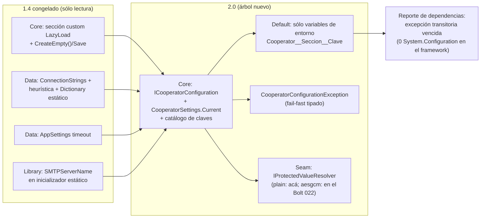

<!--
  LANGUAGE POLICY (§3.15): YAML keys, status enums, IDs and section headings stay in English;
  all prose goes in the project's content_language (devflow/LANGUAGE = es).
  ⚠️ SPEC = HOW (§2.4.1). El contrato, el catálogo de claves, la fuente por defecto, la regla del prefijo y los
  errores tipados están decididos en ADR-004 §3.2/§3.3 y el vencimiento de la excepción transitoria en ADR-004
  §3.5: este SPEC los ejecuta y los hace verificables, sin reabrir la decisión.
  ⚠️ REVISIÓN 2 — REVISIÓN MATERIAL (G15/G16) del SPEC de `US-000.BOLT-011`, disparada por el V-Bounce N°1
  registrado en `devflow/memory/MEM-261016-0053-configuracion-portable.md` (`execution_outcome: blocked`): se
  corrige un **hueco de secuencia**, no un diseño. Este Bolt entrega **contrato + catálogo + retiro en `Core` y
  `Library` + constancia**, y el retiro de las lecturas de configuración del host **en `Data`** se materializa
  cuando la capa `Data` sea aportada por sus Bolts (012/013/014; materialmente 013/014), que **nacen consumiendo**
  el contrato portable (§4, §6/C.2). El control de ausencia pasa a medirse **sobre la capa que exista** al cierre
  de este Bolt, con la **obligación registrada** que cumplen esos Bolts (§6/E.2, §7/AC-4 y AC-5, §12). Los **dos
  findings obligatorios** del `AITL-SPEC-Approval` de la revisión 1 —clave del cap de caché y etiqueta calificada
  del provider Lazy— siguen **intactos y vigentes**, y quedan transcriptos en §2 porque el bloque `review` se
  re-abre vacío. **No se toca ningún archivo de otro Bolt.**
  ⚠️ AITL-SPEC-Approval (§2.4.1, §3.0): la revisión 2 es un DRAFT hasta que el Dev-validator (y los dueños de
  dominio aplicables) registre la decisión en el bloque `review`. Un cambio material en una fuente gobernada
  invalida la aprobación → parar, revisar el SPEC canónico y re-aprobar (G15).
-->

# SPEC-261016-0018 — Configuración portable del framework: contrato en `Core`, default por entorno y vencimiento de la excepción transitoria

| Field | Value |
|-------|-------|
| **Origin** | [REV-001](../reviews/REV-001-analisis-migracion-cooperator.md) — §6 ítem 9 (hallazgos F-04, F-13, F-22) |
| **Bolt** | [US-000.BOLT-011](../functional/bolts/US-000.BOLT-011-configuracion-portable.md) |
| **ADRs** | [ADR-004](../adrs/ADR-004-cache-y-configuracion.md) §3.2, §3.3, §3.5 · [ADR-001](../adrs/ADR-001-layout-y-empaquetado-cooperator-2.md) §3.4, §5 |
| **Risk Class** | medium |
| **Revision** | 2 |

---

## 1. Objective

Se entrega la **configuración del framework** como un contrato propio de **valores nombrados** —declarado en
`Cooperator.Framework.Core`, sin dependencias de terceros— con su **implementación por defecto desde las variables
de entorno**, su **catálogo de claves publicado**, **errores tipados** para todo lo inválido o ausente, y sin que
ninguna biblioteca lea **ni escriba** la configuración de su host.

El problema que resuelve es doble y ya está diagnosticado: **(1)** el framework hoy lee la configuración del host
por tres caminos distintos y **escribe** su archivo (REV-001 F-04: `Core` crea y guarda la sección custom del
LazyLoad; F-13: `Data` lee la cadena de conexión con una **heurística por substrings** y la cachea en un
`Dictionary` estático, y el timeout por `AppSettings`; F-22: `Library` lee el servidor SMTP en un **inicializador
estático** que revienta con `NullReferenceException` si la clave falta); y **(2)** mientras eso siga así, la
**excepción transitoria** que ADR-001 §4/§5 dejó viva hasta el release 2.0.0 —`System.Configuration.ConfigurationManager`
en `Data`— no puede vencer. Este Bolt **es** el que la vence: ADR-004 §3.5 lo dice de forma explícita ("esta
decisión **es** la *fuente portable* que el ADR-001 §4/§5 dejó pendiente… la excepción caduca **con esta
decisión**, no con el paso del tiempo").

Si no se implementa, el framework seguirá atado al modelo de configuración de .NET Framework (un `System.Configuration`
que no existe en el runtime objetivo), un valor de conexión inválido seguirá fallando de forma confusa o silenciosa,
y el umbral del NFR `dependency-footprint` quedará con una excepción vencida pero viva.

**Alcance del retiro y su secuencia (revisión 2).** Este Bolt entrega el **contrato**, su **catálogo**, la
**implementación por entorno**, los **errores tipados**, el **seam** del resolutor, el **retiro en `Core` y
`Library`** y la **constancia de las rupturas**; el **retiro de las lecturas de configuración del host en `Data`**
—la cadena de conexión con su heurística por substrings y su `Dictionary` estático, y el timeout por `AppSettings`—
**se materializa cuando esa capa sea aportada por sus Bolts** (012/013/014; materialmente 013/014, `SPEC-261016-0019`
y `SPEC-261016-0020`), que **nacen consumiendo** la configuración portable: la forma en que esos archivos pueden
existir en la 2.0 —`BaseRule.cs` y `SQLHelper.cs` tipados sobre el provider de ADR-005, con `SqlHelper` interno y
sin `System.Data.SqlClient`— **es** el entregable del Bolt 014. Mientras esa capa no exista, la ausencia se mide
**sobre la capa que exista** y la obligación queda **registrada** (§6/E.2, §7/AC-4 y AC-5). La forma del contrato,
del catálogo, del default y de los errores **no cambia** con esta revisión: el hueco era de secuencia (§4, §15).

---

## 2. Context

**Origen y decisión.** `REV-001` (aprobado 2026-10-15) ruteó el ítem 9 a un ADR. Ese ADR es **ADR-004**
(`accepted`), que decide: contrato mínimo `ICooperatorConfiguration`, implementación por defecto **sólo por
variables de entorno**, **el framework deja de leer y de escribir archivos de configuración** (§3.2), regla única
para el valor de conexión —**prefijo de esquema obligatorio**, sin heurística, con `CooperatorConfigurationException`
para lo inválido— (§3.3), y el **vencimiento** de la excepción transitoria de ADR-001 §4/§5 (§3.5). Este SPEC
**no decide nada nuevo**: fija cómo se construye, dónde vive cada pieza y cómo se demuestra.

**Inventario verificado en esta sesión — la configuración del host que el framework toca hoy:**

| Punto | Qué hace hoy | Evidencia (1.4) |
|---|---|---|
| `Core` — LazyLoad | Sección **custom** (`ProvidersSection` : `ConfigurationSection`, `ProvidersCollection`, `Provider` : `ConfigurationElement`) y **escritura del archivo del host**: `CreateEmpty()` / `CreateEmpty(fileName)` → `cfg.Save(ConfigurationSaveMode.Full)`, sobre `ConfigurationManager.OpenMappedExeConfiguration` | `Core/LazyLoad/LazyProviderFactoryConfigHelper.cs:293,372-373,396,405,415,425` |
| `Data` — connection string | `ConfigurationManager.ConnectionStrings[clave].ConnectionString`, con **heurística por substrings** (`initial catalog`/`database`/`data source`) y **caché estático** | `Data/BaseRule.cs:104` (+ ADR-004 §1) |
| `Data` — timeout | `ConfigurationManager.AppSettings.Get("CooperatorCommandTimeOut")` | `Data/SQLHelper.cs:84` |
| `Library` — SMTP | `private static string _SmtpServerName = ConfigurationManager.AppSettings["SMTPServerName"].ToString();` → **inicializador estático** que lanza `NullReferenceException` en el *type-initializer* si la clave falta (error poco diagnosticable) | `Library/SmtpMail.cs:33,45` |

**Catálogo de claves (ADR-004 §3.2) y su correspondencia con el inventario de 1.4** — es el reemplazo directo de
lo anterior y lo que este Bolt publica:

| Clave 2.0 | Origen 1.4 | Tipo / default |
|---|---|---|
| `Cooperator:ConnectionStrings:<nombre>` (nombre por defecto **`CooperatorConnectionString`**, conservado) | `ConnectionStrings[...]` del host | obligatoria (sin default): su ausencia es error tipado |
| `Cooperator:Data:CommandTimeoutSeconds` | `AppSettings["CooperatorCommandTimeOut"]` | entero; default documentado |
| `Cooperator:Cache:DefaultTtlSeconds` | (caché de colecciones, 1 h) | entero; default **1 h** |
| `Cooperator:Cache:ParameterMetadataTtlSeconds` | (caché de metadata de SP, 1 día) | entero; default **1 día** |
| `Cooperator:Mail:SmtpServer` | `AppSettings["SMTPServerName"]` | obligatoria **al usarse** (lectura perezosa) |
| `Cooperator:LazyLoad:Providers:<entidad>:Assembly` y `…:Class` | sección custom `LazyLoad/ProvidersSection` | par de valores por entidad |

> Las dos claves de caché se **publican** acá (el default no vive escondido en el código) pero su **consumo** es
> del Bolt de caché (013); el mecanismo de carga que consume las claves de LazyLoad es del Bolt 005 (SPEC-0015).

> **Obligaciones vinculantes del `AITL-SPEC-Approval` de la revisión 1 — siguen intactas y vigentes.** Se
> transcriben acá porque esta revisión material re-abre el bloque `review` vacío, y porque las dos son
> **obligaciones de ejecución del V-Bounce**, no decisiones que esta revisión reabra:
>
> **(a) Clave del cap de caché.** El catálogo de este SPEC **no** la publicaba: §2/§A.2 sólo listaba los dos TTL
> (`Cooperator:Cache:DefaultTtlSeconds`, `Cooperator:Cache:ParameterMetadataTtlSeconds`). ADR-004 §3.1 exige el cap
> «configurable» y §3.2 fija «toda región con default propio tiene su clave»; `SPEC-013` §14 propone «una clave
> bajo `Cooperator:Cache:*`» sin nombre concreto y difiere su publicación al Bolt 011. **FINDING para el V-Bounce
> del 011:** publicar la clave concreta del cap en `configuration-keys.md` + `ConfigurationKeys.cs` —propuesta
> aprobada: **`Cooperator:Cache:MaxEntries`** (forma de las existentes `…Seconds`)— de modo que el 013 pueda tomar
> el cap del catálogo sin esconder el default.
>
> **(b) Forma del nombre del provider Lazy.** El catálogo debe gobernar la forma **calificada**: ADR-004 §3.4
> ejemplifica sin calificar (`Class`: `CustomerLazyProvider`) pero ADR-006 §3.1 exige el nombre completo
> calificado. **FINDING para el V-Bounce del 011:** publicar en `configuration-keys.md` el etiquetado de
> `Cooperator:LazyLoad:Providers:<entidad>:Class` como **nombre completo calificado** por namespace (p. ej.
> `Ventas.LazyProviders.CustomerLazyProvider`), corrigiendo el ejemplo sin calificar — coherente con ADR-006 §3.1
> y con el `SPEC-261016-0015`, que ya lo exige.

**Estado del árbol 2.0 y dependencias.** `2.0/` existe con lo que dejó el Bolt 001 —los cuatro `.csproj`
portables, la solución, el comando reproducible y el arnés— y **todavía sin fuentes `.cs`** (verificado por el
V-Bounce N°1: `2.0/src` contiene únicamente los cuatro `.csproj`). Por eso la §4 declara la **regla de aporte**,
acotada por esta revisión a los archivos que **no** requieren transformación. La partición del modelo (003), el
retiro del export (006) y el de la serialización (007) ya tienen SPEC en disco, y la **capa `Data`** —de la que
depende el retiro diferido de sus lecturas— tiene los suyos (`SPEC-261016-0021` del Bolt 012,
`SPEC-261016-0019` del Bolt 013 y `SPEC-261016-0020` del Bolt 014). La verificación de este Bolt es: el arnés, el
reporte de dependencias y la búsqueda de usos sobre el árbol.

---

## 3. Source inventory and approval references

**Pre-SPEC evidence gate (§2.4.1) — resultado: PASA.** Todas las fuentes gobernadas que este SPEC usa están
aprobadas; no hay ADRs activos en conflicto (ADR-004 §3.2/§3.3 concuerda con ADR-007 §3 sobre `plain:`, el prefijo
obligatorio y la ubicación del contrato del resolutor; ADR-004 §3.5 documenta expresamente el efecto sobre el
umbral de ADR-001 §5, sin enmendarlo), y el plan de integración declarado (`n/a`) coincide con el
`test_integration: not-required` del Bolt (§3.2.2). No se emite reporte bloqueante.

La **revisión 2** vuelve a correr el gate al reabrirse el SPEC: **PASA**. Las fuentes gobernadas siguen aprobadas
y **sin cambio material** —el V-Bounce N°1 lo verificó de forma explícita (`MEM-261016-0053` §8.3) y el
`AITL-SPEC-Approval` de la revisión 1 sigue vigente hasta que se registre el de esta revisión— y lo que cambia es
de **alcance/secuencia**, no de fuentes: el retiro de las lecturas de configuración del host **en `Data`** se
reasigna a los Bolts que aportan esa capa (§4, §6/C.2, §15).

| Source | Ref | Approval |
|--------|-----|----------|
| Bolt | `US-000.BOLT-011` (`devflow/functional/bolts/US-000.BOLT-011-configuracion-portable.md`) | AITL-BOLT-READY-Approval ✓ — `approved`, `agent:dotnet-architect-reviewer-agent` (architect), 2026-10-16T00:06:40-03:00; `risk_class: medium`, `test_integration: not-required` |
| Parent US | `US-000` (`functional/user-stories/US-000-non-functional.md`) | Contenedor permanente: **sin** ciclo de aprobación (§2.6) — no aplica checkpoint |
| ADR (gobernante) | `ADR-004` §3.2 (contrato, catálogo, fuente por defecto y retiro de la lectura/escritura), §3.3 (prefijo obligatorio, error tipado, seam del resolutor, retiro del caché estático), §3.5 (vencimiento de la excepción transitoria), §5 (NFRs: fail-fast y presupuesto de dependencias) | AITL-ADR-Approval ✓ — `accepted`, `human:eugenioserrano` (tech_lead), 2026-10-15T22:32:47-03:00 |
| ADR (gobernante) | `ADR-001` §3.4 (política de dependencias de terceros), §5 (NFR `dependency-footprint` y su umbral), §4 (la excepción transitoria y su dueño) | AITL-ADR-Approval ✓ — `accepted`, 2026-10-15T22:32:47-03:00 |
| ADR (de apoyo, consultado) | `ADR-007` §3 (ubicación del contrato `IProtectedValueResolver` en `Core` y esquemas `plain:`/`aesgcm:` + hook del host) | AITL-ADR-Approval ✓ — `accepted` (2026-10-15) |
| ADR (de apoyo, consultado — revisión 2) | `ADR-005` §3.1 (provider `Microsoft.Data.SqlClient` **único**; `System.Data.SqlClient` **se retira** de `Data`), §3.3/§4 (`SqlHelper` **interno**, sin casts, «el `SqlHelper` público **desaparece**») — **gobierna el destino** de los archivos de `Data` cuyo retiro esta revisión difiere a la capa | AITL-ADR-Approval ✓ — `accepted`, `human:eugenioserrano` (tech_lead), 2026-10-15T23:11:40-03:00 |
| REV evidence | `REV-001` §4 F-04, F-13, F-22 y §6 ítem 9 | AITL-REV-Approval ✓ — aprobado 2026-10-15 |
| SPECs previos (prerrequisitos) | `SPEC-261016-0000-…` (arnés, reporte de dependencias por proyecto, línea base 1.4) y `SPEC-261016-0015-…` (carga de providers Lazy) | Ambos **en disco** |
| SPECs de la capa `Data` (relación de **secuencia**, no prerrequisito — revisión 2) | `SPEC-261016-0021-…` (Bolt 012), `SPEC-261016-0019-…` (Bolt 013) y `SPEC-261016-0020-…` (Bolt 014) | Los tres **en disco**; son quienes **aportan la capa `Data`** y, con ella, materializan el retiro de sus lecturas de configuración del host (§4, §6/C.2, §7/AC-5) |
| Repository baseline | commit `6aa497f793cd3ab9d83c68db7ef2c1d80d3421d4` | — (nada bajo `2.0/` ni bajo `1.4/` en el árbol de trabajo) |

---

## 4. Scope

### In scope

1. **El contrato de configuración en `Core`** (`ICooperatorConfiguration`): lectura por clave, variantes tipadas y
   `GetConnectionString(name)`; **cero dependencias de terceros**. Instancia ambiental
   (`CooperatorSettings.Current`) fijable **una vez** al arranque, con lectura perezosa, **más sobrecargas
   explícitas** que aceptan una configuración (tests y hosts con inyección de dependencias).
2. **La implementación por defecto: sólo variables de entorno**, con la convención de doble guion bajo
   (`Cooperator__Data__CommandTimeoutSeconds`); **defaults documentados** para lo que los tiene y **error tipado**
   para lo que no (la connection string). El framework **no** lee archivos y **no** define precedencias (la
   precedencia entorno > archivo > default es del bootstrap del Bolt 021).
3. **El catálogo de claves publicado y versionado** (documento + nombres expuestos por el contrato), con las dos
   claves de caché incluidas porque el default no vive escondido en el código (ADR-004 §3.2).
4. **El retiro de la configuración del host en lo que este Bolt puede materializar**: la sección custom del
   LazyLoad y **su escritura** fuera de `Core` (`CreateEmpty`/`OpenMappedExeConfiguration`/`cfg.Save`) y la
   lectura del servidor SMTP en `Library`. El **retiro de las lecturas de configuración del host en `Data`** —la
   lectura de `ConnectionStrings` **con su heurística por substrings y su `Dictionary` estático**, y la lectura
   del timeout por `AppSettings`— **no es un archivo que este Bolt modifique**: esos archivos **no existen** en
   `2.0/` y su forma compilable —tipada sobre el provider de ADR-005— **es** el entregable del Bolt 014
   (ADR-005 §3.3/§4; evidencia del bloqueo en `MEM-261016-0053` §8.1). La obligación se **registra** acá (§6/E.2)
   y la **cumplen los Bolts que aportan esa capa** (012/013/014; materialmente 013/014), que nacen consumiendo el
   contrato portable.
5. **La forma del valor de conexión y sus errores tipados:** prefijo de esquema **obligatorio** (`plain:` =
   identidad), la excepción **propia del framework** (`CooperatorConfigurationException`, definida en `Core`) con
   la **clave** y —cuando corresponda— el **prefijo ofensor**, y el **seam** hacia `IProtectedValueResolver`
   (contrato en `Core`, ADR-007 §3) que entrega el valor crudo con su prefijo a la capa que lo consume.
   Cero fallback silencioso, cero descifrado a ciegas, cero adivinanza de "esto parece plano".
6. **`SmtpMail`: lectura perezosa y validada** del valor de correo (sin inicializador estático que explote).
7. **La constancia de las rupturas** (superficie y comportamiento, ADR-008 §3.1), el **vencimiento demostrado**
   de la excepción transitoria de ADR-001 §4/§5 —**0 lecturas y 0 escrituras de configuración del host en la capa
   que exista** al cierre de este Bolt, con el reporte de dependencias por proyecto como evidencia— y la
   **obligación registrada** para los Bolts de la capa `Data` (013/014): al aportar `BaseRule.cs`, `SQLHelper.cs` y
   compañía, **ninguna** de sus lecturas de configuración puede provenir del host; todas salen del catálogo.

### Out of scope

| Fuera de alcance | Dueño | Por qué |
|---|---|---|
| La **caché** (`ICacheProvider`, TTLs efectivos, cap y desalojo) | Bolt 013 (ADR-004 §3.1) | Acá se **publica** la clave y su default; el consumo y el mecanismo son de su Bolt |
| El **provider de datos** y su borde de conversión | Bolt 014 (ADR-005 §3) | El valor crudo con prefijo llega del contrato; quién lo convierte en conexión es `Data` |
| La **implementación `aesgcm:`**, sus parámetros, el hook del host y los comandos de valores protegidos | Bolt 022 (ADR-007 §3) | ADR-004 §3.3 fija **la forma** del contrato (prefijo obligatorio, resolutor intercambiable); el algoritmo y las claves son de ADR-007 |
| La **configuración de las aplicaciones generadas**: `appsettings.json`, el bootstrap y la precedencia **entorno > archivo > default** | Bolt 021 (ADR-004 §3.4, ADR-003 §3.6) | El framework no lee archivos: la precedencia es propiedad del bootstrap que emite el set de plantillas |
| La **caché de la cadena de conexión** que el resolutor o el proveedor decidan | Bolts 014/022 | ADR-004 §3.3: la resolución es del proveedor de configuración, con su propio criterio |
| El **retiro de las lecturas de configuración del host en `Data`** (`ConnectionStrings` + heurística por substrings + `Dictionary` estático, y el timeout por `AppSettings`) | Bolts de la capa `Data` (012/013/014) — materialmente el **014** (`SPEC-261016-0020`), ADR-005 §3 | Esos archivos **no existen** en `2.0/` y su forma compilable **es** el entregable del 014: están tipados sobre `System.Data.SqlClient`, que ADR-005 §3.1 **retira de `Data`**. Aportarlos verbatim **no compila** en `netstandard2.1` (sonda: `CS0234`/`CS0246`) y transformarlos invade al 014 — es la quinta condición de parada de §15, y la causa del V-Bounce N°1 bloqueado (`MEM-261016-0053` §8.1) |
| La **versión del provider ADO.NET** y su smoke test de conexión real | Bolt 014 (ADR-005 §3.1) | El ADR asigna la versión «al **Bolt**» con dos criterios obligatorios: asset consumible desde `netstandard2.1` y **smoke test de conexión real** contra SQL Server. Ninguno es de este Bolt; elegirla acá sería inventar (octava condición de parada) |
| Cambiar TFMs o **agregar** dependencias al framework | — (nadie) | ADR-001 §3.1/§3.4; este Bolt **quita** una excepción, no suma nada |
| Cualquier **edición de `1.4/`** | — (nadie) | El 1.4 es inmutable: se referencia o se copia como fuente, nunca se modifica |

**Regla de aporte (bounded, explícita — acotada por la revisión 2).** El contrato y el retiro se materializan
sobre el árbol 2.0. Si al ejecutar el V-Bounce alguno de los archivos en alcance **todavía no está** en `2.0/`
(porque su porte lo aporta otro Bolt), el V-Bounce lo aporta **en su forma ya migrada** —sin la lectura ni la
escritura de configuración del host— y, para que compile, el **cierre mínimo** de tipos que necesite, **copiados
tal cual están en el 1.4** y **sin ninguna otra transformación**. Cada archivo aportado se declara uno por uno en
el MEM.

**El límite de la regla (el hueco de secuencia que cierra esta revisión).** El aporte **sólo** cubre archivos cuya
*forma ya migrada* consista en **quitar** la lectura/escritura de configuración del host. El mapa de factibilidad
del V-Bounce N°1 (`MEM-261016-0053` §2) lo verificó archivo por archivo: son aportables el contrato y el catálogo
en `Core` (nuevos, BCL puro), `SmtpMail.cs` y el cierre de `Library/Exceptions/*` (sólo `System.*` disponible en
`netstandard2.1`), y el archivo del LazyLoad **se retira entero** —no hay nada que aportar—. **Los archivos de
`Data` (`BaseRule.cs`, `SQLHelper.cs`, `SqlHelperParameterCache.cs`) quedan fuera del aporte**: su forma migrada
**no** es "quitar una lectura" sino pasarlos al provider de ADR-005 (`SqlHelper` **interno**,
`Microsoft.Data.SqlClient` de punta a punta, sin casts, con un único punto de conversión —«el `SqlHelper` público
**desaparece**»—), que **es** el entregable del Bolt 014; y aportarlos tal cual **no compila** en `netstandard2.1`
(sonda registrada: `CS0234`/`CS0246`). Si el V-Bounce volviera a necesitarlos, está ante la **quinta condición de
parada** de §15 — la que detuvo el V-Bounce N°1 y la que esta revisión resuelve.

---

## 5. Prerequisites and baseline

- **Bolt 001 y su SPEC** (`SPEC-261016-0000-…`): el **comando reproducible** (`2.0/build/build.ps1`), el arnés
  (`2.0/tests/Cooperator.Harness.Tests`) y el **reporte de dependencias por proyecto** (`dotnet list package`) que
  ADR-001 §5 usa como medición del NFR y que este Bolt necesita como **evidencia del vencimiento** de la excepción
  transitoria.
- **Bolt 005 y su SPEC** (`SPEC-261016-0015-…`): el mecanismo que **consume** las claves del LazyLoad. La relación
  es declarada, no de bloqueo: este Bolt define las claves y retira la sección custom; 005 resuelve el nombre
  calificado y el `AssemblyLoadContext` (ADR-006). Si 005 ya retiró la lectura de la sección por su lado, se
  registra como tal y este Bolt sólo cierra lo que quede.
- **La capa `Data` y sus Bolts (012/013/014) — relación de secuencia, declarada (revisión 2).** `SPEC-261016-0021`
  (Bolt 012), `SPEC-261016-0019` (Bolt 013) y `SPEC-261016-0020` (Bolt 014) están **en disco**. Son quienes
  **aportan la capa `Data`** al árbol 2.0 y, con ella, **materializan el retiro de sus lecturas de configuración
  del host** (§4, §6/C.2): nacen consumiendo el contrato portable, y el 014 además con el provider de ADR-005 y sin
  `System.Data.SqlClient`. No es un prerrequisito de este Bolt —la relación se cierra **al revés**, porque este
  Bolt define el contrato que ellos consumen— y por eso la obligación se **registra** (§6/E.2) en lugar de
  bloquear.
- **Toolchain fijado por el Bolt 001:** SDK 10.0.402 (`global.json`), MSBuild 18.11.x de Visual Studio 18,
  advertencias tratadas como error. La verificación es `pwsh -File 2.0/build/build.ps1 -Scope Hermetic`.
- **Estado del árbol 2.0 al escribir esta revisión:** `2.0/` existe con los cuatro `.csproj` portables, la
  solución, el comando reproducible y el arnés del Bolt 001, y **sin fuentes `.cs`** (estado verificado por el
  V-Bounce N°1, `MEM-261016-0053` §9). Por eso la §4 declara la **regla de aporte**, acotada a los archivos que
  **no** requieren transformación.
- **`1.4/**` es sólo lectura:** se verifica contra el commit baseline antes y después de construir.
- **Convención de constancia:** cada Bolt aporta su propia lista de rupturas (el documento de notas del consumidor
  es del Bolt 028). Este Bolt usa el fragmento por Bolt en `2.0/docs/api-removals/`, con datos por entrada —
  **tipo retirado** y **cambio de comportamiento**— más su lista en el MEM.

---

## 6. Phases

> Un solo Bolt (`US-000.BOLT-011`), 1–2 V-Bounces esperados. El orden construye primero el contrato, después el
> default, después **quita** la configuración del host y al final demuestra el vencimiento y firma la constancia.

### Phase A — El contrato y el catálogo en `Core`

**Duration:** ~2h de ciclo — **Complexity:** Medium

#### A.1 `ICooperatorConfiguration` y su acceso

Se declara en `Cooperator.Framework.Core` (capa base, **cero dependencias de terceros**) el contrato de
**valores nombrados**: lectura por clave, variantes tipadas (cadena, entero) y `GetConnectionString(name)`. El
contrato **no conoce** archivos, rutas ni formatos: eso es exactamente lo que ADR-004 §3.2 le prohíbe saber. El
acceso es una **instancia ambiental** (`CooperatorSettings.Current`) fijable **una vez** al arranque por la app y
leída de forma perezosa por el framework, **más sobrecargas explícitas** que aceptan una instancia — la vía de los
tests y de los hosts con inyección de dependencias. Se elige ambiental-por-defecto (no inyección obligatoria)
porque el código del consumidor que la 2.0 debe migrar con cambios mínimos no instancia gateways a mano.

#### A.2 El catálogo de claves, publicado

Se publican las claves de ADR-004 §3.2 con su tipo, su default y —cuando existe— su correspondencia con el
inventario de 1.4, en un documento versionado junto al código (`2.0/docs/configuration-keys.md`) y como nombres
expuestos por el contrato (constantes), de modo que ni el default ni el nombre queden escondidos en una
implementación. La clave por defecto de la connection string **conserva el nombre**
`CooperatorConnectionString` (continuidad declarada por el ADR).

**Files created:**
- `2.0/src/Cooperator.Framework.Core/Configuration/ICooperatorConfiguration.cs` — el contrato
- `2.0/src/Cooperator.Framework.Core/Configuration/CooperatorSettings.cs` — instancia ambiental + sobrecargas
- `2.0/src/Cooperator.Framework.Core/Configuration/ConfigurationKeys.cs` — el catálogo como constantes
- `2.0/src/Cooperator.Framework.Core/Configuration/CooperatorConfigurationException.cs` — la excepción propia del framework
- `2.0/docs/configuration-keys.md` — catálogo publicado y versionado

---

### Phase B — La implementación por defecto: sólo el entorno

**Duration:** ~1,5h de ciclo — **Complexity:** Medium

#### B.1 Lectura desde variables de entorno

La implementación por defecto es BCL puro y usa **sólo variables de entorno**, con la convención estándar de doble
guion bajo para la jerarquía (`Cooperator__ConnectionStrings__CooperatorConnectionString`,
`Cooperator__Data__CommandTimeoutSeconds`, `Cooperator__Mail__SmtpServer`,
`Cooperator__LazyLoad__Providers__<entidad>__Assembly`). Ésa es la **única** fuente propia del framework: no lee
archivos, no define precedencias y no inventa un orden de búsqueda.

#### B.2 Defaults documentados vs. error tipado

Un host sin variables y sin configuración provista obtiene **defaults documentados** para lo que los tiene
(el timeout y los dos TTL de caché) y **error tipado** para lo que no (la connection string y el servidor SMTP
—este último, al usarse—). Ningún camino devuelve un valor vacío, `null` silencioso o un fallback encubierto.

**Files created:**
- `2.0/src/Cooperator.Framework.Core/Configuration/EnvironmentConfiguration.cs` — implementación por defecto

---

### Phase C — Retiro de la configuración del host

**Duration:** ~2h de ciclo — **Complexity:** Medium

#### C.1 Fuera la sección custom y **su escritura** (`Core`)

Se retiran de `Core` la sección custom del LazyLoad (`ProvidersSection`, `ProvidersCollection`,
`Provider : ConfigurationElement`) y el helper que la leía y la **escribía**: `LazyConfigurationHelper.Read()` /
`Read(fileName)` / **`CreateEmpty()`** —con su `cfg.Save(ConfigurationSaveMode.Full)` y el
`ConfigurationManager.OpenMappedExeConfiguration`—. El framework **no vuelve a tocar la configuración de su host**:
ni para leerla ni, menos, para crearla. El `using System.Configuration;` que quedaba sin uso sale con ella.

#### C.2 La lectura en `Data`: obligación registrada, materializada por los Bolts que aportan la capa

La lectura de configuración del host en `Data` **desaparece**, pero **no en este V-Bounce**: `BaseRule.cs`,
`SQLHelper.cs` y `SqlHelperParameterCache.cs` **no existen** en `2.0/` y su única forma compilable es la del
**Bolt 014** —tipados sobre el provider de ADR-005, con `SqlHelper` **interno**, `Microsoft.Data.SqlClient` de
punta a punta y sin `System.Data.SqlClient` (ADR-005 §3.1/§3.3/§4)—, de modo que aportarlos y transformarlos
**es** su entregable (evidencia verificada del bloqueo: `MEM-261016-0053` §8.1). Este Bolt deja la obligación
**registrada** —con su entrada de constancia en `api-removals` y su lista en el MEM— y la **cumplen los Bolts de
la capa `Data`** al aportarla; en concreto:

- **(a) 0 lectura de `ConfigurationManager.ConnectionStrings[...]`:** la cadena llega de
  `ICooperatorConfiguration.GetConnectionString(name)`, **sin** la heurística por substrings que decidía a ciegas
  si el texto estaba cifrado y **sin** el `Dictionary` estático que la cacheaba (ADR-004 §3.3: eliminar el caché
  estático es lo que permite cambiar de configuración en caliente —tests, multi-tenant— y la operación documentada
  pasa a ser el reemplazo de la instancia ambiental).
- **(b) 0 lectura del timeout por `AppSettings`:** el valor llega del catálogo (`Cooperator:Data:CommandTimeoutSeconds`),
  con su default.

Al retirarse esa lectura se retira también la **única** llamada a `Library.Cryptography.Decrypt` de esa ruta
(`BaseRule.cs:114`, dentro de la heurística): dato de constancia para los Bolts 022/030, que este Bolt registra sin
ejecutarlo. El retiro **no** se anticipa por esta revisión: ejecutarlo acá exigiría transformar código de otro Bolt
(quinta condición de parada de §15).

#### C.3 Fuera la lectura en `Library` (`SmtpMail`)

`SmtpMail` lee el servidor de correo del catálogo (`Cooperator:Mail:SmtpServer`) de forma **perezosa y validada**:
sin inicializador estático, sin `.ToString()` sobre un valor posiblemente ausente y con error tipado cuando el
valor falta en el momento de usarlo. El método muerto `SendMailViaCDONTS` que ADR-004 §3.2 y ADR-001 §3.1 declaran
ya saliente **no se conserva** desde este archivo: si el Bolt de `Library` (009) ya lo retiró, se registra como
tal; si no, sale acá y se declara.

**Files modified:**
- `2.0/src/Cooperator.Framework.Core/LazyLoad/LazyProviderFactoryConfigHelper.cs` — sin la sección ni su escritura
- `2.0/src/Cooperator.Framework.Library/SmtpMail.cs` — lectura perezosa y validada

> **`Data` no figura acá por decisión de secuencia (revisión 2):** sus dos archivos no existen en `2.0/` y los
> aporta el Bolt 014 con su forma migrada. La obligación viaja **registrada** (§6/E.2) y este Bolt **no** edita
> código de otro Bolt (quinta condición de parada de §15).

---

### Phase D — Forma del valor de conexión, errores tipados y seam del resolutor

**Duration:** ~1,5h de ciclo — **Complexity:** Medium

#### D.1 Reglas únicas, sin heurística

`GetConnectionString(name)` entrega el valor **crudo, con su prefijo**. Las reglas son las de ADR-004 §3.3 y
ADR-007 §3, idénticas entre ambos ADRs: **`plain:` explícito** = identidad; un valor **sin prefijo** **no** se
asume texto plano —se rechaza—; un **prefijo desconocido** se rechaza nombrando la clave **y el prefijo ofensor**.
Nunca hay intento de descifrado a ciegas, ni fallback silencioso, ni adivinanza.

#### D.2 La excepción propia del framework

Todo lo inválido o ausente falla con **`CooperatorConfigurationException`** —tipo **propio** del framework,
definido en `Core`, **nunca** un tipo del stack de configuración clásico— con la **clave** en el mensaje y, cuando
corresponde, el prefijo ofensor. Los cuatro casos canónicos son: **clave ausente**, **valor sin prefijo**,
**prefijo desconocido** y **valor no numérico** (timeout o TTL).

#### D.3 El seam hacia el resolutor

La capa que **consume** el valor —`Data` para las cadenas de conexión, el tooling para el reverse— es la que
invoca a `IProtectedValueResolver`: el proveedor de configuración entrega el valor crudo con su prefijo, y el
resolutor conoce el esquema y la carga (ADR-004 §3.3). El contrato del resolutor vive en `Core`, junto al de
configuración (ADR-007 §3): este Bolt **consume** ese contrato y registra `plain:` (identidad); la implementación
`aesgcm:<kid>:<base64>`, los esquemas del host por hook y los parámetros criptográficos son del **Bolt 022**, y
hasta que aterricen un esquema conocido sin resolutor registrado **falla con error tipado** (jamás se resuelve
"a ver qué pasa").

**Files created:**
- `2.0/src/Cooperator.Framework.Core/Configuration/ConnectionStringValue.cs` — parsing y validación de la forma del valor
- `2.0/src/Cooperator.Framework.Core/Configuration/IProtectedValueResolver.cs` — el **seam** (si el Bolt 022 no lo declaró ya; ver §14)

---

### Phase E — Vencimiento de la excepción transitoria y constancia de rupturas

**Duration:** ~1,5h de ciclo — **Complexity:** Low

#### E.1 La evidencia del vencimiento

Se produce la evidencia que ADR-004 §3.5 exige: **(a)** 0 ocurrencias de `ConfigurationManager`,
`OpenMappedExeConfiguration` y escritura de configuración en el framework, **medidas sobre la capa que exista** al
cierre de este Bolt (los proyectos con fuentes en `2.0/src`); **(b)** 0 declaraciones de
`System.Configuration.ConfigurationManager` en los proyectos del framework; **(c)** el **reporte de dependencias
por proyecto** (Bolt 001) mostrando que la excepción transitoria de ADR-001 §4/§5 **no está tomada**, con el
umbral del NFR `dependency-footprint` de vuelta en su valor declarado (`Data`: exactamente 1 dependencia de
terceros —el provider de ADR-005— es el techo declarado; si el Bolt 014 todavía no aterrizó, el reporte lo
muestra con **0** y lo declara así, sin maquillarlo); y **(d)** la **obligación registrada** de §6/C.2 presente en
el fragmento `api-removals` y en el MEM, con su referencia cruzada a `SPEC-261016-0019` y `SPEC-261016-0020` —los
Bolts que la cumplen al aportar la capa—, de modo que la ausencia en `Data` quede **verificable en el acto en que
se aporte** y no como una promesa en prosa.

#### E.2 Los cambios de comportamiento, declarados

Se documenta en el fragmento `2.0/docs/api-removals/US-000.BOLT-011.json` —y en la lista de rupturas del MEM— cada
entrada con los tres datos de ADR-008 §3.1 (qué, por qué, con qué se reemplaza). Como mínimo, las siguientes:

| Ruptura | Qué cambia | Decisión que la ordena |
|---|---|---|
| Tipos de la sección custom retirados | `ProvidersSection`/`ProvidersCollection`/`Provider` desaparecen de la superficie de `Core` | ADR-004 §3.2 |
| Fuente del timeout | `CooperatorCommandTimeOut` (appSettings) → `Cooperator:Data:CommandTimeoutSeconds` | ADR-004 §3.2 |
| Fuente del SMTP | `SMTPServerName` (appSettings, leído al cargar el tipo) → `Cooperator:Mail:SmtpServer` (perezoso y validado) | ADR-004 §3.2 (F-22) |
| Fuente del LazyLoad | sección custom del `.config` → claves `Cooperator:LazyLoad:Providers:*` | ADR-004 §3.2 |
| Valor de conexión | un valor **sin prefijo** deja de funcionar: hay que declarar `plain:` (o el esquema del resolutor) | ADR-004 §3.3 |
| Escritura de configuración | el framework ya no crea ni guarda la sección del host: si el host la necesita, la crea él | ADR-004 §3.2 |
| Cambio en caliente | desaparece el `Dictionary` estático: la configuración puede cambiar entre lecturas (antes no) | ADR-004 §3.3 |
| Tipo de error | los fallos de configuración lanzan `CooperatorConfigurationException`, no tipos de `System.Configuration` ni `NullReferenceException` | ADR-004 §3.2/§3.3, §5 |

> **Entradas diferidas a la capa `Data` (revisión 2).** Las **dos** rupturas cuyo retiro materializan los Bolts de
> esa capa —**fuente de la cadena de conexión** (`ConnectionStrings[...]` del host → `Cooperator:ConnectionStrings:<nombre>`
> del catálogo, sin heurística y sin `Dictionary` estático; ADR-004 §3.2/§3.3) y **fuente del timeout** (la fila
> `CooperatorCommandTimeOut` → `Cooperator:Data:CommandTimeoutSeconds`, ya listada arriba)— se registran en el
> fragmento y en el MEM con su **dueño declarado** (los Bolts 013/014; materialmente `SPEC-261016-0020`) y marcadas
> como **diferidas a la capa**, nunca como entregadas acá. Un cambio de comportamiento que el consumidor va a ver
> tiene que estar en la constancia **desde ahora** (ADR-008 §3.1), aunque lo materialice otro Bolt: si esperara al
> 014, las notas de migración (Bolt 028) perderían el aviso hasta ese momento.

**Files created:**
- `2.0/docs/api-removals/US-000.BOLT-011.json` — constancia de rupturas (insumo del Bolt 028)
- `2.0/tests/Cooperator.Harness.Tests/ConfigurationContractTests.cs` — contrato, default y casos negativos
- `2.0/tests/Cooperator.Harness.Tests/HostConfigurationAbsenceTests.cs` — ausencia de lectura/escritura de configuración del host

---

## 7. Acceptance criteria

> Bolt no funcional (parent `US-000`, sin ACs): los criterios son los **resultados medibles** del Bolt (§2) y las
> restricciones de ADR-004/ADR-001, expresados como Given/When/Then verificables.

### AC-1: El contrato existe, lo consume quien lo necesita y no arrastra dependencias

**Given** el árbol 2.0
**When** se inspecciona `Cooperator.Framework.Core`
**Then** existe `ICooperatorConfiguration` con lectura tipada y `GetConnectionString(name)`, `Core` sigue con
**0** dependencias de terceros, `CooperatorSettings.Current` se fija una sola vez y las sobrecargas explícitas
permiten inyectar una configuración.

### AC-2: Default por entorno, defaults documentados y error tipado

**Given** una instancia por defecto
**When** se leen claves con valor en el entorno y claves sin él
**Then** las primeras devuelven el valor del entorno (convención `__`), las que tienen default devuelven el
documentado y las obligatorias sin valor fallan con `CooperatorConfigurationException` nombrando la clave.

### AC-3: Fail-fast tipado en los cuatro casos canónicos

**Given** cada caso inválido —clave ausente, valor **sin prefijo**, **prefijo desconocido**, valor **no numérico**
**When** se lee la clave
**Then** falla con `CooperatorConfigurationException` (nunca un tipo de `System.Configuration`), el mensaje nombra la
clave (y el prefijo ofensor cuando aplica), y **no** existe ningún camino de fallback silencioso.

### AC-4: El framework no lee ni escribe configuración del host, sobre la capa que exista

**Given** el framework construido al cierre de este Bolt
**When** corre el control de ausencia
**Then** sobre **la capa que exista** (los proyectos con fuentes en `2.0/src`) hay **0** usos de
`ConfigurationManager`, `OpenMappedExeConfiguration` y de cualquier escritura de configuración; la sección custom
no existe en la superficie ni en el código; ninguna biblioteca abre un archivo de configuración; y para la capa
`Data` —cuyas fuentes aportan los Bolts 012/013/014— existe la **obligación registrada** de §6/C.2 y §6/E.2, con
la referencia cruzada a `SPEC-261016-0019` y `SPEC-261016-0020`, de modo que su ausencia se verifica **en el acto
en que se aporte** y nunca se da por hecha.

### AC-5: La excepción transitoria de ADR-001 §4/§5 está vencida y demostrado, y la obligación de la capa `Data` queda registrada

**Given** el reporte de dependencias por proyecto, la búsqueda de usos y la constancia de §6/E.2
**When** se revisa el framework
**Then** **0** proyectos del framework declaran o usan `System.Configuration.ConfigurationManager`, el reporte lo
evidencia y el umbral del NFR `dependency-footprint` queda en su valor declarado (techo: `Data` con exactamente 1
dependencia de terceros, la del provider de ADR-005); y **además** la obligación de **0 lecturas de configuración
del host** en la capa `Data` está **registrada** en el fragmento `api-removals` y en el MEM, con su referencia
cruzada a `SPEC-261016-0019` y `SPEC-261016-0020` —los Bolts que la cumplen al aportar esa capa—, sin que este
Bolt edite código de otro Bolt.

### AC-6: `SmtpMail` es perezoso y validado

**Given** un host sin la clave del servidor SMTP
**When** el tipo se carga (sin enviar correo)
**Then** **no** hay inicializador estático que explote ni `NullReferenceException`; el valor se lee al usarse y su
ausencia produce el error tipado.

### AC-7: Constancia de rupturas completa y cubierta

**Given** el fragmento de rupturas y el reporte del gate de compatibilidad contra la línea base 1.4
**When** corre el caso de cobertura
**Then** los tipos retirados aparecen identificados y cubiertos, y **cada** cambio de comportamiento del cuadro de
§6/E.2 tiene su entrada con qué, por qué y con qué se reemplaza (una diferencia o un cambio sin entrada falla).

### AC-8: Verificación reproducible y árbol congelado intacto

**Given** el toolchain fijado
**When** se ejecuta `pwsh -File 2.0/build/build.ps1 -Scope Hermetic`
**Then** el árbol compila sin advertencias tratadas como error, la suite hermética está verde, y
`git diff --quiet <baseline> -- 1.4` y `git status --porcelain -- 1.4` están vacíos.

### AC mapping to source (measurable outcome) — non-functional

| Source outcome (Bolt §2) | How this SPEC satisfies it | Verifying test/evidence |
|--------------------------|----------------------------|--------------------------|
| "el contrato de configuración existe en la capa base y lo consumen los paquetes que lo necesitan" | Fases A/C/D: contrato en `Core`, consumido por `Data` y `Library` | AC-1 · inspección + tests del contrato |
| "la implementación por defecto toma los valores del entorno" | Fase B: implementación BCL sólo-entorno | AC-2 · tests del default |
| "el catálogo de claves está publicado" | Fase A.2: documento + constantes | AC-2 · `2.0/docs/configuration-keys.md` + tests |
| "una configuración inválida o ausente falla con la excepción **propia del framework**… nombrando la clave" | Fase D.1/D.2: reglas y tipo propio | AC-3 · casos negativos por caso |
| "el framework **no** lee ni escribe archivos de configuración y la sección custom desapareció" | Fase C: retiro de la sección, de su escritura y de la lectura en `Library`, **medido sobre la capa que exista**; el retiro en `Data` queda como obligación registrada (C.2) | AC-4, AC-6 · control de ausencia |
| "un valor de conexión **sin** prefijo explícito se rechaza" | Fase D.1: prefijo obligatorio | AC-3 · caso negativo del prefijo |
| "la dependencia transitoria de configuración clásica **desapareció** (ADR-001 §5 vencido)" | Fase E.1: evidencia de dependencias + búsqueda | AC-5 · reporte de dependencias por proyecto |
| "el retiro se completa cuando la capa `Data` se aporte, sin reabrir la puerta al host" | Fase C.2/E.2: obligación registrada con dueño y referencia cruzada | AC-4, AC-5 · fragmento `api-removals` + MEM + SPECs 0019/0020 |
| "la entrada propia de las rupturas en las notas de migración" | Fase E.2: fragmento + lista en el MEM | AC-7 · fragmento + cobertura por el gate |

---

## 8. Testing strategy

### 8.1 V-Bounce level (hermetic — run by the agent)

- **Contrato y default (`ConfigurationContractTests`, `net10.0`):** lectura tipada, `GetConnectionString`,
  instancia ambiental fijada una vez y sobrecargas explícitas; lectura desde variables de entorno con la
  convención `__`; defaults documentados por clave.
- **Casos negativos por caso (los cuatro canónicos):** clave ausente, valor sin prefijo, prefijo desconocido y
  valor no numérico → tipo de excepción exacto (`CooperatorConfigurationException`), clave en el mensaje, prefijo
  ofensor cuando aplica, y **ausencia de fallback** (se verifica el mensaje accionable, no sólo que "falle").
- **Consumer-side contract tests (test doubles):** el harness consume `ICooperatorConfiguration` con una
  implementación de prueba (y con la ambiental) para verificar que el contrato es suficiente para el consumidor —
  que es exactamente cómo los hosts y los tests lo alimentan, sin tocar archivos.
- **Control de ausencia (`HostConfigurationAbsenceTests`):** barrido de usos de `ConfigurationManager`,
  `OpenMappedExeConfiguration`, `Save`/`CreateEmpty` y de la sección custom **sobre la capa que exista** (los
  proyectos con fuentes en `2.0/src`): 0 ocurrencias; verificación de que no queda un `using System.Configuration;`
  huérfano; y verificación de que el fragmento `api-removals/US-000.BOLT-011.json` contiene la **obligación
  registrada** de la capa `Data` con su referencia cruzada a `SPEC-261016-0019`/`SPEC-261016-0020` (§6/C.2,
  §7/AC-5).
- **Cobertura de la constancia:** parsea el reporte del gate contra la línea base 1.4 y el fragmento
  `api-removals/US-000.BOLT-011.json`; asserta que los tipos retirados y los cambios de comportamiento declarados
  están cubiertos.
- **Build y suite:** `2.0/build/build.ps1 -Scope Hermetic` verde.
- **Edge cases:** valor de entorno vacío (`""` = ausente, no un valor válido); timeout/TTL no numérico, negativo o
  fuera de rango; prefijo con mayúsculas o espacios (`plain:` es explícito y exacto); cambio de la instancia
  ambiental en caliente (la operación documentada); ausencia de la clave SMTP verificada **sin** cargar el tipo
  (evita el inicializador estático).
- **BUG evidence:** `n/a` — el Bolt no corrige un BUG; no hay TDD rojo→verde obligatorio.

### 8.2 Integration test level

- **`n/a`** — el Bolt declara `test_integration: not-required` y el plan del frontmatter dice `n/a` con su razón:
  el contrato de configuración y sus fuentes se verifican dentro de la aplicación, sin tocar base de datos, cola ni
  servicio externo. No hay tests de integración que escribir ni corrida pendiente antes de la aceptación (§3.2.2).

---

## 9. Quality gates

> Los estados son el **resultado esperado**; el resultado real se registra en el MEM del V-Bounce (§3.6).

| Gate | Level | Threshold | Status |
|------|-------|-----------|--------|
| Build / lint / type checks | V-Bounce | El árbol 2.0 compila con advertencias tratadas como error | `pass` — esperado (§8.1) |
| Unit / component tests | V-Bounce | Suite hermética verde (contrato, default, negativos, ausencia) | `pass` — esperado (AC-1…AC-6) |
| Consumer-side contract tests (test doubles) | V-Bounce | El contrato se satisface con una implementación de prueba; las sobrecargas explícitas existen | `pass` — esperado (AC-1) |
| SAST | V-Bounce | Validación estricta del valor (prefijo y tipo) sin fallback silencioso; cero rutas de adivinanza | `pass` — esperado (AC-3) |
| Dependency scanning / licenses | V-Bounce | **0** dependencias nuevas; se **quita** la excepción transitoria; `Core` con 0 terceros; `Data` mide **0** hoy (su 1 tercero —el provider de ADR-005— lo declara el Bolt 014 al aportar la capa) | `pass` — esperado (AC-5) |
| OWASP Top 10 — static review | V-Bounce | No se expone interfaz alcanzable desde fuera del proceso; el cambio **quita** una ruta de creación/escritura de archivos de configuración | `n/a` — sin superficie externa |
| Prompt-injection scan | V-Bounce | No hay construcción de prompts ni entrada no confiable | `n/a` — no aplica |
| Secret-leak scan | V-Bounce | Ningún secreto en el catálogo ni en fixtures; los valores vienen del entorno y **ninguna clave** vive en el repositorio (ADR-007 §3) | `pass` — esperado |
| Hallucination lint | V-Bounce | Claves, tipos y rutas referenciados existen (o se declaran como aportados) | `pass` — esperado |
| IP / license provenance | V-Bounce | No se incorpora código de terceros | `n/a` — sin código de terceros |
| PII / DLP | V-Bounce | `data_classification: internal`; no se procesan datos personales; los fixtures usan valores sintéticos | `pass` — esperado |
| Dependency-confusion | V-Bounce | Sin paquetes nuevos; nada de `System.Configuration.ConfigurationManager` entra al framework | `pass` — esperado (AC-5) |
| Test-first evidence | V-Bounce | No es un Bolt de corrección de BUG | `n/a` — sin TDD obligatorio |
| Behavioral reproducibility (hermetic suite) | V-Bounce | Dos corridas con resultado idéntico | `pass` — esperado |
| Bolt-manifest validation | V-Bounce | Manifiesto válido contra `manifest-v5-bolt.schema.json` con la entrada `v_bounces[]` completa | `pass` — esperado |
| API-compat con la línea base 1.4 (ADR-008 §5) | V-Bounce | Los tipos retirados (sección custom) aparecen identificados y cubiertos por la constancia | `pass` — esperado (AC-7) |
| Integration tests (real dependencies) | Integration test | No aplica: `test_integration: not-required` (plan `n/a`) | `n/a` — verificación dentro de la aplicación (§3.2.2) |
| Contract / E2E against the real providers | Integration test | No hay provider externo ni entorno en el alcance | `n/a` — sin dependencias reales |
| DAST / OWASP Top 10 — dynamic | Integration test | No hay servicio desplegable | `n/a` — sin superficie ejecutable |
| Perf-smoke (p95/p99) | Integration test | No hay endpoint ni carga crítica afectada | `n/a` — sin umbral aplicable |
| Observability (logs / metrics / traces) | Integration test | No hay servicio instrumentado | `n/a` — sin telemetría de servicio |

> Coherencia con el Bolt (§3.2.2): `test_integration: not-required` → `integration_test_plan.applicability: n/a`
> con su razón. Ningún gate del nivel de integración aplica.

---

## 10. Security and data

- **Menos superficie, no más:** el cambio **quita** una escritura de archivos de configuración del host (una
  operación que hoy puede crear o modificar el `.config` de una aplicación) y **quita** la heurística que decidía
  a ciegas si un valor estaba cifrado. Lo que queda es validación estricta con fallo temprano.
- **El fallo temprano es el control:** un valor sin prefijo **no** se interpreta: se rechaza. Eso evita el modo de
  fallo más peligroso del diseño anterior (tratar como plano algo que estaba protegido, o al revés, intentar
  descifrar un valor que no lo estaba).
- **Cero material sensible en el repositorio:** el catálogo publica **nombres de claves**, tipos y defaults —
  nunca valores. Los valores vienen del entorno o del host; ninguna clave criptográfica vive en el código, en el
  repositorio ni en un archivo versionado (ADR-007 §3). Los fixtures usan valores sintéticos.
- **Clasificación y datos:** `data_classification: internal` (espeja el Bolt). No se procesan datos personales ni
  payloads; la evidencia son nombres de claves, tipos de excepción y mensajes.
- **Frontera de seguridad declarada:** acá se fija **la forma** del valor y su validación; la **protección**
  (algoritmo, claves, rotación y migración de los valores ya cifrados) es de ADR-007 y del Bolt 022. Este Bolt no
  implementa criptografía ni la insinúa.

---

## 11. Monitoring and observability

- **Reportes y artefactos versionados:** el catálogo (`2.0/docs/configuration-keys.md`), el fragmento de rupturas
  (`2.0/docs/api-removals/US-000.BOLT-011.json`), el **reporte de dependencias por proyecto** (evidencia del
  vencimiento) y la salida de la suite en `2.0/artifacts/<timestamp>/`.
- **Códigos de salida `0/1/2/3`** del comando reproducible (Bolt 001): un CI futuro trata la verificación igual
  que el resto del arnés.
- **Sin telemetría de servicio:** no hay logs, métricas ni trazas que agregar; el framework no instrumenta. `n/a`
  con esa razón en la tabla de gates.

---

## 12. Migration, compatibility and rollback

- **Migration (del consumidor):** es un cambio **de fuente de configuración**, no de datos. El nombre por defecto
  de la clave de conexión se conserva (`CooperatorConnectionString`) para que la migración de una app siga siendo
  reconocible; el resto de los valores se reubica según el cuadro de §6/E.2, que las notas de migración (Bolt 028)
  publican clave por clave. Las aplicaciones generadas reciben además su `appsettings.json` y su bootstrap del
  Bolt 021 (ADR-004 §3.4).
- **Compatibility:** es una **ruptura de superficie y de comportamiento** acotada y documentada (ADR-008 §3.1):
  desaparecen tres tipos públicos de `Core` (la sección custom) y cambia el origen de cuatro valores. Un host que
  hoy tenga los valores en su `.config` y **no** los mueva fallará de forma **explícita y temprana** con
  `CooperatorConfigurationException` —nunca en silencio—, y las notas indican dónde reubicar cada valor. Un valor
  de conexión sin prefijo **deja de funcionar** a propósito (ADR-004 §3.3): declarar `plain:` es la migración.
  No hay shims ni doble fuente: la sección custom **no** convive con el contrato.
- **Rollback:** revertir el commit del Bolt. El árbol 1.4 queda intacto como referencia congelada, y el estado
  anterior (framework leyendo el `.config`) es el del 1.4 —que sigue siendo una opción soportada—, no un modo
  intermedio del 2.0. Un rollback parcial no es válido: un contrato sin el retiro deja dos fuentes de
  configuración y rompe la regla de ADR-004 §3.2.
- **Entrega válida tras la revisión 2 (y por qué ya no es un "rollback parcial").** Entregar **contrato + catálogo
  + retiro en `Core` y `Library` + constancia, sin el retiro de las lecturas de `Data`**, **es** una entrega
  válida, porque ese retiro **no pertenece a este Bolt**: lo materializan los Bolts que aportan la capa
  (012/013/014; materialmente 013/014) y, mientras esa capa no exista, **no hay dos fuentes de configuración** —la
  fuente única sigue siendo el contrato: lo que cambia es **dónde** se materializa el retiro de las lecturas, no
  **cuál** es la fuente—. La prohibición del párrafo anterior sigue vigente para lo que **sí** está en el alcance
  de este Bolt: el contrato **no** convive con la sección custom, ni con ninguna lectura de configuración del host
  en `Core`/`Library`, ni con un valor sin prefijo.

---

## 13. Risk matrix

| Risk | Probability (1-5) | Impact (1-5) | Mitigation |
|------|-------------------|--------------|------------|
| **Ruta central:** todas las aplicaciones leen de acá; un error de diseño se propaga a todo el producto | 3 | 4 | Casos negativos por caso (NFR de ADR-004 §5), fallo temprano y tipado, y contrato mínimo: el framework sólo lee valores nombrados |
| Valores existentes que **dejan de leerse** tras el retiro (timeout, SMTP, LazyLoad, connection string) | 3 | 3 | Nombre por defecto conservado + cuadro de reubicación por clave en las notas (Bolt 028) + fallo explícito en vez de valor por defecto silencioso |
| La regla del prefijo rompe un host que tenía texto plano en el `.config` | 3 | 3 | Es intencional (ADR-004 §3.3): el error es **explícito**, nombra la clave y pide `plain:`; la migración es una línea por valor y está documentada |
| Un host sin variables y sin configuración provista no arranca | 2 | 2 | Los valores con default lo tienen documentado; los obligatorios fallan temprano con mensaje accionable (mejor que un `null` más adelante) |
| Se cuela una lectura de archivo en la biblioteca ("por comodidad") | 2 | 4 | Control de ausencia automatizado (0 `ConfigurationManager`/`OpenMappedExeConfiguration`), medido **sobre la capa que exista**, más el umbral de dependencias de ADR-001 §5 |
| **El retiro de las lecturas de `Data` queda pendiente y alguien lo da por hecho** (o los Bolts 013/014 aportan la capa con la lectura de host intacta) | 3 | 4 | La obligación queda **registrada** en el fragmento `api-removals` y en el MEM, con **referencia cruzada** a `SPEC-261016-0019`/`SPEC-261016-0020` (AC-4/AC-5) y su dueño declarado; el control de ausencia declara expresamente que mide la capa que exista, y ninguno de esos dos SPECs puede cerrar sin cumplirla |
| Duplicación de la validación del prefijo con el resolutor (Bolt 022) | 2 | 2 | Frontera declarada: acá la **forma** del valor y el seam; allá la **protección**. La regla está reconciliada entre ADR-004 §3.3 y ADR-007 §3 |
| El retiro de la sección custom rompe al Bolt 005 (que la consumía) | 2 | 3 | Relación declarada (SPEC-0015): las claves del catálogo son el reemplazo; si 005 ya retiró su lectura, se registra como tal |
| La evidencia del vencimiento se declara sin medirla (se afirma "sin dependencias" sin el reporte) | 2 | 3 | El criterio de aceptación es el **reporte de dependencias por proyecto** + la búsqueda de usos, no una afirmación en prosa (AC-5) |

---

## 14. Decisions and trade-offs

| Decision | Reason |
|----------|--------|
| El contrato y la excepción viven en `Core`; la implementación por defecto también | ADR-004 §3.2 lo fija: capa base, cero dependencias, consumido por `Data` y `Library`. Poner el contrato en `Data` obligaría a `Library` a depender de `Data` (arista prohibida por ADR-001 §3.1) |
| El catálogo se publica como documento **y** como constantes del contrato | El Bolt exige el catálogo publicado y versionado; las constantes evitan que un nombre de clave viva como cadena suelta y que el default "viva escondido en el código" (ADR-004 §3.2) |
| La instancia ambiental es **fijable una vez** y se lee de forma perezosa | Es la forma que permite migrar el código del consumidor con cambios mínimos y, a la vez, inyectar configuración en tests (ADR-004 §3.2). El reemplazo en caliente de la instancia es la operación documentada |
| La lectura de `SmtpMail` es perezosa y validada, no un valor cacheado al cargar el tipo | El inicializador estático es el defecto que F-22 señala (excepción poco diagnosticable en el *type-initializer*); la lectura perezosa convierte un fallo de carga en un error tipado y accionable en el punto de uso |
| Se incluyen las claves de caché en el catálogo aunque su consumo sea del Bolt 013 | ADR-004 §3.2: "toda región de caché con default propio tiene su clave: el default no vive escondido en el código". Publicarlas acá es publicar el catálogo, no implementar la caché |
| El seam del resolutor se **consume**; si el Bolt 022 no declaró el contrato `IProtectedValueResolver` en `Core`, este Bolt declara su forma mínima | ADR-007 §3 ubica el contrato en `Core` junto al de configuración, y ADR-004 §3.3 dice que la capa que consume el valor es la que invoca al resolutor. Se evita duplicar: si 022 ya lo declaró, se consume tal cual (nota al revisor) |
| Los esquemas conocidos sin resolutor registrado **fallan** con error tipado | Nunca se resuelve "a ver qué pasa": mientras el Bolt 022 no aterrice, un esquema distinto de `plain:` no tiene implementación y eso es un error explícito, no un modo degradado |
| El método muerto `SendMailViaCDONTS` no se conserva al pasar por `SmtpMail.cs` | ADR-004 §3.2 y ADR-001 §3.1 ya lo declaran saliente; conservarlo obligaría a mantener el parámetro `System.Web.HttpContext` en la firma pública de la clase (F-22) |
| La evidencia de vencimiento es **el reporte de dependencias**, no una afirmación | ADR-001 §5 mide el NFR con `dotnet list package` por proyecto; la política se degrada si la evidencia es prosa |
| **(⚠ aprobador) El alcance del retiro se divide (revisión 2):** contrato + catálogo + retiro en `Core`/`Library` + constancia **acá**; el retiro de las lecturas de configuración del host **en `Data`** lo materializan los Bolts que aportan esa capa (012/013/014; materialmente 013/014) | Es la **salida 1** del análisis del bloqueo (`MEM-261016-0053` §8.1/§13). Los dos archivos de `Data` **no existen** en `2.0/`; aportarlos tal cual **no compila** (`netstandard2.1` no provee `System.Data.SqlClient`: sonda con `CS0234`/`CS0246`) y transformarlos **es** el entregable del Bolt 014 (ADR-005 §3.3/§4: `SqlHelper` **interno**, `Microsoft.Data.SqlClient` de punta a punta, sin casts, «el `SqlHelper` público **desaparece**»). La **salida 2** —que este Bolt aporte la capa `Data` ya migrada— se **descarta** porque obligaría a fijar la **versión** del provider, cuyo criterio de aceptación es un **smoke test de conexión real** contra SQL Server que este Bolt no puede correr (ADR-005 §3.1), y solaparía al Bolt 014 |
| **(⚠ aprobador) El control de ausencia se mide sobre la capa que exista**, y la ausencia en `Data` pasa a ser una **obligación registrada** que cumplen 013/014 | Sin la acotación, el criterio exigiría 0 lecturas en archivos que **no existen** —un criterio insatisfacible sin transformar código de otro Bolt (quinta condición de parada)—. La obligación **conserva** la fuerza normativa de ADR-004 §3.2/§3.3: viaja en el fragmento `api-removals`, en el MEM y con referencia cruzada en los SPECs de la capa, así que no es una promesa en prosa |
| **La constancia registra las dos rupturas diferidas** (fuente de la cadena de conexión y fuente del timeout en `Data`) con su **dueño declarado**, marcadas como **diferidas a la capa** | Un cambio de comportamiento que el consumidor va a ver tiene que estar en la constancia **desde ahora** (ADR-008 §3.1), aunque lo materialice otro Bolt: si esperara al 014, las notas de migración (Bolt 028) perderían el aviso hasta ese momento |

---

## 15. Stop conditions

1. **Cambio material en una fuente gobernada** (Bolt, ADR-004, ADR-001, el REV usado, baseline de código):
   detener, revisar este SPEC canónico y re-aprobar (G15). Una V-Bounce nunca abarca dos revisiones (G16).
2. **Aparece un valor de configuración que el catálogo no cubre** (una lectura nueva de la configuración del host,
   o una clave sin decisión que la ordene): detener y reportar. Agregar una clave al catálogo es ampliar la
   decisión de ADR-004 §3.2, y no se hace por analogía.
3. **El retiro exigiría resolver criptografía** (un esquema que no sea `plain:` con necesidad de implementación
   real): detener y escalar al Bolt 022 / ADR-007. Acá sólo se fija la forma y el seam.
4. **El retiro exigiría editar `1.4/`** (o el árbol congelado aparece modificado): detener. El 1.4 es inmutable.
5. **El cierre mínimo exigiría transformar código de otro Bolt**: detener y escalar la secuencia. *(Es la
   condición que detuvo el V-Bounce N°1 —`MEM-261016-0053` §8.1— y la que esta revisión resuelve: el retiro de las
   lecturas de `Data` ya no es alcance de este Bolt, sino **obligación registrada** de los Bolts que aportan esa
   capa, con la medición de ausencia acotada a la capa que exista.)*
6. **Un gate de §9 no cierra en `pass`**: detener y escalar. Una salida por excepción exige un ADR aprobado (G21).
7. **El arnés del Bolt 001 no está disponible** (comando reproducible, suite o reporte de dependencias): detener y
   escalar la secuencia; sin arnés, el vencimiento de la excepción no se demuestra.
8. **Ambigüedad que sólo se resolvería inventando** (por ejemplo, el tipo exacto que debe devolver una variante
   tipada ante un valor no numérico): parar y reportar; no se rellena el hueco con una suposición (§2.4.1).
9. **La capa `Data` aparece en `2.0/` con una lectura de configuración del host** (alguien la aportó sin cumplir la
   obligación registrada, o los Bolts 013/014 la materializaron con la lectura intacta): detener y reportar. La
   obligación y su referencia cruzada están en §6/C.2, §6/E.2 y §7/AC-4/AC-5; este Bolt **no** edita esos archivos.

---

## 16. Definition of Done (DoD)

- [ ] Fases A–E implementadas (con el alcance de §4/§6: el retiro en `Data` es obligación registrada de los Bolts de esa capa)
- [ ] Todos los criterios de aceptación (AC-1…AC-8) verificados (incluidos los cuatro casos negativos)
- [ ] Suite hermética verde (§8.1); el plan de integración es `n/a` con su razón (no hay corrida pendiente)
- [ ] El código y la configuración siguen ADR-004 (§3.2/§3.3/§3.5) y ADR-001 (§3.4/§5)
- [ ] Gates aplicables en `pass` (o `waived`/`n/a` con su razón) según §9
- [ ] MEM creado en `devflow/memory/` (exactamente uno para este V-Bounce), con la lista de rupturas
- [ ] Entrada `v_bounces[]` agregada al manifiesto en `devflow/metrics/bolts/` (ocho campos completos)
- [ ] AITL-MEM-Approval registrado
- [ ] El vencimiento de la excepción transitoria queda evidenciado por el reporte de dependencias, medido sobre la capa que exista (AC-4/AC-5)
- [ ] La **obligación registrada** de la capa `Data` está en `api-removals/US-000.BOLT-011.json` y en el MEM, con su referencia cruzada a `SPEC-261016-0019`/`SPEC-261016-0020` (§6/C.2, AC-5)
- [ ] Los **dos findings obligatorios** de la revisión 1 (§2 (a) y (b)) están satisfechos en `configuration-keys.md` + `ConfigurationKeys.cs`
- [ ] `1.4/**` intacto respecto del commit baseline

---

## 17. References

- Bolt: [`US-000.BOLT-011`](../functional/bolts/US-000.BOLT-011-configuracion-portable.md) y su manifiesto
  [`US-000.BOLT-011-…json`](../metrics/bolts/US-000.BOLT-011-configuracion-portable.json)
- Parent: [`US-000`](../functional/user-stories/US-000-non-functional.md) — contenedor no funcional
- ADRs gobernantes: [`ADR-004`](../adrs/ADR-004-cache-y-configuracion.md) §3.2/§3.3/§3.5 · [`ADR-001`](../adrs/ADR-001-layout-y-empaquetado-cooperator-2.md) §3.4/§4/§5
- ADR de apoyo: [`ADR-007`](../adrs/ADR-007-politica-criptografica.md) §3 (contrato del resolutor y esquemas)
- ADR de apoyo (gobierna el destino de los archivos de la capa `Data`): [`ADR-005`](../adrs/ADR-005-provider-de-datos.md) §3.1/§3.3/§4 —provider `Microsoft.Data.SqlClient` **único**, `SqlHelper` **interno**, «el `SqlHelper` público **desaparece**»—
- SPECs prerrequisito: [`SPEC-261016-0000`](./SPEC-261016-0000-arnes-tests-y-build-reproducible.md) (arnés y reporte de dependencias) ·
  [`SPEC-261016-0015`](./SPEC-261016-0015-carga-de-providers-lazy.md) (carga de providers Lazy)
- SPECs de la capa `Data` (relación de **secuencia**: son quienes materializan el retiro diferido y cumplen la obligación registrada):
  [`SPEC-261016-0021`](./SPEC-261016-0021-limpieza-de-referencias.md) (Bolt 012) ·
  [`SPEC-261016-0019`](./SPEC-261016-0019-cache-en-data.md) (Bolt 013) ·
  [`SPEC-261016-0020`](./SPEC-261016-0020-provider-de-datos.md) (Bolt 014)
- SPECs relacionados: [`SPEC-261016-0012`](./SPEC-261016-0012-retiro-del-export-excel.md) y [`SPEC-261016-0013`](./SPEC-261016-0013-retiro-de-serializable.md) — convención de constancia de rupturas por Bolt (`2.0/docs/api-removals/`)
- Revisión origen: [`REV-001`](../reviews/REV-001-analisis-migracion-cooperator.md) — F-04, F-13, F-22 y §6 ítem 9
- Evidencia del bloqueo que motivó la revisión 2: [`MEM-261016-0053`](../memory/MEM-261016-0053-configuracion-portable.md) — el V-Bounce N°1 `blocked`, el mapa de factibilidad archivo por archivo, las dos sondas de compilación y el análisis de secuencia
- Evidencia de código 1.4 (verificada en esta sesión): `Core/LazyLoad/LazyProviderFactoryConfigHelper.cs:293,372-373,396,405,415,425`
  (sección custom y escritura), `Data/BaseRule.cs:104` (`ConnectionStrings` + heurística + caché estático),
  `Data/SQLHelper.cs:84` (`AppSettings`), `Library/SmtpMail.cs:33,45` (inicializador estático y `using System.Configuration;`)
- Normativo: `devflow/avenga-devflow/Avenga-DevFlow.md` §2.4.1, §3.2.2, §3.3, §3.6 · `devflow/GUARDRAILS.md`
  (G07, G10, G13, G14, G15, G16, G17, G21, G23, W02, T05, T11)

---

## 18. Revision history

| Date | Author | Change |
|------|--------|--------|
| 2026-10-16 | `agent:dotnet-developer-agent` (transcripción de `human:eugenioserrano`) | Revision 1 — SPEC inicial del Bolt `US-000.BOLT-011`: contrato de configuración en `Core`, default por entorno, catálogo publicado, errores tipados, retiro de la lectura/escritura de configuración del host y evidencia del vencimiento de la excepción transitoria |
| 2026-10-16 | `agent:dotnet-developer-agent` (llm: `deepseek/deepseek-flash`) | **Revisión 2 — revisión MATERIAL (G15/G16)**, disparada por el V-Bounce N°1 de este Bolt detenido en `blocked` (`MEM-261016-0053`), que disparó la quinta condición de parada (§15): `Data/BaseRule.cs` y `Data/SQLHelper.cs` **no existen** en `2.0/`, aportarlos verbatim no compila en `netstandard2.1` y transformarlos es el entregable del Bolt 014. Se implementa la **salida 1** del bloqueo y **un solo** cambio de fondo: el **alcance del retiro se divide** —este Bolt entrega contrato + catálogo + retiro en `Core`/`Library` + constancia, y el retiro de las lecturas de configuración del host **en `Data`** lo materializan los Bolts que aportan esa capa (012/013/014; materialmente 013/014)—; el control de ausencia pasa a medirse **sobre la capa que exista** y la ausencia en `Data` queda como **obligación registrada** con su dueño y referencia cruzada. Se actualizan §1, §2 (bloque de obligaciones que transcribe los findings + estado del árbol), §3, §4 (in-scope 4/7, dos filas nuevas de *out of scope* y el **límite** de la regla de aporte), §5, §6/C.2 (reescrita) y §6/E.1/E.2, §7 (AC-4/AC-5 y su mapeo), §8.1, §9, §12 (la entrega sin el retiro de `Data` **es válida**), §13, §14, §15, §16, §17 y esta §18. **Los dos findings obligatorios de la revisión 1** (clave `Cooperator:Cache:MaxEntries`; etiqueta calificada del provider Lazy) quedan **intactos**: se transcriben en §2 porque el bloque `review` se re-abre vacío, y se agregan al DoD. `status: draft`, `review_ready_at: ""` y `review` vacío: la revisión se re-aprueba por el revisor. |

---

## 19. AITL-SPEC-Approval

> **Avenga DevFlow §2.4.1, §3.0.** This SPEC remains a draft until the
> Dev-validator (+ applicable domain owners) records `AITL-SPEC-Approval`
> (in the `review` frontmatter block). Bolt approval (`AITL-BOLT-READY-Approval`)
> authorizes SPEC preparation; **SPEC approval** authorizes the code-run /
> V-Bounce. A material source change invalidates this approval — stop,
> revise, re-approve (G15).

**Nota al aprobador — qué cambia la revisión 2 respecto de la revisión 1, y por qué (material, G15/G16).** La
revisión 1 fue aprobada y su V-Bounce N°1 se detuvo **`blocked`** sin generar código
(`MEM-261016-0053` §8.1): `Data/BaseRule.cs` y `Data/SQLHelper.cs` **no existen** en `2.0/`, aportarlos verbatim
**no compila** en `netstandard2.1` (no provee `System.Data.SqlClient`; sonda con `CS0234`/`CS0246`) y transformarlos
**es** el entregable del Bolt 014 (ADR-005 §3.3/§4). La revisión 2 implementa la **salida 1** y **un solo** cambio
de fondo. Enumerado:

1. **El alcance del retiro se divide (§4, §6/C.2, §12).** Este Bolt entrega **contrato + catálogo + retiro en
   `Core` y `Library` + constancia**; el **retiro de las lecturas de configuración del host en `Data`**
   (`ConnectionStrings` + heurística + `Dictionary` estático, y el timeout por `AppSettings`) lo **materializan los
   Bolts que aportan esa capa** (012/013/014; materialmente 013/014: `SPEC-261016-0019`, `SPEC-261016-0020`), que
   nacen consumiendo el contrato. La **regla de aporte** se conserva para lo aportable (contrato/catálogo en
   `Core`, `SmtpMail`, cierre de `Library/Exceptions/*`; el archivo del LazyLoad se retira entero) y recibe un
   **límite explícito**: los archivos de `Data` quedan **fuera** del aporte. Cambian §1, §2, §3, §4, §5, §6/C.2,
   §6/E.2, §12, §13, §14, §15, §16 y §17.
2. **El control de ausencia (AC-4/AC-5) se mide "sobre la capa que exista"** al cierre de este Bolt, y la
   ausencia en `Data` se vuelve una **obligación registrada** con dueño declarado, constancia en
   `api-removals` + MEM y **referencia cruzada** a los SPECs de los Bolts 013/014. Cambian §6/E.1, §7 (AC-4,
   AC-5 y su tabla de mapeo), §8.1, §9, §12, §13, §14 y §15 (nueva condición de parada 9).
3. **Lo que NO cambia:** el contrato `ICooperatorConfiguration`, su ubicación en `Core`, el catálogo y su forma, la
   implementación sólo-entorno, la regla del prefijo obligatorio, la excepción tipada, el seam del resolutor y el
   vencimiento de la excepción transitoria **no se reabren**: el hueco era de **secuencia**, no de diseño. Y los
   **dos findings obligatorios del `AITL-SPEC-Approval` de la revisión 1** —(a) publicar la clave del cap de caché
   (`Cooperator:Cache:MaxEntries`) en `configuration-keys.md` + `ConfigurationKeys.cs`; (b) etiquetar
   `Cooperator:LazyLoad:Providers:<entidad>:Class` como **nombre completo calificado** por namespace (ADR-006
   §3.1)— siguen **intactos y vigentes**: se transcriben en §2 (a) y (b) y se agregan al DoD, de modo que nada se
   pierde al re-abrirse el bloque `review`.

| Field | Value |
|-------|-------|
| **review.reviewers** | [Dev-validator + dueño de arquitectura (contrato/API y frontera con ADR-007) + dueño de infraestructura si se evalúa el bootstrap de configuración] |
| **review.written_by** | [opcional — quien escribe este registro: el revisor, o el agente que transcribe la decisión; escribir no es firmar (§3.0)] |
| **review.decision** | approved / changes_requested / rejected |
| **review_ready_at** | `YYYY-MM-DDTHH:mm:ss±HH:MM` |
| **review.started_at** | `YYYY-MM-DDTHH:mm:ss±HH:MM` |
| **review.decided_at** | `YYYY-MM-DDTHH:mm:ss±HH:MM` |
| **Findings** | [hallazgos o `acknowledged_without_comment` + motivo] |

### Reviewer notes (puntos explícitos para la decisión)

1. **Alcance dividido del retiro (revisión 2, §4/§6/C.2):** confirmar que es la lectura correcta — este Bolt
   entrega contrato, catálogo, retiro en `Core`/`Library` y constancia, y el retiro de las lecturas en `Data` lo
   materializan los Bolts que aportan esa capa (013/014), con la obligación **registrada** y con referencia
   cruzada a sus SPECs. Es la **salida 1** del análisis del bloqueo (`MEM-261016-0053` §8.1/§13); la salida 2
   —aportar la capa `Data` ya migrada— se descarta por la versión del provider y su smoke test real (ADR-005 §3.1).
2. **Vencimiento de la excepción transitoria (§6/E.1):** se evidencia con el **reporte de dependencias por
   proyecto** del arnés (0 usos/declaraciones de `System.Configuration.ConfigurationManager`) medido **sobre la capa
   que exista**, y el umbral vuelve a su valor declarado con el provider aún pendiente del Bolt 014 (techo:
   exactamente 1 tercero). Confirmar que es la evidencia esperada **y** que la acotación por capa es la lectura
   correcta del NFR.
3. **El atributo de "vencimiento":** ADR-001 §5 quedó redactado con "hasta el release 2.0.0" y ADR-004 §3.5 lo
   lee como "hasta que esta decisión entre en vigencia" (nota histórica, sin enmienda). Este SPEC ejecuta esa
   lectura. Confirmar.
4. **Seam del resolutor:** si el Bolt 022 ya declaró `IProtectedValueResolver` en `Core`, este Bolt lo **consume**
   (no lo duplica); si no, declara su forma mínima según ADR-007 §3. Confirmar el reparto.
5. **`SmtpMail.SendMailViaCDONTS`:** no se conserva al pasar por el archivo (ADR-001 §3.1/ADR-004 §3.2). Si el Bolt
   009 ya lo retiró, se registra como tal.
6. **Cambios de comportamiento en las rupturas:** el cuadro de §6/E.2 es la propuesta de lo que las notas (Bolt
   028) deben publicar; confirmar que no falta ningún cambio observable de esta V-Bounce **y** que las dos
   rupturas **diferidas a la capa `Data`** (fuente de la cadena de conexión y fuente del timeout) quedan marcadas
   como tales, con su dueño declarado.
7. **Presupuesto de dependencias:** este Bolt **quita** la excepción y **no** agrega ninguna dependencia; el
   contrato va en `Core` (0 terceros) y la implementación por defecto es BCL puro. El retiro de las lecturas de
   `Data` tampoco agrega ninguna: lo materializan los Bolts de esa capa con el provider de ADR-005.
