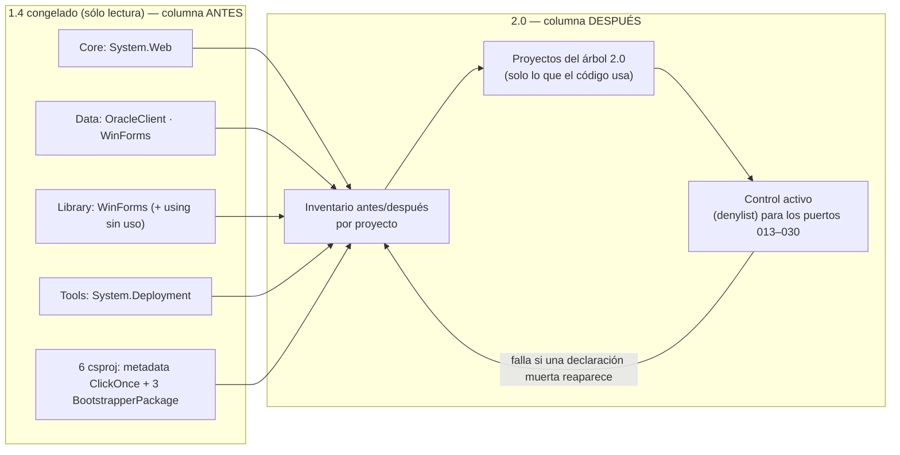

<!--
  LANGUAGE POLICY (§3.15): YAML keys, status enums, IDs and section headings stay in English;
  all prose goes in the project's content_language (devflow/LANGUAGE = es).
  ⚠️ SPEC = HOW (§2.4.1). La lista exacta de referencias a retirar sale del inventario de REV-001 y del barrido
  de usos; ADR-001 §3.3 fija la limpieza obligatoria de proyecto. Este SPEC no decide qué se retira por criterio
  propio: lo deriva de esas fuentes y lo verifica.
  ⚠️ AITL-SPEC-Approval (§2.4.1, §3.0): este SPEC es un DRAFT hasta que el Dev-validator (y los dueños de
  dominio aplicables) registre la decisión en el bloque `review`. Un cambio material en una fuente gobernada
  invalida la aprobación → parar, revisar el SPEC canónico y re-aprobar (G15).
-->

# SPEC-261016-0021 — Limpieza de referencias muertas y de metadata de publicación, con el inventario como evidencia

| Field | Value |
|-------|-------|
| **Origin** | [REV-001](../reviews/REV-001-analisis-migracion-cooperator.md) — §6 ítem 16 (hallazgos F-11, F-12, F-21, F-36, F-44) |
| **Bolt** | [US-000.BOLT-012](../functional/bolts/US-000.BOLT-012-limpieza-de-referencias.md) |
| **ADRs** | [ADR-001](../adrs/ADR-001-layout-y-empaquetado-cooperator-2.md) §3.1, §3.3 |
| **Risk Class** | low |
| **Revision** | 1 |

---

## 1. Objective

Se entregan los proyectos del árbol **sin declaraciones que nadie usa** y **sin metadata de publicación muerta**,
de modo que ninguna declaración de proyecto prometa algo que el código no usa y que el inventario de referencias
sea **verdadero** antes de mover TFMs.

El problema que resuelve está medido y es de naturaleza *latente*: una referencia muerta no rompe nada hoy, pero
se convierte en un error de compilación en cuanto el paquete se retargetea —y esa es exactamente la situación de
la migración—. `REV-001` lo inventarió: F-11/F-12 (`System.Data.OracleClient` y `System.Windows.Forms` en `Data`,
`System.Windows.Forms` en `Library`, `System.Web` en `Core`), F-21, F-44 (mapa de dependencias por proyecto) y
F-36 (metadata de publicación clásica y referencia al ensamblado de despliegue en las herramientas). ADR-001 §3.3
lo elevó a **limpieza obligatoria de proyecto** ("fuera metadata ClickOnce y `System.Deployment` … referencias
muertas"), y ADR-001 §4 declara el efecto buscado: que "las referencias muertas dejen de ser un error latente en
cada retargeteo".

Si no se implementa, cada Bolt que mueva un paquete descubrirá el mismo problema por su cuenta (o peor: lo
arrastrará al árbol nuevo), y el inventario de dependencias del que dependen los umbrales de ADR-001 §5 quedará
siendo falso.

---

## 2. Context

**Origen y decisión.** `REV-001` (aprobado 2026-10-15) ruteó el ítem 16 como **BOLT→SPEC**, con la corrección
explícita del relevamiento original que su §4 documenta ("se desmienten cuatro, todas referencias muertas en el
csproj sin uso en código…"). ADR-001 §3.1 fija que los TFMs **no** cambian en este Bolt y §3.3 manda la limpieza.
Este SPEC ejecuta esa decisión: no decide qué retirar por criterio propio, lo **deriva** del inventario y lo
verifica por búsqueda de usos.

**Inventario verificado en esta sesión (lado 1.4, que es donde las declaraciones existen y donde el REV las
encontró)** — columna "después" esperada en el árbol 2.0:

| Proyecto (1.4) | Declaración muerta | Evidencia de **0 usos** (búsqueda sobre el código del proyecto) |
|---|---|---|
| `Cooperator.Framework.Core` | `System.Web` | 0 ocurrencias de `System.Web`/`HttpContext` en `Core/**` (F-44 la desmiente como uso; es la "referencia de servicios web en la capa base") |
| `Cooperator.Framework.Data` | `System.Data.OracleClient` | 0 usos (el barrido sólo devuelve "form" dentro de los encabezados de licencia) |
| `Cooperator.Framework.Data` | `System.Windows.Forms` | 0 usos (ídem: es la "referencia de interfaz de usuario en una capa que no la usa") |
| `Cooperator.Framework.Library` | `System.Windows.Forms` | 1 sola aparición y **sin uso**: `using System.Windows.Forms;` en `Registry.cs:43` |
| `Tools/CooperatorModeler` | `System.Deployment` | 0 usos (resto de ClickOnce, F-36) |
| `Tools/ConnectionStringEncriptor` | `System.Deployment` | 0 usos (F-36) |

**Metadata de publicación clásica**, presente en los **seis** proyectos en alcance: 19 ocurrencias del bloque
ClickOnce por archivo de proyecto (`PublishUrl`, `Install`/`InstallFrom`, `UpdateEnabled`/`UpdateMode`/
`UpdateInterval`/`UpdateIntervalUnits`/`UpdatePeriodically`/`UpdateRequired`, `MapFileExtensions`,
`ApplicationRevision`/`ApplicationVersion`, `IsWebBootstrapper`, `UseApplicationTrust`, `BootstrapperEnabled`,
`ProductVersion`/`SchemaVersion`, `UpgradeBackupLocation`, …) más **3** ítems `<BootstrapperPackage>` cada uno
(paquetes de prerrequisitos de .NET 3.5 que ningún runtime objetivo usa).

**Referencias que parecen de otra plataforma y NO se retiran (frontera verificada, no intuida):**

| Declaración | Por qué no es muerta | Dueño |
|---|---|---|
| `System.Web` en **`Data`** | **Usada**: `HttpContext.Current.Cache` en `BaseGateway.cs:36,404,458-459`, `BaseLoader.cs:34,243,287`, `SQLHelper.cs:31,73`, `SqlHelperParameterCache.cs:30,57` | Bolt 013 (caché, ADR-004 §3.1: "`System.Web` fuera del framework") |
| `System.Web` en **`Library`** | **Usada**: `System.Web.HttpContext` en la firma pública de `SmtpMail.SendMailViaCDONTS` (`SmtpMail.cs:106`) | Bolt 009 (Library portable, F-22) |
| `System.Management` en `Library` | **Usada**: `Win32_LogicalDisk` (`Utility.cs:500`) | Bolt 009 |
| `System.Data.Sql` en el **Modeler** | **Usada**: `SqlDataSourceEnumerator` (`ConnectForm.cs:38`) | DISC F-34 / Bolt 025 |
| `System.configuration` en `Core`/`Data`/`Library` | **Usada hoy** (la sección custom y las tres lecturas que el Bolt 011 retira) | Bolt 011 (configuración portable) |

**Alcance material y árbol destino (declaración explícita).** `1.4/**` es **inmutable** (ADR-001 §3.1/§3.2 y los
SPECs 0000/0002/0004/0006/0007: el árbol congelado se referencia o se copia como fuente, nunca se edita; el
precondición del Bolt 001 aborta si cambia). Por eso la limpieza se ejecuta sobre el **árbol 2.0** —que es donde
el producto nuevo se construye— y el lado 1.4 aporta la **columna "antes"** del inventario: la lista verificada de
declaraciones muertas que **no deben reaparecer** en ningún proyecto de la 2.0. Eso es exactamente lo que el Bolt
pide ("que el inventario … sea verdadero **antes** de empezar a mover TFMs" y "que el retargeteo posterior de cada
paquete no arrastre errores de compilación latentes") y lo que su exclusion declara: "los Bolts de cada paquete
trabajan sobre **un proyecto ya limpio**" — el proyecto limpio es el del árbol 2.0.

---

## 3. Source inventory and approval references

**Pre-SPEC evidence gate (§2.4.1) — resultado: PASA.** Todas las fuentes gobernadas que este SPEC usa están
aprobadas y no hay ADRs activos en conflicto (ADR-001 §3.1 fija los TFMs y §3.3 manda la limpieza; ningún otro ADR
dice lo contrario sobre las declaraciones a retirar), y el plan de integración declarado (`n/a`) coincide con el
`test_integration: not-required` del Bolt (§3.2.2). No se emite reporte bloqueante.

| Source | Ref | Approval |
|--------|-----|----------|
| Bolt | `US-000.BOLT-012` (`devflow/functional/bolts/US-000.BOLT-012-limpieza-de-referencias.md`) | AITL-BOLT-READY-Approval ✓ — `approved`, `agent:dotnet-architect-reviewer-agent` (architect), 2026-10-16T00:06:40-03:00; `risk_class: low`, `test_integration: not-required` |
| Parent US | `US-000` (`functional/user-stories/US-000-non-functional.md`) | Contenedor permanente: **sin** ciclo de aprobación (§2.6) — no aplica checkpoint |
| ADR (gobernante) | `ADR-001` §3.3 (limpieza obligatoria de proyecto: metadata ClickOnce, `System.Deployment`, referencias muertas), §3.1 (los TFMs y el mapa de paquetes no cambian acá), §4 (efecto buscado) | AITL-ADR-Approval ✓ — `accepted`, `human:eugenioserrano` (tech_lead), 2026-10-15T22:32:47-03:00 |
| REV evidence | `REV-001` §4 F-11, F-12, F-21, F-36, F-44 (inventario de dependencias por proyecto y las cuatro referencias muertas desmentidas) y §6 ítem 16 | AITL-REV-Approval ✓ — aprobado 2026-10-15 |
| SPECs previos (prerrequisitos) | `SPEC-261016-0000-…` (comando reproducible, build y arnés) y `SPEC-261016-0004-…` (el primer porte: los proyectos del árbol 2.0) | Ambos **en disco** |
| Repository baseline | commit `6aa497f793cd3ab9d83c68db7ef2c1d80d3421d4` | — (nada bajo `2.0/` ni bajo `1.4/` en el árbol de trabajo) |

---

## 4. Scope

### In scope

1. **El inventario de referencias por proyecto, antes y después**, derivado del barrido de `REV-001` y **verificado
   por búsqueda de usos por referencia** (la columna "antes" sobre el 1.4 congelado; la "después" sobre el árbol
   2.0). Es el entregable central del Bolt: el inventario es la evidencia.
2. **El retiro de las referencias declaradas y no usadas** en los proyectos del árbol 2.0, con la lista verificada
   de §2 como referencia: `System.Web` (Core), `System.Data.OracleClient` y `System.Windows.Forms` (Data),
   `System.Windows.Forms` (Library) y `System.Deployment` (herramientas). Si un proyecto del árbol 2.0 no declara
   ninguna —porque nació limpio—, se registra así y **no se inventa trabajo**.
3. **El retiro de la metadata de publicación clásica** y de los ítems de prerrequisitos de arranque
   (`BootstrapperPackage`) de todos los archivos de proyecto del árbol 2.0, más cualquier resto de modelo de
   proyecto clásico (`packages.config`, `HintPath`, `SpecificVersion`, `Reference` a ensamblados de .NET Framework,
   `System.Deployment`).
4. **La depuración de importaciones sin uso** en los archivos en alcance (el `using System.Windows.Forms;` de
   `Library/Repository/Registry.cs` es el caso verificado; el barrido los enumera a todos).
5. **El control activo que hace que la limpieza sea "una sola vez"**: una verificación determinista que **falla**
   si cualquiera de las declaraciones muertas inventariadas (o la metadata de publicación) reaparece en cualquier
   archivo de proyecto del árbol 2.0 — incluidos los que porten los Bolts 013–030.

### Out of scope

| Fuera de alcance | Dueño | Por qué |
|---|---|---|
| Cambiar **TFMs**, el mapa de paquetes o agregar/actualizar paquetes | Bolts de cada paquete / Bolt 001 | El Bolt lo excluye expresamente y ADR-001 §3.1 lo fija |
| Las referencias que **se usan** aunque "parezcan" de otra plataforma (`System.Web` en `Data` y en `Library`, `System.Management` en `Library`, `System.Data.Sql` en el Modeler) | Bolts 013, 009 y DISC F-34 / Bolt 025 | El Bolt lo excluye: "eso lo decide el Bolt del paquete correspondiente". Retirarlas rompería la compilación |
| El retiro de `System.configuration` de `Core`/`Data`/`Library` (queda **sin uso** al retirarse las lecturas) | Bolt 011 | Es el Bolt que **causa** el desuso; acá la referencia está en uso y no se toca |
| Los archivos de proyecto de las **plantillas** (`Tools/CooperatorModeler/Templates/**/*.csproj`) | Bolt 021 (plantillas de proyectos, ADR-003) | Son **datos** del set de plantillas, no proyectos del producto: su modernización es su criterio de aceptación |
| El proyecto de la **Utility** y su suerte | Bolt 003 (partición, SPEC-0004) | El proyecto se disuelve: sus sucesores nacen con sus propias declaraciones y este Bolt no los limpia antes de que existan |
| La metadata de ensamblado `ComVisible`/`ReliabilityContract`/`using System.Runtime.ConstrainedExecution` (F-45) | El Bolt que porte cada `AssemblyInfo` | ADR-001 §3.3 los incluye en la limpieza, pero **no** están en el alcance de este Bolt (que habla de referencias, de metadata de publicación y de importaciones). Se **registran** en el inventario con su dueño (nota al revisor) |
| Los `bin/` y `obj/` del árbol 1.4 | — | No son fuente: quedan fuera de todo barrido por definición |
| Cualquier **edición de `1.4/`** | — (nadie) | El 1.4 es inmutable: aporta la columna "antes" del inventario, no se modifica |

**Regla de aporte (bounded, explícita).** El barrido cubre **todos** los archivos de proyecto presentes en el
árbol 2.0 al ejecutar el V-Bounce (el esqueleto del Bolt 001 y lo que hayan portado los Bolts previos). Si un
proyecto aún no existe, **no** se crea para limpiarlo: el control activo (§6/C) cubre su aparición futura. La
limpieza se ejecuta **una sola vez** acá y los Bolts de paquete la dan por hecha; ninguna ampliación del alcance
está permitida sin revisar el SPEC.

---

## 5. Prerequisites and baseline

- **Bolt 001 y su SPEC** (`SPEC-261016-0000-…`): el **comando reproducible** (`2.0/build/build.ps1`), el build de
  la solución y el arnés de pruebas. Es lo que demuestra que la limpieza **no rompió la compilación** (el criterio
  del Bolt: "el build reproducible es lo que demuestra que la limpieza no rompió la compilación").
- **Bolt 003 y su SPEC** (`SPEC-261016-0004-…`): el primer porte del árbol 2.0. A partir de ahí existen los
  proyectos sobre los que este Bolt trabaja; los demás portes (004–011) agregan los suyos.
- **Estado del árbol 2.0 al escribir este SPEC:** `2.0/` todavía no existe en el repositorio (lo crea el Bolt 001).
  Por eso la §4 declara la regla de aporte y por qué el control activo es un entregable y no un adorno: la mayor
  parte de los proyectos del producto todavía no está creada.
- **Toolchain fijado por el Bolt 001:** SDK 10.0.402 (`global.json`), MSBuild 18.11.x de Visual Studio 18,
  advertencias tratadas como error. La verificación es `pwsh -File 2.0/build/build.ps1 -Scope Hermetic`.
- **`1.4/**` es sólo lectura:** se verifica contra el commit baseline antes y después de construir; el precondición
  del Bolt 001 aborta la corrida si el árbol congelado cambió.
- **Convención de constancia:** el inventario del Bolt vive versionado junto al código
  (`2.0/docs/reference-inventory/US-000.BOLT-012.json`). Este Bolt **no** produce entradas para las notas de
  migración *per se* (su Bolt no lo pide): sólo si algún retiro cambiara superficie pública o comportamiento —no es
  el caso esperado— se agrega el fragmento `2.0/docs/api-removals/US-000.BOLT-012.json` con los tres datos de
  ADR-008 §3.1 y su lista en el MEM.

---

## 6. Phases

> Un solo Bolt (`US-000.BOLT-012`), un V-Bounce esperado. El orden es el del inventario: primero se fija la verdad
> de lo que existe, después se limpia, después se impide que vuelva, y al final se firma la evidencia.

### Phase A — Inventario "antes" (lado 1.4 congelado)

**Duration:** ~1,5h de ciclo — **Complexity:** Low

#### A.1 Barrido y búsqueda de usos por referencia

Sobre el árbol 1.4 (sólo lectura) se recorren los **diez** archivos de proyecto —los cuatro paquetes, las dos
herramientas y los cuatro de las plantillas, estos últimos para dejarlos declarados con su dueño— y se registra,
por proyecto: cada `Reference` declarada, la metadata de publicación clásica presente, los ítems de prerrequisitos
y las importaciones sin uso. Cada declaración candidata se contrasta con una **búsqueda de usos por referencia**
sobre el código del propio proyecto (namespace y tipos del ensamblado declarado), y el resultado —con su comando y
su número de coincidencias— queda en el inventario. Esa búsqueda es la que distingue "muerta" de "usada", y es la
que hace que el inventario sea **verdadero** y no una intuición.

#### A.2 El inventario como artefacto

Se produce `2.0/docs/reference-inventory/US-000.BOLT-012.json` con las dos columnas (antes/después), la
clasificación por declaración (`retirada` / `en uso, no se toca con su dueño` / `fuera de alcance con su dueño`) y,
por cada retiro, la **constancia de que no era usada**. La columna "después" se completa en la Phase B.

**Files created:**
- `2.0/docs/reference-inventory/US-000.BOLT-012.json` — inventario antes/después por proyecto (evidencia del Bolt)

---

### Phase B — Barrido y limpieza del árbol 2.0

**Duration:** ~1,5h de ciclo — **Complexity:** Low

#### B.1 Retiro de referencias muertas y de metadata muerta

Sobre cada archivo de proyecto del árbol 2.0 se retiran: las referencias de la lista verificada que aparezcan
(`System.Web` en el proyecto del núcleo, `System.Data.OracleClient`/`System.Windows.Forms` en el de datos,
`System.Windows.Forms` en el de la biblioteca, `System.Deployment` en las herramientas); el bloque completo de
metadata de publicación (ClickOnce) y los ítems `<BootstrapperPackage>`; y cualquier resto de modelo de proyecto
clásico (`packages.config`, `HintPath`, `SpecificVersion`, `Reference` a ensamblados de .NET Framework que no
existen en el runtime objetivo). Los proyectos quedan declarando **sólo lo que su código usa** y compilando en el
TFM que ya tienen, sin tocar TFMs ni versiones de paquetes.

#### B.2 Depuración de importaciones sin uso

En los archivos en alcance se retiran las importaciones que no se usan (caso verificado: el
`using System.Windows.Forms;` de `Library/Repository/Registry.cs`, que es además la única aparición de WinForms en
ese proyecto). El barrido enumera todas: la limpieza no es selectiva por parecido.

**Files modified:**
- Archivos de proyecto del árbol 2.0 (`2.0/src/**/*.csproj`, `2.0/tests/**/*.csproj`) — sólo si declaran algo de la
  lista; se declara por archivo en el MEM
- Archivos de código en alcance con importaciones sin uso — enumerados por el barrido

---

### Phase C — El control activo: la limpieza es una sola vez

**Duration:** ~1h de ciclo — **Complexity:** Low

`Cooperator.Harness.Tests` incorpora una verificación **determinista** que recorre todos los archivos de proyecto
del árbol 2.0 y **falla** si reaparece cualquiera de estas condiciones: una referencia de la lista de declaraciones
muertas inventariadas; el bloque de metadata de publicación o un ítem `<BootstrapperPackage>`; `packages.config`;
`HintPath`/`SpecificVersion`; o una `Reference` a un ensamblado fuera del runtime objetivo. Es el mecanismo que
sostiene lo que el Bolt declara ("la limpieza se ejecuta **una sola vez** acá y los Bolts de paquete la dan por
hecha"): el control corre para **todo** el árbol, incluidos los proyectos que porten los Bolts 013–030, y no
depende de que alguien recuerde la regla.

**Files created:**
- `2.0/tests/Cooperator.Harness.Tests/ReferenceHygieneTests.cs` — inventario, denylist determinista y constancia de usos

---

### Phase D — Evidencia y cierre

**Duration:** ~1h de ciclo — **Complexity:** Low

#### D.1 La evidencia del Bolt

Se completan y registran: el inventario **antes/después** por proyecto; el **build** de los proyectos afectados
desde el comando reproducible; la **constancia por declaración** de que lo retirado no era usado en código (la
búsqueda de la Phase A, con su resultado); y la **ausencia** de la metadata de publicación en los archivos de
proyecto. Todo se lista en el MEM —y si algún proyecto no requería limpieza, se registra así (evidencia, no
hueco).

#### D.2 Qué pasa si un retiro cambia algo más que una declaración

No es el caso esperado: retirar una referencia **no usada** y metadata sin efecto no cambia la superficie ni el
comportamiento. Si en la ejecución alguno de los retiros cambiara la superficie pública o el comportamiento del
producto (por ejemplo, alguien descubre que la declaración *era* consumida), se **detiene** y se reporta: no se
retira, y si el retiro fuera realmente necesario, sería una decisión con su propia constancia
(`2.0/docs/api-removals/US-000.BOLT-012.json`) y su entrada en las notas (ADR-008 §3.1).

**Files modified:**
- `2.0/docs/reference-inventory/US-000.BOLT-012.json` — columna "después" y constancia por declaración

---

## 7. Acceptance criteria

> Bolt no funcional (parent `US-000`, sin ACs): los criterios son los **resultados medibles** del Bolt (§2) y la
> restricción de ADR-001 §3.1/§3.3, expresados como Given/When/Then verificables.

### AC-1: El inventario existe, con las dos columnas y por proyecto

**Given** el árbol 1.4 congelado y el árbol 2.0 en su estado al ejecutar
**When** se lee `2.0/docs/reference-inventory/US-000.BOLT-012.json`
**Then** cada proyecto en alcance está inventariado con sus referencias, su clasificación y el resultado de la
búsqueda de usos por referencia (con el comando y el número de coincidencias).

### AC-2: Ninguna declaración sin uso permanece en los proyectos del árbol 2.0

**Given** los proyectos del árbol 2.0
**When** el control de higiene los recorre
**Then** ninguna de las declaraciones muertas inventariadas (ni la metadata de publicación ni los ítems de
prerrequisitos ni el modelo de proyecto clásico) aparece.

### AC-3: Cada retiro tiene su constancia de "no usada"

**Given** cada declaración retirada
**When** se revisa su línea del inventario
**Then** declara la búsqueda de usos que la respalda y su resultado (0 usos), y ninguna declaración aparece
retirada sin esa constancia.

### AC-4: Los proyectos compilan en el TFM que ya tienen

**Given** el toolchain fijado
**When** se ejecuta `pwsh -File 2.0/build/build.ps1 -Scope Hermetic`
**Then** el árbol compila sin advertencias tratadas como error, sin que ningún TFM ni versión de paquete haya
cambiado.

### AC-5: El control activo falla ante una reintroducción

**Given** un archivo de proyecto del árbol 2.0 (incluido uno creado por un Bolt posterior)
**When** se introduce a propósito una declaración muerta de la lista, el bloque de publicación o un
`packages.config`
**Then** el control falla nombrando el archivo y la declaración — la limpieza no puede revertirse por descuido.

### AC-6: Frontera respetada

**Given** la lista de referencias "en uso" de §2
**When** se compara con el árbol después de la limpieza
**Then** `System.Web` en `Data` y en `Library`, `System.Management` en `Library` y `System.Data.Sql` en el Modeler
siguen declaradas, los archivos de proyecto de las **plantillas** no se tocaron, y el proyecto de la Utility no se
limpió desde acá — cada uno con su dueño registrado en el inventario.

### AC-7: Verificación reproducible y árbol congelado intacto

**Given** el toolchain fijado
**When** termina el V-Bounce
**Then** la suite hermética está verde, y `git diff --quiet <baseline> -- 1.4` y
`git status --porcelain -- 1.4` están vacíos.

### AC mapping to source (measurable outcome) — non-functional

| Source outcome (Bolt §2) | How this SPEC satisfies it | Verifying test/evidence |
|--------------------------|----------------------------|--------------------------|
| "ningún proyecto declara referencias sin uso en código" | Fases B y C: retiro + control activo | AC-2, AC-5 · `ReferenceHygieneTests` |
| "no queda metadata de publicación clásica ni referencia a ensamblados que el runtime objetivo no provee" | Fase B.1: retiro de ClickOnce, `BootstrapperPackage` y `System.Deployment` | AC-2 · inventario + control |
| "los proyectos siguen compilando en el TFM que hoy tienen" | Fase B: sin cambios de TFM ni de versiones | AC-4 · corrida reproducible |
| "el inventario de referencias por proyecto queda registrado" | Fases A.2 y D.1: artefacto antes/después | AC-1 · inventario versionado |
| "la constancia de que ninguna referencia retirada era usada en código" | Fase A.1 + D.1: búsqueda por referencia con su resultado | AC-3 · inventario |
| "el inventario de referencias del árbol sea verdadero antes de empezar a mover TFMs" | Fase C: control activo que cubre los puertos posteriores | AC-5 · control en el arnés |

---

## 8. Testing strategy

### 8.1 V-Bounce level (hermetic — run by the agent)

- **Control de higiene e inventario (`ReferenceHygieneTests`, `net10.0`):** recorre los archivos de proyecto del
  árbol 2.0 y asserta (a) ausencia de la denylist —declaraciones muertas inventariadas, bloque de publicación,
  `<BootstrapperPackage>`, `packages.config`, `HintPath`/`SpecificVersion`, `Reference` fuera del runtime
  objetivo— y (b) presencia de las declaraciones "en uso" que la frontera declara (AC-6), que actúa como control
  negativo del propio control.
- **Constancia de usos:** el inventario se genera/valida contra la búsqueda de usos por referencia de la Phase A;
  el caso asserta que **ninguna** entrada marcada como retirada carece de su constancia de 0 usos.
- **Prueba negativa del control:** se introduce a propósito una declaración muerta en un proyecto de prueba y se
  asserta que el control falla (el control que nunca falla no controla nada).
- **Build y suite:** `2.0/build/build.ps1 -Scope Hermetic` verde (los proyectos afectados compilan en su TFM).
- **Edge cases:** proyecto en alcance que no requiere limpieza (se registra como evidencia, no como fallo); un
  archivo de proyecto nuevo agregado por un Bolt posterior (el control lo cubre sin tocar nada); una `Reference`
  legítima a un ensamblado del runtime objetivo (no debe fallar); metadata de publicación parcial (un ítem
  suelto del bloque también falla).
- **BUG evidence:** `n/a` — el Bolt no corrige un BUG; no hay TDD rojo→verde obligatorio.

### 8.2 Integration test level

- **`n/a`** — el Bolt declara `test_integration: not-required` y el plan del frontmatter dice `n/a` con su razón:
  la higiene de referencias y de archivos de proyecto se verifica sobre el árbol compilado, sin alcanzar ninguna
  dependencia real. No hay tests de integración que escribir ni corrida pendiente antes de la aceptación (§3.2.2).

---

## 9. Quality gates

> Los estados son el **resultado esperado**; el resultado real se registra en el MEM del V-Bounce (§3.6).

| Gate | Level | Threshold | Status |
|------|-------|-----------|--------|
| Build / lint / type checks | V-Bounce | El árbol 2.0 compila con advertencias tratadas como error, sin cambios de TFM | `pass` — esperado (§8.1) |
| Unit / component tests | V-Bounce | Suite hermética verde (higiene, inventario, control negativo) | `pass` — esperado (AC-1…AC-5) |
| Consumer-side contract tests (test doubles) | V-Bounce | El Bolt no altera superficie de consumo: retira declaraciones de proyecto sin uso | `n/a` — sin frontera de componente afectada |
| SAST | V-Bounce | El cambio no introduce código: retira declaraciones y metadata | `n/a` — sin código nuevo que analizar |
| Dependency scanning / licenses | V-Bounce | Sólo **retiros**; ninguna dependencia agregada ni actualizada; versiones centralizadas intactas | `pass` — esperado (AC-4) |
| OWASP Top 10 — static review | V-Bounce | No se expone ni altera interfaz alcanzable desde fuera del proceso | `n/a` — sin superficie externa |
| Prompt-injection scan | V-Bounce | No hay construcción de prompts ni entrada no confiable | `n/a` — no aplica |
| Secret-leak scan | V-Bounce | Ningún secreto introducido; no hay credenciales en las declaraciones | `pass` — esperado |
| Hallucination lint | V-Bounce | Rutas, proyectos y declaraciones referenciados existen y se verifican en el barrido | `pass` — esperado |
| IP / license provenance | V-Bounce | No se incorpora código de terceros | `n/a` — sin código de terceros |
| PII / DLP | V-Bounce | `data_classification: internal`; no se manipulan datos | `pass` — esperado |
| Dependency-confusion | V-Bounce | Sin paquetes nuevos; el control bloquea `Reference` sin resolver y `HintPath` | `pass` — esperado (AC-5) |
| Test-first evidence | V-Bounce | No es un Bolt de corrección de BUG | `n/a` — sin TDD obligatorio |
| Behavioral reproducibility (hermetic suite) | V-Bounce | Dos corridas con resultado idéntico | `pass` — esperado |
| Bolt-manifest validation | V-Bounce | Manifiesto válido contra `manifest-v5-bolt.schema.json` con la entrada `v_bounces[]` completa | `pass` — esperado |
| API-compat con la línea base 1.4 (ADR-008 §5) | V-Bounce | El Bolt **no** retira superficie pública: son declaraciones de proyecto sin uso | `n/a` — sin cambio de superficie (si apareciera uno, se detiene y se documenta: §6/D.2) |
| Integration tests (real dependencies) | Integration test | No aplica: `test_integration: not-required` (plan `n/a`) | `n/a` — verificación sobre el árbol compilado (§3.2.2) |
| Contract / E2E against the real providers | Integration test | No hay provider externo ni entorno en el alcance | `n/a` — sin dependencias reales |
| DAST / OWASP Top 10 — dynamic | Integration test | No hay servicio desplegable | `n/a` — sin superficie ejecutable |
| Perf-smoke (p95/p99) | Integration test | No hay endpoint ni carga crítica afectada | `n/a` — sin umbral aplicable |
| Observability (logs / metrics / traces) | Integration test | No hay servicio instrumentado | `n/a` — sin telemetría de servicio |

> Coherencia con el Bolt (§3.2.2): `test_integration: not-required` → `integration_test_plan.applicability: n/a`
> con su razón. Ningún gate del nivel de integración aplica.

---

## 10. Security and data

- **Reducción de superficie, en dos ejes:** se retiran referencias a ensamblados que el código no usa (menos
  dependencias transitivas que cargar y resolver, incluida `System.Deployment`, que es la puerta de ClickOnce) y se
  retira metadata de publicación clásica (un canal de actualización automática que el producto no usa y que no debe
  quedar declarado "por si acaso").
- **Sin cambios en el comportamiento:** nada de lo retirado se ejecuta hoy; el resultado del Bolt es que el
  inventario de dependencias deje de mentir, no un cambio funcional. Eso es también lo que hace que su rollback sea
  trivial (§12).
- **Sin secretos y sin datos:** no se introducen valores; no hay credenciales en referencias ni en metadata de
  proyecto. `data_classification: internal` (espeja el Bolt); no se procesan datos personales.
- **Integridad del árbol congelado:** `1.4/**` no se modifica (control de git contra el commit baseline). El 1.4
  aporta la columna "antes" del inventario y sigue siendo la referencia congelada del producto anterior.

---

## 11. Monitoring and observability

- **Reportes versionados:** el inventario antes/después (`2.0/docs/reference-inventory/US-000.BOLT-012.json`), la
  salida del build de los proyectos afectados y la de la suite en `2.0/artifacts/<timestamp>/`.
- **Códigos de salida `0/1/2/3`** del comando reproducible (Bolt 001): el control de higiene es una verificación
  más del arnés y se ejecuta en el mismo paso.
- **Sin telemetría de servicio:** no hay logs, métricas ni trazas que agregar (`n/a` con esa razón en la tabla de
  gates).

---

## 12. Migration, compatibility and rollback

- **Migration:** `n/a` — no hay migración de datos ni de configuración. El cambio es de **declaraciones de
  proyecto**, sobre código que ya compila sin ellas.
- **Compatibility:** **sin ruptura de superficie** (ningún miembro público desaparece) y **sin cambio de
  comportamiento** (ninguna declaración retirada se usaba). El único efecto observable es hacia adelante y es el
  buscado por ADR-001 §4: el retargeteo de cada paquete deja de arrastrar referencias muertas. Nada se retira de lo
  que el código usa: la frontera de §2 lo enumera con su dueño.
- **Rollback:** revertir el commit del Bolt (no hay estado intermedio peligroso: las declaraciones retiradas no se
  ejecutaban). El único costo de un rollback parcial es que el control de higiene volvería a fallar, lo cual es
  exactamente el comportamiento deseado.

---

## 13. Risk matrix

| Risk | Probability (1-5) | Impact (1-5) | Mitigation |
|------|-------------------|--------------|------------|
| **Retirar una referencia que sí se usa** (la única forma de romper el build) | 2 | 3 | Búsqueda de usos por referencia **antes** de retirar, por declaración, y build del proyecto afectado (AC-3, AC-4); el control negativo del arnés asserta que las declaraciones "en uso" siguen ahí (AC-6) |
| Solapamiento con los Bolts de cada paquete (alguien repite la limpieza) | 2 | 2 | La limpieza se declara **única** acá y el control activo la sostiene para los puertos 013–030; los Bolts de paquete la dan por hecha |
| Borrar metadata que otra cosa necesite (por ejemplo, del empaquetado del tooling) | 1 | 3 | Sólo se retira la metadata que **no produce efecto** en el runtime objetivo, con su constancia; si algo cambiara el comportamiento, se detiene (§6/D.2) |
| El árbol 2.0 nace limpio y el barrido no encuentra nada que retirar | 2 | 2 | Se registra como evidencia (inventario + control activo) y **no** se inventa trabajo: el valor del Bolt es el inventario verdadero y la garantía hacia adelante, no una cifra de archivos tocados |
| Una declaración muerta **reaparece** en un porte posterior | 3 | 3 | El control corre sobre todo el árbol, incluidos los proyectos nuevos: falla nombrando archivo y declaración (AC-5) |
| El inventario se completa "a ojo", sin la búsqueda de usos | 2 | 3 | El criterio de aceptación exige el comando y el número de coincidencias por declaración (AC-3): el inventario es evidencia, no opinión |
| La frontera se lee al revés y se retira `System.Web` de `Data` (que sí se usa) | 2 | 4 | La tabla de referencias "en uso" de §2 y el control negativo de AC-6 lo impiden explícitamente |

---

## 14. Decisions and trade-offs

| Decision | Reason |
|----------|--------|
| La limpieza se ejecuta sobre el **árbol 2.0**, con el 1.4 congelado como columna "antes" del inventario | `1.4/**` es inmutable (ADR-001 §3.1/§3.2 y los SPECs 0000/0002/0004/0006/0007) y el Bolt busca que "el retargeteo posterior de cada paquete" no arrastre el problema: eso sólo se consigue sobre el árbol nuevo. Se declara explícitamente para el revisor |
| El entregable central es el **inventario antes/después**, no una cifra de archivos modificados | El Bolt lo pide como evidencia ("el inventario de referencias por proyecto **antes y después**") y su ausencia es lo que hace que la limpieza no se pueda auditar |
| Se agrega un **control activo** (denylist determinista) en el arnés | El Bolt declara que la limpieza se hace **una vez** y que los Bolts de paquete la dan por hecha. Sin un control que cubra los proyectos futuros, esa declaración depende de la memoria; con él, la regla se sostiene sola |
| **No** se prescribe un detector genérico de "referencias sin uso" | Un heurístico automático sobre paquetes/referencias es poco confiable (uso transitivo, paquetes de build/analizadores, uso sólo por atributos). La verdad del inventario se establece con la búsqueda documentada por referencia + el build, y el automatismo se reserva para la denylist, que es determinista |
| Los archivos de proyecto de las **plantillas** quedan fuera | Son datos del set de plantillas (Bolt 021, ADR-003), no proyectos del producto; su modernización es criterio de aceptación de ese Bolt |
| La metadata de ensamblado `ComVisible`/`ReliabilityContract` (F-45) se **registra** pero no se retira acá | ADR-001 §3.3 la incluye en la limpieza obligatoria, pero el alcance de este Bolt habla de referencias, metadata de publicación e importaciones. Se registra con su dueño natural (el Bolt que porte cada `AssemblyInfo`) y se deja al revisor la decisión de traerla (nota 4) |
| Las referencias "en uso" que un Bolt posterior retirará (`System.configuration`, `System.Web` en `Data`/`Library`) **no** se tocan | Retirarlas hoy rompería la compilación; su desuso lo causa el Bolt 011 y su retiro es de quien ejecuta ese cambio (los Bolts de paquete). El inventario las registra con su dueño |
| El Bolt no produce entradas de notas de migración salvo que aparezca una ruptura real | Su Bolt no lo pide (a diferencia de 006/007/011) porque no retira superficie ni comportamiento. Si apareciera, se detiene, se documenta y se produce el fragmento con los tres datos de ADR-008 §3.1 |

---

## 15. Stop conditions

1. **Cambio material en una fuente gobernada** (Bolt, ADR-001, el REV usado, baseline de código): detener, revisar
   este SPEC canónico y re-aprobar (G15). Una V-Bounce nunca abarca dos revisiones (G16).
2. **Una declaración que el inventario da por muerta resulta usada** (la búsqueda de usos encuentra coincidencias
   reales): **no** se retira. Se registra con su dueño y se detiene si su presencia impide cumplir el objetivo del
   Bolt.
3. **Un retiro cambiaría superficie pública o comportamiento** (no es el caso esperado): detener y reportar; si el
   retiro fuera necesario, exige su constancia de ruptura (ADR-008 §3.1) y la revisión del SPEC.
4. **El retiro exigiría editar `1.4/`** (o el árbol congelado aparece modificado): detener. El 1.4 es inmutable.
5. **Aparece una declaración que el inventario de REV-001 no contempla y cuya suerte no está decidida**: parar y
   reportar. No se retira por analogía ni se deja sin registrar (el inventario es el que ordena la limpieza).
6. **Un gate de §9 no cierra en `pass`**: detener y escalar. Una salida por excepción exige un ADR aprobado (G21).
7. **El arnés del Bolt 001 no está disponible** (comando reproducible o suite): detener y escalar la secuencia; el
   build es la evidencia de que la limpieza no rompió la compilación.
8. **Ambigüedad que sólo se resolvería inventando** (por ejemplo, la suerte de una referencia que "parece" muerta
   pero cuyo uso está dentro de código que otro Bolt va a retirar): parar y reportar; no se rellena el hueco con
   una suposición (§2.4.1).

---

## 16. Definition of Done (DoD)

- [ ] Fases A–D implementadas
- [ ] Todos los criterios de aceptación (AC-1…AC-7) verificados
- [ ] Suite hermética verde (§8.1) — incluido el control negativo del propio control; el plan de integración es
      `n/a` con su razón (no hay corrida pendiente)
- [ ] El inventario antes/después queda versionado con la constancia de usos por declaración (AC-1, AC-3)
- [ ] Los proyectos tienen el mismo TFM y las mismas versiones de paquete que antes del Bolt (AC-4)
- [ ] Gates aplicables en `pass` (o `waived`/`n/a` con su razón) según §9
- [ ] MEM creado en `devflow/memory/` (exactamente uno para este V-Bounce), con los archivos tocados y su razón
- [ ] Entrada `v_bounces[]` agregada al manifiesto en `devflow/metrics/bolts/` (ocho campos completos)
- [ ] AITL-MEM-Approval registrado
- [ ] `1.4/**` intacto respecto del commit baseline

---

## 17. References

- Bolt: [`US-000.BOLT-012`](../functional/bolts/US-000.BOLT-012-limpieza-de-referencias.md) y su manifiesto
  [`US-000.BOLT-012-…json`](../metrics/bolts/US-000.BOLT-012-limpieza-de-referencias.json)
- Parent: [`US-000`](../functional/user-stories/US-000-non-functional.md) — contenedor no funcional
- ADR gobernante: [`ADR-001`](../adrs/ADR-001-layout-y-empaquetado-cooperator-2.md) §3.1, §3.3, §4
- SPECs prerrequisito: [`SPEC-261016-0000`](./SPEC-261016-0000-arnes-tests-y-build-reproducible.md) (build reproducible y arnés) ·
  [`SPEC-261016-0004`](./SPEC-261016-0004-particion-modeling.md) (primer porte del árbol 2.0)
- SPECs relacionados: [`SPEC-261016-0018`](./SPEC-261016-0018-configuracion-portable.md) (retira el último uso de `System.configuration`, que este Bolt deja declarado con su dueño) ·
  [`SPEC-261016-0012`](./SPEC-261016-0012-retiro-del-export-excel.md) (retiró la capacidad del núcleo que usaba OLE DB, un hallazgo hermano del ítem 16)
- Revisión origen: [`REV-001`](../reviews/REV-001-analisis-migracion-cooperator.md) — F-11, F-12, F-21, F-36, F-44 y §6 ítem 16
- Evidencia de código 1.4 (verificada en esta sesión): referencias declaradas en
  `Core/Data/Library/Utility/Properties/*.csproj` y `Tools/{CooperatorModeler,ConnectionStringEncriptor}/*.csproj`;
  0 usos de `System.Web` en `Core/**`; 0 usos de `Oracle`/`Windows.Forms` en `Data/**`;
  `Library/Repository/Registry.cs:43` (`using System.Windows.Forms;` sin uso); 0 usos de `System.Deployment` en
  `Tools/**`; usos reales que fijan la frontera: `Data/BaseGateway.cs:404`, `Data/BaseLoader.cs:243`,
  `Data/SQLHelper.cs:73`, `Data/SqlHelperParameterCache.cs:57` (`HttpContext.Current.Cache`),
  `Library/SmtpMail.cs:106` (`System.Web.HttpContext`), `Library/Utility.cs:500` (`System.Management`),
  `Tools/CooperatorModeler/ConnectForm.cs:38` (`SqlDataSourceEnumerator`); bloque de publicación + 3
  `<BootstrapperPackage>` por archivo de proyecto en los diez `.csproj` del árbol
- Normativo: `devflow/avenga-devflow/Avenga-DevFlow.md` §2.4.1, §3.2.2, §3.3, §3.6 · `devflow/GUARDRAILS.md`
  (G07, G10, G13, G14, G15, G16, G17, G21, G23, W02, T05, T11)

---

## 18. Revision history

| Date | Author | Change |
|------|--------|--------|
| 2026-10-16 | `agent:dotnet-developer-agent` (transcripción de `human:eugenioserrano`) | Revision 1 — SPEC inicial del Bolt `US-000.BOLT-012`: inventario de referencias antes/después, retiro de referencias muertas y de metadata de publicación, depuración de importaciones y control activo que sostiene la limpieza única |

---

## 19. AITL-SPEC-Approval

> **Avenga DevFlow §2.4.1, §3.0.** This SPEC remains a draft until the
> Dev-validator (+ applicable domain owners) records `AITL-SPEC-Approval`
> (in the `review` frontmatter block). Bolt approval (`AITL-BOLT-READY-Approval`)
> authorizes SPEC preparation; **SPEC approval** authorizes the code-run /
> V-Bounce. A material source change invalidates this approval — stop,
> revise, re-approve (G15).

| Field | Value |
|-------|-------|
| **review.reviewers** | [Dev-validator + dueño de arquitectura (layout y archivos de proyecto)] |
| **review.written_by** | [opcional — quien escribe este registro: el revisor, o el agente que transcribe la decisión; escribir no es firmar (§3.0)] |
| **review.decision** | approved / changes_requested / rejected |
| **review_ready_at** | `YYYY-MM-DDTHH:mm:ss±HH:MM` |
| **review.started_at** | `YYYY-MM-DDTHH:mm:ss±HH:MM` |
| **review.decided_at** | `YYYY-MM-DDTHH:mm:ss±HH:MM` |
| **Findings** | [hallazgos o `acknowledged_without_comment` + motivo] |

### Reviewer notes (puntos explícitos para la decisión)

1. **Árbol destino de la limpieza:** se ejecuta sobre el **árbol 2.0** (los proyectos del producto) y el 1.4
   congelado aporta la columna "antes" del inventario, porque `1.4/**` es inmutable en este proyecto. Confirmar
   que es la lectura esperada del Bolt (su demo habla de "los proyectos … en su TFM actual" y de que los Bolts de
   paquete trabajen "sobre un proyecto ya limpio").
2. **El control activo** (`ReferenceHygieneTests`) como entregable: es lo que hace que "la limpieza se ejecuta una
   sola vez" siga siendo cierto cuando lleguen los puertos 013–030. Confirmar que se espera un control y no sólo un
   inventario.
3. **No se prescribe un detector genérico de referencias sin uso** (§14): la verdad del inventario se establece por
   búsqueda documentada por referencia + build, y el automatismo se reserva para la denylist determinista.
   Confirmar el criterio.
4. **F-45 (`ComVisible`/`ReliabilityContract`/`using System.Runtime.ConstrainedExecution`):** ADR-001 §3.3 los
   incluye en la limpieza obligatoria, pero este Bolt no los nombra en su alcance. Quedan **registrados** en el
   inventario con dueño (el Bolt que porte cada `AssemblyInfo`). Confirmar si deben entrar acá.
5. **Frontera de las plantillas:** los cuatro `.csproj` de `Tools/CooperatorModeler/Templates/CSharpProjects/`
   también tienen el bloque de publicación y quedan fuera (Bolt 021). Confirmar.
6. **Sin entradas de notas de migración** salvo ruptura real: este Bolt no retira superficie ni comportamiento
   (§6/D.2, §12). Confirmar que no se espera el fragmento `api-removals` para este Bolt.
