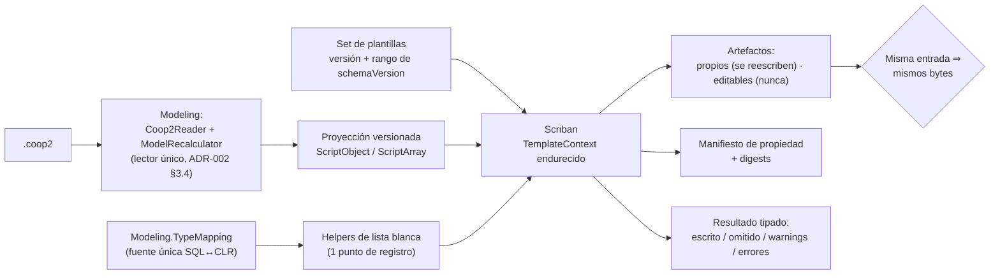

<!--
  LANGUAGE POLICY (§3.15): YAML keys, status enums, IDs and section headings stay in English;
  all prose goes in the project's content_language (devflow/LANGUAGE = es).
  ⚠️ SPEC = HOW (§2.4.1). La superficie del motor, la proyección del modelo, el endurecimiento del contexto de
  render, la resolución del set y la regla de propiedad de archivos están decididas en ADR-003 §3.1/§3.3/§3.4/§3.5
  y en ADR-002 §3.1/§3.4. Este SPEC las ejecuta y las vuelve verificables, sin reabrir la decisión.
  ⚠️ AITL-SPEC-Approval (§2.4.1, §3.0): este SPEC es un DRAFT hasta que el Dev-validator (y los dueños de
  dominio aplicables) registre la decisión en el bloque `review`. Un cambio material en una fuente gobernada
  invalida la aprobación → parar, revisar el SPEC canónico y re-aprobar (G15).
-->

# SPEC-261016-0023 — Motor de generación headless: entrada `.coop2`, proyección a datos, contexto de render endurecido y propiedad de archivos

| Field | Value |
|-------|-------|
| **Origin** | [REV-001](../reviews/REV-001-analisis-migracion-cooperator.md) — §6 ítem 6 (hallazgos F-26, F-30, F-39) |
| **Bolt** | [US-000.BOLT-017](../functional/bolts/US-000.BOLT-017-motor-headless.md) |
| **ADRs** | [ADR-003](../adrs/ADR-003-motor-scriban-headless-y-cli.md) §3.1, §3.3, §3.4, §3.5, §3.6 · [ADR-002](../adrs/ADR-002-formato-coop2-y-migrador.md) §3.1, §3.4 · [ADR-001](../adrs/ADR-001-layout-y-empaquetado-cooperator-2.md) §3.1, §3.4 |
| **Risk Class** | medium |
| **Revision** | 1 |

---

## 1. Objective

Se entrega el **motor de generación headless** (`Cooperator.Framework.CodeGeneration`, `net10.0`): un componente
sin interfaz gráfica que convierte un **modelo `.coop2`** y un **set de plantillas** en artefactos, con el modelo
expuesto a las plantillas como **datos proyectados** (no como objetos del runtime), un **contexto de render
endurecido** con límites y cancelación, y una regla de **propiedad de archivos** que nunca destruye lo editable
del consumidor.

El problema que resuelve es el bloqueante arquitectónico más profundo de la migración (REV-001 F-26): el motor de
1.4 **compila plantillas en tiempo de ejecución** con `CodeDomProvider` (`ScriptingHost.CompileExecutable` con
`GenerateInMemory = true`, `provider.CompileAssemblyFromSource`), y esas plantillas son **C# con bloques `<% %>`
que operan directamente sobre el modelo**. `CSharpCodeProvider`/`VBCodeProvider` **no existen** fuera de .NET
Framework, así que nada del generador sobrevive al retargeteo sin reescribirse. A eso se suman F-39 (selección del
scriptor por el nombre de la clase dentro de un string, `//{PROVIDERCLASSNAME}//`, con un `OracleScriptor` vacío),
F-30 (el rastro binario que atravesaba el modelo) y F-33/F-42 (no existe camino headless: el único punto de
automatización hoy es abrir el Modeler con un archivo como argumento). Si este Bolt no se implementa, el flujo
"editar el modelo y regenerar" —el objetivo de negocio— no existe y las plantillas siguen siendo código compilado
que nadie puede revisar como dato.

---

## 2. Context

**Origen y decisión.** `REV-001` (aprobado 2026-10-15) ruteó el ítem 6 a un ADR. Ese ADR es **ADR-003**
(`accepted`), que decide: motor **headless** con **Scriban interpretado**, plantillas tratadas como **datos**,
proyección del modelo a `ScriptObject`/`ScriptArray`, contexto endurecido, resolución del set con **versión
declarada** frente al `schemaVersion` del modelo, regla **incondicional** de propiedad de archivos y
determinismo byte a byte de los artefactos. Este SPEC **no reabre** nada: fija cómo se construye y cómo se
verifica.

**Lo que este Bolt consume (y no puede reimplementar).** El motor entra al modelo **exclusivamente** por el
contrato ya especificado: `Coop2Reader` (lector único), `ModelRecalculator` (derivados y estado recalculados al
leer), `Coop2Schema` (orden, nombres, dominios), `Coop2Digest` (SHA-256 del documento canónico),
`Coop2ContractException` (rechazos tipados con campo/valor/dominio) y `TypeMapping` (la **fuente única** del mapeo
SQL↔CLR, que el motor **consume** y nunca redefine) — todos de `Cooperator.Framework.Modeling`
([SPEC-261016-0004](./SPEC-261016-0004-particion-modeling.md) / [SPEC-261016-0010](./SPEC-261016-0010-contrato-coop2-en-modeling.md)).
ADR-002 §3.4 hace de `Modeling` el **único** lector/escritor del formato: un segundo lector en el motor es una
violación, no una variante.

**Lo que reemplaza (evidencia legacy verificada en esta sesión):**

| Legacy 1.4 | Evidencia | Decisión que lo reemplaza |
|---|---|---|
| Motor de plantillas por compilación en runtime (`CodeDomProvider`, `GenerateInMemory`) | `Utility/CodeGenerator/ScriptingHost.cs` (`Interpreter.Compile`, `CSharpInterpreter`/`VBNetInterpreter`), `CSharpCodeProvider`/`VBCodeProvider` | ADR-003 §3.1: Scriban **interpretado**, plantillas como datos |
| Selección de scriptor por el nombre de la clase en un string, con un `OracleScriptor` vacío | `Tools/CooperatorModeler/ScriptorProviders/*` (`ScriptorBaseProvider`, `SqlServerScriptor`, `OracleScriptor`) | ADR-003 §3.1: el concepto de scriptor desaparece; el conocimiento de SQL Server vive en helpers + plantillas del set |
| Plantillas C# con bloques `<% %>` que operan sobre el modelo (`Model.Children`, `Response.Write`, `Response.SaveBuffer`) | `Tools/CooperatorModeler/Templates/{CSharpClasses,StoredProcedures,CSharpProjects,ConfigFiles}/**` | ADR-003 §3.5: plantillas Scriban como datos, con overrides por nombre |
| Punto de entrada del generador acoplado al tool: `CodeGenerator.GenerateStoredProcedures(Snapshot)` / `GenerateClasses(Snapshot)` (estáticos, públicos, sobre el `Snapshot` binario) | `Tools/CooperatorModeler/CodeGenerator.cs` | ADR-003 §3.1: punto de entrada **tipado** de librería sobre el `.coop2`, sin `Console` ni `Exit` |
| Propiedad de archivos por modo de corrida: `CopyFolder(source, destination, onlyAutoFiles, overwrite)` — el modo completo **sobrescribía también los editables** | `Tools/CooperatorModeler/FolderHelper.cs` | ADR-003 §3.4: regla **incondicional** (lo propio se reescribe; lo editable **nunca**), manifiesto de propiedad y sin operaciones destructivas fuera de lo propio |
| Cabecera con fecha (`Created: <AutoFilesDateAndTime>`) y `StampDateAndTimeOnAutoFiles` | `Snapshot` (propiedad) + plantillas | ADR-003 §3.3: **sin marcas temporales**; cabecera fija con herramienta + versiones |
| Copia de binarios a `CooperatorAssemblies` y proyectos .NET Framework con `System.Web` | `Templates/Assemblies/*`, `Templates/CSharpProjects/*.csproj` | ADR-001 §3.1 / ADR-003 §3.1: proyectos **SDK-style** con `PackageReference` (contenidos: Bolt 021) |

**Estado del árbol 2.0 y dependencias.** `2.0/` todavía no existe en el repositorio (lo crea el Bolt 001, que
también deja los **artefactos dorados de la generación 1.4** producidos desde el `CodeGenerator` congelado —la
referencia de paridad que ADR-003 §4 declara—). Los paquetes `Modeling` (003) y su contrato `.coop2` (004) ya
tienen SPEC en disco.

---

## 3. Source inventory and approval references

**Pre-SPEC evidence gate (§2.4.1) — resultado: PASA.** Todas las fuentes gobernadas que este SPEC usa están
aprobadas; no hay ADRs activos en conflicto (ADR-003 consume el contrato de ADR-002 sin contradecirlo y respeta
los slots de ADR-001; ninguno reabre `schemaVersion`, TFM ni canal de distribución), y el plan de integración
declarado (`n/a`) coincide con el `test_integration: not-required` del Bolt (§3.2.2). No se emite reporte
bloqueante.

| Source | Ref | Approval |
|--------|-----|----------|
| Bolt | `US-000.BOLT-017` (`devflow/functional/bolts/US-000.BOLT-017-motor-headless.md`) | AITL-BOLT-READY-Approval ✓ — `approved`, `agent:dotnet-architect-reviewer-agent` (architect), 2026-10-16T00:06:40-03:00; `risk_class: medium`, `test_integration: not-required` |
| Parent US | `US-000` (`functional/user-stories/US-000-non-functional.md`) | Contenedor permanente: **sin** ciclo de aprobación (§2.6) — no aplica checkpoint |
| ADR (gobernante) | `ADR-003` §3.1 (superficie del motor, proyección, contexto endurecido, artefactos, sin SQL), §3.3 (determinismo e idempotencia), §3.4 (propiedad de archivos y manifiesto), §3.5 (plantillas: ubicación, versionado, límites, sandbox, helpers), §3.6 (dependencias: **solo** Scriban) y §5 (NFRs y sus mediciones) | AITL-ADR-Approval ✓ — `accepted`, `human:eugenioserrano` (tech_lead), 2026-10-15T22:32:47-03:00 |
| ADR (gobernante) | `ADR-002` §3.1 (formato, `schemaVersion`, derivados no serializados), §3.4 (`Modeling` como único lector/escritor) | AITL-ADR-Approval ✓ — `accepted`, 2026-10-15T22:32:47-03:00 |
| ADR (gobernante) | `ADR-001` §3.1 (slot `CodeGeneration` `net10.0`, sin paquete `-windows`), §3.4 (presupuesto de dependencias) | AITL-ADR-Approval ✓ — `accepted`, 2026-10-15T22:32:47-03:00 |
| REV evidence | `REV-001` §4 F-26, F-30, F-39, F-43, F-46, F-37, F-33/F-42 y §6 ítem 6 | AITL-REV-Approval ✓ — aprobado 2026-10-15 |
| OQ evidence | `OQ-005` (deprecaciones: VB.NET, Oracle, export a Excel) | `answered` 2026-10-15 |
| SPECs previos (prerrequisitos) | `SPEC-261016-0000-…` (arnés y artefactos dorados 1.4), `SPEC-261016-0004-…` (partición `Modeling`) y `SPEC-261016-0010-…` (contrato `.coop2`) | Los tres **en disco** |
| Repository baseline | commit `6aa497f793cd3ab9d83c68db7ef2c1d80d3421d4` | — (nada bajo `2.0/` ni bajo `1.4/` en el árbol de trabajo) |

---

## 4. Scope

### In scope

1. **El proyecto del motor y su superficie tipada**: `Cooperator.Framework.CodeGeneration` (`net10.0`, SDK-style,
   sin paquete `-windows`), con un **punto de entrada único** —petición y resultado— que **no** depende de
   `System.Console` ni de `Environment.Exit`; el CLI (Bolt 018) y el Modeler (Bolt 025) serán consumidores de la
   **misma** implementación.
2. **La entrada exclusiva por el contrato `.coop2`**: el motor lee el modelo con el lector único de `Modeling`
   (jamás un segundo lector, jamás `.coop`, jamás una conexión a base de datos) y **rechaza** con error explícito
   un `schemaVersion` fuera del rango que declara el set de plantillas activo.
3. **La proyección del modelo a datos** (`ScriptObject`/`ScriptArray`), **contrato explícito y versionado**, sin
   exponer POCOs por reflexión; los derivados que la plantilla necesita llegan **calculados por `Modeling`**
   (ADR-002 §3.1) y el **mapeo de tipos** se consume de su fuente única, nunca se redefine.
4. **El contexto de render endurecido**: modo estricto (incluida la clausura de los accesos relajados, §6/C.1),
   límites de bucle, recursión, tamaño de salida y recursión de objetos, *timeout* de expresiones regulares y
   cancelación; y el **aislamiento** de las plantillas: sin acceso a sistema de archivos, red, reflexión ni carga
   de código, con `include` resuelto por un **loader restringido a un directorio raíz**.
5. **La resolución del set de plantillas**: set por defecto **embebido** en el paquete, overrides del consumidor
   por nombre de plantilla conocida, **versión propia del set** y **rango de `schemaVersion`** que declara, y
   detección de deriva cuando un override declara una base que ya no es la vigente. El **mecanismo** es de este
   Bolt; los **contenidos** de los sets son de los Bolts 019/020/021.
6. **La propiedad de archivos y el manifiesto**: artefactos propios reescritos siempre y eliminados cuando dejan
   de corresponder; artefactos editables creados sólo si faltan y **nunca** sobrescritos (con warning de deriva y
   `--force` como única excepción explícita); el **manifiesto** de propiedad con digests; y la regla de no
   ejecutar ninguna operación destructiva fuera de lo propio.
7. **El determinismo de los artefactos** (ADR-003 §3.3) y el **reporte** del resultado (escrito, omitido,
   warnings, errores, digests), con la propiedad de **no ejecutar SQL**: el motor **emite** scripts y nunca los
   aplica, y el `postGenerationScript` del modelo se conserva como **contenido a emitir**.
8. **Las mediciones de los NFR de ADR-003 §5** que son de este Bolt: idempotencia (dos corridas sin diferencias ni
   escrituras, incluido un checkout Windows con `core.autocrlf=true`), *sandbox* (0 escapes con la batería de
   plantillas hostiles y el gate de lista blanca de helpers) y *throughput* (modelo de referencia, umbral
   provisional recalibrado y hardware declarado).

### Out of scope

| Fuera de alcance | Dueño | Por qué |
|---|---|---|
| Los **contenidos** de los sets de plantillas (`*.Auto.cs` y partials, scripts de stored procedures, proyectos/configuración) | Bolts 019, 020 y 021 | El Bolt lo excluye expresamente: este Bolt entrega el motor que las interpreta y el mecanismo de resolución |
| El **CLI**: comandos, flags, códigos de salida y ergonomía | Bolt 018 | Entrega propia; consume la superficie de este Bolt sin divergir de ella |
| El **esquema del modelo** y su lector/escritor | Bolt 004 (SPEC-0010) | ADR-002 §3.4: `Modeling` es el único lector/escritor; el motor sólo consume |
| La **partición del modelo** y la tabla de mapeo SQL↔CLR | Bolt 003 (SPEC-0004) | Fuente única ya decidida; el motor la consume |
| El **shell del Modeler** y su integración | Bolts 025/026 | La UI no se decide acá (ADR-003 §3.6) |
| El **batch de conversión** de modelos legacy | Bolts 002/029 | El motor recibe `.coop2`, no convierte `.coop` |
| Los **comandos de valores protegidos** y el descifrado legacy | Bolt 023 (ADR-007) | Otra superficie y otra política |
| La **modernización del T-SQL** emitido (`sys.objects`/`IF OBJECT_ID`) | Bolt 020 (set de plantillas) | ADR-003 §4 lo declara deuda del set, no del motor |
| El **canal de distribución** y la firma de paquetes | `tech_lead` (ADR-001 §3.6) | Decisión pendiente con dueño y fecha; no es de este Bolt |
| Toda **dependencia de terceros distinta de Scriban** | — (nadie) | ADR-003 §3.6 autoriza sólo Scriban; otra exige un ADR que reemplace a ADR-003 |
| Cualquier **edición de `1.4/`** | — (nadie) | El 1.4 es inmutable: es la referencia dorada, no un insumo editable |

**Regla de aporte (bounded, explícita).** Este Bolt **crea** el proyecto del motor y sus archivos. Si algún tipo
de `Modeling` que necesita todavía no está en el árbol 2.0, se **consume** cuando exista (sus Bolts son
prerrequisitos declarados) y **no** se reimplementa: duplicar el lector, el modelo o el mapeo de tipos está
prohibido por ADR-002 §3.4 y ADR-001 §3.1.

---

## 5. Prerequisites and baseline

- **Bolt 001 y su SPEC** (`SPEC-261016-0000-…`): el **comando reproducible** (`2.0/build/build.ps1`), el arnés
  (`2.0/tests/Cooperator.Harness.Tests`), el gate de compatibilidad y —para este Bolt— los **artefactos dorados
  de la generación 1.4** (`2.0/tests/fixtures/golden-generation/**`), producidos desde el `CodeGenerator`
  congelado, que son la referencia de paridad de ADR-003 §4.
- **Bolt 003 y su SPEC** (`SPEC-261016-0004-…`): el paquete `Modeling` (POCOs, `Reverse/TypeMapping` como fuente
  única del mapeo, sin aristas salientes).
- **Bolt 004 y su SPEC** (`SPEC-261016-0010-…`): el **lector único** del `.coop2`, el recálculo de derivados, la
  política de `schemaVersion` (`≤` acepta, `>` rechaza) y la excepción tipada del contrato.
- **Toolchain fijado por el Bolt 001:** SDK 10.0.402 (`global.json`), MSBuild 18.11.x de Visual Studio 18,
  advertencias tratadas como error. La verificación es `pwsh -File 2.0/build/build.ps1 -Scope Hermetic`.
- **Estado del árbol 2.0 al escribir este SPEC:** `2.0/` todavía no existe (lo crea el Bolt 001); los paquetes
  `Modeling` y su contrato llegan con los Bolts 003/004, que son dependencias declaradas.
- **Dependencia autorizada:** **Scriban**, única dependencia de terceros del motor (ADR-003 §3.6), licencia
  permisiva, **versión fijada al implementar** en `Directory.Packages.props` (con *lock files*) y registrada en el
  MEM — fijar el número de memoria en el SPEC sería declarar lo no verificable.
- **`1.4/**` es sólo lectura:** se verifica contra el commit baseline antes y después de construir.

---

## 6. Phases

> Un solo Bolt (`US-000.BOLT-017`), **2 V-Bounces** esperados. El orden es el del motor: primero la superficie y
> la entrada, después el contexto endurecido, después el set y la propiedad de archivos, y al final el
> determinismo con sus mediciones.

### Phase A — El proyecto y la superficie tipada del motor

**Duration:** ~2,5h de ciclo — **Complexity:** Medium

#### A.1 Proyecto, dependencias y forma del componente

Se crea `2.0/src/Cooperator.Framework.CodeGeneration/` como proyecto SDK-style `net10.0` (un solo TFM, SDK-style,
sin `-windows`, firmado como el resto del árbol), cuya **única** dependencia de terceros es Scriban —fijada
centralmente— y que **no** referencia ninguna API de plataforma. El proyecto se marca explícitamente como
compatible con AOT/recorte (`IsAotCompatible`/anotaciones de recorte) para que la publicación autocontenida del
Bolt 018 sea verificable desde acá.

#### A.2 Punto de entrada y resultado

Se define el punto de entrada **único y tipado**: una **petición** (ruta del modelo `.coop2`, carpeta de salida,
set de plantillas y opciones: forzar, plan sin escritura, ruta del reporte, cancelación) y un **resultado**
(artefactos **escritos**, artefactos **omitidos** y por qué, *warnings*, errores y **digests**). La biblioteca
**no** escribe en la consola y **no** termina el proceso: eso es del CLI. Es la condición que hace que el Modeler
y el CLI compartan una sola implementación de generación y que no existan dos comportamientos.

#### A.3 Los helpers de la lista blanca, en un único punto de registro

Los helpers C# que las plantillas pueden invocar (escritura T-SQL de tipos y *quoting* de identificadores,
nombre de archivo/lote, utilidades de texto) se registran en **un solo módulo auditable**, y su registro es la
**lista blanca** documentada: ningún otro punto del motor puede registrar funciones ni exponer objetos del
runtime. El mapeo de tipos **no** se define acá: se consume de `Modeling` (`TypeMapping`).

**Files created:**
- `2.0/src/Cooperator.Framework.CodeGeneration/Cooperator.Framework.CodeGeneration.csproj` — el proyecto del motor
- `2.0/src/Cooperator.Framework.CodeGeneration/GenerationRequest.cs` · `GenerationResult.cs` — petición y resultado tipados
- `2.0/src/Cooperator.Framework.CodeGeneration/TemplateEngine.cs` — el punto de entrada único
- `2.0/src/Cooperator.Framework.CodeGeneration/TemplateHelpers/HelperRegistration.cs` — el **único** punto de registro de helpers

---

### Phase B — Entrada exclusiva `.coop2` y proyección a datos

**Duration:** ~3h de ciclo — **Complexity:** High

#### B.1 El modelo entra por el contrato, y sólo por el contrato

El motor lee el modelo **exclusivamente** con el lector único del contrato (Bolt 004) y obtiene de él los
derivados y el estado **ya recalculados**. No abre `.coop`, no abre conexiones y no conoce el `Snapshot` legacy.
Se verifica por construcción y por control: **0** usos de serialización propia en el motor (ni `JsonSerializer` ni
`JsonDocument`), **0** referencias a tipos de acceso a datos, **0** lecturas de archivo del modelo fuera del
contrato.

#### B.2 El rango de `schemaVersion`: dos declaraciones, una decisión

El motor combina la versión que el **contrato** soporta con el **rango que declara el set activo** y rechaza
cualquier modelo fuera de él con un **error explícito** —nunca generando "a medias" ni con supuestos—: el
mensaje dice la versión encontrada, la soportada y qué hacer. La misma regla aplica a un **set con versión
declarada incompatible** con el modelo. La excepción es **tipada** y del contrato o del motor según la causa; la
biblioteca **no** traduce eso a códigos de salida (eso es del Bolt 018).

#### B.3 La proyección, como contrato versionado

El modelo se proyecta a **datos** (`ScriptObject`/`ScriptArray`): diccionarios y listas, **no** POCOs expuestos
por reflexión. Es lo que (1) mantiene la API AOT/recorte-segura de Scriban, (2) fija un **contrato de plantilla
explícito y versionado** —un refactor del modelo no cambia en silencio lo que ven las plantillas— y (3) mantiene
el conjunto de datos acotado y auditable. La proyección lleva su **propia versión** (declarada y publicada) y su
documento: qué datos ve una plantilla, con qué forma y con qué versión. El **orden** de las colecciones
proyectadas es canónico (por nombre, ordinal) porque de él depende el determinismo.

**Files created:**
- `2.0/src/Cooperator.Framework.CodeGeneration/Model/ModelProjection.cs` — la proyección a `ScriptObject`/`ScriptArray`
- `2.0/src/Cooperator.Framework.CodeGeneration/Model/ProjectionVersion.cs` — la versión del contrato de proyección
- `2.0/src/Cooperator.Framework.CodeGeneration/Model/SchemaVersionGate.cs` — el rango (contrato ∩ set) y su rechazo explícito
- `2.0/docs/template-projection.md` — el contrato de proyección publicado (qué ve una plantilla y desde qué versión)

---

### Phase C — El contexto de render endurecido

**Duration:** ~3h de ciclo — **Complexity:** High

#### C.1 El modo estricto, completo (no sólo las variables)

El contexto se configura con `StrictVariables = true` **y con la clausura de los accesos relajados**, que por
defecto en Scriban están **abiertos**: `EnableRelaxedMemberAccess` (un miembro inexistente sobre un objeto
existente devuelve `null` en silencio) y `EnableRelaxedIndexerAccess` (un índice fuera de rango devuelve `null`)
se desactivan, junto con `EnableRelaxedFunctionAccess`, `EnableRelaxedTargetAccess` y `EnableNullIndexer`. Sin
esto, "modo estricto" sería una verdad a medias: la variable inexistente fallaría y el miembro inexistente no —
exactamente el fallo silencioso que el Bolt quiere eliminar.

#### C.2 Límites y cancelación, explícitos y medidos

Se fijan **valores explícitos** (no los defaults del motor de plantillas) para `LoopLimit`, `RecursiveLimit`,
`LimitToString` (crecimiento de salida), `ObjectRecursionLimit` (recursión de objetos) y `RegexTimeOut`, y el
contexto recibe el `CancellationToken` de la petición. Una plantilla que los excede **falla de forma controlada**
con error del motor; el límite efectivo se verifica en los tests (no se declara: se mide).

#### C.3 Aislamiento: sin archivos, red, reflexión ni carga de código

Las plantillas **no** pueden salir de su caja: no hay acceso a sistema de archivos, red, reflexión ni carga de
ensamblados, y la única superficie disponible son los datos proyectados más los helpers de la lista blanca. El
`include` se resuelve con un **loader restringido a un directorio raíz**: normaliza la ruta, comprueba que el
resultado queda **dentro** de esa raíz y rechaza cualquier intento de escape con un error de ejecución de
plantilla (no con un `null` ni con un archivo de otra parte del disco). El motor usa la API AOT-segura
(`TemplateContext` + `ScriptObject`): **no** se usa el render por reflexión de un objeto cualquiera.

#### C.4 La batería de plantillas hostiles

Se escribe la batería negativa que el NFR de ADR-003 §5 exige: plantillas que intentan leer un archivo, escribir
un archivo, abrir una conexión, instanciar un tipo del runtime o cargar un ensamblado; plantillas que fuerzan
bucles, recursión y salida hasta sus límites; y plantillas que piden un `include` fuera de la raíz. **Todas**
deben fallar de forma controlada (error del motor, mensaje accionable, sin efecto en el sistema), y el resultado
del conjunto es la medición "0 escapes".

**Files created:**
- `2.0/src/Cooperator.Framework.CodeGeneration/Rendering/RenderContextFactory.cs` — el contexto endurecido (estricto + límites + cancelación)
- `2.0/src/Cooperator.Framework.CodeGeneration/Rendering/RestrictedTemplateLoader.cs` — el `ITemplateLoader` con raíz restringida
- `2.0/tests/Cooperator.Framework.CodeGeneration.Tests/HostileTemplateTests.cs` — la batería de plantillas hostiles
- `2.0/tests/Cooperator.Framework.CodeGeneration.Tests/RenderLimitsTests.cs` — límites efectivos y cancelación

---

### Phase D — El set de plantillas: resolución, versión y deriva

**Duration:** ~2,5h de ciclo — **Complexity:** Medium

#### D.1 El set por defecto y los overrides

El set **por defecto** viaja **embebido** en el paquete (una sola fuente de verdad, sin archivos sueltos junto al
ejecutable) y expone su **manifiesto**: nombre, versión propia, rango de `schemaVersion` que entiende, la lista de
plantillas conocidas y los artefactos que produce. Un consumidor puede **overridear** desde una carpeta
(`--templates <dir>` o `<solución>/.cooperator/templates/`) con la resolución "el override del usuario gana"
**por nombre de plantilla conocida**. Lo que **no** se puede es `agregar` plantillas nuevas ni cambiar el conjunto
de artefactos: el motor necesita conocer qué produce para poder verificar, reportar y limpiar huérfanos.

#### D.2 Dos versiones distintas, y una deriva que se avisa

La **versión del set** y el **`schemaVersion` del modelo** son cosas distintas: el set declara el rango del
segundo. Un override declara **la versión base del set que reemplaza**, y el motor **avisa** cuando esa base ya no
es la vigente (detección de deriva de plantillas). El aviso es un *warning* del resultado —visible en el
reporte—, no un mensaje por pantalla.

#### D.3 El límite del Bolt: el mecanismo sí, los contenidos no

Este Bolt entrega el **mecanismo** de resolución y el andamiaje del set embebido; los **contenidos** de las
plantillas (C#/partials, stored procedures, proyectos/configuración) llegan en los Bolts 019/020/021. Para que el
motor sea verificable **hoy**, los tests usan un **set de referencia del arnés** (plantillas Scriban mínimas
propiedad de los tests, con su manifiesto y su versión), y la paridad contra los **artefactos dorados 1.4**
(Bolt 001) se ejerce sobre ese set en lo que respecta al **motor**: orden canónico, determinismo, escritura
sólo-si-cambia, propiedad y reporte. La paridad de **contenido** de los artefactos es de los Bolts de plantillas.

**Files created:**
- `2.0/src/Cooperator.Framework.CodeGeneration/Templates/TemplateSetManifest.cs` — el manifiesto del set (nombre, versión, rango de `schemaVersion`, artefactos)
- `2.0/src/Cooperator.Framework.CodeGeneration/Templates/TemplateSetResolver.cs` — resolución embebido + override por nombre, con deriva
- `2.0/tests/Cooperator.Framework.CodeGeneration.Tests/TemplateSetTests.cs` — resolución, override, versión y deriva
- `2.0/tests/fixtures/template-set-reference/**` — el set de referencia del arnés (mínimo, versionado)

---

### Phase E — Propiedad de archivos, manifiesto y reporte

**Duration:** ~3h de ciclo — **Complexity:** High

#### E.1 La regla incondicional

- **Artefactos propios** (`*.Auto.cs`, el **manifiesto** de propiedad y los **scripts de stored procedures**
  emitidos): se **reescriben siempre** con el contenido calculado y se **eliminan** cuando dejan de corresponder
  (entidad o query que desaparece del modelo).
- **Artefactos editables** (los partials sin `.Auto.`, `Program.cs`, el ejemplo de regla y los `*.csproj`/`.sln`
  de los proyectos generados —que el consumidor ajusta a mano—): se **crean sólo si faltan** y **nunca** se
  sobrescriben; si el contenido calculado difiere, el motor deja el archivo intacto y registra un **warning de
  deriva**. `--force` es la única forma de sobrescribirlos, y es explícito.
- **Ninguna operación destructiva fuera de lo propio**: la lista de lo que el motor posee sale del **manifiesto**;
  si no está, el motor genera todo y **no** borra nada (modo conservador). Nunca se borra una carpeta del
  consumidor: el *staging* con borrado previo del legacy no se reproduce.

#### E.2 Escritura sólo si cambia, y la comparación que la hace posible

El motor compara el contenido calculado con el del archivo destino y **no** reescribe si es idéntico (no mueve
`mtime`, con lo que no invalida los *builds* incrementales del consumidor). Como los artefactos se versionan en
git, "¿cambió?" no puede depender de cómo el *checkout* escribió los finales de línea: la comparación
**normaliza `CRLF`→`LF`** antes de decidir, y el set emite un **`.gitattributes`** para el árbol generado
(`eol=lf`) — sin esto, un checkout Windows con `core.autocrlf=true` vería todo el árbol como "cambiado" en cada
corrida.

#### E.3 El resultado y el reporte

El resultado tipado expone lo **escrito**, lo **omitido** (y por qué: artefacto editable existente, contenido
idéntico, fuera del set), los *warnings* (deriva de editable, deriva de plantillas) y los **digests**. Toda
decisión relevante vive en el resultado —y por lo tanto en el reporte— , **nunca** sólo en un mensaje de pantalla.

**Files created:**
- `2.0/src/Cooperator.Framework.CodeGeneration/Output/ArtifactOwnership.cs` — la regla de propiedad y el manifiesto
- `2.0/src/Cooperator.Framework.CodeGeneration/Output/ChangeDetector.cs` — escritura sólo-si-cambia con normalización CRLF→LF
- `2.0/src/Cooperator.Framework.CodeGeneration/Output/GeneratedTreeWriter.cs` — escritura atómica y `.gitattributes` del árbol generado
- `2.0/tests/Cooperator.Framework.CodeGeneration.Tests/OwnershipTests.cs` — propios/ editables/ eliminación/ modo conservador/ `--force`
- `2.0/tests/Cooperator.Framework.CodeGeneration.Tests/ResultReportTests.cs` — decisiones en el resultado, digests y omisiones

---

### Phase F — Determinismo, "no ejecuta SQL" y las mediciones de ADR-003 §5

**Duration:** ~2,5h de ciclo — **Complexity:** Medium

#### F.1 Las reglas del determinismo

Archivos en **UTF-8 sin BOM**; saltos **`LF`** fijos, independientes del sistema operativo; sin espacios finales
de línea; **orden canónico** de artefactos y de colecciones (entidades, propiedades, queries y archivos por
nombre, ordinal). **Sin marcas temporales**: se retira la cabecera `Created: <fecha>` del legacy
(`StampDateAndTimeOnAutoFiles`/`AutoFilesDateAndTime`), porque hace imposible que dos corridas del mismo modelo den
bytes idénticos. La cabecera fija de cada artefacto dice **quién lo generó**: herramienta + versión del motor,
versión del set, `schemaVersion` del modelo y el nombre del archivo editable que lo acompaña. El **digest del
modelo** no va en cada archivo (haría diff en todo el árbol al tocar una entidad): va en el **reporte**.

#### F.2 "El motor emite, nunca aplica"

No hay ejecución de SQL en el motor: una plantilla por stored procedure ⇒ **un archivo por SP**, con lo que el
*split* de lotes por el string `GO` (F-46) deja de existir, y aplicar los scripts es responsabilidad del pipeline
del consumidor. El `postGenerationScript` del modelo se conserva como **contenido a emitir** (archivo cuando no
está vacío), no como algo que el motor ejecute. Se verifica por construcción: **0** tipos de acceso a datos en el
motor y **0** aperturas de conexión.

#### F.3 Las tres mediciones

- **Idempotencia:** dos corridas consecutivas sobre el modelo de referencia ⇒ `git diff` **vacío** y **0
  escrituras** (ni `mtime`), **incluido un checkout Windows con `core.autocrlf=true`**.
- **Sandbox:** la batería de plantillas hostiles con **0 escapes** y **0** APIs de E/S o de carga de ensamblados
  alcanzables desde el contexto, más el **gate de lista blanca**: un control automatizado que falla si en el motor
  aparece un registro de helpers (o de funciones) fuera del único módulo de registro, y un test que compara el
  conjunto efectivo de funciones disponibles con la lista blanca publicada.
- **Throughput:** el **modelo de referencia** (≥100 entidades / ≥1000 propiedades) generado en **< 10 s**
  (umbral **provisional**: este Bolt lo confirma o lo ajusta contra los fixtures reales) en un **hardware de
  referencia declarado**. El modelo de referencia se materializa de forma determinista para la corrida desde un
  descriptor compacto y versionado, usando el escritor del contrato (`Modeling`), con su digest registrado; el
  **hardware de referencia se declara en el MEM** (CPU, núcleos, memoria, sistema operativo) junto con el tiempo
  medido, y el umbral se actualiza con la línea base cuando cambian hardware o fixtures.

#### F.4 La constancia de rupturas (superficie y comportamiento del consumidor)

El contrato de API de la 2.0 se compara contra la **línea base 1.4 de los cuatro ensamblados del framework**, que
no incluye el Modeler: las rupturas que este Bolt produce son **de superficie de herramienta y de comportamiento
del consumidor**, así que su vehículo son las notas de migración (Bolt 028). Se produce el fragmento
`2.0/docs/api-removals/US-000.BOLT-017.json` —y su lista en el MEM— con los tres datos de ADR-008 §3.1 para cada
entrada: el **lenguaje de plantillas** (de C# compilado en runtime a Scriban interpretado), la desaparición de la
indirección por nombre de scriptor y del esqueleto Oracle, la **pérdida de la fecha de generación** en la cabecera
(con el determinismo como motivo), la regla de propiedad **incondicional** (el modo completo legacy ya no
sobrescribe lo editable), la desaparición de la copia a `CooperatorAssemblies` (los proyectos generados consumen
paquetes), la ausencia de VB/Oracle/Excel y **un archivo por stored procedure** (sin *split* por `GO`).

**Files created:**
- `2.0/src/Cooperator.Framework.CodeGeneration/Output/CanonicalText.cs` — UTF-8 sin BOM, LF, sin espacios finales, cabecera fija
- `2.0/tests/Cooperator.Framework.CodeGeneration.Tests/DeterminismTests.cs` — dos corridas byte a byte + 0 escrituras + `core.autocrlf=true`
- `2.0/tests/Cooperator.Framework.CodeGeneration.Tests/HelperWhitelistGateTests.cs` — el gate de lista blanca (registro único + conjunto efectivo)
- `2.0/tests/Cooperator.Framework.CodeGeneration.Tests/ThroughputBenchmarkTests.cs` — modelo de referencia y tiempo medido
- `2.0/tests/fixtures/engine-reference-model/reference-model.json` — descriptor compacto del modelo de referencia (≥100 entidades)
- `2.0/docs/api-removals/US-000.BOLT-017.json` — constancia de rupturas (insumo del Bolt 028)

---

## 7. Acceptance criteria

> Bolt no funcional (parent `US-000`, sin ACs): los criterios son los **resultados medibles** del Bolt (§2) y las
> restricciones de ADR-003/ADR-002/ADR-001, expresados como Given/When/Then verificables.

### AC-1: Punto de entrada tipado, sin consola y sin salida de proceso

**Given** el proyecto del motor
**When** se inspecciona su superficie
**Then** existe un punto de entrada único que recibe una petición y devuelve un resultado (escrito/omitido/
warnings/errores/digests) y **0** usos de `System.Console` o `Environment.Exit` en la biblioteca.

### AC-2: La entrada es el contrato, y el rango de versión se rechaza

**Given** un modelo `.coop2` y un set con su rango declarado
**When** el modelo está dentro del rango y cuando está fuera
**Then** en el primer caso se genera; en el segundo el motor **falla con error explícito** indicando versión
encontrada, soportada y qué hacer, sin generar artefactos parciales; y el motor **no** contiene un segundo lector
ni serialización propia del formato.

### AC-3: El modelo llega como datos proyectados

**Given** una plantilla del set de referencia
**When** se renderiza
**Then** accede al modelo como diccionarios/listas (`ScriptObject`/`ScriptArray`), el contrato de proyección está
publicado y versionado, y no hay POCOs ni tipos del runtime expuestos por reflexión.

### AC-4: El contexto es estricto de verdad

**Given** el contexto de render configurado
**When** una plantilla referencia una variable inexistente, un miembro inexistente de un objeto existente o un
índice fuera de rango
**Then** **las tres** fallan de forma controlada (ninguna devuelve `null` en silencio), los límites de bucle,
recursión, salida, recursión de objetos y expresión regular están fijados y **medidos**, y la cancelación
interrumpe el render.

### AC-5: 0 escapes del *sandbox*

**Given** la batería de plantillas hostiles (archivo, escritura, red, instanciación de tipos, carga de
ensamblado, `include` fuera de la raíz, bucles y salida al límite)
**When** corre la suite
**Then** **todas** fallan con error controlado y sin efecto en el sistema; el contexto no expone ninguna API de
E/S ni de carga; y el gate de lista blanca falla si aparece un registro de helpers fuera del módulo único.

### AC-6: Propiedad de archivos y manifiesto

**Given** un workspace con artefactos propios y editables
**When** corre una generación, y luego otra con una entidad eliminada del modelo
**Then** lo propio se reescribe y lo que ya no corresponde se elimina; lo editable **nunca** se sobrescribe (se
avisa la deriva; `--force` es la única excepción); sin manifiesto el motor **no** borra nada; y ninguna operación
destructiva toca algo fuera de lo propio.

### AC-7: Determinismo e idempotencia

**Given** el modelo de referencia
**When** se corre la generación dos veces consecutivas (incluido un checkout con `core.autocrlf=true`)
**Then** los artefactos son idénticos **byte a byte**, `git diff` queda **vacío** y no hubo **ninguna escritura**
(ni `mtime`); la cabecera no contiene marcas temporales y el digest del modelo está en el reporte.

### AC-8: El motor emite, no aplica, y las mediciones están registradas

**Given** el motor construido y el modelo de referencia
**When** se revisa su código y corre el benchmark
**Then** hay **0** tipos de acceso a datos y **0** conexiones (el `postGenerationScript` se emite como contenido),
y el tiempo de generación del modelo de referencia queda medido y registrado con el **hardware de referencia**
declarado en el MEM, contra el umbral provisional de ADR-003 §5.

### AC-9: Verificación reproducible y árbol congelado intacto

**Given** el toolchain fijado
**When** se ejecuta `pwsh -File 2.0/build/build.ps1 -Scope Hermetic`
**Then** el árbol compila sin advertencias tratadas como error, la suite hermética está verde y
`git diff --quiet <baseline> -- 1.4` y `git status --porcelain -- 1.4` están vacíos.

### AC mapping to source (measurable outcome) — non-functional

| Source outcome (Bolt §2) | How this SPEC satisfies it | Verifying test/evidence |
|--------------------------|----------------------------|--------------------------|
| "el motor expone un punto de entrada tipado (petición y resultado) que no depende de la consola ni de terminar el proceso" | Fase A: superficie única, sin consola | AC-1 · inspección + control automatizado |
| "su única entrada es el modelo en el formato vigente, leído por el contrato ya entregado" | Fase B.1: lector único, 0 serialización propia | AC-2 · control de construcción |
| "un modelo fuera del rango de versión que el set declara se rechaza con error explícito" | Fase B.2: rango (contrato ∩ set) y rechazo tipado | AC-2 · caso negativo de versión |
| "el modelo llega a la plantilla como datos proyectados, no como objetos por reflexión" | Fase B.3: proyección versionada a `ScriptObject`/`ScriptArray` | AC-3 · tests de proyección |
| "el contexto aplica las restricciones de ADR-003 §3.1 y una plantilla no puede leer archivos, abrir conexiones, reflejar tipos ni cargar código" | Fase C: estricto completo, límites, loader restringido, batería hostil | AC-4, AC-5 · `HostileTemplateTests`, `RenderLimitsTests` |
| "el motor no ejecuta SQL" | Fase F.2: emite; 0 tipos de acceso a datos | AC-8 · control de construcción |
| "el resultado reporta lo escrito, lo omitido y los hallazgos" | Fase E.3: resultado tipado y reporte | AC-6, AC-7 · `ResultReportTests` |
| "el reporte de determinismo disponible para el gate junto con la medición" | Fase F.3: idempotencia, sandbox y throughput medidos | AC-5, AC-7, AC-8 · corridas registradas |
| "la constancia en las notas de migración si la superficie nueva lo requiere" | Fase F.4: fragmento de rupturas | AC-9 · fragmento + MEM |

---

## 8. Testing strategy

### 8.1 V-Bounce level (hermetic — run by the agent)

- **Motor y contrato:** entrada por `Coop2Reader` sobre los fixtures del contrato; rechazo de `schemaVersion`
  fuera de rango (versión del modelo y versión del set declarada); ausencia de serialización propia y de acceso a
  datos (control estático).
- **Proyección:** el contrato publicado coincide con lo que la plantilla ve (forma, nombres, orden canónico,
  versión); un derivado del modelo llega calculado; el mapeo de tipos se consume de `Modeling` (no hay una segunda
  tabla).
- **Contexto:** matriz de estricto y límites (variable, miembro e índice inexistentes; bucle, recursión, salida y
  recursión de objetos al límite; expresión regular con *timeout*; cancelación a mitad del render).
- **Plantillas hostiles (`HostileTemplateTests`):** lectura/escritura de archivo, red, instanciación de tipos,
  carga de ensamblado, `include` fuera de la raíz y variantes de escape por rutas relativas/dobles puntos →
  **0 escapes**, error controlado.
- **Gate de lista blanca:** registro en un único módulo (control estático) y conjunto efectivo de funciones ==
  lista blanca publicada (test).
- **Set de plantillas:** resolución embebido/override por nombre, rechazo de plantillas desconocidas, versión del
  set y rango de `schemaVersion`, aviso de deriva cuando el override declara una base vieja.
- **Propiedad y resultado:** propios reescritos, editables intactos con warning, eliminación de huérfanos con
  manifiesto, modo conservador sin manifiesto, `--force`, y todas las decisiones presentes en el resultado.
- **Determinismo:** dos corridas byte a byte, 0 escrituras (incluido `mtime`), normalización `CRLF`→`LF`, `.gitattributes`
  emitido, cabecera sin marcas temporales, digest en el reporte.
- **Throughput:** benchmark sobre el modelo de referencia con el hardware declarado; el resultado se registra en el
  MEM junto al umbral (confirmado o ajustado).
- **Edge cases:** modelo válido pero sin entidades; entidad sin propiedades; nombre de plantilla con mayúsculas
  distintas (colisión de override); archivo de salida existente con finales de línea Windows; manifiesto corrupto
  o incompleto (modo conservador); `include` con ruta absoluta; plantilla que produce salida vacía.
- **BUG evidence:** `n/a` — el Bolt no corrige un BUG; no hay TDD rojo→verde obligatorio.

### 8.2 Integration test level

- **`n/a`** — el Bolt declara `test_integration: not-required` y el plan del frontmatter dice `n/a` con su razón:
  el motor produce artefactos a partir del modelo en memoria, sin base de datos, cola, servicio externo ni entorno
  desplegado. La ejecución **distribuida** de la herramienta es del Bolt 018 (su ciclo de integración).

---

## 9. Quality gates

> Los estados son el **resultado esperado**; el resultado real se registra en el MEM del V-Bounce (§3.6).

| Gate | Level | Threshold | Status |
|------|-------|-----------|--------|
| Build / lint / type checks | V-Bounce | El motor compila en `net10.0` con advertencias tratadas como error y anotaciones de AOT/recorte limpias | `pass` — esperado (§8.1) |
| Unit / component tests | V-Bounce | Suite hermética verde (contrato, proyección, contexto, set, propiedad, determinismo) | `pass` — esperado (AC-1…AC-7) |
| Consumer-side contract tests (test doubles) | V-Bounce | La proyección y el resultado son el contrato que consumen el CLI y el Modeler: se ejercen con el set de referencia | `pass` — esperado (AC-3) |
| SAST | V-Bounce | Superficie de ejecución de plantillas: el endurecimiento se revisa explícitamente (E/S, red, reflexión, carga de código, límites) | `pass` — esperado (AC-4, AC-5) |
| Dependency scanning / licenses | V-Bounce | **Sólo** Scriban como dependencia de terceros, con licencia permisiva, versión fijada centralmente y *lock files* | `pass` — esperado (§5) |
| OWASP Top 10 — static review | V-Bounce | No hay interfaz alcanzable desde fuera del proceso; el análisis se concentra en la ejecución de plantillas (entrada no confiable) y su confinamiento | `n/a` — sin superficie externa de servicio |
| Prompt-injection scan | V-Bounce | No hay construcción de prompts; las plantillas **no** son instrucciones para un LLM sino datos interpretados por Scriban | `n/a` — no aplica |
| Secret-leak scan | V-Bounce | 0 secretos en el motor, en el set de referencia y en los fixtures; el modelo **no** transporta credenciales (ADR-002 §3.1) | `pass` — esperado |
| Hallucination lint | V-Bounce | Rutas, tipos y miembros referenciados existen (o se declaran como aportados por sus Bolts) | `pass` — esperado |
| IP / license provenance | V-Bounce | No se incorpora código de terceros; la dependencia está declarada y licenciada | `pass` — esperado |
| PII / DLP | V-Bounce | `data_classification: internal`; el modelo describe **estructura**, no datos de negocio; fixtures sintéticos | `pass` — esperado |
| Dependency-confusion | V-Bounce | Versiones centralizadas y sin paquetes de nombre ambiguo; una sola dependencia autorizada | `pass` — esperado |
| Test-first evidence | V-Bounce | No es un Bolt de corrección de BUG; los artefactos dorados 1.4 existen **antes** (Bolt 001) y el set de referencia se escribe antes de la implementación | `n/a` — sin TDD obligatorio |
| Behavioral reproducibility (hermetic suite) | V-Bounce | Dos corridas idénticas: **este Bolt es el que la mide** para los artefactos del motor | `pass` — esperado (AC-7) |
| Bolt-manifest validation | V-Bounce | Manifiesto válido contra `manifest-v5-bolt.schema.json` con la entrada `v_bounces[]` completa | `pass` — esperado |
| Template sandbox / confinement (ADR-003 §5) | V-Bounce | 0 escapes en la batería hostil; 0 APIs de E/S o carga alcanzables; gate de lista blanca de helpers | `pass` — esperado (AC-5) |
| Generation idempotence (ADR-003 §5) | V-Bounce | 2 corridas ⇒ `git diff` vacío y 0 escrituras, incluido `core.autocrlf=true` | `pass` — esperado (AC-7) |
| API-compat con la línea base 1.4 (ADR-008 §5) | V-Bounce | El motor es un paquete **nuevo**: no retira superficie de los cuatro ensamblados del framework; sus rupturas de herramienta van a las notas (Fase F.4) | `n/a` — sin superficie del baseline afectada |
| Integration tests (real dependencies) | Integration test | No aplica: `test_integration: not-required` (plan `n/a`) | `n/a` — sin dependencias reales (§3.2.2) |
| Contract / E2E against the real providers | Integration test | No hay provider externo ni entorno en el alcance | `n/a` — sin dependencias reales |
| DAST / OWASP Top 10 — dynamic | Integration test | No hay servicio desplegable | `n/a` — sin superficie ejecutable |
| Perf-smoke (p95/p99) | Integration test | El *throughput* del motor se mide en la V-Bounce (benchmark hermético), no contra un servicio | `n/a` — sin endpoint |
| Observability (logs / metrics / traces) | Integration test | El motor no instrumenta un servicio: su observabilidad es el resultado/reporte (§11) | `n/a` — sin telemetría de servicio |

> Coherencia con el Bolt (§3.2.2): `test_integration: not-required` → `integration_test_plan.applicability: n/a`
> con su razón. Ningún gate del nivel de integración aplica.

---

## 10. Security and data

- **La superficie de riesgo principal de este Bolt es la ejecución de plantillas**, y es donde se concentra el
  diseño: las plantillas son **datos, jamás código** —se interpretan, no se compilan ni se cargan—, el contexto
  cierra los accesos relajados y fija límites, y no hay acceso a sistema de archivos, red, reflexión ni carga de
  ensamblados. Un *template* hostil puede, en el peor caso, consumir hasta los límites y **fallar**: no puede leer
  archivos, abrir conexiones ni cargar código. Eso es exactamente lo que el NFR *Template sandbox /
  confinement* mide con 0 escapes.
- **`include` confinado:** el loader normaliza la ruta, comprueba que el resultado queda dentro de la raíz del set
  y rechaza cualquier escape; no hay lectura arbitraria del disco disfrazada de `include`.
- **El motor no toca la base de datos ni el sistema operativo:** no ejecuta SQL, no abre conexiones, no escribe
  fuera de la carpeta de salida y no realiza operaciones destructivas fuera de lo que su manifiesto declara como
  propio.
- **Datos y clasificación:** `data_classification: internal` (espeja el Bolt). El modelo describe estructura
  (entidades, campos, tipos), **no** datos de negocio; el formato no transporta credenciales (ADR-002 §3.1) y los
  fixtures son sintéticos. El digest del modelo es un hash de contenido, no un dato sensible.
- **Integridad del árbol congelado:** `1.4/**` no se modifica: es la referencia dorada contra la que se mide la
  paridad, no un insumo editable.

---

## 11. Monitoring and observability

- **El resultado tipado y el reporte son la observabilidad del motor:** artefactos escritos, omitidos y por qué,
  *warnings* (deriva de editable, deriva de plantillas), errores y digests. Toda decisión relevante queda ahí; el
  CLI (Bolt 018) lo serializa de forma estable y le asigna códigos de salida.
- **Evidencia versionada:** el contrato de proyección (`2.0/docs/template-projection.md`), el manifiesto del set,
  el fragmento de rupturas (`2.0/docs/api-removals/US-000.BOLT-017.json`), el descriptor del modelo de referencia
  y las salidas de las corridas en `2.0/artifacts/<timestamp>/`.
- **Sin telemetría de servicio:** no hay logs, métricas ni trazas que agregar al producto; el motor no
  instrumenta. `n/a` con esa razón en la tabla de gates.

---

## 12. Migration, compatibility and rollback

- **Migration:** `n/a` en datos y esquema. El motor es un componente **nuevo**: no migra nada por sí mismo. Su
  entrada (el corpus `.coop2`) la produce el migrador (Bolt 002) y su conformidad la cierra el Bolt 004.
- **Compatibility:** el motor **no** retira superficie de los cuatro ensamblados del framework, así que el gate de
  compatibilidad de API no lo alcanza: sus rupturas son de **herramienta y de comportamiento del consumidor** (el
  lenguaje de plantillas, la desaparición de la indirección de scriptor y del esqueleto Oracle, la pérdida de la
  fecha de generación, la regla de propiedad incondicional, el fin de la copia a `CooperatorAssemblies`, la
  ausencia de VB/Oracle/Excel y un archivo por SP). Todas van documentadas con su reemplazo en el fragmento de
  rupturas y en las notas de migración (Bolt 028), que es el vehículo correcto cuando el objeto de la ruptura no
  está en la línea base de API.
- **Rollback:** revertir el commit del Bolt. El motor no está referenciado aún por nada más que el arnés; el
  Modeler y el CLI llegan después. Una reversión parcial no es válida (un motor sin contexto endurecido o sin
  regla de propiedad es precisamente lo que el Bolt existe para no entregar).

---

## 13. Risk matrix

| Risk | Probability (1-5) | Impact (1-5) | Mitigation |
|------|-------------------|--------------|------------|
| **Escapes del *sandbox*:** una plantilla (del set o override) consigue leer un archivo, abrir una conexión o cargar código | 2 | 5 | Contexto endurecido + `include` con raíz restringida + batería hostil como criterio (0 escapes) + gate de lista blanca de helpers (ADR-003 §5) |
| **Fallo silencioso de plantilla:** un miembro o un índice inexistente renderiza vacío y el artefacto sale "bien" | 3 | 4 | Modo estricto **completo** (variables **y** accesos relajados cerrados) con tests de los tres casos (§6/C.1, AC-4) |
| **Regresión de los artefactos generados** frente a 1.4 | 3 | 4 | Artefactos dorados 1.4 (Bolt 001) como referencia de paridad (ADR-003 §4) + orden canónico y comparación byte a byte; la paridad de **contenido** se cierra en los Bolts 019/020/021 |
| **No determinismo** (orden no canónico, finales de línea, marca temporal residual) | 3 | 3 | Reglas explícitas de §6/F.1 + normalización `CRLF`→`LF` + `.gitattributes` + test de dos corridas byte a byte, incluido `core.autocrlf=true` |
| **Se cuela un segundo lector del formato o una dependencia no autorizada** | 2 | 4 | ADR-002 §3.4 y ADR-003 §3.6: control de construcción (0 serialización propia, 0 serializadores) y revisión de dependencias por proyecto en el gate |
| **La proyección se vuelve un contrato frágil** (un refactor del modelo rompe plantillas sin aviso) | 3 | 3 | Proyección **versionada** y publicada; cambio de proyección = cambio de versión + aviso (contrato explícito, no accidental) |
| **Destrucción de código del consumidor** (sobrescribir un archivo editable) | 2 | 5 | Regla incondicional de ADR-003 §3.4 + manifiesto + modo conservador sin manifiesto + `--force` explícito, todo verificado por tests |
| El umbral de *throughput* provisional (<10 s) resulta inalcanzable en el hardware real | 3 | 2 | Es **provisional y recalibrable**: el Bolt lo confirma o lo ajusta con el hardware declarado y los fixtures reales (ADR-003 §5), registrándolo en el MEM |
| El motor no puede verificarse porque faltan los contenidos de los sets (Bolts 019-021) | 3 | 3 | Set de referencia del arnés para ejercer el **mecanismo** hoy; los contenidos y la paridad de contenido son de sus Bolts, declarado como frontera |

---

## 14. Decisions and trade-offs

| Decision | Reason |
|----------|--------|
| El **modo estricto** se implementa cerrando también los accesos relajados de Scriban, no sólo `StrictVariables` | Es la única forma de que "una variable inexistente falla" sea cierto **también** para miembros e índices: por defecto, Scriban devuelve `null` en esos dos casos y el artefacto saldría incompleto sin error |
| Los límites del contexto se fijan con **valores explícitos** y se **miden**, en vez de confiar en los *defaults* de la librería | El NFR de *sandbox* se mide con límites efectivos; un default que cambie entre versiones no puede ser el control. Además, el valor elegido queda documentado en el motor |
| El motor usa **sólo** Scriban y ninguna otra dependencia; el parseo de argumentos del CLI se resuelve con BCL (Bolt 018) | ADR-003 §3.6 autoriza expresamente Scriban "y ninguna otra sin un ADR que la reemplace". Traer una librería de CLI sería una decisión de arquitectura, no una comodidad de Bolt |
| La **versión de Scriban** se fija al implementar (centralizada + *lock files*) y se registra en el MEM | ADR-003 §3.2/§3.6 deja la versión al Bolt; escribir un número de memoria en el SPEC sería declarar lo no verificable |
| El **contrato de proyección** se publica como documento y se versiona aparte del `schemaVersion` del modelo | La proyección es lo que ven las plantillas (y los overrides del usuario): versionarla es lo que evita que un refactor del modelo cambie el contrato en silencio (ADR-003 §2, *trade-off* declarado) |
| Los **contenidos** de los sets no entran acá; la verificación usa un **set de referencia del arnés** | El Bolt lo excluye (019/020/021) y el motor debe ser verificable antes: el set de referencia ejerce el mecanismo completo (resolución, overrides, propiedad, determinismo) sin invadir lo ajeno |
| El **modelo de referencia** se materializa desde un descriptor compacto versionado, usando el escritor del contrato | El NFR exige ≥100 entidades/≥1000 propiedades; versionar ese volumen como JSON crudo agrandaría el repositorio sin aportar. El descriptor es la fuente, el `.coop2` un artefacto de corrida, y ambos quedan con su digest |
| La regla de propiedad es **incondicional** y `--force` la única excepción explícita | Es la corrección de un riesgo real del legacy (el modo completo sobrescribía lo editable). Un modo de corrida que cambie la regla de convivencia la volvería impredecible |
| Las rupturas del motor se documentan en el **fragmento de notas**, no como entradas del gate de API | La línea base de API cubre los cuatro ensamblados del framework (Bolt 001); las rupturas acá son de herramienta y comportamiento, y su vehículo son las notas (Bolt 028) |
| El *benchmark* se ejecuta en el arnés y su **hardware se declara en el MEM** | Un umbral de tiempo sin hardware declarado no es medible; el ADR exige declararlo y recalibrarlo con los fixtures reales |

---

## 15. Stop conditions

1. **Cambio material en una fuente gobernada** (Bolt, ADR-003/ADR-002/ADR-001, el REV usado, baseline de código):
   detener, revisar este SPEC canónico y re-aprobar (G15). Una V-Bounce nunca abarca dos revisiones (G16).
2. **El contrato `.coop2` (Bolt 004) no cubre lo que el motor necesita** (un dato que la plantilla requiere y que
   el contrato no expone, o una brecha en el recálculo de derivados): detener y reportar — es una brecha del
   contrato, no algo que el motor resuelva leyendo por su cuenta (ADR-002 §3.4).
3. **Una plantilla hostil consigue un escape** (archivo, red, reflexión o carga de código): detener y escalar. No
   se sigue con un *sandbox* permeable ni se "mitiga" documentándolo: es el NFR central del Bolt.
4. **El endurecimiento exige una dependencia nueva** (por ejemplo un motor de plantillas distinto): detener y
   escalar — exige un ADR que reemplace a ADR-003.
5. **Se descubre que hace falta generar un artefacto que el conjunto del set no contempla** (agregar plantillas
   nuevas): detener y reportar; ADR-003 §3.5 fija que el set se puede overridear pero **no** ampliar.
6. **La paridad contra los artefactos dorados 1.4 no puede establecerse** porque los dorados no existen en el
   árbol (Bolt 001 sin ejecutar): detener y escalar la secuencia.
7. **Un gate de §9 no cierra en `pass`**: detener y escalar. Una salida por excepción exige un ADR aprobado (G21).
8. **Ambigüedad que sólo se resolvería inventando** (por ejemplo, el conjunto exacto de datos que la proyección
   debe exponer para un artefacto que aún no existe): parar y reportar; no se rellena el hueco con una suposición
   (§2.4.1).

---

## 16. Definition of Done (DoD)

- [ ] Fases A–F implementadas (o, si el presupuesto se agota, progreso en el MEM y pendiente explícito para un
      V-Bounce nuevo — el Bolt estima 2)
- [ ] Todos los criterios de aceptación (AC-1…AC-9) verificados
- [ ] Suite hermética verde (§8.1), incluida la batería de plantillas hostiles con **0 escapes** y el test de
      determinismo byte a byte; el plan de integración es `n/a` con su razón
- [ ] El contrato de proyección está publicado y versionado; el manifiesto del set existe
- [ ] Las tres mediciones de ADR-003 §5 quedan registradas (idempotencia, *sandbox*, *throughput* con hardware
      declarado y umbral confirmado o ajustado)
- [ ] El código sigue ADR-003 (§3.1/§3.3/§3.4/§3.5/§3.6), ADR-002 (§3.1/§3.4) y ADR-001 (§3.1/§3.4)
- [ ] Gates aplicables en `pass` (o `waived`/`n/a` con su razón) según §9
- [ ] MEM creado en `devflow/memory/` (exactamente uno **por V-Bounce**), con la lista de rupturas
- [ ] Entrada `v_bounces[]` agregada al manifiesto en `devflow/metrics/bolts/` (ocho campos completos por entrada)
- [ ] AITL-MEM-Approval registrado
- [ ] `1.4/**` intacto respecto del commit baseline

---

## 17. References

- Bolt: [`US-000.BOLT-017`](../functional/bolts/US-000.BOLT-017-motor-headless.md) y su manifiesto
  [`US-000.BOLT-017-…json`](../metrics/bolts/US-000.BOLT-017-motor-headless.json)
- Parent: [`US-000`](../functional/user-stories/US-000-non-functional.md) — contenedor no funcional
- ADRs gobernantes: [`ADR-003`](../adrs/ADR-003-motor-scriban-headless-y-cli.md) · [`ADR-002`](../adrs/ADR-002-formato-coop2-y-migrador.md) · [`ADR-001`](../adrs/ADR-001-layout-y-empaquetado-cooperator-2.md)
- SPECs prerrequisito: [`SPEC-261016-0000`](./SPEC-261016-0000-arnes-tests-y-build-reproducible.md) (arnés y artefactos dorados 1.4) ·
  [`SPEC-261016-0004`](./SPEC-261016-0004-particion-modeling.md) (partición `Modeling`) · [`SPEC-261016-0010`](./SPEC-261016-0010-contrato-coop2-en-modeling.md) (contrato `.coop2`)
- SPEC relacionado: [`SPEC-261016-0021`](./SPEC-261016-0021-limpieza-de-referencias.md) (convención de constancia de rupturas por Bolt y frontera de referencias del árbol 2.0)
- Revisión origen: [`REV-001`](../reviews/REV-001-analisis-migracion-cooperator.md) — F-26, F-30, F-39, F-43, F-46, F-37, F-33/F-42 y §6 ítem 6
- Evidencia de código 1.4 (verificada en esta sesión): `Utility/CodeGenerator/ScriptingHost.cs` (compilación en
  runtime: `CSharpInterpreter`/`VBNetInterpreter`, `Interpreter.Compile`), `Tools/CooperatorModeler/CodeGenerator.cs`
  (`GenerateStoredProcedures`/`GenerateClasses` sobre `Snapshot`), `Tools/CooperatorModeler/FolderHelper.cs`
  (`CopyFolder(source, destination, onlyAutoFiles, overwrite)`), `Tools/CooperatorModeler/ScriptorProviders/*`
  (incluido el `OracleScriptor` vacío), `Tools/CooperatorModeler/Templates/**` (set legacy: `CSharpClasses`,
  `StoredProcedures`, `CSharpProjects`, `ConfigFiles`, `Assemblies`, `VisualBasic*`), `Snapshot` (propiedades
  `StampDateAndTimeOnAutoFiles`/`AutoFilesDateAndTime`/`GenerateAutoFileOnly`)
- Scriban (documentación consultada): propiedades de seguridad del `TemplateContext` (`StrictVariables`, `LoopLimit`,
  `RecursiveLimit`, `LimitToString`, `ObjectRecursionLimit`, `RegexTimeOut`, `CancellationToken`) y sus *defaults*,
  la familia de accesos relajados (`EnableRelaxedMemberAccess`/`EnableRelaxedIndexerAccess`/…), el `ITemplateLoader`
  con raíz restringida y la guía de AOT (`ScriptObject`/`ScriptArray`; `Template.Render(object)` **no**)
- Normativo: `devflow/avenga-devflow/Avenga-DevFlow.md` §2.4.1, §3.2.2, §3.3, §3.6 · `devflow/GUARDRAILS.md`
  (G07, G10, G13, G14, G15, G16, G17, G21, G23, W02, T05, T11)

---

## 18. Revision history

| Date | Author | Change |
|------|--------|--------|
| 2026-10-16 | `agent:dotnet-developer-agent` (transcripción de `human:eugenioserrano`) | Revision 1 — SPEC inicial del Bolt `US-000.BOLT-017`: superficie tipada del motor, entrada exclusiva `.coop2`, proyección versionada, contexto de render endurecido con límites medidos, resolución del set y propiedad de archivos, con las mediciones de idempotencia, *sandbox* y *throughput* |

---

## 19. AITL-SPEC-Approval

> **Avenga DevFlow §2.4.1, §3.0.** This SPEC remains a draft until the
> Dev-validator (+ applicable domain owners) records `AITL-SPEC-Approval`
> (in the `review` frontmatter block). Bolt approval (`AITL-BOLT-READY-Approval`)
> authorizes SPEC preparation; **SPEC approval** authorizes the code-run /
> V-Bounce. A material source change invalidates this approval — stop,
> revise, re-approve (G15).

| Field | Value |
|-------|-------|
| **review.reviewers** | [Dev-validator + dueño de arquitectura (superficie del motor y contrato de proyección) + dueño de seguridad si se evalúa el *sandbox* de plantillas] |
| **review.written_by** | [opcional — quien escribe este registro: el revisor, o el agente que transcribe la decisión; escribir no es firmar (§3.0)] |
| **review.decision** | approved / changes_requested / rejected |
| **review_ready_at** | `YYYY-MM-DDTHH:mm:ss±HH:MM` |
| **review.started_at** | `YYYY-MM-DDTHH:mm:ss±HH:MM` |
| **review.decided_at** | `YYYY-MM-DDTHH:mm:ss±HH:MM` |
| **Findings** | [hallazgos o `acknowledged_without_comment` + motivo] |

### Reviewer notes (puntos explícitos para la decisión)

1. **Modo estricto completo (§6/C.1):** además de `StrictVariables`, se cierran los accesos **relajados** de
   Scriban (`EnableRelaxedMemberAccess` y `EnableRelaxedIndexerAccess` vienen **abiertos** por defecto y devuelven
   `null` en silencio). Es la diferencia entre "una variable inexistente falla" y "un miembro inexistente
   también". Confirmar el criterio (implica que ciertas expresiones de plantilla que hoy tolerarían `null` fallen).
2. **Límites con valores explícitos:** se fijan valores propios (no los *defaults* de la librería) para bucle,
   recursión, salida, recursión de objetos y *timeout* de regex, y se **miden**. El SPEC no fija las cifras: las
   fija el V-Bounce y las registra en el MEM.
3. **Frontera con los sets de plantillas:** este Bolt entrega el mecanismo y usa un **set de referencia del
   arnés** para ser verificable hoy; los contenidos y la paridad de contenido son de 019/020/021.
4. **Umbral de *throughput* provisional (<10 s) y hardware de referencia:** se declaran en el MEM y el umbral se
   confirma o se ajusta con los fixtures reales (ADR-003 §5). Confirmar que esa recalibración es esperada.
5. **Modelo de referencia:** se materializa desde un descriptor compacto versionado (≥100 entidades / ≥1000
   propiedades) usando el escritor del contrato, en lugar de versionar un `.coop2` de gran tamaño.
6. **Rupturas del motor en el fragmento de notas** (no en el gate de API): la línea base cubre los cuatro
   ensamblados del framework, y acá las rupturas son de herramienta/comportamiento del consumidor.
7. **Dependencias:** sólo Scriban (ADR-003 §3.6). Cualquier otra —incluida una librería de CLI para el Bolt 018—
   exigiría un ADR que reemplace a ADR-003.
