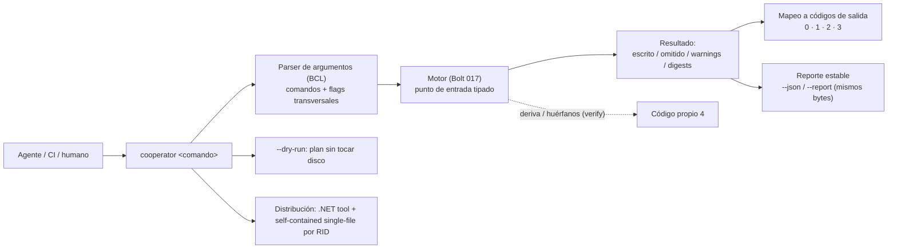

<!--
  LANGUAGE POLICY (§3.15): YAML keys, status enums, IDs and section headings stay in English;
  all prose goes in the project's content_language (devflow/LANGUAGE = es).
  ⚠️ SPEC = HOW (§2.4.1). La superficie de comandos, los flags transversales, los códigos de salida, el plan sin
  escritura, el reporte estable y la distribución están decididos en ADR-003 §3.2/§3.3 (y el vocabulario base
  compartido en ADR-002 §3.2). Este SPEC los ejecuta y los vuelve verificables, sin reabrir la decisión.
  ⚠️ AITL-SPEC-Approval (§2.4.1, §3.0): este SPEC es un DRAFT hasta que el Dev-validator (y los dueños de
  dominio aplicables) registre la decisión en el bloque `review`. Un cambio material en una fuente gobernada
  invalida la aprobación → parar, revisar el SPEC canónico y re-aprobar (G15).
-->

# SPEC-261016-0025 — CLI del motor: comandos, contrato de códigos de salida, reporte estable y distribución como comando

| Field | Value |
|-------|-------|
| **Origin** | [REV-001](../reviews/REV-001-analisis-migracion-cooperator.md) — §6 ítem 6 (hallazgos F-33 y F-42: no hay camino headless) |
| **Bolt** | [US-000.BOLT-018](../functional/bolts/US-000.BOLT-018-cli-del-motor.md) |
| **ADRs** | [ADR-003](../adrs/ADR-003-motor-scriban-headless-y-cli.md) §3.2, §3.3 · [ADR-001](../adrs/ADR-001-layout-y-empaquetado-cooperator-2.md) §3.1, §3.6 · [ADR-002](../adrs/ADR-002-formato-coop2-y-migrador.md) §3.2 |
| **Risk Class** | medium |
| **Revision** | 1 |

---

## 1. Objective

Se entrega la **herramienta de línea de comandos** del motor (`Cooperator.Cli`, `net10.0`, distribuible como
comando): los comandos con los que un agente o un pipeline **genera, verifica y consulta** el set activo, su
**contrato de códigos de salida** y un **reporte estable**, legible por máquina.

El problema que resuelve está verificado: hoy el único punto de automatización es abrir el Modeler con un archivo
como argumento (`MainForm.cs:509-512`, REV-001 F-33/F-42) — **no hay camino headless**, así que un agente no puede
"editar el modelo y regenerar", no hay forma de que la CI detecte que "el `.coop2` cambió y nadie regeneró", y no
existe una superficie de resultado interpretable sin heurísticas. Si este Bolt no se implementa, el flujo agente
que motivó toda la migración queda a medio camino: el motor existiría, pero nadie podría invocarlo de forma
programática ni confiar en lo que devuelve.

La herramienta es **delgada por diseño**: es un consumidor del punto de entrada tipado del motor (Bolt 017) y
**no puede** implementar generación por su cuenta. Una sola implementación de generación es la regla que impide
que el Modeler, el CLI y un agente vean comportamientos distintos.

---

## 2. Context

**Origen y decisión.** `REV-001` (aprobado 2026-10-15) ruteó el ítem 6 a un ADR. Ese ADR es **ADR-003**
(`accepted`), que decide la superficie de comandos, los flags transversales, el contrato de códigos de salida
—**`0` éxito, `1` error inesperado, `2` éxito con warnings, `3` entrada inválida, `4` deriva u huérfanos**—, el
**plan sin escritura**, el **reporte estable** (mismo input ⇒ mismos bytes), el alcance **headless y
multiplataforma** y la **distribución evaluada** (.NET tool como canal primario **más** un binario autocontenido
single-file por RID, con AOT/recorte viables). El vocabulario base `0/1/2/3` es **el mismo** que el de
`cooperator-migration` (ADR-002 §3.2), con `4` como código propio de este CLI.

**Los hechos que el CLI debe respetar (verificados en esta sesión):**

| Hecho | Evidencia / consecuencia para el CLI |
|---|---|
| El motor expone **un** punto de entrada tipado (petición → resultado) y **no** usa `Console` ni `Environment.Exit` | El CLI es el que habla con la consola, traduce el resultado a códigos de salida y escribe el reporte |
| El motor ya decide **sin escribir** cuando se le pide el plan, y **no** reescribe un archivo idéntico (comparación con normalización `CRLF`→`LF`) y emite el `.gitattributes` del árbol generado | `--dry-run`, `verify` y la idempotencia se apoyan en ese mecanismo; el CLI **expone** y **verifica** el comportamiento, no lo reimplementa |
| `verify` recomputa y reporta **deriva, huérfanos y artefactos faltantes** sin escribir (ADR-003 §3.3) | Es el comando con el que un agente o la CI comprueban "el workspace está al día"; su código es `4` |
| El motor emite **un archivo por stored procedure** y **nunca** aplica SQL | `sql` genera scripts; el CLI no abre ninguna conexión (no hay comando que aplique scripts) |
| El canal de publicación **no está decidido** (ADR-001 §3.6: dueño `tech_lead`, antes del release 2.0.0) ni la firma de paquetes | La distribución se entrega como **capacidad** (pack + autocontenido) y su verificación usa un **folder feed local** del propio Bolt; el canal se declara pendiente |
| La ruta de migración ya tiene su propio vocabulario de salida (`0` todo migrado, `2` con warnings, `3` bloqueados, `1` error) | El CLI comparte la base y agrega `4`: un agente trata los **dos pasos** de la migración con la misma convención |
| `.NET tool` requiere un feed para instalarse | El foldo feed local del Bolt permite verificar la instalación **sin** depender de una decisión de canal que no existe todavía |

**Estado del árbol 2.0 y dependencias.** `2.0/` todavía no existe en el repositorio: lo crea el Bolt 001, con el
comando reproducible y el arnés. El motor (Bolt 017, [SPEC-261016-0023](./SPEC-261016-0023-motor-headless.md)) es
el prerrequisito directo: sin su punto de entrada tipado no hay nada que este CLI pueda consumir legítimamente.

---

## 3. Source inventory and approval references

**Pre-SPEC evidence gate (§2.4.1) — resultado: PASA.** Todas las fuentes gobernadas que este SPEC usa están
aprobadas; no hay ADRs activos en conflicto (ADR-003 §3.2 fija los códigos y el vocabulario compartido con
ADR-002 §3.2; ADR-001 §3.6 deja el canal pendiente **sin** contradecir la distribución evaluada), y el plan de
integración declarado (`applicable`) coincide con el `test_integration: required` del Bolt (§3.2.2). No se emite
reporte bloqueante.

| Source | Ref | Approval |
|--------|-----|----------|
| Bolt | `US-000.BOLT-018` (`devflow/functional/bolts/US-000.BOLT-018-cli-del-motor.md`) | AITL-BOLT-READY-Approval ✓ — `approved`, `agent:dotnet-architect-reviewer-agent` (architect), 2026-10-16T00:09:32-03:00; `risk_class: medium`, `test_integration: required` (confirmado en el READY: infra distribuida, contrato de salida sólo demostrable en entorno real) |
| Parent US | `US-000` (`functional/user-stories/US-000-non-functional.md`) | Contenedor permanente: **sin** ciclo de aprobación (§2.6) — no aplica checkpoint |
| ADR (gobernante) | `ADR-003` §3.2 (comandos, flags, plan sin escritura, reporte estable, códigos de salida, alcance headless/multiplataforma, distribución evaluada), §3.3 (determinismo e idempotencia que hacen posible que reporte y plan sean estables), §3.6 (dependencias) | AITL-ADR-Approval ✓ — `accepted`, `human:eugenioserrano` (tech_lead), 2026-10-15T22:32:47-03:00 |
| ADR (gobernante) | `ADR-001` §3.1 (slot `Cooperator.Cli`, `net10.0`, .NET tool, sin `-windows`) y §3.6 (canal de distribución: **decisión pendiente** del dueño técnico) | AITL-ADR-Approval ✓ — `accepted`, 2026-10-15T22:32:47-03:00 |
| ADR (gobernante) | `ADR-002` §3.2 (vocabulario base de códigos de salida compartido con el migrador) | AITL-ADR-Approval ✓ — `accepted`, 2026-10-15T22:32:47-03:00 |
| REV evidence | `REV-001` §4 F-33/F-42 (no hay camino headless) y §6 ítem 6 | AITL-REV-Approval ✓ — aprobado 2026-10-15 |
| SPEC prerrequisito (directo) | `SPEC-261016-0023-…` — el motor y su punto de entrada tipado (Bolt 017) | **En disco**; dependencia declarada del Bolt |
| SPECs previos | `SPEC-261016-0000-…` (arnés/build), `SPEC-261016-0010-…` (contrato del modelo) y `SPEC-261016-0002-…` (vocabulario compartido) | Los tres **en disco** |
| Repository baseline | commit `6aa497f793cd3ab9d83c68db7ef2c1d80d3421d4` | — (nada bajo `2.0/` ni bajo `1.4/` en el árbol de trabajo) |

---

## 4. Scope

### In scope

1. **El proyecto y su forma distribuible**: `Cooperator.Cli` (`net10.0`, SDK-style, sin paquete `-windows`, sin
   registro del sistema operativo) empaquetado como **.NET tool** con nombre de comando `cooperator`, y la forma
   **autocontenida single-file por RID** publicada desde el mismo código.
2. **La superficie de comandos**: `generate`, `sql`, `verify`, `templates` y `version`, con los **flags
   transversales** `--model`, `--output`, `--templates`, `--dry-run`, `--force`, `--report <archivo>` y `--json`.
3. **El contrato de códigos de salida**: `0` éxito, `1` error inesperado, `2` éxito con warnings, `3` entrada
   inválida (`schemaVersion` fuera de rango, modelo inválido), `4` deriva u huérfanos detectados por `verify` —
   con el **mismo vocabulario base `0/1/2/3`** que el paso de migración y `4` como código propio, **un código por
   desenlace** y documentado en la ayuda de la herramienta.
4. **El reporte estable y ordenado**, legible por máquina: mismo input ⇒ **mismos bytes**, con la colección en
   orden canónico, todas las decisiones relevantes de la corrida dentro (plantilla usada, artefacto omitido por
   ser editable, *warning*, digest del modelo, conteos) y **nunca** sólo en un mensaje por pantalla.
5. **El plan sin escritura (`--dry-run`)** y la **no escritura de `verify`**: ambos verificables comparando el
   estado del workspace antes y después.
6. **La idempotencia observable en Windows**: dos corridas iguales no producen diff ni escrituras, incluido un
   *checkout* con `core.autocrlf=true`, y el árbol generado lleva su `.gitattributes`.
7. **La verificación de la distribución en un entorno real** (ciclo de integración): la herramienta instalada
   como comando y ejecutada donde corren los agentes y la CI, **sin** interfaz gráfica ni dependencias de
   plataforma; más la forma autocontenida desde el mismo código.
8. **La documentación de la superficie** (ayuda de cada comando, esquema del reporte) y la constancia de lo que
   este Bolt rompa, si rompe algo (ADR-008 §3.1).

### Out of scope

| Fuera de alcance | Dueño | Por qué |
|---|---|---|
| El **motor**, su punto de entrada, la proyección del modelo y el contexto de render | Bolt 017 (SPEC-0023) | El Bolt lo excluye: el CLI **consume** esa superficie y no puede divergir de ella |
| Los **contenidos** de los sets de plantillas | Bolts 019/020/021 | El CLI lista el set activo y sus overrides; no los escribe ni los versiona |
| El **shell del Modeler** y su flujo de interfaz | Bolts 025/026 | Otra superficie; el Modeler consumirá la misma librería o el CLI |
| El **migrador** y el batch de conversión | Bolts 002/029 | El CLI comparte su **vocabulario** de códigos, no su implementación |
| Los **comandos de valores protegidos** y el descifrado legacy | Bolt 023 (ADR-007 §3.5) | Otra superficie y otra política |
| **Aplicar** scripts contra una base de datos | — (nadie) | ADR-003 §3.1: el motor emite, nunca ejecuta; aplicar es del pipeline del consumidor |
| El **canal de distribución** (feed privado/público), la firma de paquetes y la publicación | `tech_lead` (ADR-001 §3.6) | Decisión pendiente con dueño y fecha; el Bolt entrega la **capacidad** y su verificación local |
| La integración como **tarea MSBuild / source generator** | reservado (ADR-003 §3.2) | Descartado por el ADR: acoplaría el build del consumidor |
| Una **librería de parseo de argumentos** de terceros | — (nadie) | ADR-003 §3.6 autoriza **sólo** Scriban; otra dependencia exige un ADR que reemplace a ADR-003 |
| Cualquier **edición de `1.4/`** | — (nadie) | El 1.4 es inmutable |

**Regla de aporte (bounded, explícita).** Este Bolt **crea** el proyecto del CLI y sus archivos. No reimplementa
el motor ni el contrato: si una capacidad que necesita no está en la superficie del Bolt 017, se **detiene** y se
reporta (es una brecha de esa superficie, no algo que el CLI resuelva por su cuenta).

---

## 5. Prerequisites and baseline

- **Bolt 017 y su SPEC** (`SPEC-261016-0023-…`): el **punto de entrada tipado** del motor (petición → resultado),
  el plan sin escritura, la escritura sólo-si-cambia y la regla de propiedad. Es la superficie que este Bolt
  consume; sin ella, el CLI no tiene contrato que exponer.
- **Bolt 001 y su SPEC** (`SPEC-261016-0000-…`): el **comando reproducible** (`2.0/build/build.ps1`), el arnés
  (`2.0/tests/Cooperator.Harness.Tests`) y el build de la solución.
- **Bolt 004 y su SPEC** (`SPEC-261016-0010-…`): el contrato del `.coop2` que los comandos reciben (`--model`) y
  sus rechazos tipados, que el CLI traduce a `3`.
- **Bolt 002 y su SPEC** (`SPEC-261016-0002-…`): el **vocabulario base** de códigos de salida que este CLI
  comparte, para que un agente trate los dos pasos de la migración con la misma convención.
- **Toolchain fijado por el Bolt 001:** SDK 10.0.402 (`global.json`), MSBuild 18.11.x de Visual Studio 18,
  advertencias tratadas como error. La verificación es `pwsh -File 2.0/build/build.ps1 -Scope Hermetic` (lazo
  hermético) y la corrida de integración del Bolt para lo distribuido.
- **Estado del árbol 2.0 al escribir este SPEC:** `2.0/` todavía no existe (lo crea el Bolt 001) y el motor llega
  con el Bolt 017, que es dependencia declarada.
- **Dependencias:** el CLI **no** agrega dependencias de producto: sólo BCL + el proyecto del motor (y, por él,
  Scriban como dependencia transitiva autorizada). El parseo de argumentos se implementa en el proyecto.
- **`1.4/**` es sólo lectura:** se verifica contra el commit baseline antes y después de construir.

---

## 6. Phases

> Un solo Bolt (`US-000.BOLT-018`), **1–2 V-Bounces** esperados más el ciclo de integración. El orden va del
> contrato a la evidencia: primero la forma distribuible y los comandos, después los códigos y el reporte,
> después las propiedades que el agente necesita (plan, verificación, idempotencia) y al final la distribución
> verificada en el entorno real.

### Phase A — El proyecto y la forma distribuible

**Duration:** ~2h de ciclo — **Complexity:** Medium

#### A.1 Proyecto, comandos y empaquetado

Se crea `2.0/src/Cooperator.Cli/` como proyecto SDK-style `net10.0` firmado como el resto del árbol, con
`PackAsTool` y nombre de comando `cooperator`, cuya única referencia de proyecto es el motor (Bolt 017) y cuyas
dependencias de producto son **sólo BCL**. El parseo de argumentos se implementa en el proyecto (tabla de
comandos, flags transversales, ayuda): ADR-003 §3.6 autoriza **sólo Scriban** como dependencia de terceros del
motor, así que traer una librería de CLI sería una decisión de arquitectura, no una comodidad de Bolt.

#### A.2 La ayuda como contrato

Cada comando y cada flag tienen su texto de ayuda con el **mismo contenido** que el contrato de §6/C: qué hace,
qué escribe, qué devuelve y con qué código. La ayuda es la primera documentación que un agente lee; se verifica
que todo código de salida del contrato esté descrito y que ningún flag cambie de significado entre comandos.

**Files created:**
- `2.0/src/Cooperator.Cli/Cooperator.Cli.csproj` — el proyecto y su empaquetado como .NET tool
- `2.0/src/Cooperator.Cli/Program.cs` — arranque mínimo (sin lógica de generación)
- `2.0/src/Cooperator.Cli/CommandLine/ArgumentParser.cs` — parseo de comandos y flags transversales (BCL)
- `2.0/src/Cooperator.Cli/CommandLine/HelpText.cs` — la ayuda como contrato

---

### Phase B — Los cinco comandos y los flags transversales

**Duration:** ~3h de ciclo — **Complexity:** High

#### B.1 Los comandos, cada uno con un resultado distinto

- **`generate`**: código + proyectos (el caso del flujo agente) — escribe el árbol generado según la regla de
  propiedad del motor.
- **`sql`**: **solo** los scripts de stored procedures (un archivo por SP); no aplica nada contra una base.
- **`verify`**: re-evalúa el modelo y **no escribe**: reporta deriva, huérfanos y artefactos faltantes. Es el
  comando con el que un agente o la CI comprueban "el workspace está al día".
- **`templates`**: lista el set activo, su versión y las plantillas **overrideadas** por el consumidor.
- **`version`**: informa la versión de la herramienta (y la del motor/set que expone).

#### B.2 Los flags transversales, con un único significado

`--model` (ruta del `.coop2`), `--output` (carpeta destino), `--templates` (carpeta de overrides),
`--dry-run` (plan sin tocar disco), `--force` (única forma de sobrescribir artefactos editables),
`--report <archivo>` (destino del reporte) y `--json` (reporte legible por máquina en la salida estándar). Los
flags tienen el mismo significado en todos los comandos que los aceptan; un flag que un comando no usa **falla**
(no se ignora en silencio) y eso es una entrada inválida (`3`).

#### B.3 Una sola implementación

Cada comando es un envoltorio fino sobre el punto de entrada del motor: no hay lógica de generación, de propiedad
de archivos ni de comparación de contenido en el CLI. La divergencia entre "lo que hace el comando" y "lo que hace
el motor embebido" es imposible por construcción, y hay un test que lo comprueba invocando ambos caminos y
comparando resultados.

**Files created:**
- `2.0/src/Cooperator.Cli/Commands/GenerateCommand.cs` · `SqlCommand.cs` · `VerifyCommand.cs` · `TemplatesCommand.cs` · `VersionCommand.cs`
- `2.0/src/Cooperator.Cli/Commands/CommandContext.cs` — traducción de flags a la petición del motor
- `2.0/tests/Cooperator.Cli.Tests/SingleImplementationTests.cs` — el CLI y el motor en proceso dan el mismo resultado

---

### Phase C — El contrato de códigos de salida

**Duration:** ~2h de ciclo — **Complexity:** Medium

#### C.1 Un código por desenlace, sin ambigüedad

| Código | Desenlace | Cuándo |
|---|---|---|
| `0` | Éxito | La operación se completó sin advertencias |
| `1` | Error inesperado | Fallo no clasificable (bug, E/S inesperada): el mensaje explica qué pasó |
| `2` | Éxito con advertencias | La operación se completó **y** hubo hallazgos no bloqueantes (deriva de artefacto editable, deriva de plantillas) |
| `3` | Entrada inválida | `schemaVersion` fuera de rango, modelo inválido, flag desconocido o incompatible, ruta inexistente |
| `4` | El workspace no está al día | **Sólo** `verify`: deriva, huérfanos o artefactos faltantes |

#### C.2 El vocabulario compartido con el paso de migración

`0/1/2/3` es **el mismo** vocabulario que `cooperator-migration` (ADR-002 §3.2); `4` es propio de este CLI porque
el migrador no tiene el estado "el workspace no está al día". Un agente o un pipeline trata los dos pasos con la
misma convención, y el CLI documenta la correspondencia (y la diferencia) de forma explícita en su ayuda.

#### C.3 El mapeo desde el motor, en un solo lugar

El CLI traduce el **resultado tipado** del motor (y sus excepciones tipadas de entrada) a los códigos de arriba en
**un único módulo**: ninguna otra parte del CLI decide códigos de salida. `verify` con deriva devuelve `4` **sin**
escribir; un modelo con `schemaVersion` fuera de rango devuelve `3` sin generar artefactos parciales; y una corrida
con *warnings* devuelve `2` (nunca `0`, que silenciaría el hallazgo).

**Files created:**
- `2.0/src/Cooperator.Cli/Commands/ExitCodes.cs` — **el** mapeo resultado → código
- `2.0/docs/cli-contract.md` — el contrato publicado: comandos, flags, códigos y su relación con el migrador
- `2.0/tests/Cooperator.Cli.Tests/ExitCodeTests.cs` — un caso por desenlace, incluida la ausencia de escritura

---

### Phase D — El reporte estable y ordenado

**Duration:** ~2,5h de ciclo — **Complexity:** Medium

#### D.1 Mismo input ⇒ mismos bytes

El reporte (`--json` a la salida estándar y `--report <archivo>`) es un documento **estable**: la misma entrada
produce los **mismos bytes**, con la colección en **orden canónico** (artefactos por nombre, ordinal; *warnings*
por tipo y luego por artefacto). Sin marcas temporales, sin rutas absolutas de la máquina (rutas relativas al
`--output`), sin orden dependiente del sistema de archivos ni de la cultura del proceso: es lo que permite a un
agente comparar dos corridas sin heurísticas y a la CI detectar cambios reales.

#### D.2 Todas las decisiones relevantes, dentro

El reporte contiene: el comando y sus opciones efectivas; la versión de la herramienta, del motor y del set de
plantillas; el `schemaVersion` del modelo y su **digest**; los artefactos **escritos**, **omitidos** (con motivo:
editable existente, contenido idéntico, fuera del set), **eliminados** (huérfanos con manifiesto) y **faltantes**
(en `verify`); los *warnings*; y los conteos. Ninguna decisión relevante vive **sólo** en un mensaje por pantalla:
lo que no está en el reporte no ocurrió.

#### D.3 El esquema, versionado

El esquema del reporte se publica y se versiona (un cambio de forma es un cambio de versión), de modo que un
consumidor pueda fijarse a él. La salida humana (`sin --json`) es para leer; la legible por máquina es el
contrato.

**Files created:**
- `2.0/src/Cooperator.Cli/Reporting/JsonReportWriter.cs` — serialización estable y ordenada del reporte
- `2.0/src/Cooperator.Cli/Reporting/ReportModel.cs` — el modelo del reporte (con su versión)
- `2.0/docs/cli-report-schema.md` — el esquema publicado y versionado
- `2.0/tests/Cooperator.Cli.Tests/ReportStabilityTests.cs` — dos corridas ⇒ bytes idénticos; orden canónico; decisiones presentes

---

### Phase E — El plan sin escritura y la verificación que no escribe

**Duration:** ~2h de ciclo — **Complexity:** Medium

#### E.1 `--dry-run`: el plan que no toca el workspace

`--dry-run` imprime el plan (altas, actualizaciones, borrados y conteos) **sin tocar el disco**. Se verifica
comparando el estado completo del workspace (árbol de archivos con tamaños y hashes) **antes y después**: idéntico.
El dry-run también respeta el modo conservador (sin manifiesto, ningún borrado en el plan).

#### E.2 `verify`: detecta, no arregla

El contrato de `verify` es **no escribir**, incluso cuando encuentra deriva: recomputa el árbol, lo compara con el
workspace y sale con `4` si no coincide, `0` si está al día, `2` si además hay *warnings*. Se verifica igual que el
plan: estado del workspace antes y después, idéntico. Es la forma en que la CI convierte "el `.coop2` cambió y
nadie regeneró" en un fallo, sin que el comando "arregle" nada por su cuenta.

**Files created:**
- `2.0/tests/Cooperator.Cli.Tests/DryRunTests.cs` — el plan no escribe (workspace hash antes/después)
- `2.0/tests/Cooperator.Cli.Tests/VerifyNoWriteTests.cs` — `verify` no escribe y devuelve `4` con deriva

---

### Phase F — Idempotencia observable en Windows

**Duration:** ~1,5h de ciclo — **Complexity:** Medium

Dos corridas consecutivas de `generate` sobre el mismo modelo dejan el workspace **idéntico**: `git diff` vacío y
**0 escrituras** (ni `mtime`). El caso se ejerce también sobre un *checkout* con `core.autocrlf=true` (el escenario
que rompería la idempotencia si la comparación no normalizara `CRLF`→`LF`) y se verifica que el árbol generado
lleva su `.gitattributes` con `eol=lf`. Es la evidencia end-to-end del NFR `generation-idempotence` de ADR-003 §5
desde la superficie que realmente usan los agentes (el comando, no la librería).

**Files created:**
- `2.0/tests/Cooperator.Cli.Tests/IdempotenceTests.cs` — dos corridas, `git diff` vacío y 0 escrituras (incluido `core.autocrlf=true`)

---

### Phase G — La distribución, verificada en el entorno real

**Duration:** ~2h de ciclo — **Complexity:** Medium

#### G.1 El canal primario, sin depender de una decisión pendiente

La herramienta se empaqueta como **.NET tool** (`dotnet tool install`) y se verifica instalando desde un **folder
feed local** que el propio Bolt produce: el canal de publicación (feed privado/público, firma) es una decisión
**pendiente** de `tech_lead` (ADR-001 §3.6) y este Bolt **no** la toma — usa un feed local para poder demostrar la
instalación **hoy**, y deja el cambio de feed como un parámetro de la verificación, no del código.

#### G.2 La forma autocontenida, desde el mismo código

Se publica un **binario self-contained single-file por RID** desde el mismo proyecto y se ejecuta en un entorno
**sin** el SDK del proyecto ni interfaz gráfica. La viabilidad AOT/recorte se valida acá (el motor ya usa la
superficie AOT-segura de Scriban): la publicación con `PublishAot`/recorte debe completar **sin** advertencias de
AOT/trimming atribuibles a la cadena del CLI.

**Files created:**
- `2.0/build/publish-cli.ps1` — empaquetado del tool, folder feed local y publicación self-contained por RID
- `2.0/tests/Cooperator.Cli.Integration.Tests/InstallAndRunTests.cs` — instalación desde el feed local y corrida como comando
- `2.0/tests/Cooperator.Cli.Integration.Tests/SelfContainedRunTests.cs` — publicación y corrida en un entorno sin SDK ni GUI
- `2.0/tests/Cooperator.Cli.Integration.Tests/CommandContractTests.cs` · `ReportStabilityTests.cs` · `WorkspaceIdempotenceTests.cs` — el contrato y las propiedades, en el entorno real

---

### Phase H — Documentación y constancia

**Duration:** ~1h de ciclo — **Complexity:** Low

Se publican la ayuda de la herramienta, el contrato (`2.0/docs/cli-contract.md`) y el esquema del reporte
(`2.0/docs/cli-report-schema.md`), y se registra en el MEM lo que este Bolt **rompa**, si rompe algo: la
herramienta es **nueva**, así que no retira superficie del framework ni del baseline de API; su aporte a las notas
de migración (Bolt 028) es la **convención de salida** compartida con el migrador y la existencia del camino
headless. Si en la ejecución apareciera una ruptura real (por ejemplo, un cambio de contrato que afecte a un
consumidor ya publicado), se produce el fragmento `2.0/docs/api-removals/US-000.BOLT-018.json` con los tres datos
de ADR-008 §3.1 y se detiene para revisión.

**Files modified:**
- `2.0/README.md` — la invocación de la herramienta junto al resto del árbol (si el Bolt 001 lo creó)

---

## 7. Acceptance criteria

> Bolt no funcional (parent `US-000`, sin ACs): los criterios son los **resultados medibles** del Bolt (§2) y las
> restricciones de ADR-003/ADR-001/ADR-002, expresados como Given/When/Then verificables.

### AC-1: Los cinco comandos entregan el resultado que declaran

**Given** el modelo de referencia y un workspace de prueba
**When** se ejecutan `generate`, `sql`, `verify`, `templates` y `version`
**Then** cada uno hace lo que su contrato dice (`sql` sólo scripts de SP; `templates` lista set, versión y
overrides; `version` informa la versión) y **ninguno** aplica SQL contra una base.

### AC-2: Un código por desenlace, sin ambigüedad

**Given** cada desenlace posible
**When** corre el comando correspondiente
**Then** el código es `0` (éxito), `1` (error inesperado), `2` (éxito con *warnings*), `3` (entrada inválida:
`schemaVersion` fuera de rango, modelo inválido, flag desconocido) o `4` (sólo `verify`, con deriva u huérfanos), y
la ayuda documenta cada uno con su relación con el vocabulario del migrador.

### AC-3: El plan no toca el workspace

**Given** un workspace con los artefactos generados
**When** se ejecuta `generate --dry-run`
**Then** se imprime el plan (altas, actualizaciones, borrados, conteos) y el estado del workspace es **idéntico**
antes y después (mismos archivos, tamaños y hashes).

### AC-4: `verify` detecta sin arreglar

**Given** un workspace desactualizado respecto del modelo
**When** se ejecuta `verify`
**Then** reporta la deriva (y los huérfanos y faltantes), devuelve `4`, y el workspace queda **intacto**; con el
workspace al día devuelve `0`.

### AC-5: El reporte es estable y completo

**Given** el modelo de referencia
**When** se ejecutan dos veces el mismo comando con `--json` y con `--report`
**Then** los reportes son **idénticos byte a byte**, la colección está en orden canónico, y toda decisión
relevante (plantilla usada, artefacto omitido por editable, *warning*, digests y conteos) está en el reporte y no
sólo en pantalla.

### AC-6: Idempotencia observable desde el comando

**Given** un workspace limpio en un *checkout* con `core.autocrlf=true`
**When** se ejecuta `generate` dos veces consecutivas
**Then** `git diff` queda **vacío**, no hubo **escrituras** (ni `mtime`), y el árbol generado incluye su
`.gitattributes` con `eol=lf`.

### AC-7: La herramienta se instala y corre como comando en el entorno real

**Given** el lane de integración (entorno sin interfaz gráfica ni SDK del proyecto)
**When** se instala la herramienta desde el folder feed local y se ejecutan sus comandos sobre el modelo de
referencia
**Then** la instalación y las corridas funcionan, sin registro del sistema operativo ni dependencias de
plataforma, con los códigos de salida de AC-2 y el reporte de AC-5.

### AC-8: La forma autocontenida corre sin el SDK

**Given** el binario self-contained single-file por RID publicado desde el mismo código
**When** se ejecuta en un entorno sin el SDK del proyecto ni interfaz gráfica
**Then** los comandos funcionan igual, y la publicación con AOT/recorte completa sin advertencias atribuibles a
la cadena del CLI.

### AC-9: Una sola implementación (el CLI no reimplementa el motor)

**Given** una misma entrada
**When** se invoca el comando y, por separado, el punto de entrada del motor en proceso
**Then** el resultado es el mismo (artefactos, omisiones, *warnings*), y el CLI **no** contiene lógica de
generación, de propiedad de archivos ni de comparación de contenido.

### AC-10: Verificación reproducible y árbol congelado intacto

**Given** el toolchain fijado
**When** se ejecuta `pwsh -File 2.0/build/build.ps1 -Scope Hermetic`
**Then** el árbol compila sin advertencias tratadas como error, la suite hermética está verde (con los casos de
integración filtrados por categoría) y `git diff --quiet <baseline> -- 1.4` y `git status --porcelain -- 1.4`
están vacíos.

### AC mapping to source (measurable outcome) — non-functional

| Source outcome (Bolt §2) | How this SPEC satisfies it | Verifying test/evidence |
|--------------------------|----------------------------|--------------------------|
| "cada comando entrega el resultado que declara su contrato" | Fase B: los cinco comandos, cada uno con su resultado | AC-1 · corridas del arnés + integración |
| "el plan sin escritura **no toca el workspace**" | Fase E.1: plan y verificación del estado antes/después | AC-3 · `DryRunTests` |
| "el reporte legible por máquina es **estable** y toda decisión relevante aparece en el reporte" | Fases D.1/D.2: reporte estable, orden canónico y completo | AC-5 · `ReportStabilityTests` |
| "cada desenlace tiene su código de salida propio y distinto … con el mismo vocabulario base que el paso de migración" | Fase C: contrato de códigos y mapeo único | AC-2 · `ExitCodeTests` + integración |
| "la herramienta se instala y ejecuta como comando en una máquina que no tiene el shell" | Fase G.1: .NET tool desde el feed local, verificado en el lane | AC-7 · `InstallAndRunTests` |
| "la forma autocontenida se publica desde el mismo código y se ejecuta en ese entorno" | Fase G.2: self-contained single-file por RID + AOT/recorte | AC-8 · `SelfContainedRunTests` |
| "divergencia entre el comando y el motor embebido" (riesgo declarado) | Fase B.3: envoltorio fino + test de equivalencia | AC-9 · `SingleImplementationTests` |
| "la verificación que **no escribe** cuando hay deriva" | Fase E.2: contrato de `verify` | AC-4 · `VerifyNoWriteTests` |
| "la entrada propia de lo que este Bolt rompa en la superficie, registrada en las notas de migración" | Fase H: constancia (la herramienta es nueva; se documenta la convención compartida y, si hubiera ruptura real, su fragmento) | AC-10 · MEM + (si aplica) fragmento |

---

## 8. Testing strategy

### 8.1 V-Bounce level (hermetic — run by the agent)

- **Contrato de comandos (proceso, no librería):** se ejecuta el binario construido y se asserta, por comando, el
  resultado y los archivos tocados: `generate` (árbol generado), `sql` (sólo scripts), `templates` (set, versión,
  overrides), `version` (versión), `verify` (reporte sin escritura).
- **Códigos de salida:** un caso por desenlace, incluidos los negativos: modelo inexistente, modelo inválido,
  `schemaVersion` fuera de rango (`3`), flag desconocido o incompatible (`3`), corrida con *warnings* (`2`), deriva
  en `verify` (`4`).
- **Plan sin escritura y `verify` sin escritura:** hash del árbol de archivos (nombre, tamaño, hash) antes y
  después; idéntico en ambos casos.
- **Reporte:** dos corridas ⇒ bytes idénticos; orden canónico; presencia de cada decisión; ausencia de rutas
  absolutas de la máquina y de marcas temporales; el esquema del reporte valida contra el documento publicado.
- **Idempotencia:** dos `generate` ⇒ `git diff` vacío y 0 escrituras (comparación de `mtime`), incluido el caso
  `core.autocrlf=true`; `.gitattributes` presente.
- **Equivalencia CLI ↔ motor:** misma entrada por los dos caminos ⇒ mismo resultado (artefactos, omisiones,
  *warnings*).
- **Edge cases:** `--output` inexistente (se crea) y `--output` que apunta a un archivo (entrada inválida); `--model`
  con extensión distinta de `.coop2`; `--json` y `--report` a la vez (reporte idéntico en ambos destinos); salida
  estándar redirigida; `--force` sobre un artefacto editable; flags duplicados; comando desconocido.
- **BUG evidence:** `n/a` — el Bolt no corrige un BUG; no hay TDD rojo→verde obligatorio.

### 8.2 Integration test level (written in a V-Bounce, executed in the integration test cycle)

- **Integration tests (real dependencies):** los cinco archivos de `2.0/tests/Cooperator.Cli.Integration.Tests/`
  (fase G), `Category=Integration`, ejecutados en el **lane de integración** del Bolt: la herramienta **instalada
  como comando** desde el folder feed local y la forma **autocontenida** corridas en un host sin interfaz gráfica
  ni SDK del proyecto; el contrato de códigos, la estabilidad del reporte y la idempotencia **en el entorno real**.
- **Contract / E2E against the real providers:** no hay proveedor externo en el alcance; el "contrato" que se
  verifica end-to-end es el **de la herramienta** (comandos, códigos, reporte) tal como lo consumen un agente o un
  pipeline, en el entorno donde efectivamente corren (ADR-003 §3.2: headless y multiplataforma).
- **Edge cases:** instalación repetida (idempotente) y desinstalación limpia; corrida desde un directorio distinto
  del workspace; `--json` consumido por un parser externo; ausencia de variables de entorno del proyecto;
  permisos de escritura restringidos en `--output`.
- **BUG evidence:** `n/a` — no hay defecto en corrección.

---

## 9. Quality gates

> Los estados son el **resultado esperado**; el resultado real se registra en el MEM del V-Bounce (V-Bounce) y en
> `integration_test_runs[]` del manifiesto (ciclo de integración) (§3.6, §3.12).

| Gate | Level | Threshold | Status |
|------|-------|-----------|--------|
| Build / lint / type checks | V-Bounce | El CLI compila en `net10.0` con advertencias tratadas como error | `pass` — esperado (§8.1) |
| Unit / component tests | V-Bounce | Suite hermética verde (comandos, códigos, plan, reporte, idempotencia, equivalencia) | `pass` — esperado (AC-1…AC-6, AC-9) |
| Consumer-side contract tests (test doubles) | V-Bounce | El contrato del agente es el par (código de salida, reporte): se ejercen ambos desde el proceso | `pass` — esperado (AC-2, AC-5) |
| SAST | V-Bounce | El CLI no abre conexiones, no escribe fuera de `--output` y no usa registro del sistema operativo | `pass` — esperado |
| Dependency scanning / licenses | V-Bounce | **0** dependencias de producto nuevas (BCL + el motor); ninguna librería de CLI; versiones centralizadas | `pass` — esperado (§5) |
| OWASP Top 10 — static review | V-Bounce | No expone superficie de red ni de servicio; los datos vienen de archivos del propio consumidor | `n/a` — sin superficie externa |
| Prompt-injection scan | V-Bounce | No hay construcción de prompts | `n/a` — no aplica |
| Secret-leak scan | V-Bounce | 0 secretos en el código, en la ayuda, en los fixtures y en el reporte (el modelo no transporta credenciales) | `pass` — esperado |
| Hallucination lint | V-Bounce | Comandos, flags, rutas y códigos referenciados existen y se verifican en la suite | `pass` — esperado |
| IP / license provenance | V-Bounce | No se incorpora código de terceros; sólo la dependencia autorizada por ADR-003 §3.6 | `pass` — esperado |
| PII / DLP | V-Bounce | `data_classification: internal`; fixture sintético; el reporte contiene rutas y conteos, no datos de negocio | `pass` — esperado |
| Dependency-confusion | V-Bounce | Sin paquetes nuevos; el *tool* se publica con su identidad y versión fijadas | `pass` — esperado |
| Test-first evidence | V-Bounce | No es un Bolt de corrección de BUG | `n/a` — sin TDD obligatorio |
| Behavioral reproducibility (hermetic suite) | V-Bounce | Dos corridas idénticas del reporte y del árbol generado | `pass` — esperado (AC-5, AC-6) |
| Bolt-manifest validation | V-Bounce | Manifiesto válido contra `manifest-v5-bolt.schema.json` con la entrada `v_bounces[]` completa | `pass` — esperado |
| API-compat con la línea base 1.4 (ADR-008 §5) | V-Bounce | La herramienta es **nueva**: no retira superficie de los cuatro ensamblados del framework | `n/a` — sin superficie del baseline afectada |
| Integration tests (real dependencies) | Integration test | La herramienta instalada como comando y la forma autocontenida corren en el lane sin GUI ni SDK, con el contrato de códigos y el reporte estables | `pass` — **en el ciclo de integración (entorno por provisionar)** |
| Contract / E2E against the real providers | Integration test | El contrato de la herramienta (comandos, códigos, reporte) tal como lo consume un agente/pipeline en el entorno real | `pass` — **en el ciclo de integración** |
| DAST / OWASP Top 10 — dynamic | Integration test | No hay servicio desplegable | `n/a` — sin superficie ejecutable de red |
| Perf-smoke (p95/p99) | Integration test | El CLI no es un servicio: su costo está dominado por el motor (medido en el Bolt 017) | `n/a` — sin endpoint |
| Observability (logs / metrics / traces) | Integration test | La observabilidad de la herramienta es su reporte y sus códigos de salida (§11), no telemetría de servicio | `n/a` — sin servicio instrumentado |

> Coherencia con el Bolt (§3.2.2): `test_integration: required` → `integration_test_plan.applicability: applicable`
> con sus tests, su entorno y sus datos. El gate de integración decide el paso del Bolt por su ciclo de
> integración antes de la aceptación.

---

## 10. Security and data

- **Superficie de riesgo acotada:** la herramienta corre en la máquina del consumidor, sin red, sin servicio y sin
  registro del sistema operativo; escribe **sólo** dentro de `--output` y elimina **sólo** lo que su manifiesto
  declara propio. `--force` es la única operación que sobrescribe artefactos editables, y es explícita y visible
  en el reporte.
- **El CLI no aplica SQL ni se conecta a nada** (ADR-003 §3.1): no hay credenciales en el alcance de este Bolt, y
  los comandos no aceptan cadenas de conexión. Cualquier aplicación de scripts es del pipeline del consumidor.
- **Cadena de suministro declarada, no improvisada:** el canal de publicación y la firma de paquetes están
  **pendientes** (ADR-001 §3.6, dueño `tech_lead`); este Bolt verifica la instalación con un **folder feed local**
  y deja el feed como parámetro de la verificación. No se publica nada a un canal no decidido.
- **Datos y clasificación:** `data_classification: internal` (espeja el Bolt). El reporte contiene rutas, conteos y
  digests; **no** contiene datos de negocio ni valores del modelo más allá de lo que el propio reporte declara
  público para el consumidor. Los fixtures son sintéticos.
- **Integridad del árbol congelado:** `1.4/**` no se modifica: la referencia dorada sigue intacta.

---

## 11. Monitoring and observability

- **El reporte y los códigos de salida son la interfaz con el agente y la CI:** cada corrida es interpretable sin
  heurísticas, y el reporte queda donde el consumidor lo pida (`--report`) además de la salida estándar con
  `--json`.
- **El esquema del reporte se versiona** (`2.0/docs/cli-report-schema.md`): un cambio de forma es un cambio de
  versión, no una sorpresa para el parser de un consumidor.
- **Evidencia de las corridas:** salidas del arnés hermético y de la corrida de integración, con el código de
  salida y el reporte, en `2.0/artifacts/<timestamp>/`.
- **Sin telemetría de servicio:** la herramienta no envía nada a ninguna parte (`n/a` con esa razón en la tabla de
  gates).

---

## 12. Migration, compatibility and rollback

- **Migration:** `n/a` en datos. El cambio de rutina para el consumidor es sustituir "abrir el Modeler con un
  archivo" por `cooperator generate` en su pipeline; el flujo completo —editar el `.coop2`, regenerar, revisar el
  diff— queda disponible desde la línea de comandos.
- **Compatibility:** la herramienta es **nueva**: no retira superficie del framework ni del baseline de API. Su
  aporte a la convención de la migración es el **vocabulario de códigos de salida compartido** con
  `cooperator-migration` (`0/1/2/3`, más `4` propio) y el **contrato del reporte**. Un consumidor que hoy
  automatice el Modeler por argumento de línea no tiene un equivalente exacto: el reemplazo es el CLI y está
  documentado (ayuda + contrato), y su entrada a las notas de migración (Bolt 028) es la existencia del camino
  headless.
- **Rollback:** revertir el commit del Bolt. La herramienta no está referenciada por nada más que el arnés; el
  Modeler (Bolt 025/026) todavía no la consume.

---

## 13. Risk matrix

| Risk | Probability (1-5) | Impact (1-5) | Mitigation |
|------|-------------------|--------------|------------|
| **Contrato de salida que un agente o un pipeline no pueda interpretar sin adivinar** | 2 | 4 | Un código por desenlace, `4` distinguiendo "no está al día" de "error", y el reporte estable como contrato (§6/C, §6/D) |
| **Salida no estable** que rompe la comparación entre corridas | 2 | 3 | Mismos bytes con orden canónico, sin marcas temporales ni rutas absolutas; test de dos corridas + esquema versionado |
| **El plan escribe** (o escribe "un poquito") | 1 | 4 | Verificación por hash del workspace antes/después del `--dry-run` (§6/E.1) |
| **`verify` "arregla" lo que encuentra** | 1 | 4 | Su contrato es no escribir y se verifica igual que el plan; el código `4` informa sin tocar nada |
| **Decisiones visibles sólo en pantalla** (el agente no se entera) | 2 | 3 | Toda decisión relevante va al resultado del motor y por lo tanto al reporte (§6/D.2) |
| **Distribución en un entorno sin el shell ni el SDK del proyecto** | 2 | 3 | Forma autocontenida publicada desde el mismo código + verificación en el lane sin GUI ni SDK (AC-7, AC-8) |
| **Divergencia entre el comando y el motor embebido** | 2 | 4 | Envoltorio fino + un solo mapeo de códigos + test de equivalencia CLI ↔ motor (AC-9) |
| **La instalación como comando depende de un canal no decidido** | 2 | 2 | Folder feed local propio para verificar hoy; el canal (ADR-001 §3.6) queda como parámetro de la verificación y de la decisión del dueño |
| La cadena del CLI arrastra advertencias de AOT/recorte y la forma single-file no es viable | 2 | 3 | El motor usa la superficie AOT-segura de Scriban; la publicación se valida en el ciclo de integración como criterio (AC-8) |

---

## 14. Decisions and trade-offs

| Decision | Reason |
|----------|--------|
| El parseo de argumentos se implementa en el proyecto, **sin** librería de CLI | ADR-003 §3.6 autoriza **sólo** Scriban como dependencia de terceros del motor; traer una librería de CLI sería una decisión de arquitectura. La superficie es chica (5 comandos + 7 flags): implementarla es trabajo acotado y verificable |
| Un **único módulo** traduce resultado/excepción del motor a códigos de salida | Un código por desenlace sólo se sostiene si hay un solo lugar que decide códigos; dispersarlo es la forma más rápida de que dos comandos devuelvan códigos distintos para el mismo hecho |
| `--json` y `--report` son **el mismo documento** en dos destinos | El consumidor debe poder comparar exactamente lo mismo venga de stdout o del archivo; dos serializadores distintos serían dos contratos |
| El reporte **no** incluye rutas absolutas de la máquina | Lo haría inestable entre máquinas (y filtraría estructura local del consumidor). Las rutas se emiten relativas a `--output` |
| `verify` y `--dry-run` son cosas distintas y ambas se verifican por estado del workspace | `--dry-run` es un **plan** de lo que se escribiría; `verify` es una **comparación** con el modelo y sale `4` con deriva. Confundirlos perdería justamente el código propio de la herramienta |
| La instalación se verifica contra un **folder feed local** | El canal de publicación no está decidido (ADR-001 §3.6): un feed local permite demostrar la instalación y la corrida como comando **hoy**, sin inventar una decisión ajena |
| La forma autocontenida se publica **desde el mismo código** y se valida con AOT/recorte | Es la condición para correr donde no hay SDK; y es verificable porque el motor evitó el render por reflexión (ADR-003 §3.6) |
| El CLI **no** contiene lógica de generación, propiedad ni comparación | Una sola implementación de generación es la regla que evita que el Modeler, el CLI y un agente vean resultados distintos (ADR-003 §3.1); el test de equivalencia lo sostiene |
| Se publica el **contrato** (`cli-contract.md`) y el **esquema del reporte** (`cli-report-schema.md`) | El consumidor del CLI es un agente o un pipeline: sin contrato publicado no hay interfaz, sólo comportamiento observado |

---

## 15. Stop conditions

1. **Cambio material en una fuente gobernada** (Bolt, ADR-003/ADR-001/ADR-002, el REV usado, baseline de código):
   detener, revisar este SPEC canónico y re-aprobar (G15). Una V-Bounce nunca abarca dos revisiones (G16).
2. **La superficie del motor (Bolt 017) no alcanza para un comando del contrato** (por ejemplo, no expone el plan
   o la detección de huérfanos que `verify` necesita): detener y reportar — es una brecha del motor, y el CLI no
   la resuelve reimplementando generación.
3. **Un desenlace del contrato no se puede mapear a un código distinto** (dos hechos comparten código y un agente
   no podría distinguirlos): detener y escalar; el contrato de códigos es el objetivo del Bolt, no un detalle.
4. **La verificación de distribución requiere decidir el canal de publicación o firmar paquetes**: detener y
   escalar al dueño (ADR-001 §3.6). Este Bolt verifica con un feed local y **no** publica en ningún canal.
5. **Se necesita una dependencia nueva** (librería de CLI, de parseo o de publicación): detener y escalar — exige
   un ADR que reemplace a ADR-003 §3.6.
6. **Un gate de §9 no cierra en `pass`**: detener y escalar. Una salida por excepción exige un ADR aprobado (G21).
7. **El arnés del Bolt 001 no está disponible** (comando reproducible, suite o build): detener y escalar la
   secuencia.
8. **Ambigüedad que sólo se resolvería inventando** (por ejemplo, el significado exacto de un flag para un comando
   que el ADR no enumera): parar y reportar; no se rellena el hueco con una suposición (§2.4.1).

---

## 16. Definition of Done (DoD)

- [ ] Fases A–H implementadas (o, si el presupuesto se agota, progreso en el MEM y pendiente explícito para un
      V-Bounce nuevo)
- [ ] Todos los criterios de aceptación (AC-1…AC-10) verificados
- [ ] Suite hermética verde (§8.1) y suite de integración escrita, compilada y estáticamente verificada (§8.2)
- [ ] El contrato publicado (`cli-contract.md`), el esquema del reporte versionado y la ayuda de cada comando
- [ ] Los códigos de salida verificados con un caso por desenlace, incluida la ausencia de escritura en
      `--dry-run` y `verify`
- [ ] El código sigue ADR-003 (§3.2/§3.3/§3.6), ADR-001 (§3.1/§3.6) y ADR-002 (§3.2)
- [ ] Gates aplicables en `pass` (o `waived`/`n/a` con su razón) según §9
- [ ] MEM creado en `devflow/memory/` (exactamente uno **por V-Bounce**)
- [ ] Entrada `v_bounces[]` agregada al manifiesto en `devflow/metrics/bolts/` (ocho campos completos por entrada)
- [ ] AITL-MEM-Approval registrado
- [ ] Plan de integración satisfecho antes de la aceptación: corrida de cobertura pasante en el lane (instalación
      y ejecución como comando + forma autocontenida), registrada en `integration_test_runs[]`
- [ ] `1.4/**` intacto respecto del commit baseline

---

## 17. References

- Bolt: [`US-000.BOLT-018`](../functional/bolts/US-000.BOLT-018-cli-del-motor.md) y su manifiesto
  [`US-000.BOLT-018-…json`](../metrics/bolts/US-000.BOLT-018-cli-del-motor.json)
- Parent: [`US-000`](../functional/user-stories/US-000-non-functional.md) — contenedor no funcional
- ADRs gobernantes: [`ADR-003`](../adrs/ADR-003-motor-scriban-headless-y-cli.md) §3.2/§3.3/§3.6 ·
  [`ADR-001`](../adrs/ADR-001-layout-y-empaquetado-cooperator-2.md) §3.1/§3.6 · [`ADR-002`](../adrs/ADR-002-formato-coop2-y-migrador.md) §3.2
- SPEC prerrequisito directo: [`SPEC-261016-0023`](./SPEC-261016-0023-motor-headless.md) (el motor y su punto de entrada tipado)
- SPECs previos: [`SPEC-261016-0000`](./SPEC-261016-0000-arnes-tests-y-build-reproducible.md) (arnés/build, con el vocabulario `0/1/2/3` de sus herramientas) ·
  [`SPEC-261016-0010`](./SPEC-261016-0010-contrato-coop2-en-modeling.md) (contrato del modelo) · [`SPEC-261016-0002`](./SPEC-261016-0002-migrador-coop-a-coop2.md) (vocabulario base compartido)
- Revisión origen: [`REV-001`](../reviews/REV-001-analisis-migracion-cooperator.md) — F-33/F-42 y §6 ítem 6
- Evidencia de código 1.4 (verificada en esta sesión): `Tools/CooperatorModeler/MainForm.cs:509-512` (el único
  punto de automatización es abrir el tool con un archivo como argumento), `Tools/CooperatorModeler/
  CodeGenerator.cs` (`GenerateStoredProcedures`/`GenerateClasses`, acoplados al `Snapshot` binario y a la UI),
  `Tools/CooperatorModeler/FolderHelper.cs` (`CopyFolder`, regla de propiedad del legacy)
- Normativo: `devflow/avenga-devflow/Avenga-DevFlow.md` §2.4.1, §3.2.2, §3.3, §3.6 · `devflow/GUARDRAILS.md`
  (G07, G10, G13, G14, G15, G16, G17, G21, G23, W02, T05, T11)

---

## 18. Revision history

| Date | Author | Change |
|------|--------|--------|
| 2026-10-16 | `agent:dotnet-developer-agent` (transcripción de `human:eugenioserrano`) | Revision 1 — SPEC inicial del Bolt `US-000.BOLT-018`: los cinco comandos y los flags transversales, el contrato de códigos de salida (`0/1/2/3` compartido + `4` propio) con mapeo único, el reporte estable y completo, el plan y la verificación que no escriben, la idempotencia observable en Windows y la distribución verificada (tool desde folder feed local + autocontenido por RID) |

---

## 19. AITL-SPEC-Approval

> **Avenga DevFlow §2.4.1, §3.0.** This SPEC remains a draft until the
> Dev-validator (+ applicable domain owners) records `AITL-SPEC-Approval`
> (in the `review` frontmatter block). Bolt approval (`AITL-BOLT-READY-Approval`)
> authorizes SPEC preparation; **SPEC approval** authorizes the code-run /
> V-Bounce. A material source change invalidates this approval — stop,
> revise, re-approve (G15).

| Field | Value |
|-------|-------|
| **review.reviewers** | [Dev-validator + dueño de arquitectura (contrato del CLI y vocabulario de códigos) + SRE/infraestructura para el ciclo de integración de la distribución] |
| **review.written_by** | [opcional — quien escribe este registro: el revisor, o el agente que transcribe la decisión; escribir no es firmar (§3.0)] |
| **review.decision** | approved / changes_requested / rejected |
| **review_ready_at** | `YYYY-MM-DDTHH:mm:ss±HH:MM` |
| **review.started_at** | `YYYY-MM-DDTHH:mm:ss±HH:MM` |
| **review.decided_at** | `YYYY-MM-DDTHH:mm:ss±HH:MM` |
| **Findings** | [hallazgos o `acknowledged_without_comment` + motivo] |

### Reviewer notes (puntos explícitos para la decisión)

1. **Dependencia del canal no decidido (§6/G.1):** el canal de publicación y la firma son de ADR-001 §3.6
   (dueño `tech_lead`). La verificación de la instalación usa un **folder feed local** producido por el Bolt; el
   feed es un parámetro de la verificación, no una decisión. Confirmar.
2. **Sin librería de CLI** (§14): el parseo de argumentos se implementa en el proyecto porque ADR-003 §3.6 autoriza
   sólo Scriban. Si el equipo prefiere una librería, es un ADR que reemplace a ADR-003.
3. **Entorno del ciclo de integración:** el plan declara un lane sin GUI ni SDK (Linux/contenedor con .NET 10),
   **aún no provisionado** (el repositorio no tiene pipeline). Se pide confirmar que el plan (tests/entorno/datos
   del frontmatter) es el objetivo esperado, o indicar el entorno disponible.
4. **`4` como código propio de `verify`** y su relación con el `3` de "entrada inválida": el primero es "el mundo
   no coincide con el modelo", el segundo "la entrada no es válida". Confirmar que la distinción es la esperada
   por los agentes que consuman la herramienta.
5. **Reporte = contrato:** se publica y versiona su esquema; `--json` y `--report` emiten el **mismo** documento en
   dos destinos. Confirmar que no se espera un formato humano distinto por defecto.
6. **Frontera con el motor:** si algún comando del contrato necesita algo que el Bolt 017 no expone, la respuesta
   es detenerse y escalar (no reimplementar generación en el CLI). Confirmar.
